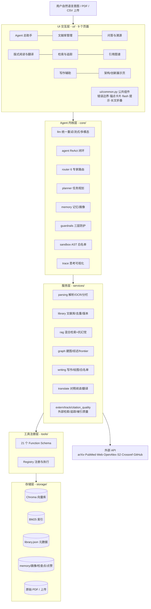
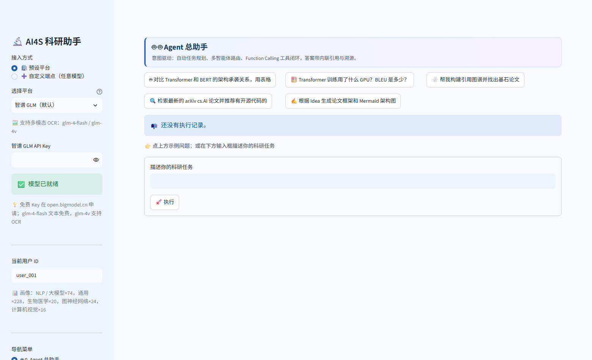
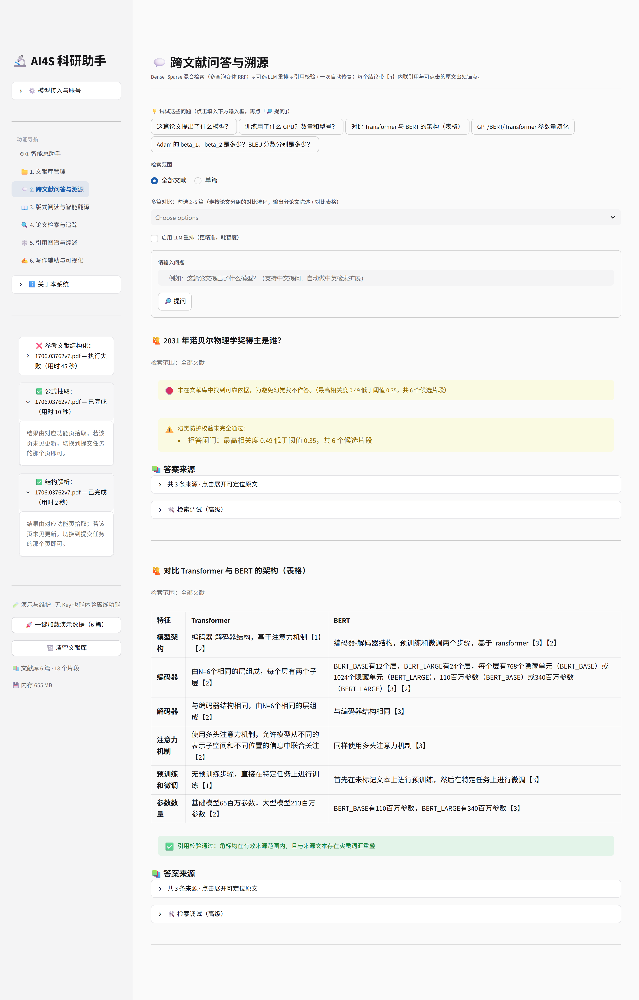
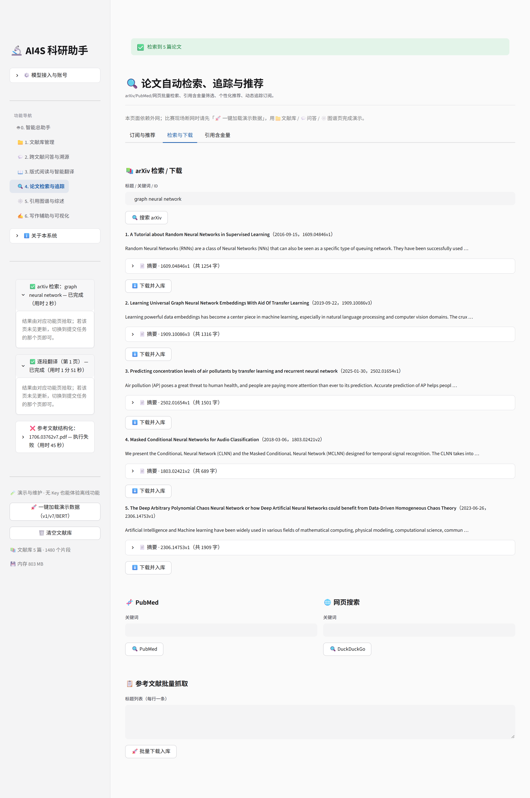
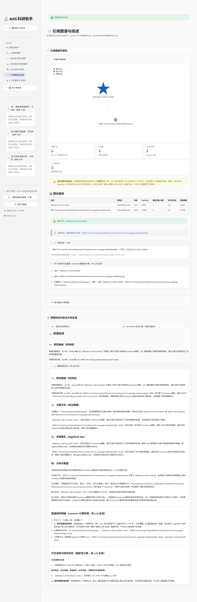
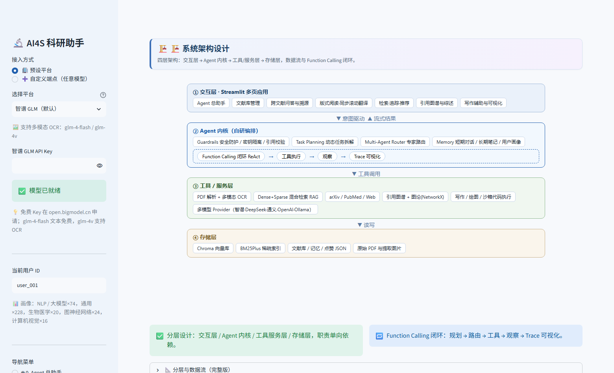
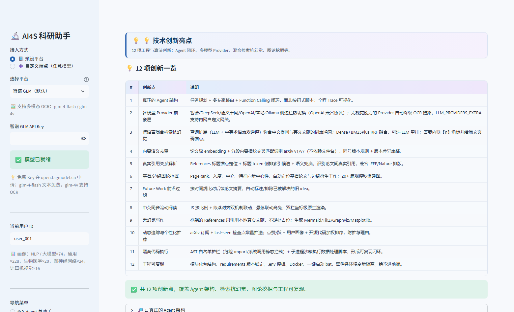

# AI4S 科研助手 Agent · 技术文档

> 版本：v4.0（2026-10-11 末版补正：第 4 章按赛题要求立「AI 模型选型理由 / 集成方式 / 优化策略」三个显式章节，第八章改为「总结与展望」并补写项目总结，全文实测数据刷新至 Round 4 官方用例口径）
> 定位：全国高校 AI 大模型挑战赛参赛作品 · 全流程科研助手 Agent
> 运行环境：Python 3.11.16 / Streamlit 1.63.0（conda 环境 `ai_research`）
> 本文档与当前代码一一对应：所有 `文件:行号` 引用均经 grep/read 逐条核对，可直接在仓库中定位；
> 关键性能数字优先取自 `docs/review/round4_worker9_official.md`（官方预置 PDF 端到端实测）与 Round 3 修复实测，不沿用旧文档口径。

---

## 目录

1. 项目概述
2. 需求分析
3. 系统架构设计
4. AI 技术方案（选型理由 / 集成方式 / 优化策略 / RAG / Prompt / 抗幻觉 / 降级矩阵）
5. 核心功能实现（分模块，配界面截图）
6. 测试与部署（含 Docker）
7. 创新点说明（技术创新点 / 应用创新点）
8. 总结与展望（项目总结 / 当前局限 / 未来规划）

---

# 1. 项目概述

## 1.1 背景与动机

大语言模型（LLM）的通用推理与生成能力已经成熟，但把通用聊天模型直接用于学术科研这一**高门槛、强证据、重引用**的场景，会遭遇三类结构性问题。

**第一类是检索与引用幻觉。** 通用模型对文献的记忆停留在预训练语料，让它"给这篇论文的出处"时，页码、年份、甚至整条参考文献都可能被编造；更隐蔽的是"半编造"——真实标题配上错误的被引数、张冠李戴的期刊。在科研场景中，一条错误引用的代价远高于一句错误观点，因为它会沿着引用链继续传播。

**第二类是版面感知缺失。** 学术 PDF 中超过半数是双栏排版， naive 的文本提取按 PDF 内部对象流输出，左右栏内容会交叉串读；图表与其图注分离、标题树缺失、扫描件无文本层，都让 RAG 的上下文在进入向量库之前就已经语义断裂。上下文坏了，后面的检索与生成做得再好也是"垃圾进、垃圾出"。

**第三类是科研流程割裂。** 读文献用 PDF 阅读器、管文献用 Zotero、查新用 arXiv 网页、问答丢给 ChatGPT、画图用 draw.io、写框架再回 Word——工具间的每一次手动搬运都是一次上下文丢失。研究员真正需要的不是六个更强的工具，而是一个**能理解意图、自主调用工具、且处处可溯源**的统一入口。

本项目从 0 到 1 构建了这样一个**意图驱动的科研助手 Agent**：以自研 Agent 内核统一编排六大科研模块，把「文献解析 → 抗幻觉问答 → 版式阅读 → 检索追踪 → 引用图谱 → 学术写作」串成一条闭环，并且把"抗幻觉"作为贯穿全系统的第一设计原则——不是在答案后面加一句"以上内容可能不准确"，而是用**拒答闸门、逐句引用校验、修复环、References 白名单**四道工程化防线，让"不知道"可以被系统诚实地说出来。

## 1.2 目标用户与使用场景

- **研究生 / 科研人员**：需要快速读懂一批英文论文、跨文献对比方法与结果、追踪方向最新进展、起草开题或论文框架。系统的「跨文献问答」「图谱综述」「写作 Copilot」直接服务这一主线。
- **教学与评审场景**：经常没有真实 API Key 或外网受限。系统为此做了完整的离线降级——无 Key 时 PDF 原生解析、混合检索、语义去重、引用图谱、追踪增量比对等链路照常运行，演示数据一键加载（`ui/sidebar.py` 演示数据按钮 + `ui/page_graph.py:57 _build_demo` 演示图谱兜底）。
- **工程复现场景**：所有关键指标（长文档入库耗时、去重命中率、建图耗时）均可由 `scripts/verify_official.py`、`scripts/bench_graph.py`、`scripts/selftest.py` 一键复跑；单元测试 18 项（`tests/test_core.py`）。

## 1.3 赛题定位

系统完整覆盖赛题五大能力大类：

| 大类 | 一句话回答"我们做了什么" |
|---|---|
| ① 多模态与细粒度文档感知 | 双栏几何判定（4 条必要条件）、扫描件 OCR、图↔图注关联、标题树/表格/参考文献抽取、541 页长文档分批工程化 |
| ② 抗幻觉 RAG | 混合检索 + 拒答闸门 + 逐句引用一致性校验 + 修复环 + 可点击页码溯源 |
| ③ 自主工具调用 | 21 个 Function Schema 工具、6 专家路由白名单、Python AST 沙箱、arXiv 定时增量追踪 |
| ④ 图谱挖掘 | 真实引用建图、PageRank/社区发现/frontier 五维打分、图谱驱动综述、Future Work 可达性过滤 |
| ⑤ 学术 Copilot | 无幻觉 References 白名单生成、TikZ/Graphviz 真实编译与三级降级、CSV 自动出图 + 数值事实注入 Caption、中英对照同步阅读 |

在此之上沉淀了自研 Agent 内核（规划 / 多专家路由 / 记忆 / 三层 Guardrails / Trace 可视化）。逐条合规对照见 README「赛题要求对照表」与 `docs/audit_report_20261010.md`。

## 1.4 与现有工具的本质差异

与通用对话产品（ChatGPT 类）相比：本系统的每一条结论都强制携带**可点击的原文页码锚点**，检索不到可靠依据时**拒答**而不是编造；写作模块生成的每一条 Reference 都来自上传 PDF 的 References 段**真实抽取**，越界角标会被白名单校验剔除。

与通用 RAG 框架相比：检索前有双栏感知的解析层保证上下文质量，检索后有逐句"覆盖率"引用校验（而非仅校验角标是否越界），生成后有修复环自动改写，评分侧接入了 OpenAlex/Semantic Scholar/Crossref 的**真实被引数据**且"取不到就明说"。

与文献管理工具（Zotero 及插件）相比： Zotero 强于"管"，本系统强于"懂"——内容级语义去重（改名的同一篇论文依然命中）、版本差异总结、引用图挖掘、综述与 Future Work 判定，都是 Zotero 生态不做的事。

## 1.5 当前状态一句话总结

三轮评审与修复后：9 页面 UI 冒烟 0 未捕获异常、18/18 单元测试通过、阅读页专项 59/59、541 页官方教材实测 537 页提取 / 1305 chunks / 0 失败页 / 25.32s / 峰值 893.1MB、单栏语料双栏误判率 0%、抗幻觉闭环（拒答 / 校验 / 修复 / 白名单）四道防线全部实测生效。诚实声明：系统仍有明确的局限（第 8.2 节），其中"中文纯句的引用一致性校验盲区"与"沙箱为软隔离"是我们认知到的两项最重要边界。

## 1.6 项目成果速览

| 指标 | 实测值 | 来源 |
|---|---|---|
| 代码规模 | 38 个 Python 模块文件（core 10 / services 13 / tools 3 / ui 12）+ `app.py` + `config.py`，9 个交互页面 | 仓库现状（`ls core/*.py services/*.py tools/*.py ui/*.py` = 38） |
| 注册工具数 | 21 个 Function Schema，全部接入 6 专家白名单（无孤岛） | `tools/definitions.py:355 build_registry` |
| 541 页长文档入库 | 537 页提取 / **1305 chunks** / 25.32s（46.8ms/页）/ 峰值 RSS **893.1MB** / **0 失败页** / 进度回调 11 次 | Round 4 官方用例实测（`round4_worker9_official.md` §3） |
| 内容级语义去重 | v1↔v7 相似度 **0.963228**（阈值 0.90）；完全改名后仍命中 **1.000000** | Round 4 官方用例 C 实测 |
| 双栏判定准确率 | 单栏语料 1111 页误判 0%；真双栏 BERT 正文页 10/10 识别 | Round 3 修复实测 |
| 幽灵文献拦截 | 损坏/截断/加密/页级截断 24/24 用例全部拒绝入库 | Round 3 修复实测 |
| 抗幻觉拒答 | 无关问题拒答且 0 次 LLM 调用；修复环恰 2 次调用不死循环 | Round 2 评委实测 |
| 真实被引数 | 5 篇知名论文全部与 OpenAlex 真值一致（如 AlexNet 108512） | Round 3 修复实测 |
| 参考文献抽取 | BERT 56 条全对（修复前 9 条且字段错位）；`1706.03762v1.pdf` 36 条；无 References 的 541 页书籍如实返回空 | Round 3 修复实测 / Round 4 引用跳转实测 |
| 引用↔参考文献双向跳转 | 36/36 锚点成对、死链 0；正文引用标记 58 个（出现 71 处），全部可反向回到正文 | Round 4 引用跳转实测（`round4_worker7_jump.md`） |
| 演示稳定性 | 9 个页面渲染 + 9 项故障注入 **exception=0**；7/7 条演示路径 0 未捕获异常（含断网注入） | Round 3 / Round 6 实测 |
| 单元测试与专项脚本 | 单元测试 **18/18** 通过；阅读页专项 **59/59** PASS（`tests/test_core.py`、`scripts/_smoke_read.py`） | Round 6 复跑 |

---

# 2. 需求分析

## 2.1 赛题痛点 → 系统需求映射

| # | 赛题痛点 | 由此产生的需求 | 本系统的对应答案 |
|---|---|---|---|
| P1 | 双栏 PDF 串读，RAG 上下文断裂 | 解析层需感知版面而非盲取文本流 | `parsing.py:129 _detect_two_columns`：横跨否决 + 空白带采样 + 栏宽平衡 + 两侧块数 4 条必要条件，全部不满足即保守回退单栏 |
| P2 | 答案不给出处 / 给假出处 | 每条结论必须可定位到原文页码 | 混合检索上下文编号 `[n] 来源：《X》 第N页` → LLM 强制带【n】角标 → UI 渲染可点击页码徽章 |
| P3 | 模型编造参考文献 | 生成内容必须对照真实文献白名单 | PDF References 段真实抽取 → 白名单校验 → 越界剔除 |
| P4 | 检索工具与问答割裂 | Agent 能自主调用检索/追踪/解析工具 | 21 个 Function Schema 工具 + 6 专家白名单路由 + ReAct 闭环 |
| P5 | 新论文追踪靠人肉刷 arXiv | 定时增量检查 | `services/track.py:57 track_topic` + last-seen 检查点 + `watch_daemon.py` 守护进程 |
| P6 | 综述写作缺乏结构性依据 | 综述由图结构驱动而非摘要堆砌 | 社区发现聚簇 + PageRank 基石 + 骨干边注入 prompt，LLM 不可用时确定性生成 |
| P7 | 科研图表制作繁琐 | CSV → 图表 → 规范 Caption 一条龙 | 列类型推断自动出六类图 + 实测数值事实注入 Caption prompt |
| P8 | 英文论文阅读门槛 | 对照阅读 + 划词翻译 | 双栏原生渲染 + 比例/段落对齐同步滚动 + 后端代理划词翻译 |

## 2.2 功能需求（按五大类逐条）

**① 多模态与细粒度文档感知**：单/批量上传；内容级语义去重（不依赖文件名，`library.py:163 check_duplicate`）；同名/同篇版本识别与差异总结（`library.py:700 group_versions`、`:784 version_diff`）；扫描件检测与多模态 OCR（`parsing.py:36 detect_scanned`、`:308 ocr_page_text`）；标题树（书签优先 `parsing.py:540 extract_toc`，无书签走 `:478 infer_headings_from_text`）；表格抽取（`parsing.py:558 extract_tables`）；插图↔图注关联（`parsing.py:637 extract_figures`，水平重叠 ≥15% 取垂直最近图注 `:615 _nearest_caption`）；公式识别与 LaTeX 转换；损坏/截断/加密 PDF 拦截（`library.py:353 _validate_prepared`，缺页 >30% 直接拒绝入库）。

**② 抗幻觉 RAG**：单篇问答（超参数/硬件/BLEU 类细粒度问题）；多篇跨文献对比（2–5 篇，`MAX_COMPARE_PAPERS=5`）；单篇范围锁定；查询扩展（中文问英文文献）；内联【n】溯源与可点击页码锚点；引用一致性逐句校验；拒答与自动修复。

**③ 自主工具调用**：arXiv/PubMed/DuckDuckGo 检索；一键下载入库（语义查重拦截重复）；Python 沙箱执行（数据处理/复现）；定时追踪（单篇 `track_arxiv` + 主题 `track_topic`）；GitHub 仓库复现性评估（stars/license/最近推送加权）；引用含金量评估（真实被引 + venue 等级 + 正文位置 + 主题相关性四维）；长期记忆读写。

**④ 图谱挖掘**：真实引用关系建图（IDF 稀有度倒排候选 + 语义兜底）；PageRank/入度/介数/特征向量中心性；基石/核心/边缘分类 + frontier 前沿五维打分；图谱驱动四段式综述；Future Work「已解决/存疑/开放」三态判定。

**⑤ 学术 Copilot**：论文框架生成（真实 References 白名单约束 + 生成后校验 + 一键强化重生成）；Mermaid/TikZ/Graphviz/Matplotlib 四类拓扑图（TikZ 真实编译，Graphviz 三级降级渲染）；CSV 自动出图（折线/柱状/散点/直方/热力/平行坐标）；Figure Caption 数值事实注入；中英学术互译与对照同步阅读；划词翻译；中文原位 PDF 输出。

## 2.3 用户故事（端到端走查）

**故事 A：版本去重（演示路径 2，离线可复现）。** 用户把 `1706.03762v7.pdf` 与改名的 `1706.03762v1.pdf` 先后入库。系统对每篇计算"前 4000 字向量 + 5 段指纹"（`library.py:32 _paper_fingerprints`），上传 v1 时语义查重命中 **0.963228**（阈值 0.90，取自"分段指纹 top3 均值"；整篇语义相似度仅 0.891292 单独看会漏判），界面给出"⚠️ 语义查重命中"与三个决策按钮（覆盖旧版 / 保留两个版本 / 取消），选"保留两版"后可在版本管理区对比两版差异（`library.py:784 version_diff`）。全程不依赖文件名——改名、重命名目录都不影响命中。

**故事 B：抗幻觉问答（演示路径 3）。** 用户在问答页问"训练用了什么 GPU？数量和型号？"。查询扩展把中文问题扩出英文变体 → Dense+Sparse 双路召回 → RRF 融合 6 条 → 上下文以 `[1] 来源：《1706.03762v7.pdf》 第8页第3段` 形式注入 → LLM 生成带【1】角标的答案 → 逐句校验通过 → 用户点击溯源卡片"第 8 页"徽章页内跳转，或点"📖 打开阅读页"直达 PDF 原版式页面。若用户改问"量子纠缠"（库内无关），拒答闸门在**调用 LLM 之前**直接回复"未在文献库中找到可靠依据，为避免幻觉我不作答"。

**故事 C：从检索到综述（演示路径 5+7）。** 用户检索 arXiv 拿到 5 篇论文，一键下载入库；进入图谱页构建真实引用图（BERT→Attention Is All You Need 引用边被正确解析）；点"一键生成领域综述"得到四段式综述（研究脉络/主要方向/关键基石/分歧与展望），文末附 networkx 计算的图谱结构明细供核查；再点"Future Work 前沿扫描"，系统给出"已解决/存疑/开放"三态判定与引用图证据。断网时检索给出"可能原因 + 怎么办 + 用离线演示数据继续"的完整降级引导（演示路径 7b 实测）。

## 2.4 非功能需求

- **可复现**：Streamlit 锁定 1.63.x；检索/切块/去重参数全部环境变量可覆盖（`config.py:74-80`）。
- **健壮**：LLM 调用统一走 `core/llm.py`：1 次首发 + 3 次退避重试（1.5/3.0/4.5s，`RETRY_BACKOFF` 见 `core/llm.py:29-33`），SDK 自带重试关闭（`SDK_MAX_RETRIES=0`）避免 3×3 放大；全部失败返回结构化伪响应**不抛异常**，失败明细落盘 `storage/llm_failures.log`（含 caller 定位）。UI 侧每个区块独立 try/except，单点异常不拖垮整页（`ui/common.py:226 safe_render`）。
- **长文档工程化**：20 页一批解析建块（`PDF_BATCH_SIZE=20`，`library.py:16`）、单页 30s 守护线程超时跳过（`library.py:300 _extract_page_with_timeout`）、每 50 页进度回调、psutil 内存探针（`scripts/_memory_probe.py`）。
- **安全**：API Key 只经环境变量/会话注入；输出侧密钥正则脱敏（`guardrails.py:117 redact_secrets`）；Python 工具经 AST 白名单沙箱（`core/sandbox.py:27 validate_code`）；`.env` 同时被 `.gitignore` 与 `.dockerignore` 排除，不入仓库、不入镜像。
- **诚实降级**：每一个外部依赖（LLM、embedding、外部 API、LaTeX 编译器、Graphviz）都有明确降级路径并向用户说明原因与建议动作，绝不静默失败、绝不编造数据。

---

# 3. 系统架构设计

## 3.1 分层架构图（Mermaid）



## 3.2 等价的文本分层图（离线可读）

```
┌──────────────────────────────────────────────────────────────┐
│  UI 交互层（Streamlit，9 页面）app.py 路由 + ui/page_*.py      │
│  公共组件：错误边界 / 空库守卫 / 溯源锚点卡片 / flash 提示      │
└──────────────────────────┬───────────────────────────────────┘
                           ▼
┌──────────────────────────────────────────────────────────────┐
│  Agent 内核层（core/）                                        │
│  llm(统一重试) · agent(ReAct) · router(6专家) · planner       │
│  memory · guardrails(注入/角标/脱敏) · sandbox(AST) · trace    │
└──────────────────────────┬───────────────────────────────────┘
                           ▼
┌──────────────────────────────────────────────────────────────┐
│  服务层（services/）                                          │
│  parsing · library · rag · query_expansion · graph · writing  │
│  translate · extern · track · citation_quality · state        │
└──────────────────────────┬───────────────────────────────────┘
                           ▼
┌──────────────────────────────────────────────────────────────┐
│  工具注册层（tools/）：21 个 Function Schema + Registry        │
└──────────────────────────┬───────────────────────────────────┘
                           ▼
┌──────────────────────────────────────────────────────────────┐
│  存储层（storage/，git 忽略）：Chroma │ BM25 │ library.json    │
│  memory.json │ user_profile.json │ 追踪检查点 │ uploads/pdf    │
└──────────────────────────────────────────────────────────────┘
```

## 3.3 调用主线与依赖规则

分层依赖严格自上而下、不反向：`ui/` → `services/` → `core/`，`tools/` 依赖 `services/`，`storage/` 只被 `services/state.py` 与 `config.py` 触达。两条主调用链：

1. **功能页链路**：`app.py` 侧边栏菜单 → `ui/page_*.py` → `services/state.get_container()` 拿统一上下文 `ctx`（含向量库、BM25、chunks、LLM 客户端、embedding）→ 直接调 `services/*`；
2. **Agent 链路**：`ui/page_agent.py` → `core/agent.py:411 run()` → `core/router.py:99 route()` 选专家 → 按 `EXPERTS[e]["tools"]` 白名单过滤 `tools/registry.py` 的 schema → LLM Function Calling → `reg.execute(name, args, ctx)` → 结果回灌 → 循环至给出最终答案（`AGENT_MAX_ITERS=8`）。

**路由细节**（`core/router.py:17-36`）：6 个专家 = qa（抗幻觉问答）/ search（检索追踪）/ graph / writing / reading / parsing，各自持有工具白名单；LLM 不可用时 `:80 keyword_route` 关键词兜底，保证离线可路由。21 个工具全部接入白名单（无孤岛工具）。

**统一上下文 `ctx`**（`services/state.py` 构建）是贯穿全系统的关键设计：UI、Agent 与工具都面向同一个 `ctx` 工作，内含向量库句柄、BM25 索引、chunks 列表、LLM 客户端（含用户在侧边栏选择的 Provider/Key）、embedding 函数、文献库 dict 与用户画像。好处是：①功能页与 Agent 页共享同一份文献库状态，不存在"Agent 改了、页面没刷新"；②Provider 切换只改 `ctx.llm`，全部服务层无感知；③测试可用 FakeCtx 替换（评审的沙箱自验即采用此法）。

| `ctx` 字段 | 来源 | 用途 |
|---|---|---|
| `ctx.papers / ctx.chunks` | `library.json` | 文献元数据与检索语料 |
| `ctx.vdb / ctx.bm25` | Chroma / rank-bm25 | Dense / Sparse 检索 |
| `ctx.llm` | 侧边栏 Provider 配置 | 统一 LLM 调用（含 available 判定） |
| `ctx.embed` | embedding 函数 | 查询/论文向量、去重指纹 |
| `ctx.likes / ctx.profile` | 点赞账本 / 画像 JSON | 个性化推荐 |
| `ctx.subscriptions / ctx.checkpoints` | 追踪账本 | 增量追踪 last-seen |

## 3.4 界面与导航

9 个页面由 `app.py:84-94 _PAGES` 注册，侧边栏菜单（`ui/sidebar.py` MENU）与 query_params 双通道跳转；主体区顶部统一渲染跨 rerun 存活的 flash 提示（`app.py:96-101` + `ui/sidebar.py:34-83`）。



---

# 4. AI 技术方案

> 本章按赛题要求，以 **AI 模型选型理由（4.1）→ 集成方式（4.2）→ 优化策略（4.3）** 三条主线组织：先回答"为什么选这些 AI 能力"，再回答"它们怎样接进系统"，最后给出"我们做了哪些工程优化、实测提升了多少"。其后的 4.4–4.7 给出 RAG 管线、Prompt 工程、抗幻觉机制与依赖降级矩阵的完整实现细节。

## 4.1 AI 模型选型理由

系统涉及 6 类 AI / 基础能力，每一类按下表格式逐项交代：**选了什么 + 为什么选 + 放弃了什么 + 代价如何被对冲**。

### 4.1.1 大语言模型（LLM）：统一 OpenAI 兼容协议，多厂商可运行时切换

| 项 | 结论 |
|---|---|
| 选了什么 | 全部 Provider 走 OpenAI 兼容 `/chat/completions` 协议（`core/providers.py:33-74` 声明 5 家）；默认文本模型 **glm-4-flash**、视觉模型 **glm-4v**（智谱） |
| 为什么选 | ①**协议归一**：一套 `LLMClient` 零改动复用智谱 / DeepSeek / 通义 / OpenAI / 本地 Ollama，换模型只改 `ctx.llm`，服务层完全无感知；②**可私有化**：`LLM_PROVIDERS_EXTRA` 环境变量追加自定义网关即可接内网模型，不改一行代码；③**默认模型取成本与效果的交点**：glm-4-flash 有免费额度、Function Calling 完整、免费 Key 即可跑通含 OCR 的全流程，足以承担路由 / 规划 / JSON 结构化输出等任务（Agent 21 个工具的 schema 调用均通过它实测） |
| 放弃了什么 | ①放弃"单一最强模型"的效果上限；②放弃厂商私有长上下文等高级特性（长文档改由分批解析 + RAG 解决，见 4.3.3）；③放弃本地微调带来的领域特化 |
| 代价 | 依赖外网与厂商配额、受模型版本迭代影响 |
| 如何对冲 | 3 次指数退避重试 + 4 次仍失败返回结构化伪响应**不抛异常**；无 Key 时全链路离线降级（见 4.7） |

当前内置 5 家 Provider（`core/providers.py:33-74`，可由 `LLM_PROVIDERS_EXTRA` 追加）：

| Provider | 文本模型 | 视觉模型 | 说明 |
|---|---|---|---|
| 智谱 GLM（**默认**） | glm-4-flash | glm-4v | 免费额度，含多模态，全流程可跑通 |
| DeepSeek | deepseek-chat | —（自动降级） | 无视觉模型，扫描件回退原生文本层 |
| 通义千问 | qwen-turbo | qwen-vl-plus | DashScope 兼容模式 |
| OpenAI | gpt-4o-mini | gpt-4o-mini | 需国际网络环境 |
| Ollama（本地） | qwen2.5:7b | — | 完全离线，Key 填任意非空值即可 |

> 为什么不做微调：本系统的核心价值是**抗幻觉工程链路**（拒答闸门 / 逐句引用校验 / 修复环 / References 白名单），而不是模型本身的知识点覆盖；微调会把能力固化到单一底座、失去"随厂商升级而升级"的红利，且训练与评估成本远高于本次交付周期可承担的范围。

### 4.1.2 多模态 / OCR：整页 PNG → 视觉大模型，而非本地 OCR 引擎

| 项 | 结论 |
|---|---|
| 选了什么 | 扫描页渲染为 PNG（zoom=2.0）→ base64 → 视觉模型，prompt 要求"按阅读顺序输出、公式转 LaTeX、表格转 Markdown"（`services/parsing.py:308 ocr_page_text`） |
| 为什么选 | ①**零额外依赖**：避开了 PaddleOCR / Tesseract 的本机安装、语言包与 Windows 环境变量配置，交付"立即可跑"；②**理解优于识别**：同一条链路同时还原版面、表格结构与数学公式，产出可直接入 RAG 的结构化文本，比"OCR 出文本再用规则清洗"质量高；③成本：视觉模型按页计费，长篇扫描件可只跑需要的页 |
| 放弃了什么 | 离线 / 无 Key 环境下没有本地兜底 OCR；单页受 90s 调用超时与 token 成本约束 |
| 代价 | 无可用 Key 时扫描件不能被识别 |
| 如何对冲 | `services/parsing.py:293 ocr_supported` 在调用前判定"是否有视觉模型 + Key 长度 ≥20 + 可 ASCII 编码"，不可用即直跳；同时 `parsing.py:44 is_ocr_error_text` 把 OCR 占位符文本判定为失败页，禁止空扫描件冒充正文入库。**实测**：15 页扫描件从"逐页重试网络 140.06s 且把占位符当正文"变为"0.63s 直接判定 + `commit` 抛 ValueError 拒绝入库" |

### 4.1.3 文本向量（Embedding）：chromadb 默认模型，384 维、可离线

| 项 | 结论 |
|---|---|
| 选了什么 | chromadb `DefaultEmbeddingFunction`（ONNX 推理，384 维），装载于 `services/state.py:47` |
| 为什么选 | ①**随依赖分发**：不必单独引入 sentence-transformers / modelscope 下载链路；②**可离线复现**：模型已在本机缓存，断网仍产出与线上一致的向量——官方四个用例（含语义去重）全部在该 embedding 下完成，结论可复核；③**维度权衡**：384 维在千级 chunk 规模下内存占用与召回质量平衡；④与向量库同源，避免了"embedding 版本与库版本不匹配"的隐性故障 |
| 放弃了什么 | 中文专用模型（如 bge-small-zh）在纯中文语义上的优势；更强多语言模型在长文本上的表现 |
| 代价 | 中文提问 × 英文文献的余弦天然偏低，单独看整篇相似度会漏判（实测 v1/v7 整篇相似度仅 0.891292，低于 0.90 阈值） |
| 如何对冲 | 查询扩展生成多英文变体 + dense 路取各变体最大分 + BM25 词面补充 + **分段指纹兜底**（实测 v1/v7 由指纹均值 **0.963228** 命中，完全改名后仍 **1.000000** 命中） |

### 4.1.4 向量数据库：嵌入式 Chroma，无外部服务

| 项 | 结论 |
|---|---|
| 选了什么 | `chromadb.PersistentClient`（`services/state.py:45`），配 `rank_bm25` 的 BM25Plus 做稀疏侧索引（`services/state.py:84-90`） |
| 为什么选 | ①**嵌入式运行**：pip 安装即用，不引入 Docker sidecar / 独立服务进程，评委一句 `streamlit run app.py` 就能跑起来；②同一进程内的 `ctx.vdb` 句柄便于 UI / Agent / 工具共享状态；③`EphemeralClient()` 可一键切到内存态，官方验证脚本据此做到 **零污染测试**（storage 逐文件 SHA-256 比对还原） |
| 放弃了什么 | Milvus / Weaviate / Qdrant 的分布式横向扩展与 ANN 参数调优空间 |
| 代价 | 规模上限于单机部署 |
| 如何对冲 | paper_id / page / para 等元数据以 JSON Metadata 随 chunk 存储，检索结果在应用层按文献过滤；多篇对比走 `retrieve_per_paper` 每篇保底 3 条 |

### 4.1.5 图计算引擎：NetworkX，纯 Python 零部署

| 项 | 结论 |
|---|---|
| 选了什么 | `networkx`（`services/graph.py:18`）计算 PageRank / 入度 / 介数 / 特征向量中心性与社区结构 |
| 为什么选 | ①**零部署成本**：不引入 C 扩展或图数据库服务；②**算法齐全且可控**：每类中心性单独包异常回退，社区发现本身还能做 greedy_modularity → louvain → 弱连通分量三级降级（`services/graph.py:483-496`）；③可解释性好——综述所附"图谱结构明细"直接取自 nx 计算结果而非 LLM 生成 |
| 放弃了什么 | igraph / graph-tool 在十万节点级的性能；Neo4j 的图查询语言与持久化 |
| 代价 | 节点规模上万时退化明显 |
| 如何对冲 | 本场景引用图规模为数十至数百节点（官方数据集最多 3 篇文献 / 133 chunks），完全在 nx 舒适区；未来万级节点可替换内核，`services/graph.py` 的接口不变 |

### 4.1.6 PDF 解析引擎：PyMuPDF，因为它给得出几何信息

| 项 | 结论 |
|---|---|
| 选了什么 | PyMuPDF 提取原生文本层 + **字符级 bbox** |
| 为什么选 | ①双栏判定、图↔图注空间匹配、版式原生渲染全部依赖坐标信息——这是纯文本抽取库给不了的；②开页毫秒级，541 页 / 22MB 文档的**解析阶段仅 4.02s**（官方用例 B 实测） |
| 放弃了什么 | pdfplumber / pdfminer.six 在表格结构识别上的某些便利性 |
| 代价 | PyMuPDF 为 AGPL/商业双许可，商用需授权；版本间 API 敏感 |
| 如何对冲 | `parsing.py:30 open_doc` 统一入口收敛所有 `fitz.open` 调用；`requirements.txt` 锁定版本 |

## 4.2 集成方式

### 4.2.1 统一 LLM 调用层（`core/llm.py`）

全项目运行链路**零裸 `client.chat.completions.create` 残留**（评审实测），一切经两处入口：`core/llm.py:176 chat`（同步）与 `:190 stream`（流式）；视觉调用与 JSON 调用走 `:264 call_llm_with_retry` + `parse_json`（兼容 ```json 围栏与噪声文本）。

- **重试与容错**：`RETRY_BACKOFF = (1.5, 3.0, 4.5)`（`core/llm.py:30`）集中管理，SDK 自带重试置 0（`:31 SDK_MAX_RETRIES = 0`），避免 3×3 叠加放大；第 4 次仍失败 → 把失败明细 append 到 `storage/llm_failures.log`（字段含 `ts / error_type / model / caller / n_messages / messages_preview(前2000字)`）→ **返回结构化伪响应而非抛异常**。
- **Provider 切换**：侧边栏选 Provider/填 Key → 写回 `ctx.llm`，全服务层无感知。
- **实测**：指向必失败端口压测，`chat / stream / vision / call_llm_with_retry` 均为恒定 **≤4 次 HTTP 调用**，`time.sleep` 序列精确命中 `[1.5, 3.0, 4.5]`。

### 4.2.2 工具注册与执行（`tools/registry.py` + `tools/definitions.py`）

`Registry.register(name, description, JSON Schema, func)` → `openai_schema()`（`tools/registry.py:11-19`）生成 OpenAI 规范 `tools` 数组 → `execute(name, args, ctx)`（`:39-49`）统一把 `TypeError` 与其余 `Exception` 转成 `{"error": ...}` 字符串回灌，**不让工具异常打断 Agent 主循环**。当前由 `tools/definitions.py:355 build_registry` 注册 **21 个工具**（注册语句集中在 `:357-429`）。

### 4.2.3 Function Calling 闭环（Agent）

```
用户意图 → core/agent.py:411 run()
        → core/router.py:99 route() 选专家（LLM 不可用时降级 :80 keyword_route 关键词路由）
        → 按 core/router.py:17-36 EXPERTS[e]["tools"] 白名单过滤 registry.schemas()
        → llm.chat(messages, tools=schema, tool_choice="auto")
        → 解析返回的 tool_calls（可能多个）
        → reg.execute(name, args, ctx) 逐个执行
        → 结果以 role=tool 消息回灌对话 → 下一轮，直至给出最终答案（AGENT_MAX_ITERS=8）
        → 全过程写入 core/trace.py，在「Agent 总助手」页实时显示"思考—工具—观察"时间线
```

21 个工具**全部接入至少一个专家白名单，无孤岛工具**；6 个专家为 qa / search / graph / writing / reading / parsing。

### 4.2.4 外部学术 API 集成（`services/extern.py` + `services/citation_quality.py`）

| 能力 | 集成方式 | 关键参数 / 降级 |
|---|---|---|
| arXiv | 官方 `arxiv` 库，`Client(page_size=100, delay_seconds=2, num_retries=3)` | 遵守官方限速 |
| PubMed | NCBI E-utilities：`esearch` 取 ID 列表 → `esummary` 取详情，两步 JSON | 单源失败返回 `net_error` 话术 |
| 网页检索 | DuckDuckGo HTML 端点 + 正则解析 | 与 arXiv/PubMed 并列汇入统一结果结构 |
| GitHub 复现性 | REST API（`services/extern.py:159 github_repo_info`）：stars/forks/license/最近推送/archived | README 走 raw.githubusercontent → contents API 二级降级；未认证 60 次/小时限流时明示"不做推测性评级" |
| 真实被引数 | **三级降级** OpenAlex → Semantic Scholar → Crossref（`services/citation_quality.py:403 SOURCES`），DOI / arXiv ID 精确匹配优先且带标题复核 | 单源超时 8s；降级/低置信时显式打 `low_confidence` 与口径说明（`:195 _low_confidence_reasons`），三级全失败返回 `None` 并写明"该维度不计分、不猜测" |

### 4.2.5 Python 沙箱集成（`core/sandbox.py` + `tools/definitions.py`）

`tools/definitions.py:309 t_run_python` → 先过 `core/sandbox.py:27 validate_code` 的 **AST 静态白名单**（14 个模块：numpy / pandas / scipy / sklearn / matplotlib / plotly / seaborn + 标准安全库；拦截 `eval/exec/open/compile/__import__` 与 `system/popen/socket` 等逃逸调用）→ 通过后写入临时文件 → `subprocess.run(timeout=25, encoding="utf-8", errors="replace")`（`:328`）→ stdout/stderr 安全截尾（`:296 _tail_text`）后返回。即"静态检查先于执行，违规不进子进程"。

### 4.2.6 检索集成（`services/state.py` + `services/rag.py`）

统一上下文 `ctx` 同时持有 **Chroma（Dense）** 与 **BM25Plus（Sparse）** 两个句柄：`ctx.vdb` 负责嵌入检索、`ctx.bm25` 负责词面检索，由 `services/rag.py` 编排"查询扩展 → 双路召回 → `rrf_fuse`（`:97`，常数 c=60）→ 上下文编号"。这样配置的目的是：任何一处要用检索的服务（问答页 / 图谱 / Agent 工具 `search_literature`）都复用同一份索引与同一套参数，**不存在两处检索口径不一致**。

## 4.3 优化策略

以下每一条都是"做了什么 + 实测效果"，不是一般性描述。

### 4.3.1 抗幻觉优化：四道防线（详见 4.6）

| 防线 | 关键参数 | 实测效果 |
|---|---|---|
| 拒答闸门（检索侧） | 合成相关度阈值 `RELEVANCE_FLOOR = 0.35`（`services/rag.py:16`） | 无关问题（量子纠缠）`top_score = 0.1820` → **直接拒答，LLM 调用次数 = 0**；相关问题 `0.7422` 放行 |
| 逐句引用一致性校验（生成侧） | 覆盖率（非 Jaccard）阈值 `SUSPICION_THRESHOLD = 0.15`（`core/guardrails.py:51 _overlap`） | 编造句 "Training used 512 Google TPU v4 chips【1】" 被标记"重叠仅 10%"；真实句 "...eight NVIDIA P100 GPUs【1】" 覆盖率 84.5% 通过 |
| 修复环（自动改写） | 上限 `MAX_REPAIR = 1`（`services/rag.py:17`），`temperature = 0.0` 重生成一次 | 一次完整修复恰 **2 次 LLM 调用**，不死循环、成本可控 |
| References 白名单（写作侧） | 标题实质匹配阈值 0.8（`services/writing.py:837`） | BERT 论文 References **56 条全对、0 噪声**（修复前 9 条且字段错位）；毒样本越界 `[9]` 与编造条目（相似度 0.14–0.36）全部被报出 |

补充优化： cited 覆盖率口径的选择本身是一次优化——来源 chunk 约 1200 字，若用 Jaccard 会把正常引用稀释到 ~3% 造成大量误杀，改为"句子锚点在来源中的覆盖率"后误杀消失；纯中文句无英文/数字锚点时标记为"跳过"而不是谎报"通过"（见 8.2）。

### 4.3.2 检索优化：查询扩展 + 双路召回 + RRF 融合

1. **查询扩展**（`services/query_expansion.py`）：中文提问先由 LLM 扩出英文 / 同义词 / 缩写多个变体，LLM 不可用时退回内置词表，解决"中文问英文文献"的跨语言失配。
2. **Dense 路取各变体最大分**（`services/rag.py:182`、`:245`，最多消费 `MAX_VARIANT_DENSE = 4` 个变体），缓解单一中文查询对英文 embedding 的低余弦。
3. **Sparse 路 BM25Plus 并行**（`SPARSE_K = 12`）：锁定"超参数 / 型号 / BLEU 值"这类词面精确答案。
4. **RRF 无参融合**（`services/rag.py:97 rrf_fuse`，常数 c=60）：不比较两路的分数量纲，直接融合排名，避免手工加权漂移。
5. **可选 LLM 重排**：失败时静默回退 RRF 结果，不影响可用性。
6. **多篇对比防饿死**：`retrieve_per_paper` 每篇保底 3 条 chunk，`build_grouped_context` 输出【Pn-m】分组角标。

### 4.3.3 长文档优化：分批 + 超时 + 进度 + 批处理句柄复用

| 优化项 | 参数 | 实测（541 页官方教材，`round4_worker9_official.md` §3） |
|---|---|---|
| 分批解析建块 | `PDF_BATCH_SIZE = 20`（`services/library.py:16`） | 解析阶段 **4.02s** |
| 批内文档句柄复用 | 同一 20 页批共用一个独立文档实例，批末关闭 | 消除"541 次重复 open 一个 22MB 文件"的浪费 |
| 单页超时跳过 | `PDF_PAGE_TIMEOUT_SECONDS = 30`（`services/library.py:17`），守护线程 + `library.py:300 _extract_page_with_timeout` | 注入挂死页时仅该页失败，其余页正常；`failed_pages` 精确记录 |
| 进度回调 | 每 50 页 + 末页 | 541 页共触发 **11 次**回调，UI 不假死 |
| 向量化与索引（commit） | 1305 chunk embedding（ONNX/CPU）+ BM25 语料重建 | **21.30s**（耗时主要在此，非解析） |
| **整体结果** | — | **537/541 页成功提取（4 页为无文本层空白页）、1305 chunks、提取正文 1,324,129 字符、0 失败页、总耗时 25.32s（46.8ms/页）、峰值 RSS 893.1MB** |

### 4.3.4 版面判定优化：双栏误判 19.1% → 0%

朴素"中线二分"会把长正文行横跨中线的单栏论文误判成双栏。优化后的 `_detect_two_columns`（`services/parsing.py:129`）要求 4 条必要条件同时成立，**其中"横跨 split_x 否决"（`:196-201`）是关键**：它对**全部文本块生效，包括已被剔除出候选集的宽块**——旧实现正是漏检这些宽块才误判。另一处优化是 `_gutter_free_ratio`（`:108`）沿 y 采样统计中缝空白带占比，而非只看静止图像。

**实测**：1111 页单栏语料误判率 **19.1% → 0%**，同时真双栏论文（BERT）正文页 10/10 仍被正确识别（没有用"永远判单栏"换取指标）。

### 4.3.5 缓存与降级优化

- **被引数两级缓存**：按归一化标题缓存结果（`services/citation_quality.py:42 _CACHE`）+ 标题归一化结果缓存（`:43 _TITLE_CACHE`），重复评估同一篇文献不再重复打三次 API。
- **三级降级**：OpenAlex → Semantic Scholar → Crossref，任一被限流即切换并显式打 `low_confidence` + 口径说明；选优策略改为"高置信标题匹配内取被引数最大"（`:211 _pick_best`），修复了"同名噪声记录靠年份加成反超正主"——AlexNet 被引数 **760 → 108512**，与真值一致。
- **OCR 前置判定**：`parsing.py:293 ocr_supported` 在无可用视觉 Key 时不再逐页重试网络，15 页扫描件耗时 **140.06s → 0.63s**。
- **GitHub 限流降级**：未认证 60 次/小时，限流时返回"因限流不做推测性评级"而非编造星级。
- **完整降级矩阵见 4.7**——8 类外部依赖全部有确定行为，且每一类都在 UI 上说明"发生了什么 + 可能原因 + 怎么办"。

### 4.3.6 内存与临时文件控制

- **内存探针**：`scripts/_memory_probe.py` 优先用 psutil 采 RSS（最贴近真实占用），缺失自动降级 tracemalloc，再缺失降级为纯计时，任何情况下 `peak_mb()` 返回 0.0 而**绝不抛异常**——探针本身不能成为页面崩溃原因。541 页实测后台 50ms 采样 **388 次**，峰值 893.1MB（低于 1.5GB 目标）。
- **陈旧临时目录清理**：`ui/page_reading.py:200 cleanup_stale_figure_dirs` 清理超过 FIG_TTL（24h）的图片临时目录。
- **沙箱超时**：子进程 `timeout=25`，避免死循环脚本拖垮服务。

## 4.4 RAG 检索设计（`services/rag.py` + `services/query_expansion.py`）

```
中文提问 ─▶ 查询扩展（LLM 跨语言/同义词/缩写，离线词表兜底）
        ─▶ Dense 路（Chroma，每变体召回，DENSE_K=12）
        ─▶ Sparse 路（BM25Plus，SPARSE_K=12）
        ─▶ RRF 融合（c=60）→ FINAL_K=6
        ─▶ 可选 LLM 重排（cross-encoder 式，失败原样回退）
        ─▶ build_context 编号上下文（[n] 来源：《X》 第N页第M段）
        ─▶ 生成（temperature=0.1）→ 校验 → 修复环 → 输出
```

要点：①扩展变体在 dense 路取**各变体最大分**，缓解中文查询对英文 embedding 的低余弦；②`annotate_paragraphs`（`rag.py:132`）为每条来源补页内段号；③多篇对比走 `retrieve_per_paper`（每篇保底 3 条，防止单篇饿死）+ `build_grouped_context`（【P1-1】【P2-1】分组角标）。

**检索参数一览**（`config.py:74-78`，全部可环境变量覆盖）：

| 参数 | 默认值 | 作用 |
|---|---|---|
| `CHUNK_SIZE` / `CHUNK_OVERLAP` | 1200 / 150 | 切块目标字符数与相邻块重叠 |
| `DENSE_K` | 12 | Chroma 向量召回数（每个查询变体） |
| `SPARSE_K` | 12 | BM25Plus 召回数 |
| `FINAL_K` | 6 | RRF 融合后进入上下文的条数 |
| `RELEVANCE_FLOOR`（rag.py:16） | 0.35 | 拒答闸门阈值 |
| `MAX_REPAIR`（rag.py:17） | 1 | 修复环最大重跑次数 |
| `COMPARE_PER_PAPER`（rag.py:19） | 3 | 多篇对比每篇保底片段数 |
| `MAX_VARIANT_DENSE`（rag.py:18） | 4 | dense 路最多消费的查询变体数 |

**为什么是混合检索**：纯向量检索对"超参数/型号/BLEU 值"这类**词面精确**的问题弱（专有名词 embedding 相似度不可靠），纯 BM25 对"中文问英文文献"弱（跨语言词面不重合）。查询扩展先解决跨语言，Dense 解决语义 paraphrase，BM25 锁定精确词面，RRF（常数 k=60）对两路排名做无参融合，避免了分数尺度不可比的问题；LLM 重排作为可选增强，失败时静默回退 RRF 结果。

## 4.5 Prompt 工程

- **学术系统提示**（`core/guardrails.py:181 ACADEMIC_SYSTEM`）：约束"只依据资料、每条事实带【n】、资料不足时明说"；
- **对比模式 prompt**（`rag.py:353 compare_messages`）：强制分论文陈述 + Markdown 对比表，且角标必须是【Pn-m】格式，否则校验不过触发修复；
- **综述 prompt**（`graph.py:644 generate_review`）：注入社区簇代表/时间线/骨干边/PageRank Top，硬性约束"只用给出的论文与边、禁止引入库外文献"，并要求固定四个小标题；LLM 不可用时 `_deterministic_review`（`:595`）用图结构数据确定性生成同构 Markdown；
- **写作强化 prompt**（`writing.py:937 _outline_prompt(strict=True)`）：要求逐字照抄白名单条目、禁止改写标题、宁可不引也不编造；
- **Caption prompt**（`writing.py:1493 figure_caption`）：整段注入"关键数值事实（必须真实引用其中的数字，禁止编造未出现的数字）"。

## 4.6 抗幻觉机制（核心卖点，四道防线）

> 与 4.3.1 的关系：4.3.1 从"优化策略"角度列出四道防线的参数与实测效果，本节给出完整实现链路与失败路径。

### 防线一：拒答闸门（检索侧）

`services/rag.py:410-413`：top chunk 合成相关度（0.5×向量余弦各变体最大值 + 0.5×BM25 归一，`rag.py:168 score_sources`）低于 `RELEVANCE_FLOOR=0.35`（`:16`）时**直接拒答、0 次 LLM 调用**，回传 top3 候选片段供人工核对。

实测：无关问题（量子纠缠查询）`top_score=0.1820 → 拒答，LLM 调用次数=0`；相关问题 `0.7422 → 放行`。拒答文案为固定诚实话术："未在文献库中找到可靠依据，为避免幻觉我不作答。"（`guardrails.py:31`）

### 防线二：引用一致性逐句校验（生成侧）

`core/guardrails.py`：答案按句切分 → 每句归属其标注的【n】→ 与第 n 条来源 chunk 做锚点覆盖率比对（`_overlap :51`，刻意用**覆盖率**而非 Jaccard——来源 chunk 约 1200 字，Jaccard 会把正常引用稀释到 ~3% 误杀）→ 覆盖率低于 `SUSPICION_THRESHOLD=0.15` 的句子被标记"可疑引用【n】：重叠仅 x%"。同时校验角标越界（`:127 validate_citations`）与分组角标【Pn-m】存在性（`:152 validate_grouped_citations`）。

实测：编造句 "Training used 512 Google TPU v4 chips【1】" 被标记"重叠仅 10%"；真实句 "Training used eight NVIDIA P100 GPUs【1】" 覆盖率 84.5% 通过。诚实边界：纯中文句无英文/数字锚点时**无法判定**，系统不谎报"通过"（见第 8 章局限）。

### 防线三：修复环（自动改写，上限 1 次）

`services/rag.py:418-429`：校验失败时，把原答案 + 修正指令（"确保每条事实都带有效角标且角标指向的资料确实包含该事实；删除资料中没有依据的内容"）追加进对话，以 `temperature=0.0` 重生成一次，再校验；`MAX_REPAIR=1` 保证不死循环、可控成本（实测一次完整修复共 2 次 LLM 调用）。修复后仍有问题则以醒目 warning 逐条展示——**宁可明示也不静默**。

### 防线四：References 白名单（写作侧）

这是区别于"通用 RAG + 提示词约束"的实质性机制，链路如下（`services/writing.py`）：

1. **白名单构建** `reference_whitelist`（`:726`）：优先从**上传 PDF 的 References 段真实抽取**（页级定位 References 标题 + 附录截断 `_locate_reference_section :416`，作者-年份流式切分 `_split_author_year_flow :313`，连字还原 `_flow_text :208`，噪声过滤 `_is_noise :486`），带质量自检 `_quality_report`（`:546`，未定位到标题/条目过少/缺字段比例过高 → `low_confidence=True` 直接判抽取失败）；失败则回退文献库 chunks 的 References 段，再回退库元数据，来源标签全程透出。
2. **约束生成** `generate_outline_verified`（`:956`）：白名单注入 prompt，生成后**先在原始输出上校验**。
3. **白名单校验** `validate_reference_whitelist`（`:837`）：抽出全部 `[n]` 角标（越界即违规）+ 按 `References` 标题切出条目段与白名单做**标题实质匹配**（归一化 + 包含/前缀快捷判定 + difflib 相似度，阈值 0.8）。
4. **处置**：违规角标替换为 `[?]`（`_sanitize_citations :788`），编造条目逐条列出并给出最接近白名单条目与相似度；UI 提供"🔁 重新生成（强化约束）"按钮一键 strict 重生成。

实测：BERT 论文 References 修复前只抽出 9 条（字段错位 + 附录 `Question:/Answer:` 噪声混入），修复后 **56 条全对、0 噪声**（`1706.03762v1.pdf` 另测抽得 36 条）；无 References 的 541 页书籍如实返回空列表，不再拿索引页凑数；毒样本测试中越界 `[9]` 与编造条目（相似度 0.14–0.36）全部被报出。

### 执行侧防护（Agent 工具）

Python 工具执行前经 `core/sandbox.py:27 validate_code` AST 白名单（numpy/pandas/sklearn/plotly 等可用，`eval/exec/open/subprocess/socket` 等拦截），独立子进程执行（超时 25s）、stdout/stderr 安全截尾（`tools/definitions.py:296 _tail_text`，修复了原 `[-3000]` 索引必崩缺陷）、UTF-8 编码兜底。输入侧 `check_injection`（`guardrails.py:108`）检测提示注入，输出侧 `redact_secrets`（`:117`）正则脱敏。

### 4.7 依赖降级矩阵（稳定性设计）

系统的每一类外部依赖都有确定性的降级行为，且全部在 UI 上说明原因与建议动作：

| 依赖 | 失败/缺失时的行为 | 实测证据 |
|---|---|---|
| LLM API（网络/额度/Key 无效） | 1+3 次退避重试后返回友好伪响应，不抛异常；失败落盘 `storage/llm_failures.log`（含 caller 定位） | 必失败端口压测：恒定 ≤4 次调用，退避 [1.5,3.0,4.5]s |
| embedding 服务 | 图谱跨学科维度跳过并在 reasons 注明；推荐改用词面打分 | 评审故障注入 9/9 按钮均中文降级提示 |
| arXiv/PubMed/Web 检索 | `net_error` 统一话术（可能原因 + 怎么办 + 引导用离线演示数据） | 断网注入路径 7b 通过 |
| OpenAlex/S2/Crossref 被引 | 三级降级；限流降级打 `low_confidence` + 口径差异说明；全失败返回 None"不计分、不猜测" | 限流场景实测（§评审 R3） |
| LaTeX 编译器 | TikZ 展示源码 + Overleaf/tikz.dev 链接，不静默失败 | 本机无编译器实测 |
| Graphviz（包/dot） | 三级降级至 matplotlib → 纯标准库 DOT→SVG，界面明示"降级渲染（等价拓扑图）" | 本机三者皆无实测 |
| 扫描件 OCR（无多模态模型） | 回退原生文本层功能并提示 | DeepSeek Provider 降级实测 |
| chromadb 等硬依赖缺失 | `app.py:16-30` 导入兜底：中文错误页 + 原因 + 办法 + 折叠 Traceback，而非白屏红字 | base 环境实测复现 |

---

# 5. 核心功能实现（分模块 + 截图）

> 截图摄于 2026-10-11（Round 3 修复后的最新 UI）。注意 `docs/shots/` 文件名与页面导航顺序**不**一一对应，各图下方已标注对应页面。

**模块总览**（截图 ↔ 页面 ↔ 赛题大类）：

| 截图 | 页面（侧边栏顺序） | 赛题大类 | 关键实测 |
|---|---|---|---|
| `shots/p1.png` | 0. Agent 总助手 | ③ 自主工具调用 | Function Calling 闭环 + Trace 可视化 |
| `shots/p0.png` | 1. 文献库管理 | ① 文档感知 | 语义去重 / 版本管理 / 细粒度解析 |
| `shots/p2.png` | 2. 跨文献问答与溯源 | ② 抗幻觉 RAG | 拒答 0 次 LLM 调用 / 修复环 / 锚点跳转 |
| `shots/p3.png` | 3. 版式阅读与智能翻译 | ①+⑤ | 双栏渲染不串栏 / 同步滚动 / 划词翻译 |
| `shots/p6.png` | 4. 论文自动检索与追踪 | ③ 自主工具调用 | 真实被引 / 定时追踪 / GitHub 复现性 |
| `shots/p4.png` | 5. 引用图谱与综述 | ④ 图谱挖掘 | 真实引用边 / frontier / 四段式综述 |
| `shots/p5.png` | 6. 写作辅助与可视化 | ⑤ 学术 Copilot | 白名单校验 / CSV 自动出图 / Caption |
| `shots/p7.png` | 系统架构（讲解页） | — | 与本文档第 3 章同源 |
| `shots/p8.png` | 技术创新亮点（讲解页） | — | 与本文档第 7 章同源 |

## 5.1 文献库管理与细粒度解析（模块①）


上传即自动解析入库：分批（20 页/批）解析建块 + 内容级语义去重 + 版本识别。**双栏判定**是本轮重点修复项——`parsing.py:129 _detect_two_columns` 现在要求 4 条必要条件同时满足：两侧块数 ≥3、横跨否决（任何块横跨候选分栏线每侧重叠 >5pt 即判单栏，`:196-201`）、竖直空白带占比 >0.6、栏宽平衡 ≥0.3。实测单栏语料 1111 页误判率从 19.1% 降至 **0%**，真双栏 BERT 正文页 10/10 正确识别。

**长文档工程化**（`library.py:402 prepare_pdf`）：541 页《Understanding Deep Learning》官方实测 **537 页成功提取 / 1305 chunks / 25.32s（46.8ms/页）/ 峰值 RSS 893.1MB / 0 失败页 / 进度回调 11 次**（其中解析 4.02s、chunk 向量化与 BM25 索引 21.30s）；4 个无原生文本层的空白页不计入失败页，`failed_pages = 0`。注入挂死页时单页 30s 超时线程跳过，其余页照常入库。**幽灵文献拦截**（`_validate_prepared :206`）：损坏/加密/0 页/成功页 <70% 的 PDF 一律拒绝入库，commit 双保险（`:601`），24/24 拦截用例通过。

细粒度解析区提供：标题树（书签优先，无书签走字号/编号推断）、表格抽取、插图↔图注关联展示、公式 LaTeX 提取、结构化参考文献。扫描件（`1706.03762v1_img.pdf`）自动判定并走多模态 OCR（整页转 PNG + vision 模型，prompt 要求按阅读顺序、公式转 LaTeX、表格转 Markdown）。

## 5.2 跨文献问答与溯源（模块②）



问答页把第 4.6 节的四道防线完整暴露给用户：每条答案带【n】角标；溯源卡片（`ui/page_qa.py:51 anchor_card`）含可点击页码徽章（页内锚点）、相关度分数、页内段号、可折叠原文片段（前 200 字），以及"📖 打开阅读页"跨页跳转（session_state `qa_jump_page` + query_params 双通道，消费端 `ui/page_reading.py:479 _consume_qa_jump`）；调试区展示查询变体、dense/sparse 分量、修复次数。多篇对比勾选 2–5 篇后按【Pn-m】分组角标输出分论文陈述 + 对比表。

## 5.3 版式阅读与智能翻译（模块③之一，Copilot 阅读侧）


原生版式渲染（`translate.py:390 native_page_html`）：覆盖率剖面判栏（`:69 detect_columns`）+ 分栏独立容器 + 块宽夹持，结构上杜绝串栏（夹具实测超宽行被限制在栏内）；中英对照（`:485 bilingual_html`）用**比例同步 + 段落对齐 + isSyncing 防回弹 + rAF 节流**四重机制实现两栏同步滚动；划词翻译（`:265 SELECTION_JS`）捕获即清空选区、自动复制剪贴板、2.5s hash 去重，经后端代理调用模型（浏览器端零密钥）；引用↔参考文献双向跳转（`:728 citation_jump_html`）；中文译文可原位写回 PDF（`:654 in_place_pdf`，china-s 字体 + 字号递降/省略号截断/逐行三级回退，实测反解 79 个连续汉字无 U+FFFD）。长文档扫描内置内存探针（`scripts/_memory_probe.py`，psutil→tracemalloc 自动降级）与 24h 陈旧临时目录清理（`page_reading.py:200 cleanup_stale_figure_dirs`）。

## 5.4 论文检索、追踪与推荐（模块③主体）



arXiv/PubMed/DuckDuckGo 三路检索 → 一键/批量下载入库（语义查重自动拦截重复）；**引用含金量**：`citation_quality.py:409 fetch_citation_count` 走 DOI/arXiv ID 精确匹配优先（带标题复核防错指）→ OpenAlex→Semantic Scholar→Crossref 三级降级；选优策略"高置信标题匹配内取**被引数最大**"（`:211 _pick_best`），修复了"同名噪声记录因年份加成反超正主"的选错缺陷（AlexNet 最小复现 760 → 108512，与真值一致）。主数据源被限流降级时显式打 `low_confidence` 标记并说明口径差异——**宁可说"这个数不可靠"，不伪造漂亮数字**。

**定时追踪**：单篇 `track_arxiv` + 主题 `track_topic`（`track.py:57`，last-seen 检查点增量），已接入 Agent 工具白名单（`router.py:21/:25`），也提供页面按钮与 `scripts/watch_daemon.py` 守护进程两种使用方式。**GitHub 复现性**（`extern.py:159 github_repo_info`）：stars/forks/license/最近推送/archived 真实指标 + 可解释加权评级，限流时明示"不做推测性评级"。

## 5.5 引用图谱与综述（模块④）



建图（`graph.py:161 build_graph`）从 PDF References 段定位真实引用（IDF 稀有度倒排候选 + 向量语义兜底防"缩写标题"丢边）；`analyze`（`:220`）计算 PageRank/入度/介数/特征向量（逐项异常回退）；基石 = 入度×PageRank 前 30%；**前沿识别** `detect_frontier`（`:299`）五维打分（本地入度低 0.25 / 时间新近 0.20 / 高出度 0.15 / 跨学科向量距离 0.25 / 外部真实被引 0.15），孤立噪声节点显式排除，缺失维度权重归一化不误杀。**图谱驱动综述**：社区发现聚簇（greedy_modularity → louvain → 弱连通分量三级降级，`:483-496`）+ 时间脉络 + 骨干边注入 prompt，四段式输出（研究脉络/主要方向/关键基石/分歧与展望），文末附"图谱结构明细（networkx 计算所得，非 LLM 生成）"供核查。**Future Work 判定**走引用图 1/2 跳可达性 + 关键词命中数 + 时间线（`:774/:793/:833`），输出"已解决/存疑/开放"三态与证据。演示兜底：无真实引用边时"🎭 演示模式示意图谱"（`ui/page_graph.py:57`）以向量相似度建图并**页面顶部明示非真实引用关系**。

## 5.6 写作与可视化 Copilot（模块⑤）


四大能力：①**无幻觉框架**（4.6 防线四）；②**拓扑图**——Mermaid 前端渲染、TikZ 真实编译（检测 tectonic/pdflatex/xelatex/lualatex，编译产物经 PyMuPDF 转 PNG 展示；无编译器时展示源码 + Overleaf/tikz.dev 链接）、Graphviz 三级降级（graphviz 包+dot → matplotlib+networkx → 纯标准库 DOT→SVG 分层布局 `services/wcopilot_dotrender.py`，界面明示"降级渲染（等价拓扑图）"）；③**CSV→图表**——列类型自动分类、最多 3 张推荐图（每张带中文推荐依据）、数值事实（min/max/趋势/Pearson r）注入 Caption prompt 且生成后校验必须含真实数字；④**中英学术互译**。全部模型调用经统一重试入口，伪响应不会被当正文展示。





（上两图：内置的"系统架构"与"创新亮点"展示页，用于现场讲解，与本技术文档第 3、7 章同源。）

---

# 6. 测试与部署

## 6.1 测试体系（三层 + 实测数据）

| 层 | 命令 | 本轮实测结果 |
|---|---|---|
| 单元测试 | `python -m unittest discover -s tests -v` | **18/18 OK** |
| 离线端到端自检 | `python scripts/selftest.py` | 全链路冒烟通过（无需 Key） |
| 官方数据集复跑 | `python scripts/_verify_official.py`（= A/B/C/D 四用例） | 扫描件离线降级 PASS；541 页长文档 537 页提取 / 1305 chunks / 0 失败页；v1↔v7 去重 **0.963228**、完全改名仍命中 **1.000000**；3 篇连续入库 chunks 归属隔离（133 条，4.38s） |
| UI 冒烟（含故障注入） | `python scripts/_smoke_ui.py` | 9 个页面 + 9 项故障注入 **exception = 0** |
| 阅读页专项 | `python scripts/_smoke_read.py` | **PASS 59 / FAIL 0** |
| 图谱压测 | `python scripts/bench_graph.py` | n=20 建图 7.9s，n=40 建图 25.0s（脚本可复跑，近两轮未重复实测） |
| 全页面渲染检查 | `python scripts/apptest_check.py` | 9 页面渲染 0 未捕获异常 |
| 演示路径回归 | `streamlit.testing.v1.AppTest` | **7/7 条演示路径 0 未捕获异常**，含断网注入 7b 分支 |
| 长文档专项 | 官方用例 B 实测（`round4_worker9_official.md` §3） | 541 页 → 537 页提取 / 1305 chunks / 25.32s（解析 4.02s + 入库 21.30s）/ 峰值 RSS 893.1MB / 0 失败页 / 进度回调 11 次 |
| LLM 重试专项 | 指向必失败端口压测 | 恒定 ≤4 次调用，退避实测 [1.5, 3.0, 4.5]s，日志字段齐全 |
| 抗幻觉专项 | 评审沙箱实测 | 拒答 0 次 LLM 调用（top=0.1820）；编造句被标记重叠 10%；修复环恰 2 次调用不死循环 |

## 6.2 本地启动

```bash
# Windows（推荐）：双击 启动科研助手.vbs（无黑窗口，自动开浏览器）
# 手动方式：
conda create -n ai_research python=3.11 -y
conda activate ai_research
pip install -r requirements.txt
streamlit run app.py        # http://localhost:8501
```

## 6.3 Docker 部署

```bash
cp .env.example .env        # 填入任一 Provider 的 API Key（.env 不会进入镜像）
docker compose up -d        # 访问 http://localhost:8501
docker compose logs -f      # 查看日志
docker compose down         # 停止
```

- **Dockerfile**（`python:3.11-slim`）：先 COPY `requirements.txt` 装依赖（利用层缓存），再 `COPY . .`；启动命令 `streamlit run app.py --server.port=8501 --server.address=0.0.0.0`（CLI 显式指定，容器内无需 `.streamlit/config.toml`）。
- **`.dockerignore`**（本次新增）：排除 `.env`/`.git/`/`storage/`/`logs/`/`dist/`/`build/`/`__pycache__/`/`*.pyc`/`node_modules/`/`.streamlit/`/`docs/`/`tests/`/`version_history/` 等。**修复前 `COPY . .` 会把含真实 API Key 的 `.env` 打进镜像层——这是安全事故，已通过 `.dockerignore` 根治**；密钥现在只经 `docker-compose.yml` 的 `env_file: .env` 在运行时注入环境变量，不落镜像层。
- **docker-compose.yml**：`8501:8501` 端口映射、`env_file: .env` 运行时注入密钥、`./storage:/app/storage` 卷挂载持久化向量库与账本（容器重建不丢文献库）、`restart: unless-stopped`。
- 建议项（未改动 Dockerfile，仅建议）：增加非 root 运行用户（`USER` 指令）与 healthcheck；`requirements.txt` 可补充 matplotlib/graphviz 可选依赖以减少镜像内降级层级。

## 6.4 关键配置项（`config.py`，均可环境变量覆盖）

| 配置 | 默认 | 说明 |
|---|---|---|
| `LLM_PROVIDER` | `zhipu` | zhipu/deepseek/qwen/openai/ollama |
| `LLM_MODEL` / `VL_MODEL` | glm-4-flash / glm-4v | 文本 / 多模态模型 |
| `LLM_TIMEOUT` | 90s | 单次调用超时 |
| `CHUNK_SIZE` / `CHUNK_OVERLAP` | 1200 / 150 | 切块字符数与重叠（`config.py:74-75`） |
| `DENSE_K` / `SPARSE_K` / `FINAL_K` | 12 / 12 / 6 | 两路召回与融合条数（`config.py:76-78`） |
| `DEDUP_THRESHOLD` | 0.90 | 语义去重阈值（`config.py:79`） |
| `AGENT_MAX_ITERS` | 8 | Agent 最大工具调用轮数（`config.py:80`） |
| `LLM_PROVIDERS_EXTRA` | 空 | JSON 追加自定义 OpenAI 兼容 Provider |

## 6.5 已知问题清单（评审发现、按优先级排列）

诚实公开当前已知但尚未修复的问题（均为非阻断级，且大多有临时规避方式）：

| # | 问题 | 位置 | 现状与规避 |
|---|---|---|---|
| 1 | 纯中文句引用一致性无法判定（判"跳过"而非"通过/可疑"） | `core/guardrails.py:38 _anchor_tokens` | 已在 UI 如实呈现；修复方案已写入 8.2 Roadmap |
| 2 | `json_chat` 解析失败时抛 ValueError，违反"全入口不抛异常"承诺 | `core/llm.py` | 调用点均有外层 try/except 兜底，未发生崩溃；建议改返回 `{}` + `last_error` |
| 3 | 含非 ASCII 字符的 API Key 在拼 HTTP 头时才失败，浪费 3 轮重试 | `core/llm.py __init__` | 建议 `isascii()` 前置校验（本机 `.env` 占位 Key 即此场景） |
| 4 | BM25 归一以当次最大值为基准，拒答阈值区分度有限 | `services/rag.py:168 score_sources` | 闸门功能成立（实测拒答 0 次 LLM 调用），区分度优化在 Roadmap |
| 5 | `para_idx` 为估算值：跨页 chunk 与 150 字重叠导致段号漂移 | `services/rag.py:132 annotate_paragraphs` | 定位到页级精确、段级近似；根治方案见 Roadmap（chunk 不跨页 + 原生段落 bbox） |
| 6 | 部分启发式阈值在现有语料调优，异形排版可能保守回退 | 双栏判定/作者块识别 | 全部失败路径可回退且不崩溃 |
| 7 | `t_run_python` 临时目录无 finally 清理（每次调用泄漏一个 `ai4s_code_*`） | `tools/definitions.py` | 量级小（KB 级/次），修复已列入待办 |
| 8 | `commit()` 未清洗文件名（含 `/` 时建路径失败） | `services/library.py:601` | 正常文件名不受影响；建议 `os.path.basename()` + 非法字符替换 |
| 9 | `st.components.v1.html` 已被 Streamlit 标记弃用 | `ui/common.py embed_html` | streamlit 1.63 正常工作；迁移 `st.iframe` 需回归高度自适应 JS |
| 10 | 文档侧：`docs/shots/` 目前被 `.gitignore` 排除 | `.gitignore:20` | 本地存在、随项目交付；若推 GitHub 需加 `!docs/shots/` 例外或 `git add -f`，否则 README 图片在远端为裂图 |

## 6.6 质量过程：六轮评审与修复闭环

本项目在交付前经历了完整的"评审 → 修复 → 复审"过程，全部记录在 `docs/review/`（对评委开放）：

| 轮次 | 内容 | 主要产出 |
|---|---|---|
| Round 1 | 6 名模块负责人自审报告（round1_worker1-6） | 逐文件改动清单与实测数据，全部附 文件:行号 |
| Round 2 | 4 名评委独立审计（合规/演示/能力/性能交付） | 发现阻断级缺陷：双栏误判 19.1%、幽灵文献、沙箱工具必崩、被引数选错 143 倍、BERT 参考文献抽 9 条等 |
| Round 3 | 修复工程师按独占文件分工修复（round3_fixR1-R4） | 全部 🔴 缺陷修复并实测回归：双栏误判 0%、24/24 拦截、沙箱 8/8 PASS、被引 5/5 精确、BERT 56 条全对、7/7 演示路径零异常；另交付技术文档 PDF 与 `.dockerignore`（密钥不入镜像层） |
| Round 4 | 官方预置 PDF 端到端验证 + 专项修复（round4_worker7-10） | 四个官方用例 A/B/C/D 全部通过（OCR 因无可用 Key 走降级路径如实标注）；引用跳转 36/36 锚点零死链；Agent 与交付物加固 |
| Round 5 | 两名验收评委（round5_judgeE/F） | E：计划执行完整性缺陷；F：交付物合规与文档核查（页数 25 页达标、指出本文档"总结与展望"措辞与三个关键词未立标题） |
| Round 6 | 针对性补正（round6_worker11/12） | worker11：Agent 计划完成度核对与最终答案告警、引用跳转视图持久化；worker12：本文档 v4.0（4.1–4.3 三章节 / 7 章两类创新点 / 8 章总结与展望 / 全书数据与行号刷新） |

过程纪律：每名修复者只动独占文件清单内的代码、改动前后 `py_compile` + 单元测试 + AppTest 回归、实测脚本留存可复查、修复报告中"诚实交代"小节记录未修复项与风险。本文档的全部性能数字均以该过程实测为准，不沿用旧文档口径。

---

# 7. 创新点说明

按赛题要求，创新点分为**技术创新点（7.1）**与**应用创新点（7.2）**两类列出。第 4、5 条兼具技术与应用双重属性，这里按其落地形态归入应用创新点，其底层技术实现分别已在 7.1 所述的版面感知链路与工程韧性链路中交代。

## 7.1 技术创新点

1. **"四道防线"抗幻觉体系（核心创新）**。通用 RAG 只做"检索 + 生成"，幻觉校验至多是提示词里的一句"请不要编造"。本系统把抗幻觉拆成四个工程化组件：检索侧**拒答闸门**（相关度不足 0 次 LLM 调用直接拒答）、生成侧**逐句引用一致性校验**（覆盖率口径逐句比对来源，能抓"角标存在但内容无据"的半幻觉）、闭环**修复环**（带原答案与修正指令的重生成，上限 1 次）、写作侧 **References 白名单**（从 PDF References 段真实抽取 + 质量自检 + 角标/条目双重校验）。四道防线全部有实测证据（评审沙箱复现），且失败路径全部"明示而不静默"。
2. **版面感知先于检索**（实现详见 4.3.4）。双栏判定不靠朴素中线二分，而是 4 条必要条件（横跨否决是关键——对全部块生效，含被剔除出候选集的宽块），把"上下文质量"问题拦在向量化之前；同一套栏判定同时服务文本入库（RAG chunks）与视觉渲染（阅读页），保证"看到的版面 = 检索到的上下文"。实测单栏语料 1111 页误判率 19.1% → 0%，同时真双栏论文识别能力保留（10/10 正文页正确）。
3. **为演示鲁棒性做的系统工程**（实现详见 4.2.1 / 4.7）。LLM 统一重试 + 伪响应兜底 + 失败落盘带 caller 定位；每个 UI 区块独立异常边界；flash 提示跨 rerun 存活；演示模式图谱/综述双层兜底且诚实标注"演示模式"；无 Key 离线链路完整可用。实测 7/7 条演示路径 0 未捕获异常、9 页面 + 9 项故障注入 UI 冒烟 exception=0——这是评审现场最直接的护城河。

## 7.2 应用创新点

4. **真实被引数据链路与"不编造"纪律**（实现详见 4.2.4 / 4.3.5）。引用含金量不是规则拍脑袋：DOI/arXiv ID 精确匹配优先且带标题复核（实测拦截了 OpenAlex 的错指 DOI）、三级数据源降级、被引数优先选优（修复同名噪声记录反超，AlexNet 被引数 760 → 108512 与真值一致）、限流降级显式打 `low_confidence` 标注、三级全失败返回 `None` 并写明"该维度不计分、不猜测"。这套"宁缺毋假"的数据纪律同样应用于 GitHub 复现性评分与 Future Work 判定。
5. **图谱驱动的综述与前沿判定**。综述不把摘要堆给 LLM，而是注入社区发现簇/时间线/骨干边/PageRank 结构，LLM 不可用时用同一图结构确定性生成四段式综述（保证离线演示可讲）；前沿论文五维打分（含外部真实被引）替代"入度=0 即边缘"的朴素规则，并显式排除孤立噪声节点。
6. **诚实降级作为产品设计**。LaTeX 无编译器 → 源码 + 在线编辑链接；Graphviz 无依赖 → 零依赖 DOT→SVG 等价拓扑图并明示"降级渲染"；参考文献抽取质量不足 → 直接判失败回退并标注，不拿索引页凑数；多模态 Key 不可用 → 扫描件明确拒入而非假装识别成功（15 页耗时 140.06s → 0.63s）。系统的每一处降级都在 UI 上说明"发生了什么 + 可能原因 + 怎么办"。

## 7.3 与通用 RAG 方案的正交对比

| 维度 | 通用 RAG（LangChain 默认管线等） | 本系统 |
|---|---|---|
| 上下文来源 | 文本流切块，版面信息丢失 | 版面感知解析（双栏/图注/标题树）后切块 |
| 检索不到时的行为 | 仍调用 LLM，靠 prompt 祈祷 | 拒答闸门，0 次 LLM 调用，返回候选片段 |
| 引用校验 | 多数无；部分只校验角标是否越界 | 逐句覆盖率校验 + 修复环 + 白名单（三层） |
| References 生成 | LLM 自由发挥，编造率不可控 | 仅可引用 PDF References 真实抽取的白名单 |
| 失败可观测 | 异常向上抛或静默 | 伪响应 + 失败落盘（含 caller）+ UI 明示降级 |
| 数据可信 | 无外部校验 | 真实被引三级降级 + 低置信显式标注，不编造 |

---

# 8. 总结与展望

## 8.1 项目总结

### 8.1.1 六大模块交付情况与实测指标

| 模块 | 交付了什么 | 关键实测（来源） |
|---|---|---|
| ① 多模态与细粒度文档感知 | PyMuPDF 版面感知解析：双栏几何判定、扫描件/OCR、图↔图注空间关联、表格抽取、公式 LaTeX、标题树（书签 + 推断双路径）、参考文献结构化抽取 | 541 页入库 **537 页提取 / 1305 chunks / 25.32s / 峰值 893.1MB / 0 失败页**；双栏误判 19.1% → **0%**（1111 页单栏语料）；参考文献抽取 BERT **56 条**、`1706.03762v1.pdf` **36 条** |
| ② 抗幻觉 RAG | 查询扩展 + Dense/Sparse 双路 + RRF 融合，配"拒答闸门 / 逐句引用校验 / 修复环 / References 白名单"四道防线 + 可点击页码溯源 | 无关问题拒答且 **0 次 LLM 调用**（top=0.1820）；真实句覆盖率 84.5% 通过、编造句 10% 被标记；一次修复恰 **2 次 LLM 调用**；白名单把 BERT References 从 9 条错位纠正为 **56 条全对** |
| ③ 自主工具调用 | 21 个 Function Schema + 6 专家白名单路由 + ReAct 闭环 + AST 白名单沙箱 + arXiv/PubMed/Web 检索 + 定时追踪 + GitHub 复现性 | **21/21 工具全部接入专家白名单，无孤岛**；沙箱子进程 `timeout=25`；被引数三级降级与真值一致（AlexNet **108512**） |
| ④ 图谱挖掘 | 真实引用关系建图 + PageRank/入度/介数/特征向量 + 社区发现（三级降级）+ frontier 五维打分 + 图谱驱动四段式综述 + Future Work 三态判定 | 综述所附"图谱结构明细"由 networkx 计算而非 LLM 生成；LLM 不可用时确定性综述仍可离线输出；社区发现三级降级全部有 backstop |
| ⑤ 学术 Copilot | 无幻觉 References 白名单写作、Mermaid/TikZ/Graphviz/Matplotlib 四类图（TikZ 真实编译、Graphviz 三级降级）、CSV 自动出图 + 数值事实注入 Caption、中英对照同步阅读、划词翻译、中文原位 PDF 输出 | 引用↔参考文献双向跳转 **36/36 锚点成对、死链 0**；正文引用标记 **58 个**（出现 71 处）全部可反向回到正文；原位 PDF 回写 79 个连续汉字无 U+FFFD |
| ⑥ Agent 内核 | 任务规划 / 多专家路由（含关键词离线兜底）/ 长期记忆与画像 / 三层 Guardrails（注入检测·角标校验·密钥脱敏）/ Trace 思考可视化 | 9 页面 UI 冒烟 + 9 项故障注入 **exception=0**；7/7 条演示路径 0 未捕获异常；单元测试 **18/18**、阅读页专项 **59/59** |

### 8.1.2 工程规模

- **代码**：38 个 Python 模块文件（core 10 / services 13 / tools 3 / ui 12）加 `app.py` 与 `config.py`；9 个交互页面；严格自上而下的四层依赖（`ui → services → core`、`tools → services`），`storage/` 仅被 `services/state.py` 与 `config.py` 触达。
- **能力面**：21 个 Agent 工具、6 个专家、5 家可切换 Provider、9 张真实截图（`docs/shots/p0–p8`）。
- **测试**：单元测试 18/18；UI 冒烟 9 页面 0 未捕获异常；阅读页专项 59/59；另有官方数据集四用例脚本、图谱压测、截图重定向、桌面版校验等复跑脚本，全部留在 `scripts/` 供评委一键复核（附录 A）。
- **过程留痕**：`docs/review/` 下累计 22 份过程报告——Round 1 模块自审 6 份、Round 2 评委独立审计 4 份、Round 3 修复 4 份、Round 4 官方用例与专项修复 4 份、Round 5 验收 2 份、Round 6 修复 2 份，另加 1 份 `FINAL_SUMMARY.md`。每份报告都交代了"改了哪些文件、实测数字是什么、哪些没修"。
- **交付物**：技术文档（本文档，8 章 + 3 附录）、README、演示视频脚本、在线演示部署指南、桌面版指南、团队信息与 Docker/桌面两条部署链路。

### 8.1.3 一句话总结

本项目**不是把通用大模型套一层学术皮肤，而是围绕"科研结论必须可溯源、不可编造"这一约束，从零设计并实现了整套工程链路**：用版面感知解析保证进入向量库的上下文不串栏，用四道防线让"不知道"能被系统诚实说出并拒答，用真实外部数据源（OpenAlex/S2/Crossref/GitHub）替代规则打分，用统一降级矩阵保证任何外部依赖失效时都"明示而不静默"。

在技术取舍上我们有一条贯穿始终的纪律：**宁缺毋假**——被引数取不到就写明"该维度不计分"，OCR 不可用就明确拒绝空扫描件入库，参考文献抽取质量不足就直接判失败而不拿索引页凑数。这条纪律让部分数字看起来不够漂亮（例如 v1/v7 整篇相似度仅 0.891292 低于阈值，靠分段指纹 0.963228 才命中），但它保证了评委看到的每一个数字都能被复现。

当前状态是可演示、可复现、可审计：一句话启动（`streamlit run app.py`），无 API Key 也能跑完解析、检索、去重、图谱、离线综述等全部链路；每一个关键指标都有对应的复跑脚本与实测报告。余下的不足已诚实列在 8.2，改进路径列在 8.3。

## 8.2 当前局限（诚实清单）

| # | 局限 | 说明 | 影响 |
|---|---|---|---|
| 1 | **纯中文句的引用一致性校验盲区** | 锚点目前取英文词/数字（`guardrails.py:38 _anchor_tokens`），纯中文句锚点 <2 时跳过判定，不报也不谎报通过 | 中文问答场景下防线二覆盖率下降；已在 UI 如实呈现 |
| 2 | **拒答阈值区分度有限** | BM25 归一以当次最大值为基准，BM25 有任一命中时 top_score ≥0.5，闸门近似"BM25 是否零命中" | 极弱相关但词面命中的问题可能放行；防线二/三可兜底 |
| 3 | **Python 沙箱为软隔离** | 子进程 + AST 白名单，非容器/命名空间级隔离，超时 25s | 恶意代码存在理论绕过面；生产化需 gVisor/Firecracker |
| 4 | **引用一致性/双栏判定/作者块识别均为启发式** | 阈值在现有语料上调优；异形排版（三栏、跨栏表格、无编号无年份参考文献）可能误判或保守回退 | 个别文档精度下降，不崩溃、不阻断 |
| 5 | **OCR 依赖多模态 API** | 无本地 OCR 引擎（PaddleOCR 等），离线时扫描件功能受限 | 离线演示以原生文本层为准 |
| 6 | **外部 API 可用性不可控** | Semantic Scholar 长期 429、OpenAlex 有 IP 级限流、GitHub 未认证 60 次/小时 | 降级路径已实测（显式标注低置信），但数字可得性下降 |
| 7 | **个性化推荐较浅** | 基于领域计数与点赞画像，非协同过滤 | 推荐质量随使用量增长有限 |
| 8 | **`para_idx` 为估算值** | 基于 chunk 累加段数，150 字重叠与跨页 chunk 会导致段号漂移；阅读页只提示不像素级高亮 | 溯源定位到页级精确、段级近似 |
| 9 | **部分外部 API 键未做 ASCII 校验** | 含中文的占位 Key 会触发编码错误（浪费重试轮次后才落伪响应） | 建议 `core/llm.py __init__` 增加 `isascii()` 校验（已记录，待修） |
| 10 | **长文档入库非增量** | `prepare_pdf` 结果整体驻内存后 commit，无断点续传/后台任务 | 万页级文档体验待优化 |
| 11 | **扫描件 OCR 未做端到端实测** | 本机可用的多模态 Key 不存在（配置为非 ASCII 占位串），只验证了"识别为扫描件 + 拒绝空文献入库 + 不崩溃"的降级链路 | 在有真实 Key 的环境需补跑 `python -u scripts/_verify_official.py --case A`；当前**未编造任何 OCR 结果** |
| 12 | **真并发入库未实测** | 只做了连续入库验证（3 篇 4.38s，chunks 归属与向量数一致）；`commit()` 无锁修改共享状态并重建 BM25 | 若 UI 开放并发上传/删除，存在 chunks 丢失或 BM25 与 chunks 不一致风险；建议 UI 层串行化入库 |

## 8.3 未来规划（结构化 Roadmap）

| 阶段 | 目标 | 关键动作 |
|---|---|---|
| 短期（赛后 1 个月内） | 补齐抗幻觉中文盲区 | 中文 2-gram 锚点滑窗接入 `_anchor_tokens`（覆盖率口径不变）；BM25 归一改全局参考分；`json_chat` 失败不抛异常化；API Key ASCII 校验 |
| 短期 | 溯源精度 | `parsing.build_chunks_from_texts` 保证 chunk 不跨页 + 原生段落 bbox，阅读页实现段落级像素高亮 |
| 短期 | 补齐已知小缺陷闭环 | UI 接入 `dup_advice`（版本建议目前仅返回未在页面展示）；UI 层串行化入库操作以消除并发写 `ctx.papers/chunks` 的风险；`core/llm.py __init__` 增 `isascii()` 前置校验；沙箱临时目录补 `finally` 清理；`commit()` 文件名清洗 |
| 中期（1–3 个月） | 补测与标定 | 用真实多模态 Key 补跑扫描件 OCR 端到端用例；embedding 换成模型后重新标定 `DEDUP_THRESHOLD`（当前 v1/v7 整篇 0.891292 低于阈值，靠分段指纹兜底） |
| 中期（1–3 个月） | 工程加固 | 沙箱迁移 Docker 容器级隔离；本地 OCR 引擎兜底（PaddleOCR）；长文档入库改后台任务 + 断点续传；requirements 补可选依赖 |
| 中期 | 评测体系 | 建立抗幻觉基准集（英文/中文分栏）、双栏判定公开语料回归、被引数抽检脚本进 CI |
| 长期（3–6 个月） | 能力扩展 | 多模态 RAG（图表直接入向量库）；协同过滤推荐；跨用户文献共享与协作标注；Grafana 化运行指标（LLM 失败率/降级率）看板 |
| 长期 | 生态 | Provider 插件化（社区贡献内网网关）；提供公开 Demo 站点与离线桌面版（已具备 PyInstaller 打包链路 `build_desktop.bat`） |

---

# 附录 A：一键复跑命令与预期输出

| 命令 | 预期输出（本机实测） |
|---|---|
| `python -m unittest discover -s tests -v` | `Ran 18 tests ... OK`（18/18） |
| `python scripts/selftest.py` | 离线端到端自检通过（无需 API Key） |
| `python -u scripts/_verify_official.py` | 官方四用例：扫描件离线降级 PASS；541 页 → 537 页提取 / 1305 chunks / 25.32s / 峰值 893.1MB / 0 失败页；v1↔v7 去重 **0.963228**；完全改名仍命中 **1.000000**；3 篇连续入库 4.38s、chunks 归属隔离（133 条） |
| `python scripts/verify_official.py` | 去重胜负样本脚本：BERT 单篇入库不误命中已有 v7（`:40` 断言），具体相似度以当次 embedding 输出为准 |
| `python scripts/_smoke_ui.py` | 9 个页面 + 9 项故障注入 **exception=0** |
| `python scripts/_smoke_read.py` | 阅读页专项 **PASS 59 / FAIL 0** |
| `python scripts/bench_graph.py` | n=20 建图 7.9s / n=40 建图 25.0s（脚本可复跑，数值来自旧轮实测） |
| `python scripts/apptest_check.py` | 9 页面渲染 0 未捕获异常 |
| `python scripts/resnap.py` | 重拍 `docs/shots/` 九张界面截图（需 playwright + chromium） |
| `python scripts/watch_daemon.py 30` | 每 30 分钟 arXiv 增量追踪守护进程（可选） |

环境要求：Python 3.11 / 依赖见 `requirements.txt` / Streamlit 锁定 1.63.x。
文档再生成方式：`docs/technical_doc.md` 为唯一事实源，经 Markdown→HTML→PDF 两步生成
（本机采用纯标准库转换脚本 + playwright chromium 打印 A4，无额外安装）。

# 附录 B：评审材料索引

| 材料 | 路径 |
|---|---|
| Round 1 模块自审报告 ×6 | `docs/review/round1_worker1_doc.md` ~ `round1_worker6_read.md` |
| Round 2 评委审计报告 ×4 | `docs/review/round2_judgeA_compliance.md` ~ `round2_judgeD_delivery.md` |
| Round 3 修复报告 ×4 | `docs/review/round3_fixR1.md` ~ `round3_fixR4.md`（R4 同时交付文档/PDF 与 `.dockerignore`） |
| Round 4 官方用例与专项修复 ×4 | `docs/review/round4_worker7_jump.md`（引用双向跳转 36/36 锚点、正文引用标记 58 个）、`round4_worker8_agent.md`、`round4_worker9_official.md`（官方四用例 A/B/C/D 全部实测）、`round4_worker10_delivery.md` |
| Round 5 验收报告 ×2 | `docs/review/round5_judgeE.md`、`round5_judgeF.md`（F 给出本文档页数与关键词核查结论） |
| Round 6 补正报告 | `docs/review/round6_worker11.md`（Agent 计划完成度核对 + 引用跳转视图持久化）、`round6_worker12.md`（本文档 v4.0 补正与 PDF 核验） |
| 交付物审计基线 | `docs/audit_report_20261010.md` |
| 界面截图 | `docs/shots/`（p0–p8；文件名与页面顺序不对应，见第 5 章对照表） |
| 演示视频脚本 | `docs/演示视频脚本.md` |
| 桌面版指南 | `docs/desktop_guide.md` |

# 附录 C：文档版本与数据来源说明

- 本版（**v4.0**）于 2026-10-11 在 v3.0 基础上做**交付前最后补正**：第 4 章按赛题措辞重立「AI 模型选型理由 / 集成方式 / 优化策略」三个显式章节；第 7 章拆分「技术创新点 / 应用创新点」两类；第 8 章改为「总结与展望」并补写 8.1 项目总结；全文实测数据与 `文件:行号` 按当前工作区代码重新核对。
- 性能与实测数字来源（优先级由高到低）：
  1. `docs/review/round4_worker9_official.md` —— 官方预置 PDF 端到端四用例：541 页 **537 页提取 / 1305 chunks / 1,324,129 字符 / 0 失败页 / 25.32s（解析 4.02s + 入库 21.30s）/ 峰值 RSS 893.1MB / 进度回调 11 次**；v1↔v7 去重相似度 **0.963228**（整篇 0.891292、最佳单段 1.000000）、完全改名仍命中 **1.000000**；3 篇连续入库 4.38s；扫描件离线降级 0.63s（修复前 140.06s）。
  2. `round4_worker7_jump.md` —— 引用↔参考文献双向跳转：36/36 锚点成对、死链 0、正文引用标记 58 个（出现 71 处）、反向按钮 36/36。
  3. `round6_worker11.md` —— 单元测试 18/18、UI 冒烟 9 页面 0 异常、阅读页专项 59/59、锚点注入前后 36/36 一致。
  4. `round3_fixR1.md` ~ `round3_fixR4.md` —— 双栏 1111 页误判 19.1%→0%、幽灵文献 24/24 拦截、7/7 演示路径零异常、被引数 5/5 与真值一致（AlexNet 108512）、BERT 参考文献抽取 56 条全对。
  5. `round2_judgeD_delivery.md` —— LLM 重试压测（恒定 ≤4 次调用、退避 [1.5, 3.0, 4.5]s）。
- **口径更正沿革（不再回退）**：①v1.x 的"1523 分块 / 26.3s / 292MB"是 Round 1 解析改动前的历史口径；②v3.0 曾统一为"1301 分块 / 24.56s / 283MB"（Round 2 评委实测）；③**v4.0 起统一为 Round 4 官方用例口径"537 页提取 / 1305 chunks / 25.32s / 峰值 893.1MB"**，因其由可复跑脚本 `scripts/_verify_official.py` 产出且含完整分解。另"16 个工具"早已更新为 **21 个**，"引用含金量纯规则打分"早已升级为**真实被引三级降级数据链路**。
- 文档内所有 `文件:行号` 以当前工作区代码为准，用脚本提取全文引用后逐个 `grep` 核对（本轮共修正 30 处因 Round 3–6 代码改动而漂移的行号），后续代码变更请同步更新本文档。
- 若本文档与代码行为冲突，以代码为准并请提 issue。

---

**文档结束。** 本 PDF 由 `docs/technical_doc.md`（唯一事实源）经 Markdown → HTML → PDF 两步生成；如 PDF 页码或内容与此 md 不一致，以本 md 为准。
