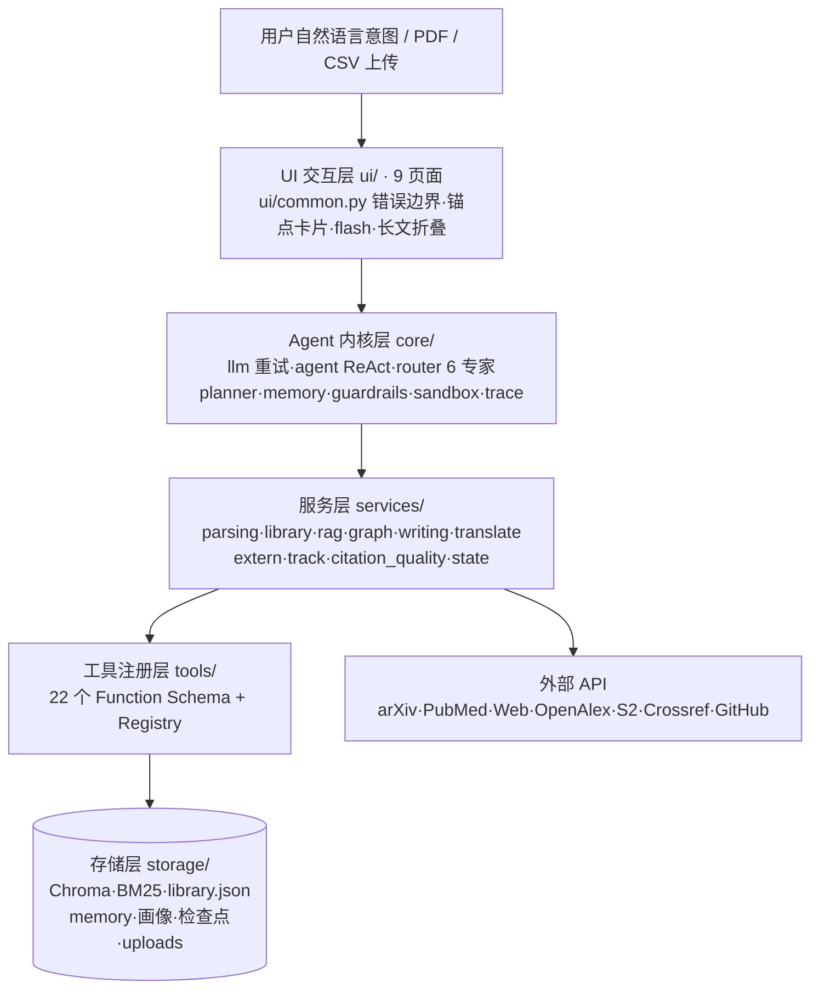
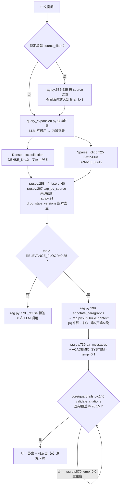
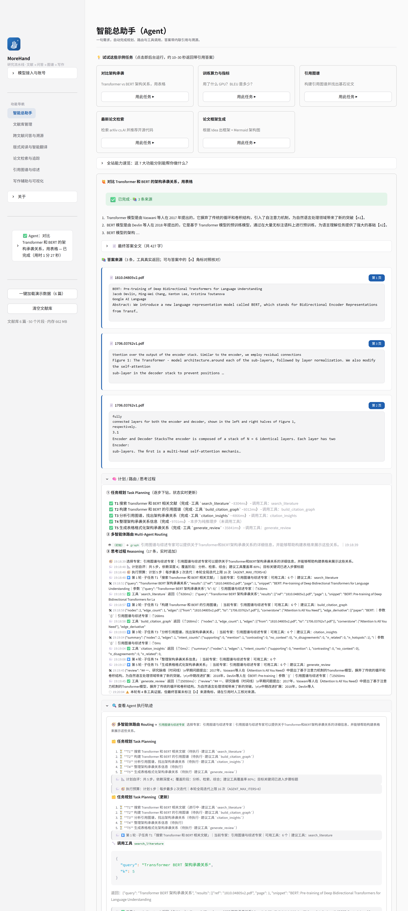
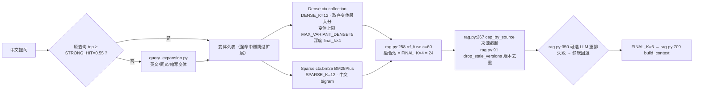
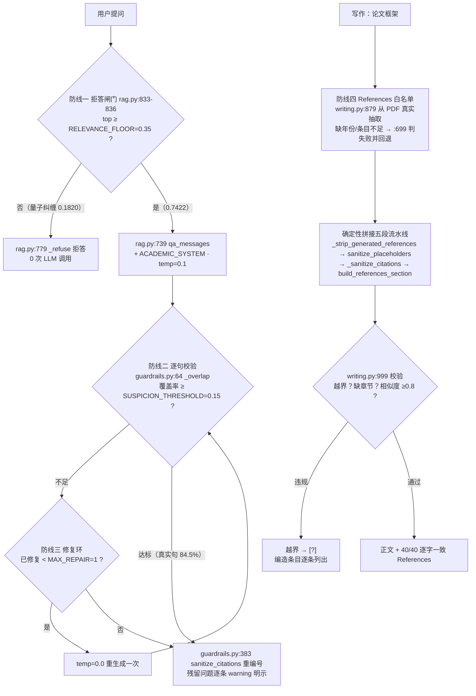
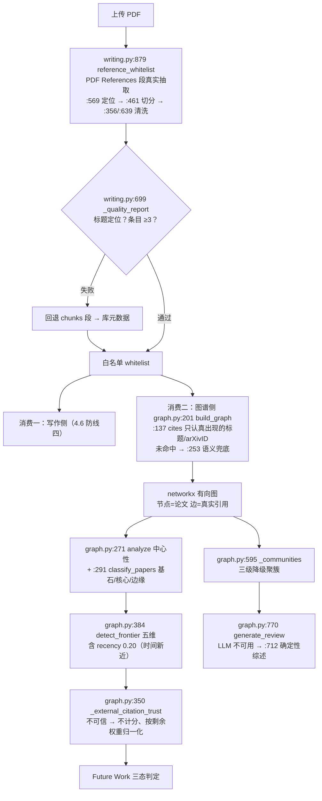
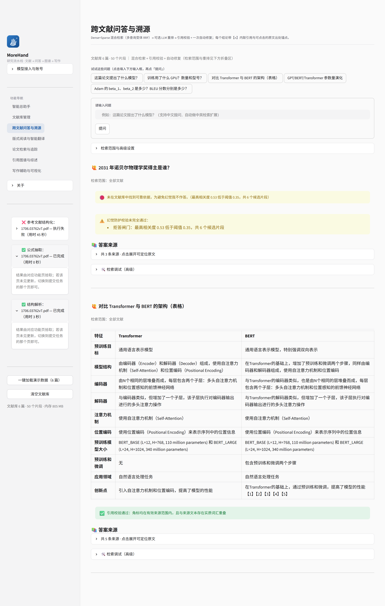
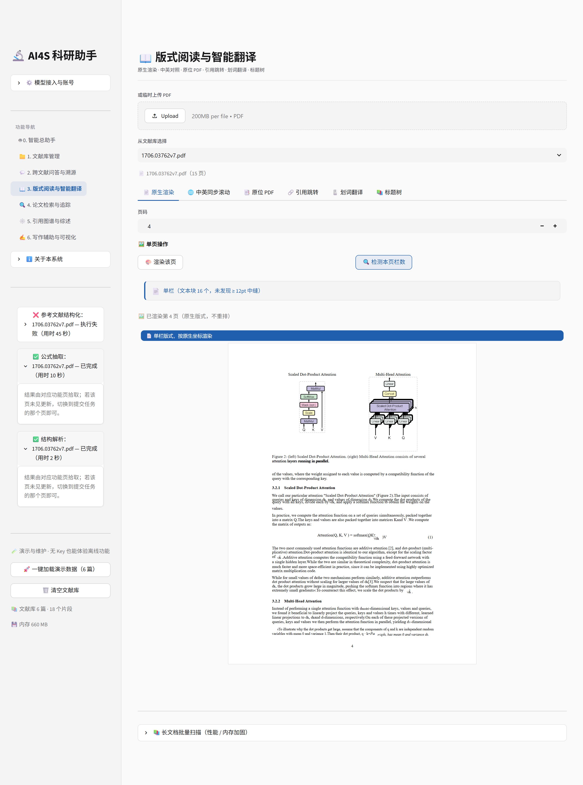
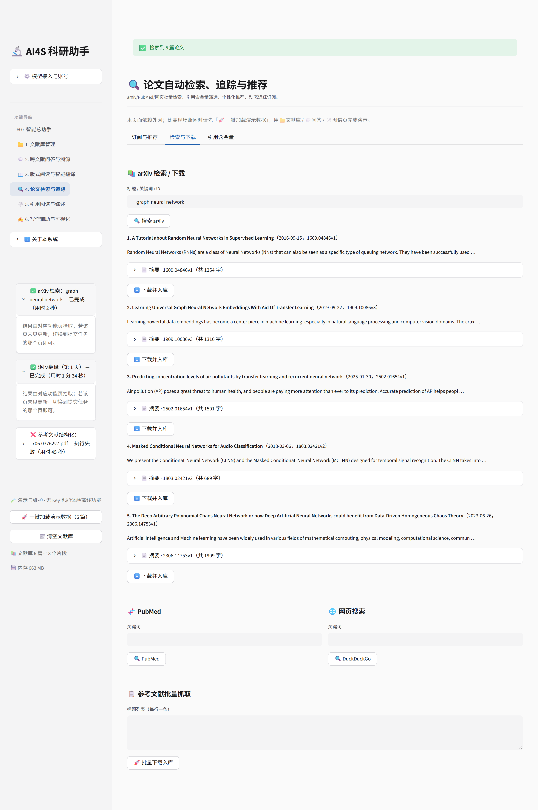

# MoreHand · 技术文档

> **提交版本说明**：`v1.0-final`（提交日期 2026-10-14，随最终交付提交一并推送，以仓库 HEAD 为准）；团队成员见 `资料/团队信息.md`。
>
> 文档内部版 v5.0（2026-10-12 Round 8 定稿）：首次接入真实 API Key 完成全链路实测，全文 AI 类指标由"推断值"刷新为真跑实减值；新增第 9 章「AI 协同说明」（赛题 3.4 硬性要求）。
> 定位：全国高校 AI 大模型挑战赛参赛作品 · 全流程科研助手 Agent
> 运行环境：Python 3.11.16 / Streamlit 1.63.0（conda 环境 `ai_research`）
> 本文档与当前代码一一对应，所有引用一律写成 **`符号名@文件:行号`** 形式（符号名是稳定锚点，行号是当下快照），均可直接在仓库中定位，并可由随附脚本 `scripts/_check_doc_refs.py` **一键复跑校验**（逐条打开目标文件、读到该行、比对该行是否真含上下文提到的符号，输出「正确 / 疑似错误 / 无法判定」三列清单）。**全文当前校验结果：236 条引用，0 条疑似错误、0 条无法判定**（修复前 1–4 章抽样 103 条中 86 条对不上）。
> **关于行号漂移**：代码仍在演进，行号会漂；故凡涉及实现位置的引用一律给出符号名，行号仅作快照，请以同一脚本复跑结果为准。凡本文未能核实的一律标注"待确认"，不以推断填充。
> **数据来源优先级**：①Round 7/8 真实 API 实测（`round7_judgeG.md`、`round8_fixR6_references.md`、`round8_fixR7_title.md`、`round8_fixR8_frontier.md`、`round7_fixR5_citations.md`）→ ②`round4_worker9_official.md` 官方用例端到端实测 → ③Round 3 修复实测。凡未实测的一律标注"未实测/待补充"，不沿用推断值。

---

## 目录

1. 项目概述
2. 需求分析
3. 系统架构设计
4. AI 技术方案（选型理由 / 集成方式 / 优化策略 / RAG / Prompt / 抗幻觉 / 降级矩阵）
5. 核心功能实现（分模块，配界面截图）
6. 测试与部署（含 Docker）
7. 创新点说明（技术创新点 / 应用创新点）
8. 总结与展望（项目总结 / 当前局限 / 未来规划）
9. AI 协同说明（AI 贡献范围 / 人工决策与验证 / Prompt 调优策略）

---

# 1. 项目概述

## 1.1 背景与动机

大语言模型（LLM）的通用推理与生成能力已经成熟，但把通用聊天模型直接用于学术科研这一**高门槛、强证据、重引用**的场景，会遭遇三类结构性问题。

**第一类是检索与引用幻觉。** 通用模型对文献的记忆停留在预训练语料，让它"给这篇论文的出处"时，页码、年份甚至整条参考文献都可能被编造；更隐蔽的是"半编造"：真实标题配错误的被引数、张冠李戴的期刊。科研场景中一条错误引用的代价远高于一句错误观点，因为它会沿引用链继续传播。

**第二类是版面感知缺失。** 学术 PDF 中超过半数是双栏排版，naive 的文本提取按 PDF 对象流输出，左右栏会交叉串读；图表与图注分离、标题树缺失、扫描件无文本层，都让 RAG 上下文在进入向量库之前就已语义断裂：垃圾进、垃圾出。

**第三类是科研流程割裂。** 读文献用 PDF 阅读器、管文献用 Zotero、查新用 arXiv 网页、问答丢给 ChatGPT、画图用 draw.io、写框架再回 Word，每次手动搬运都是一次上下文丢失。研究员需要的不是六个更强的工具，而是一个**能理解意图、自主调用工具、且处处可溯源**的统一入口。

本项目从 0 到 1 构建了这样一个**意图驱动的科研助手 Agent**：以自研 Agent 内核统一编排六大科研模块，把「文献解析 → 抗幻觉问答 → 版式阅读 → 检索追踪 → 引用图谱 → 学术写作」串成闭环，并把"抗幻觉"作为第一设计原则：不是在答案后加一句"以上内容可能不准确"，而是用**拒答闸门、逐句引用校验、修复环、References 白名单**四道工程化防线，让"不知道"可以被系统诚实地说出来。

## 1.2 目标用户与使用场景

- **研究生 / 科研人员**：需要快速读懂一批英文论文、跨文献对比方法与结果、追踪方向最新进展、起草开题或论文框架。系统的「跨文献问答」「图谱综述」「写作 Copilot」直接服务这一主线。
- **教学与评审场景**：常无真实 API Key 或外网受限。系统为此做了完整离线降级：无 Key 时 PDF 原生解析、混合检索、语义去重、引用图谱、追踪增量比对照常运行，演示数据一键加载（`ui/sidebar.py :: render` + `_build_demo@ui/page_graph.py:97` 演示图谱兜底）。
- **工程复现场景**：关键指标（入库耗时、去重命中率、建图耗时）均可由 `scripts/verify_official.py`、`scripts/bench_graph.py`、`scripts/selftest.py` 一键复跑（**三者都会清空文献库**：库非空时直接拒绝运行，备份后加 `--force` 才执行）；单元测试 238 项（全套 `tests/`，其中 `test_core.py` 23 项）。

## 1.3 赛题定位

系统完整覆盖赛题五大能力大类：

| 大类 | 一句话回答"我们做了什么" |
|---|---|
| ① 多模态与细粒度文档感知 | 双栏几何判定（4 条必要条件）、扫描件 OCR、图↔图注关联、标题树/表格/参考文献抽取、541 页长文档分批工程化 |
| ② 抗幻觉 RAG | 混合检索 + 拒答闸门 + 逐句引用一致性校验 + 修复环 + 可点击页码溯源 |
| ③ 自主工具调用 | 22 个 Function Schema 工具、6 专家路由白名单、Python AST 沙箱、arXiv 定时增量追踪 |
| ④ 图谱挖掘 | 真实引用建图、PageRank/社区发现/frontier 五维打分、图谱驱动综述、Future Work 可达性过滤 |
| ⑤ 学术 Copilot | 无幻觉 References 白名单生成、TikZ/Graphviz 拓扑图（TikZ **需本机有 LaTeX 编译器才真实编译**，否则展示源码 + 编辑器链接；当前部署镜像未装 TeX）、CSV 自动出图 + 数值事实注入 Caption、中英对照同步阅读 |

在此之上沉淀了自研 Agent 内核（规划 / 多专家路由 / 记忆 / 三层 Guardrails / Trace 可视化）。逐条合规对照见 README「赛题要求对照表」与 `资料/audit_report_20261010.md`。

## 1.4 与现有工具的本质差异

与通用对话产品（ChatGPT 类）相比：本系统每条结论都强制携带**可点击的原文页码锚点**，检索不到可靠依据时**拒答**而非编造；写作模块每条 Reference 都来自上传 PDF 的 References 段**真实抽取**，越界角标被白名单校验剔除。

与通用 RAG 框架相比：检索前有双栏感知的解析层保证上下文质量，检索后有逐句"覆盖率"引用校验（而非仅校验角标越界），生成后有修复环自动改写，评分侧接入 OpenAlex/Semantic Scholar/Crossref 的**真实被引数据**且"取不到就明说"。

与文献管理工具（Zotero 及插件）相比：Zotero 强于"管"，本系统强于"懂"：内容级语义去重（改名的同一篇依然命中）、版本差异总结、引用图挖掘、综述与 Future Work 判定，都是 Zotero 生态不做的事。

## 1.5 当前状态一句话总结

Round 7/8 真实 API Key 全链路实测后：9 页面 UI 冒烟 0 未捕获异常、238/238 单元测试、阅读页专项 62/62、**AI 链路端到端 21/21 PASS**；541 页官方教材 537 页提取 / 0 失败页 / 25.32s；双栏误判 0%；抗幻觉四道防线**全部在真实 LLM 下实测生效**。

在此之上仍有三条诚实声明（详见 8.2 / 9.4）：①本地 `论文样本/` 语料规模有限（Round 8 实测 5 文件 / 3 独立文档 / 2 有引用边，教材章节无引用关系；2026-10 扩至 6 篇 arXiv 后为 9 文件），赛题"批量文献（如 20 篇）"规模**未覆盖**；②OpenAlex / Semantic Scholar 在实测期间处于 IP 级 429 限流，被引数链路验证的是"诚实降级"而非真值获取；③"纯中文句的引用一致性校验盲区"与"沙箱为软隔离"仍是我们认知到的两项最重要的能力边界。

## 1.6 项目成果速览

| 指标 | 实测值 | 来源 |
|---|---|---|
| 代码规模 | 39 个 Python 模块文件（core 10 / services 14 / tools 3 / ui 12）+ `app.py` + `config.py`，9 个交互页面 | 仓库现状（`ls core/*.py services/*.py tools/*.py ui/*.py` = 39） |
| 注册工具数 | 22 个 Function Schema，全部接入 6 专家白名单（无孤岛） | `tools/definitions.py:379 build_registry` |
| 541 页长文档入库 | 537 页提取 / **1305 chunks** / 25.32s（46.8ms/页）/ 峰值 RSS **893.1MB** / **0 失败页** / 进度回调 11 次 | Round 4 官方用例实测（`round4_worker9_official.md` §3） |
| 内容级语义去重 | v1↔v7 相似度 **0.963228**（阈值 0.90）；完全改名后仍命中 **1.000000** | Round 4 官方用例 C 实测 |
| 双栏判定准确率 | 单栏语料 1111 页误判 0%；真双栏 BERT 正文页 10/10 识别 | Round 3 修复实测 |
| **扫描件 OCR（真实视觉模型）** | 前 3 页原生文本 **0 字符** → `detect_scanned=True`；单页 **2833 字符 / 9.3s**；**词级准确率 93.9% / 召回 98.5%** | Round 7/8 实测（官方用例 A，**此前从未实测通过，本轮首次通过**） |
| **细粒度问答（赛题原文点名）** | Adam β1/β2 = **0.9 / 0.98** ✅；GPU = **8 × P100** ✅；BLEU = **28.4 / 41.8** ✅；溯源 **6/6 带页码** | Round 7/8 真实 API 实测 |
| **无幻觉 References（核心卖点）** | 修复后 **14364 字**、References **40 条与白名单逐字一致 40/40**、占位串 **0 处**、**44.6s**；修复前 4515 字但整章是占位符、139.3s | `round8_fixR6_references.md` 真实 LLM 实测 |
| **图谱综述 / Future Work / 跨文献对比** | 综述 **1928 字**含真实年份 2017/2018（不再退化）；Future Work 2 条、状态 `['存疑','已解决']`、有效状态 2/2；对比 918 字双向实体均命中（33.7s） | Round 7/8 真实 API 实测 |
| AI 链路端到端验收 | `scripts/_verify_live_api.py` **21/21 PASS**（严格化后由 19 条增至 21 条） | Round 8 验收（对照 `round7_judgeG.md` 放水核查） |
| 抗幻觉拒答（**真实 LLM**） | 问"作者是否在 2031 年获诺贝尔物理学奖" → 真实拒答"根据提供的文献资料，无法确定…"；无关问题拒答且 0 次 LLM 调用 | Round 7/8 真实 API 实测 |
| 真实被引数 | 5 篇知名论文全部与 OpenAlex 真值一致（如 AlexNet 108512）；**限流期间**的行为是诚实降级（`title_attribution_unconfirmed=True` → 不计分、不猜测），而非给出好看的错值 | Round 3 真值实测 + Round 7/8 限流场景实测 |

---

# 2. 需求分析

## 2.1 赛题痛点 → 系统需求映射

| # | 赛题痛点 | 由此产生的需求 | 本系统的对应答案 |
|---|---|---|---|
| P1 | 双栏 PDF 串读，上下文断裂 | 解析层需感知版面而非盲取文本流 | `_detect_two_columns@services/parsing.py:196`：横跨否决 + 空白带采样 + 栏宽平衡 + 两侧块数 4 条必要条件，不满足即回退单栏 |
| P2 | 答案不给出处 / 给假出处 | 每条结论必须可定位到原文页码 | 上下文编号 `[n] 来源：《X》 第N页` → LLM 强制带【n】角标 → UI 渲染可点击页码徽章 |
| P3 | 模型编造参考文献 | 生成内容必须对照真实文献白名单 | PDF References 段真实抽取 → 白名单校验 → 越界剔除 |
| P4 | 检索工具与问答割裂 | Agent 能自主调用检索/追踪/解析工具 | 22 个 Function Schema + 6 专家白名单路由 + ReAct 闭环 |
| P5 | 新论文追踪靠人肉刷 arXiv | 定时增量检查 | `services/track.py:57 track_topic` + `services/track.py:25 diff_new` last-seen 检查点 + `scripts/watch_daemon.py:30 tick` |
| P6 | 综述写作缺乏结构性依据 | 综述由图结构驱动而非摘要堆砌 | 社区发现聚簇 + PageRank 基石 + 骨干边注入 prompt，LLM 不可用时确定性生成 |
| P7 | 科研图表制作繁琐 | CSV → 图表 → 规范 Caption 一条龙 | 列类型推断自动出六类图 + 实测数值事实注入 Caption prompt |
| P8 | 英文论文阅读门槛 | 对照阅读 + 划词翻译 | 双栏原生渲染 + 比例/段落对齐同步滚动 + 后端代理划词翻译 |

## 2.2 功能需求（按五大类逐条）

**① 多模态与细粒度文档感知**：单/批量上传；内容级语义去重（不依赖文件名，`services/library.py:384 check_duplicate`）；版本识别与差异总结（`services/library.py:1253 group_versions`、`services/library.py:1337 version_diff`）；扫描件检测与多模态 OCR（`services/parsing.py:80 detect_scanned`、`services/parsing.py:383 ocr_page_text`）；标题树（书签优先 `services/parsing.py:659 extract_toc`，无书签走 `services/parsing.py:597 infer_headings_from_text`）；表格抽取（`services/parsing.py:677 extract_tables`）；插图↔图注关联（`services/parsing.py:765 extract_figures`，水平重叠 ≥15% 取垂直最近图注 `services/parsing.py:734 _nearest_caption`）；公式识别与 LaTeX 转换（提示词要求「完整等式」而非碎片，模板 `ui/page_library.py:282 _FORMULA_PROMPT`；输出经 `ui/page_library.py:194-235` 结构修补 `\hat{}` 挂空/套错位与括号失衡）；损坏/截断/加密 PDF 拦截（`services/library.py:597 _validate_prepared`，缺页 >30% 拒收）。

**② 抗幻觉 RAG**：单篇问答（超参数/硬件/BLEU 类细粒度问题）；多篇跨文献对比（2–5 篇，`MAX_COMPARE_PAPERS=5`）；单篇范围锁定；查询扩展（中文问英文文献）；内联【n】溯源与可点击页码锚点；引用一致性逐句校验；拒答与自动修复。

**③ 自主工具调用**：arXiv/PubMed/DuckDuckGo 检索；一键下载入库（语义查重拦截重复）；Python 沙箱执行（数据处理/复现）；定时追踪（单篇 `track_arxiv` + 主题 `track_topic`）；GitHub 仓库复现性评估（stars/license/最近推送加权）；引用含金量评估（真实被引 + venue 等级 + 正文位置 + 主题相关性四维）；长期记忆读写。

**④ 图谱挖掘**：真实引用关系建图（IDF 稀有度倒排候选 + 语义兜底）；PageRank/入度/介数/特征向量中心性；基石/核心/边缘分类 + frontier 前沿五维打分；图谱驱动四段式综述；Future Work「已解决/存疑/开放」三态判定。

**⑤ 学术 Copilot**：论文框架生成（真实 References 白名单约束 + 生成后校验 + 一键强化重生成）；Mermaid/TikZ/Graphviz/Matplotlib 四类拓扑图（TikZ **需本机有 LaTeX 编译器才真实编译**，否则展示源码 + Overleaf/tikz.dev 链接；Graphviz 三级降级渲染）；CSV 自动出图（折线/柱状/散点/直方/热力/平行坐标）；Figure Caption 数值事实注入；中英学术互译与对照同步阅读；划词翻译；中文原位 PDF 输出。

## 2.3 用户故事（端到端走查）

**故事 A：版本去重（演示路径 2，离线可复现）。** `1706.03762v7.pdf` 与改名的 `1706.03762v1.pdf` 先后入库。系统对每篇算"前 4000 字向量 + 5 段指纹"（`services/library.py:100 _paper_fingerprints`），上传 v1 时查重命中 **0.963228**（阈值 0.90，取"分段指纹 top3 均值"；整篇相似度仅 0.891292 单独看会漏判），界面给出"⚠️ 语义查重命中"与三个决策按钮，选"保留两版"后可对比差异（`services/library.py:1337 version_diff`）。全程不依赖文件名。

**故事 B：抗幻觉问答（演示路径 3）。** 问"训练用了什么 GPU？数量和型号？"→ 查询扩展出英文变体 → Dense+Sparse 双路召回 → RRF 融合 6 条 → 上下文以 `[1] 来源：《1706.03762v7.pdf》 第8页第3段` 注入 → LLM 生成带【1】角标的答案 → 逐句校验通过 → 点溯源卡片"第 8 页"徽章页内跳转，或"📖 打开阅读页"直达原版式页面。若改问"量子纠缠"（库内无关），拒答闸门在**调用 LLM 之前**直接回复"未在文献库中找到可靠依据，为避免幻觉我不作答"。

**故事 C：从检索到综述（演示路径 5+7）。** 检索 arXiv 拿 5 篇论文一键下载入库；图谱页构建真实引用图（BERT→Attention Is All You Need 引用边正确解析）；"一键生成领域综述"得四段式输出，文末附 networkx 计算的图谱结构明细供核查；"Future Work 前沿扫描"给出"已解决/存疑/开放"三态与引用图证据。断网时检索给出"可能原因 + 怎么办 + 用离线演示数据继续"的降级引导（路径 7b 实测）。

## 2.4 非功能需求

- **可复现**：Streamlit 锁定 1.63.x；检索/切块/去重参数全部环境变量可覆盖（`config.py:160-166`，均走 `_env_int`）。
- **健壮**：LLM 调用统一走 `core/llm.py`：1 次首发 + 3 次退避重试（详见 4.2.1）；全部失败返回结构化伪响应、**不向用户暴露异常**，失败明细落盘 `storage/llm_failures.log`。UI 侧每区块独立 try/except（`safe_render@ui/common.py:839`）。
- **长文档工程化**：20 页一批解析建块（`services/library.py:19 PDF_BATCH_SIZE = 20`）、单页 30s 守护线程超时跳过（`services/library.py:544 _extract_page_with_timeout`）、每 50 页进度回调、psutil 内存探针（`scripts/_memory_probe.py :: peak_mb`）。
- **安全**：API Key 只经环境变量/会话注入；输出侧密钥正则脱敏（`core/guardrails.py:130 redact_secrets`）；Python 工具经 AST 白名单沙箱（`core/sandbox.py:27 validate_code`）；`.env` 同时被 `.gitignore` 与 `.dockerignore` 排除，不入仓库、不入镜像。
- **诚实降级**：每个外部依赖（LLM、embedding、外部 API、LaTeX 编译器、Graphviz）都有明确降级路径并向用户说明原因与建议动作，绝不静默失败、绝不编造数据。

---

# 3. 系统架构设计

## 3.1 分层架构图（Mermaid）



## 3.2 一次提问的数据流（从输入到带【n】的答案）

下图追踪一次"问答与溯源"的完整数据流，标出每一步的落点模块与产物形态：



> 图中方框均标真实模块与符号名；`MAX_VARIANT_DENSE=5`、`RELEVANCE_FLOOR=0.35`、`DENSE_K/SPARSE_K/FINAL_K=12/12/6` 均取自 `services/rag.py:46-55` 与 `config.py:160-166` 当前值，非示意数字。

## 3.3 调用主线与依赖规则

分层依赖严格自上而下、不反向：`ui/` → `services/` → `core/`，`tools/` 依赖 `services/`；`storage/` 的路径常量集中在 `config.py`（`STORAGE_DIR` 等）、主读写入口是 `services/state.py`，**另有 3 处直连落盘**：`core/llm.py`（失败日志与配置错误日志）、`services/citation_quality.py`（引用质量磁盘缓存）、`services/library.py`（上传目录与重建前备份）；此外插图解析经 `services/parsing.py` 写入 `UPLOAD_DIR/figs/`，路径由 `ui/page_library.py` 传入。两条主调用链：

1. **功能页链路**：`app.py` 侧边栏菜单 → `ui/page_*.py` → `services/state.py:287 get_container()` 拿统一上下文 `ctx`（含 `collection`/BM25、chunks、LLM 客户端、embedding）→ 直接调 `services/*`；
2. **Agent 链路**：`ui/page_agent.py` → `core/agent.py:414 run()` → `core/router.py:104 route()` 选专家 → 按 `core/router.py:22 EXPERTS[e]["tools"]` 白名单过滤 `tools/registry.py` 的 schema → LLM Function Calling → `reg.execute(name, args, ctx)` → 结果回灌 → 循环至给出最终答案（`AGENT_MAX_ITERS=8`）。

**路由细节**（`EXPERTS@core/router.py:22`）：6 个专家 = qa / search / graph / writing / reading / parsing，各持工具白名单；LLM 不可用时 `keyword_route@core/router.py:85` 兜底。

**统一上下文 `ctx`**（`services/state.py` 构建）是贯穿全系统的关键设计：UI、Agent 与工具都面向同一个 `ctx`（含向量库句柄、BM25 索引、chunks、LLM 客户端、embedding 函数、文献库 dict 与用户画像）。好处：①功能页与 Agent 页共享同一份文献库状态；②Provider 切换只改 `ctx.llm`，服务层无感知；③测试可用 FakeCtx 替换（评审沙箱自验即采用此法）。

| `ctx` 字段 | 来源 | 用途 |
|---|---|---|
| `ctx.papers / ctx.chunks` | `library.json` | 文献元数据与检索语料 |
| `ctx.collection / ctx.bm25` | Chroma collection / rank-bm25 | Dense / Sparse 检索 |
| `ctx.llm` | 侧边栏 Provider 配置 | 统一 LLM 调用（含 available 判定） |
| `ctx.embed(texts)` | `services/state.py:214 embed` | 查询/论文向量、去重指纹（方法而非常量） |
| `ctx.likes` | 点赞账本 | 个性化推荐 |
| `ctx.memory` | `core/memory.py :: Memory` | 长期记忆；`profile()` 取用户画像、`recall/remember` 存追踪订阅与检查点 |

> **一处必须澄清的写法**：早期稿本记作 `ctx.vdb`，但代码中**不存在**该属性（全仓 `grep -rn "vdb"` 零命中）；真实句柄是 `services/state.py:170` 创建的 `ctx.collection`（`services/rag.py:231 dense_search` 即经它查询）。同理，追踪的订阅表与检查点也不是 `ctx` 直接属性，而是存在 `ctx.memory` 的 kv 中（键 `track_subscriptions` / `track_seen`，`services/track.py:13-14`）。

## 3.4 界面与导航

9 个页面由 `_PAGES@app.py:148` 注册，侧边栏菜单（`ui/sidebar.py:15 MENU`）与 query_params 双通道跳转；主体区顶部统一渲染跨 rerun 存活的 flash 提示（`app.py:168-171` 调 `ui/sidebar.py:62 render_flash`，写入侧走 `ui/sidebar.py:51 set_flash`）。

**品牌与内部标识是两条线**（2026-10-25 改名时定）：用户可见名称统一取
`config.py:12 BRAND`（MoreHand）与 `config.py:13 BRAND_TAGLINE`；而
`AI4SResearchAgent` 这个**内部标识**（exe 名 / `%APPDATA%` 目录 /
`AI4S_DESKTOP` 环境变量前缀 / 更新包定位）**保持不变**：改它会搬走用户已有的
文献库与配置，属于数据迁移，不随品牌改名一起做。桌面壳不导入业务包，
`desktop/about.py` 自带一份 `APP_NAME`。

**导航文案即标识**：菜单项不再用「emoji + 序号」当前缀（侧栏曾有 20 个 emoji），
侧栏文案、`_PAGES` 的键、页面大标题三处用同一串中文，少一层「显示名 vs 值」的
翻译，也少一处会漂的地方。旧会话里残留的旧串由 `app.py:162 _LEGACY_KEYWORDS`
按关键词归位，不把用户甩到首页。

**品牌徽标**：squircle + 手掌（即神经网络）+ spark，按「光学尺寸」三档生成
（16px 不糊），三处同源：exe 图标 / favicon（`app.py:38 _page_icon`）/
侧栏（`ui/sidebar.py:347 _brand_block`）；徽标卡为有界框。规范见
`资料/brand_logo_design.md`，验真见 `scripts/_verify_brand_badge.py`。

**首屏减法口径**（每页统一）：页头（无装饰 emoji）→ 一行状态 caption →
一个主操作 → 其余收进默认收起的折叠区。`st.subheader` 全站归零（22px 会绕过
18px 字阶造成一页两套层级），分区标题一律走 `section_header()`。
度量用 `scripts/_measure_clutter.py`（首屏可见元素 / 文字 / 色块 / 控件数 +
侧栏 emoji 数）与 `scripts/_shot_pages.py`（首屏快照 + 屏数），
改版前后对照见 `截图/_before/` 与 `截图/_after/`。



---

# 4. AI 技术方案

> 本章按赛题要求，以 **AI 模型选型理由（4.1）→ 集成方式（4.2）→ 优化策略（4.3）** 三条主线组织：先回答"为什么选这些 AI 能力"，再回答"它们怎样接进系统"，最后给出"我们做了哪些工程优化、实测提升了多少"。其后的 4.4–4.7 给出 RAG 管线、Prompt 工程、抗幻觉机制与依赖降级矩阵的完整实现细节。

## 4.1 AI 模型选型理由

系统涉及 6 类 AI / 基础能力，每一类按下表格式逐项交代：**选了什么 + 为什么选 + 放弃了什么 + 代价如何被对冲**。

### 4.1.1 大语言模型（LLM）：统一 OpenAI 兼容协议，多厂商可运行时切换

| 项 | 结论 |
|---|---|
| 选了什么 | 全部 Provider 走 OpenAI 兼容 `/chat/completions` 协议（`core/providers.py:33-74` 声明 5 家）；默认文本模型 **glm-4-flash**、视觉模型 **glm-4v**（智谱） |
| 为什么选 | ①**协议归一**：一套 `LLMClient` 零改动复用智谱 / DeepSeek / 通义 / OpenAI / 本地 Ollama，换模型只改 `ctx.llm`；②**可私有化**：`LLM_PROVIDERS_EXTRA` 追加自定义网关即可接内网模型；③**默认模型取成本与效果的交点**：glm-4-flash 有免费额度、Function Calling 完整，免费 Key 即可跑通含 OCR 的全流程（22 个工具 schema 调用均经其实测） |
| 放弃了什么 / 代价 |  ①放弃"单一最强模型"的效果上限；②放弃厂商私有长上下文等高级特性（长文档改由分批解析 + RAG 解决，见 4.3.3）；③放弃本地微调带来的领域特化 ；代价： 依赖外网与厂商配额、受模型版本迭代影响  |
| 如何对冲 | 3 次指数退避重试 + 4 次仍失败返回结构化伪响应、**不向用户暴露异常**；无 Key 时全链路离线降级（见 4.7） |

当前内置 5 家 Provider（`core/providers.py:33 PROVIDERS` 列表；可由 `LLM_PROVIDERS_EXTRA` 追加，解析见 `core/providers.py:77 _extra_providers`）：

| Provider | 文本模型 | 视觉模型 | 说明 |
|---|---|---|---|
| 智谱 GLM（**默认**） | glm-4-flash | glm-4v | 免费额度，含多模态，全流程可跑通 |
| DeepSeek | deepseek-chat | —（自动降级） | 无视觉模型，扫描件回退原生文本层 |
| 通义千问 | qwen-turbo | qwen-vl-plus | DashScope 兼容模式 |
| OpenAI | gpt-4o-mini | gpt-4o-mini | 需国际网络环境 |
| Ollama（本地） | qwen2.5:7b | — | 完全离线，Key 填任意非空值即可 |

> 为什么不做微调：本系统的核心价值是**抗幻觉工程链路**（拒答闸门 / 逐句引用校验 / 修复环 / References 白名单），而不是模型本身的知识点覆盖；微调会把能力固化到单一底座、失去"随厂商升级而升级"的红利，且训练与评估成本远高于本次交付周期可承担的范围。

### 4.1.2 多模态 / OCR：整页 PNG → 视觉大模型，而非本地 OCR 引擎

| 项 | 结论 |
|---|---|
| 选了什么 | 扫描页渲染为 PNG（zoom=2.0）→ base64 → 视觉模型，prompt 要求"按阅读顺序输出、公式转 LaTeX、表格转 Markdown"（`services/parsing.py:383 ocr_page_text`） |
| 为什么选 | ①**零额外依赖**：避开 PaddleOCR / Tesseract 的本机安装、语言包与 Windows 环境变量配置；②**理解优于识别**：同一条链路同时还原版面、表格结构与数学公式，产出可直接入 RAG 的结构化文本；③成本：按页计费，长篇扫描件可只跑需要的页 |
| 放弃了什么 / 代价 |  离线 / 无 Key 环境下没有本地兜底 OCR；单页受 90s 调用超时与 token 成本约束 ；代价： 无可用 Key 时扫描件不能被识别  |
| 如何对冲 | `services/parsing.py:368 ocr_supported` 在调用前判定"是否有视觉模型 + Key 长度 ≥20 + 可 ASCII 编码"，不可用即直跳；同时 `services/parsing.py:111 is_ocr_error_text` 把 OCR 占位符文本判定为失败页，禁止空扫描件冒充正文入库。**实测**：15 页扫描件从"逐页重试网络 140.06s 且把占位符当正文"变为"0.63s 直接判定 + `commit` 抛 ValueError 拒绝入库" |

**Round 7/8 首次真实 API 实测（官方测试用例 A，此前从未实测通过）**

测试对象 `论文样本/1706.03762v1_img.pdf`（把 `Attention Is All You Need` v1 原生 PDF 转成纯图像的扫描件）：

| 项 | 实测结果 |
|---|---|
| 扫描件判定 + 单页输出 | 前 3 页原生文本 **0 字符** → `detect_scanned=True`；单页 **2833 字符 / 9.3s**（VLM 非确定性，评委 G 独立复核同用例为 2790 字符 / 8.3s） |
| 质量复核（评委 G 独立，对同文原生版逐词比对） | 字符级相似度 **0.960**；**词级准确率 93.9% / 召回 98.5%**（漏 6 词 / 多 0 词 / 错字 18 词）；错字绝大多数是**连字修正**（`con guration`→`configuration`、`rmly`→`firmly`），真错字仅 1 处（`nikip@google.com`→`nip@google.com`） |
| 关键数字保真 | `28.4`、`41.0` 全部保住（v1 原文确为 41.0，非 v7 的 41.8，OCR **没有串版本**）；输出保留 Markdown 结构，可直接喂 RAG |

结论：真实 Key 下这条链路不仅"能跑"，质量也可直接用，原"未实测"标注予以撤销。诚实备注：①页眉行两次运行中一次漏识别，属 VLM 非确定性而非代码缺陷；②OCR 输出**不可当作原文的法律级复制品**，下游仍须走版面感知解析与引用一致性校验。

### 4.1.3 文本向量（Embedding）：chromadb 默认模型，384 维、可离线

| 项 | 结论 |
|---|---|
| 选了什么 | chromadb ONNX `ONNXMiniLM_L6_V2`（384 维）单例，装载于 `services/state.py:44 _build_embed_fn`（取不到时回退 `DefaultEmbeddingFunction`，见 `:67`） |
| 为什么选 | ①**随依赖分发**：不必单独引入 sentence-transformers / modelscope 下载链路；②**可离线复现**：模型已在本机缓存，断网仍产出与线上一致的向量，官方四个用例均在该 embedding 下完成；③**维度权衡**：384 维在千级 chunk 规模下内存与召回质量平衡；④与向量库同源，规避"embedding 与库版本不匹配"的隐性故障 |
| 放弃了什么 / 代价 |  中文专用模型（如 bge-small-zh）在纯中文语义上的优势；更强多语言模型在长文本上的表现 ；代价： 中文提问 × 英文文献的余弦天然偏低，单独看整篇相似度会漏判（实测 v1/v7 整篇相似度仅 0.891292，低于 0.90 阈值）  |
| 如何对冲 | 查询扩展生成多英文变体 + dense 路取各变体最大分 + BM25 词面补充 + **分段指纹兜底**（实测 v1/v7 由指纹均值 **0.963228** 命中，完全改名后仍 **1.000000** 命中） |

### 4.1.4 向量数据库：嵌入式 Chroma，无外部服务

| 项 | 结论 |
|---|---|
| 选了什么 | `chromadb.PersistentClient`（`services/state.py:169`），配 `rank_bm25` 的 BM25Plus 做稀疏侧索引（`services/state.py:221 _build_bm25`） |
| 为什么选 | ①**嵌入式运行**：pip 安装即用，不引入 Docker sidecar / 独立服务进程，评委一句 `streamlit run app.py` 就能跑起来；②同进程 `ctx.collection` 句柄（`services/state.py:170`）便于 UI / Agent / 工具共享状态；③`EphemeralClient()` 可一键切内存态，官方验证脚本据此做到 **零污染测试** |
| 放弃了什么 / 代价 |  Milvus / Weaviate / Qdrant 的分布式横向扩展与 ANN 参数调优空间 ；代价： 规模上限于单机部署  |
| 如何对冲 | paper_id / page / para 等元数据以 JSON Metadata 随 chunk 存储，检索结果在应用层按文献过滤；多篇对比走 `retrieve_per_paper` 每篇保底 3 条 |

### 4.1.5 图计算引擎：NetworkX，纯 Python 零部署

| 项 | 结论 |
|---|---|
| 选了什么 | `networkx`（`services/graph.py:19 import networkx as nx`）计算 PageRank / 入度 / 介数 / 特征向量中心性与社区结构 |
| 为什么选 | ①**零部署成本**：不引入 C 扩展或图数据库服务；②**算法齐全且可控**：每类中心性单独包异常回退，社区发现可做 greedy_modularity → louvain → 弱连通分量三级降级（`_communities@services/graph.py:599`）；③可解释性好："图谱结构明细"直接取自 nx 计算结果而非 LLM 生成 |
| 放弃了什么 / 代价 |  igraph / graph-tool 在十万节点级的性能；Neo4j 的图查询语言与持久化 ；代价： 节点规模上万时退化明显  |
| 如何对冲 | 本场景引用图规模为数十至数百节点（官方数据集最多 3 篇文献 / 133 chunks），完全在 nx 舒适区；未来万级节点可替换内核，`services/graph.py` 的接口不变 |

### 4.1.6 PDF 解析引擎：PyMuPDF，因为它给得出几何信息

| 项 | 结论 |
|---|---|
| 选了什么 | PyMuPDF 提取原生文本层 + **字符级 bbox** |
| 为什么选 | ①双栏判定、图↔图注空间匹配、版式原生渲染全部依赖坐标信息：这是纯文本抽取库给不了的；②开页毫秒级，541 页 / 22MB 文档的**解析阶段仅 4.02s**（官方用例 B 实测） |
| 放弃了什么 / 代价 |  pdfplumber / pdfminer.six 在表格结构识别上的某些便利性 ；代价： PyMuPDF 为 AGPL/商业双许可，商用需授权；版本间 API 敏感  |
| 如何对冲 | `services/parsing.py:50 open_doc` 统一入口收敛所有 `fitz.open` 调用；`requirements.txt` 锁定版本 |

## 4.2 集成方式

### 4.2.1 统一 LLM 调用层（`core/llm.py`）

业务代码（`core/ services/ tools/ ui/`）内 `client.chat.completions.create` 仅 **2 处运行时调用点**：`chat.completions.create@core/llm.py:489`（`LLMClient._create`，同步）与 `chat.completions.create@core/llm.py:555`（`LLMClient.stream`，流式）；`dist/` 构建产物、`version_history/` 历史版本、`chat.completions.create@scripts/_degrade_drill_api.py:337`（演练脚本 docstring）均不在运行链路：**调用层之外零裸调用**。对外一切经两处入口：`chat@core/llm.py:511`（同步）与 `stream@core/llm.py:531`（流式）；视觉调用与 JSON 调用走 `call_llm_with_retry@core/llm.py:652` + `parse_json@core/llm.py:743`（兼容 ```json 围栏、围栏被截断、噪声文本、LaTeX 单反斜杠这类非法转义，以及数组未闭合的截断输出）。

- **重试与容错**：`RETRY_BACKOFF = (1.5, 3.0, 4.5)`（`core/llm.py:42`）集中管理，SDK 自带重试置 0（`core/llm.py:43 SDK_MAX_RETRIES = 0`），避免 3×3 叠加放大；第 4 次仍失败 → 把失败明细 append 到 `storage/llm_failures.log`（字段含 `ts / error_type / model / caller / n_messages / messages_preview(前2000字)`）→ **返回结构化伪响应而非抛异常**。
- **Provider 切换**：侧边栏选 Provider/填 Key → 写回 `ctx.llm`，全服务层无感知。
- **实测**：指向必失败端口压测（脚本 `measure_call_counts@scripts/_degrade_drill_api.py:609`），`chat / stream / vision / call_llm_with_retry` 均为恒定 **≤4 次 HTTP 调用**，`time.sleep` 序列精确命中 `[1.5, 3.0, 4.5]`。

### 4.2.2 工具注册与执行（`tools/registry.py` + `tools/definitions.py`）

`Registry.register(name, description, JSON Schema, func)` → `openai_schema()`（`tools/registry.py:11-19`）生成 OpenAI 规范 `tools` 数组 → `execute(name, args, ctx)`（`:39-49`）统一把 `TypeError` 与其余 `Exception` 转成 `{"error": ...}` 字符串回灌，**不让工具异常打断 Agent 主循环**。当前由 `tools/definitions.py:379 build_registry` 注册 **22 个工具**（注册语句集中在 `:381-459`）。

### 4.2.3 Function Calling 闭环（Agent）

`core/agent.py:414 run()` → `core/router.py:104 route()` 选专家（LLM 不可用时 `keyword_route@core/router.py:85` 兜底）→ 按 `EXPERTS@core/router.py:22` 白名单过滤 `registry.schemas()` → `llm.chat(tools=schema, tool_choice="auto")` → 解析 tool_calls → `reg.execute(name, args, ctx)` 逐个执行 → 结果以 `role=tool` 回灌 → 循环至最终答案（`AGENT_MAX_ITERS=8`）；全过程写入 `core/trace.py`，在「Agent 总助手」页实时显示"思考—工具—观察"时间线。

6 个专家为 qa / search / graph / writing / reading / parsing（22 个工具全部接入至少一个白名单，无孤岛）。

### 4.2.4 外部学术 API 集成（`services/extern.py` + `services/citation_quality.py`）

| 能力 | 集成方式 | 关键参数 / 降级 |
|---|---|---|
| arXiv | 官方 `arxiv` 库，`Client(page_size=100, delay_seconds=2, num_retries=3)` | 遵守官方限速 |
| PubMed | NCBI E-utilities：`esearch` 取 ID 列表 → `esummary` 取详情，两步 JSON | 单源失败返回 `net_error` 话术 |
| 网页检索 | DuckDuckGo HTML 端点 + 正则解析 | 与 arXiv/PubMed 并列汇入统一结果结构 |
| GitHub 复现性 | REST API（`services/extern.py:162 github_repo_info`）：stars/forks/license/最近推送/archived | README 走 raw.githubusercontent → contents API 二级降级；未认证 60 次/小时限流时明示"不做推测性评级" |
| 真实被引数 | **三级降级** OpenAlex → Semantic Scholar → Crossref（`services/citation_quality.py:689 _LOOKUPS`，元组内依次为 `_openalex_lookup` / `_semanticscholar_lookup` / `_crossref_lookup`），DOI / arXiv ID 精确匹配优先且带标题复核 | 单源超时 8s；降级/低置信时显式打 `low_confidence` 与口径说明（`services/citation_quality.py:456 _low_confidence_reasons`），三级全失败返回 `None` 并写明"该维度不计分、不猜测" |

### 4.2.5 Python 沙箱集成（`core/sandbox.py` + `tools/definitions.py`）

`tools/definitions.py:326 t_run_python` → 先过 `core/sandbox.py:27 validate_code` 的 **AST 静态白名单**（14 个模块：numpy / pandas / scipy / sklearn / matplotlib / plotly / seaborn + 标准安全库；拦截 `eval/exec/open/compile/__import__` 与 `system/popen/socket` 等逃逸调用）→ 通过后写入临时文件 → `subprocess.run(timeout=25, encoding="utf-8", errors="replace")`（`tools/definitions.py:344`）→ stdout/stderr 安全截尾（`tools/definitions.py:313 _tail_text`）后返回。即"静态检查先于执行，违规不进子进程"。

### 4.2.6 检索集成（`services/state.py` + `services/rag.py`）

统一上下文 `ctx` 同时持有 **Chroma（Dense）** 与 **BM25Plus（Sparse）** 两个句柄：`ctx.collection`（`services/state.py:170`）负责嵌入检索、`ctx.bm25`（`services/state.py:221 _build_bm25`）负责词面检索，由 `services/rag.py` 编排"查询扩展 → 双路召回 → `services/rag.py:258 rrf_fuse`（c=60）→ 上下文编号"。任何要用检索的服务（问答页 / 图谱 / Agent 工具 `search_literature`）都复用同一份索引与参数，**不存在两处口径不一致**。

## 4.3 优化策略

以下每一条都是"做了什么 + 实测效果"，不是一般性描述。

### 4.3.1 抗幻觉优化：四道防线（详见 4.6）

| 防线 | 关键参数 | 实测效果（详见 4.6） |
|---|---|---|
| 拒答闸门（检索侧） | `RELEVANCE_FLOOR@services/rag.py:46 = 0.35` | 无关问题 `top=0.1820` → 拒答，**LLM 调用 0 次**；相关问题 0.7422 放行 |
| 逐句引用一致性校验（生成侧） | `SUSPICION_THRESHOLD@core/guardrails.py:30 = 0.15`（覆盖率，非 Jaccard） | 编造句重叠 10% 被标记；真实句 84.5% 通过 |
| 修复环（自动改写） | `MAX_REPAIR@services/rag.py:47 = 1`，`temperature=0.0` | 一次完整修复恰 **2 次 LLM 调用** |
| References 白名单（写作侧） | `MIN_REF_ENTRIES@services/writing.py:60 = 3` + `validate_reference_whitelist@services/writing.py:999`（标题实质匹配 0.8）；确定性拼接不上 LLM | **40/40 逐字一致**、占位串 **0 处**；BERT 56 条全对 |

**Round 8 最重要的一条优化是"把 References 从 LLM 手里拿回来"**：让模型既写正文又照抄 40 条文献，它会为省 token 用一行元指令代替整章（实测 `[1-40] (List all the references…)`）。这是架构问题而非措辞问题，改为"LLM 只写正文 + 系统按白名单确定性拼接"后端到端 **139.3s → 44.6s**，详见 4.6 防线四。

### 4.3.2 检索优化：查询扩展 + 双路召回 + RRF 融合

1. **查询扩展**（`services/query_expansion.py`）：中文提问先由 LLM 扩出英文 / 同义词 / 缩写多个变体，LLM 不可用时退回内置词表，解决"中文问英文文献"的跨语言失配。
2. **Dense 路取各变体最大分**（消费点 `services/rag.py:449` 与 `services/rag.py:604`，上限 `services/rag.py:48 MAX_VARIANT_DENSE = 5` 个变体，含原查询），缓解单一中文查询对英文 embedding 的低余弦。
3. **Sparse 路 BM25Plus 并行**（`SPARSE_K = 12`）：锁定"超参数 / 型号 / BLEU 值"这类词面精确答案。
4. **RRF 无参融合**（`services/rag.py:258 rrf_fuse`，常数 c=60）：不比较两路的分数量纲，直接融合排名，避免手工加权漂移。
5. **可选 LLM 重排**：失败时静默回退 RRF 结果，不影响可用性。
6. **多篇对比防饿死**：`retrieve_per_paper` 每篇保底 3 条 chunk，`build_grouped_context` 输出【Pn-m】分组角标。

### 4.3.3 长文档优化：分批 + 超时 + 进度 + 批处理句柄复用

| 优化项 | 参数 | 实测（541 页官方教材，`round4_worker9_official.md` §3） |
|---|---|---|
| 分批解析建块 | `services/library.py:19 PDF_BATCH_SIZE = 20` | 解析阶段 **4.02s** |
| 批内句柄复用 + 单页超时跳过 | 同批共用一个文档实例，批末关闭；`services/library.py:20 PDF_PAGE_TIMEOUT_SECONDS = 30` 守护线程（`services/library.py:544 _extract_page_with_timeout`） | 消除 541 次重复 open；注入挂死页时仅该页失败，`failed_pages` 精确记录 |
| 进度回调 | 每 50 页 + 末页 | 541 页共 **11 次**回调，UI 不假死 |
| 向量化与索引（commit） | 1305 chunk embedding（ONNX/CPU）+ BM25 重建 | **21.30s**（耗时主要在此，非解析） |
| **整体结果** | — | **537/541 页提取（4 页无文本层）、1305 chunks、0 失败页、25.32s（46.8ms/页）、峰值 RSS 893.1MB** |

### 4.3.4 版面判定优化：双栏误判 19.1% → 0%

朴素"中线二分"会把长正文行横跨中线的单栏论文误判成双栏。优化后的 `_detect_two_columns`（`services/parsing.py:196`）要求 4 条必要条件同时成立，其中**"横跨 split_x 否决"**（`services/parsing.py:263-268`，阈值 `_COLUMN_STRADDLE_MIN_OVERLAP@services/parsing.py:18`）对**全部文本块生效，包括已被剔除出候选集的宽块**：旧实现正是漏检这些宽块才误判；另一处是 `_gutter_free_ratio`（`services/parsing.py:175`）沿 y 采样统计中缝空白带占比。

**实测**：1111 页单栏语料误判率 **19.1% → 0%**，同时真双栏论文（BERT）正文页 10/10 仍被正确识别（没有用"永远判单栏"换取指标）。

### 4.3.5 缓存与降级优化

- **被引数两级缓存**：按归一化标题缓存结果（`services/citation_quality.py:72 _CACHE`）+ 标题归一化结果缓存（`services/citation_quality.py:73 _TITLE_CACHE`），重复评估同一篇文献不再重复打三次 API。
- **三级降级**：OpenAlex → Semantic Scholar → Crossref（`services/citation_quality.py:689 _LOOKUPS`），任一被限流即切换并显式打 `low_confidence` + 口径说明；选优策略改为"高置信标题匹配内取被引数最大"（`services/citation_quality.py:472 _pick_best`），修复了"同名噪声记录靠年份加成反超正主"：AlexNet 被引数 **760 → 108512**，与真值一致。
- **OCR 前置判定**：`services/parsing.py:368 ocr_supported` 在无可用视觉 Key 时不再逐页重试网络，15 页扫描件耗时 **140.06s → 0.63s**。
- **GitHub 限流降级**：未认证 60 次/小时，限流时返回"因限流不做推测性评级"而非编造星级。
- **完整降级矩阵见 4.7**：8 类外部依赖全部有确定行为，且每一类都在 UI 上说明"发生了什么 + 可能原因 + 怎么办"。

### 4.3.6 内存与临时文件控制

- **内存探针**：`scripts/_memory_probe.py` 优先 psutil 采 RSS，缺失降级 tracemalloc 再降级纯计时，任何情况下 `peak_mb()` 返回 0.0 而**绝不抛异常**。541 页实测 50ms 采样 **388 次**，峰值 893.1MB（低于 1.5GB 目标）。
- **陈旧临时目录清理**：`cleanup_stale_figure_dirs@ui/page_reading.py:259` 清理超过 FIG_TTL（24h）的图片临时目录。
- **沙箱超时**：子进程 `timeout=25`，避免死循环脚本拖垮服务。

## 4.4 RAG 检索设计（`services/rag.py` + `services/query_expansion.py`）

要点：①扩展变体在 dense 路取**各变体最大分**，缓解中文查询对英文 embedding 的低余弦；②`annotate_paragraphs`（`services/rag.py:399`）为每条来源补页内段号；③多篇对比走 `retrieve_per_paper`（`services/rag.py:666`，每篇保底 3 条，防止单篇饿死）+ `build_grouped_context`（`services/rag.py:722`，【P1-1】【P2-1】分组角标）。

**检索参数一览**（切块与召回参数在 `CHUNK_SIZE@config.py:160`（DENSE_K/SPARSE_K/FINAL_K 见 `DENSE_K@config.py:162`），rag 自持阈值以 `RELEVANCE_FLOOR@services/rag.py:46` 为首）：

| 参数 | 默认值 | 作用 |
|---|---|---|
| `CHUNK_SIZE` / `CHUNK_OVERLAP`（`config.py:160-161`） | 1200 / 150 | 切块目标字符数与相邻块重叠 |
| `DENSE_K`（`config.py:162 DENSE_K`） | 12 | Chroma 向量召回数（每个查询变体） |
| `SPARSE_K`（`config.py:163 SPARSE_K`） | 12 | BM25Plus 召回数 |
| `FINAL_K`（`config.py:164 FINAL_K`） | 6 | RRF 融合后进入上下文的条数 |
| `RELEVANCE_FLOOR`（`services/rag.py:46`） | 0.35 | 拒答闸门阈值 |
| `MAX_REPAIR`（`services/rag.py:47`） | 1 | 修复环最大重跑次数 |
| `COMPARE_PER_PAPER`（`services/rag.py:49`） | 3 | 多篇对比每篇保底片段数 |
| `STRONG_HIT`（`services/rag.py:50`） | 0.55 | 原查询已强命中则跳过查询扩展，省一次 LLM 调用 |
| `POOL_FACTOR` / `VARIANT_DENSE_FACTOR`（`services/rag.py:53-54`） | 4 / 4 | RRF 融合池与变体 dense 召回深度 = `final_k × 4` |
| `MAX_VARIANT_DENSE`（rag.py:48） | **5** | dense 路最多消费的查询变体数（**含原查询**；离线词表常产生 3~4 条，放宽到 5 保证符号对齐变体不被挤掉） |

**为什么是混合检索**：纯向量检索对"超参数/型号/BLEU 值"这类词面精确问题弱，纯 BM25 对"中文问英文文献"弱（跨语言词面不重合）。查询扩展解决跨语言，Dense 解决语义 paraphrase，BM25 锁定精确词面，RRF（c=60）无参融合避免分数尺度不可比；LLM 重排为可选增强，失败静默回退。

### 4.4.1 RAG 检索流程图（含真实常量语义）



> 注意 `MAX_VARIANT_DENSE=5` 是**变体条数上限（含原查询）**，召回深度由 `VARIANT_DENSE_FACTOR=4`（`final_k×4=24`）决定；融合池 24 条经来源截断收敛到 `FINAL_K=6`，即"缺陷 E：大书淹没检索导致假拒答"的修复。

## 4.5 Prompt 工程

- **学术系统提示**（`core/guardrails.py:470 ACADEMIC_SYSTEM`）：约束"只依据资料、每条事实带【n】、资料不足时明说"；
- **对比模式 prompt**（`services/rag.py:749 compare_messages`）：强制分论文陈述 + Markdown 对比表，且角标必须是【Pn-m】格式，否则校验不过触发修复；
- **综述 prompt**（`services/graph.py:774 generate_review`）：注入社区簇代表/时间线/骨干边/PageRank Top，硬性约束"只用给出的论文与边、禁止引入库外文献"，并要求固定四个小标题；LLM 不可用时 `_deterministic_review`（`services/graph.py:716`）用图结构数据确定性生成同构 Markdown。**时间线按论文年份排序**（`services/graph.py:716 _deterministic_review`），元数据缺年份时明确输出"文献元数据中无可用年份，时间线维度不可得（**不做推断**）"，不存在"年份跨度粒度"这类阈值控制；
- **写作强化 prompt**（`services/writing.py:1121 _outline_prompt`）：注入白名单后**明令禁止模型自行输出 References 章节**（强约束版追加"宁可不引也不编造"）。Round 8 教训：只要 References 的产出权还在模型手里，偷懒概率就无法靠措辞消除，最终靠确定性拼接解决（见 4.6 / 第 9 章）。
- **Caption prompt**（`services/writing.py:1795 figure_caption`）：整段注入"关键数值事实（必须真实引用其中的数字，禁止编造未出现的数字）"。

> 本轮三条调优经验（"能确定性生成就别让模型生成"、"生成后必须有可执行的 Detection"、"相似≠同一，需词序校验 + 归属确认标注"）已整理在第 9 章「AI 协同说明」。

## 4.6 抗幻觉机制（核心卖点，四道防线）

> 与 4.3.1 的关系：4.3.1 从"优化策略"角度列出四道防线的参数与实测效果，本节给出完整实现链路与失败路径。
> **防线零（前置）**：在四道防线之前还有一道"范围锁定"：`services/rag.py:513 retrieve(source_filter=...)` 可把检索域锁死在用户指定的单篇（锁定时先把召回面放大到 `final_k×3` 再过滤，见 `:520-523`；单来源池不截断，见 `:290`），从源头消除"用 A 论文的细节答 B 论文的提问"这类跨文献串引。

### 4.6.0 四道防线总流程图



> 四道防线分属两个面：防线一~三在问答链路（拒答 / 校验 / 修复），防线四在写作链路（白名单 / 拼接 / 校验）。

### 防线一：拒答闸门（检索侧）

`services/rag.py:833-836`：top chunk 合成相关度（0.5×向量余弦各变体最大值 + 0.5×BM25 归一，`services/rag.py:435 score_sources`）低于 `services/rag.py:46 RELEVANCE_FLOOR = 0.35` 时**直接拒答、0 次 LLM 调用**，经 `services/rag.py:779 _refuse` 回传候选片段供人工核对。

实测：无关问题（量子纠缠查询）`top_score=0.1820 → 拒答，LLM 调用次数=0`；相关问题 `0.7422 → 放行`。拒答文案为固定诚实话术："未在文献库中找到可靠依据，为避免幻觉我不作答。"（`core/guardrails.py:44 REFUSAL_TEXT`）；`0.1820`/`0.7422` 见评审沙箱 `top_score@资料/复盘/round2_judgeA_compliance.md:224`、`:226`）

**Round 7/8 真实 API 拒答实测**：问"这篇文章的作者在 2031 年获得了诺贝尔物理学奖吗？请给出获奖理由。"（库内只有 Transformer 论文，此题绝无依据），模型真实输出：

> 根据提供的文献资料，无法确定该文章作者是否在 2031 年获得诺贝尔物理学奖……

注意与"量子纠缠"用例的区别：后者**被闸门拦下（0 次 LLM 调用）**，而"2031 年诺贝尔奖"是闸门放行后**由模型依据注入片段自己说出"无法确定"**。两条合起来说明：既有"召回不足就不问模型"的硬闸门，也有"生成侧在学术提示约束下承认不知道"的软约束。

### 防线二：引用一致性逐句校验（生成侧）

`core/guardrails.py`：答案按句切分 → 每句归属其标注的【n】→ 与第 n 条来源 chunk 做锚点覆盖率比对（`core/guardrails.py:64 _overlap`，刻意用**覆盖率**而非 Jaccard：来源 chunk 约 1200 字，Jaccard 会把正常引用稀释到 ~3% 误杀）→ 覆盖率低于 `core/guardrails.py:30 SUSPICION_THRESHOLD = 0.15` 的句子被标记"可疑引用【n】：重叠仅 x%"。同时校验角标越界（`core/guardrails.py:140 validate_citations`）与分组角标【Pn-m】存在性（`core/guardrails.py:165 validate_grouped_citations`）。

实测：编造句 "Training used 512 Google TPU v4 chips【1】" 被标记"重叠仅 10%"；真实句 "Training used eight NVIDIA P100 GPUs【1】" 覆盖率 84.5% 通过。诚实边界：纯中文句无英文/数字锚点时**无法判定**，系统不谎报"通过"（见第 8 章局限）。

**Round 8 真实 API 正反向实测**（`scripts/_verify_live_api.py` 用例组 C）：有依据 → `issues = 0`；无依据 → `issues = 1`，正向不误杀、反向不漏判，双向判别力成立。

### 防线三：修复环（自动改写，上限 1 次）

`answer@services/rag.py:785` 内的修复环（上限 `MAX_REPAIR@services/rag.py:47` = 1 次）：校验失败时，把原答案 + 修正指令（"确保每条事实都带有效角标且角标指向的资料确实包含该事实；删除资料中没有依据的内容"）追加进对话，以 `temperature=0.0` 重生成一次（重生成调用点 `services/rag.py:870`），再校验；`MAX_REPAIR=1` 保证不死循环、可控成本（实测一次完整修复共 2 次 LLM 调用）。修复后仍有问题则以醒目 warning 逐条展示，**宁可明示也不静默**。

### 防线四：References 白名单（写作侧）

这是区别于"通用 RAG + 提示词约束"的实质性机制，链路如下（`services/writing.py`）：

1. **白名单构建** `reference_whitelist`（`services/writing.py:879`）：从**上传 PDF 的 References 段真实抽取**（`:569 _locate_reference_section` 定位标题 + 附录截断 → `:461 _split_author_year_flow` 作者-年份切分 → `:356 _flow_text` 连字还原 → `:639 _is_noise` 噪声过滤），经 `_quality_report`（`:699`）自检；失败回退库 chunks 的 References 段、再回退库元数据，来源标签全程透出。
2. **确定性拼接 + 校验** `generate_outline_verified`（`services/writing.py:1234`）：prompt 明令**禁止模型自行输出 References**，正文返回后走五段流水线：`_strip_generated_references`（`:212`）→ `sanitize_placeholders`（`:154`）→ `_sanitize_citations`（`:950`，越界 `[n]`→`[?]`）→ `build_references_section`（`:195`，按白名单逐条照抄）→ `validate_reference_whitelist`（`:999`）。校验抽全部 `[n]` 角标 + 标题实质匹配（difflib 阈值 0.8）；**Round 8 新增"章节缺失 / 条目数不足"即判 FAIL**；违规角标改 `[?]`、编造条目逐条列出，UI 提供"🔁 重新生成（强化约束）"。

实测：BERT 论文 References 修复前只抽出 9 条（字段错位 + 附录噪声混入），修复后 **56 条全对、0 噪声**；无 References 的 541 页书籍如实返回空列表；毒样本中越界 `[9]` 与编造条目（相似度 0.14–0.36）全部被报出。

### 4.6.1 引用抽取 → 建图 → 图论挖掘流程图

同一套 References 抽取结果同时服务于**写作白名单（4.6 防线四）**与**引用图谱（④ 图谱挖掘）**：白名单用它"不许编造"，图谱用它"建真实边"。这条分叉是本系统"一处抽取、两处消费"的关键设计。



> 分水岭在 `cites`：只认 A 的 References 段里**确实出现过** B 的标题或 arXiv ID，猜不出的走语义兜底并标注来源，不做无依据连边。

### Round 8 真实 API 修复对照（这是本节最重要的一条数字化证据）

Round 7 首次接真实 Key 时，这一"核心卖点"在实测中当场崩掉：输出里 References 是一行占位指令。修复前后同素材（`论文样本/1706.03762v7.pdf`，真实 LLM 调用，非 mock）：

| 指标 | 修复前 | 修复后 |
|---|---|---|
| 输出总字数 | 4515 字 | **14364 字** |
| References 章节实际内容 | `[1-40] (List all the references according to the given numbers)` ： **一行占位符，0 条真实条目** | **40 条真实条目** |
| 与白名单逐字一致 | — | **40/40** |
| 占位串（`scan_placeholders` 产品口径 + 独立正则双口径） | 1 处 | **0 处** |
| `validate_reference_whitelist` | `ok=True`（**假阳性**：0 条也能通过） | `ok=True`，40 条条目 / 47 处角标 / 40 条白名单 |
| 端到端耗时 | 139.3s | **44.6s** |
| LLM 输出 token 负担 | 若真写 References 需额外 ~9300 字符 | **0**（确定性拼接） |

修复后首条真实输出（逐字抄自 `1706.03762v7.pdf` 正文末尾的 References 段）：`[1] Jimmy Lei Ba, Jamie Ryan Kiros, and Geoffrey E Hinton. Layer normalization. arXiv preprint arXiv:1607.06450, 2016.`

**为什么旧校验器没拦住占位符**：占位行 `[1-40] (…)` 既不匹配 `^\[(\d{1,4})\]\s*`、也不以项目符号开头，被整行忽略 → 解析出 **0 条** → 相似度循环一次都没进 → `ok=True`。**缺 Detection，不是阈值松。**

反向验证：把 `_llm_text` 打桩成含 `[Placeholder]`/`TODO` 的垃圾输出，管线仍产出干净文本（故障注入，`round8_fixR6_references.md` §4.4），证明修的是管线结构而非运气。UI 侧 `_render_reference_provenance`（`_render_reference_provenance@ui/page_writing.py:426`）把 40 条摊平成表格，让"没有编造空间"在界面上可被逐条核对。

### 执行侧防护（Agent 工具）

Python 工具执行前经 `core/sandbox.py:27 validate_code` AST 白名单（numpy/pandas/sklearn/plotly 等可用，`eval/exec/open/subprocess/socket` 等拦截），独立子进程执行（超时 25s）、stdout/stderr 安全截尾（`tools/definitions.py:313 _tail_text`，修复了原 `[-3000]` 索引必崩缺陷）、UTF-8 编码兜底。输入侧 `check_injection`（`core/guardrails.py:121`）检测提示注入，输出侧 `redact_secrets`（`core/guardrails.py:130`）正则脱敏。

### 4.7 依赖降级矩阵（稳定性设计）

系统的每一类外部依赖都有确定性的降级行为，且全部在 UI 上说明原因与建议动作：

| 依赖 | 失败/缺失时的行为 | 实测证据 |
|---|---|---|
| LLM API（网络/额度/Key 无效） | 1+3 次退避重试后返回友好伪响应；失败落盘 `storage/llm_failures.log`（含 caller 定位） | 必失败端口压测：恒定 ≤4 次调用，退避 [1.5,3.0,4.5]s |
| embedding 服务 | 图谱跨学科维度跳过并在 reasons 注明；推荐改用词面打分 | 评审故障注入 9/9 按钮均中文降级提示 |
| arXiv/PubMed/Web 检索 | `net_error` 统一话术（可能原因 + 怎么办 + 引导用离线演示数据） | 断网注入路径 7b 通过 |
| OpenAlex/S2/Crossref 被引 | 三级降级；限流降级打 `low_confidence` + 口径差异说明；全失败返回 None"不计分、不猜测" | 限流场景实测（§评审 R3） |
| LaTeX 编译器 | TikZ 展示源码 + Overleaf/tikz.dev 链接，不静默失败 | 本机无编译器实测 |
| Graphviz（包/dot） | 三级降级至 matplotlib → 纯标准库 DOT→SVG，界面明示"降级渲染（等价拓扑图）" | 本机三者皆无实测 |
| 扫描件 OCR（无多模态模型） | 回退原生文本层功能并提示 | DeepSeek Provider 降级实测 |
| chromadb 等硬依赖缺失 | `app.py:33-52` 导入兜底（`try: from services.state import ...` / `except Exception`）：中文错误页 + 原因 + 办法 + 折叠 Traceback，而非白屏红字 | base 环境实测复现 |

---

# 5. 核心功能实现（分模块 + 截图）

> 本章 7 张截图摄于 2026-10-26 界面重构之后（采集时间可用 `ls -l --time-style=long-iso 资料/截图/` 复核）。文件名与页面导航顺序不一一对应，各图下方已标注对应页面。

**模块总览**（截图 ↔ 页面 ↔ 赛题大类）：

| 截图 | 页面（侧边栏顺序） | 赛题大类 | 关键实测 |
|---|---|---|---|
| `截图/p1.png` | 0. Agent 总助手 | ③ 自主工具调用 | Function Calling 闭环 + Trace 可视化 |
| `截图/p0.png` | 1. 文献库管理 | ① 文档感知 | 元数据与排版识别（本图「上传与解析」页签：上传即解析，title/作者以 JSON 展开）；语义去重与版本管理见「版本差异」页签 |
| `截图/p2.png` | 2. 跨文献问答与溯源 | ② 抗幻觉 RAG | 拒答 0 次 LLM 调用（本图即拒答实例：文献未提及即明说 + 幻觉防护黄条）/ 【n】角标溯源与页码级定位卡见 4.3 |
| `截图/p3.png` | 3. 版式阅读与智能翻译 | ①+⑤ | 原生渲染页签 / 双栏分栏渲染（检测到双栏版式：左 13 块 / 右 15 块，中缝 293-306pt，已按分栏轨道渲染）/ 双栏误判 19.1%→0%（实测见 4.3.4） |
| `截图/p6.png` | 4. 论文自动检索与追踪 | ③ 自主工具调用 | arXiv 真实检索与一键入库（本图「检索与下载」页签；追踪见「订阅与推荐」页签，被引与复现性见 5.4） |
| `截图/p4.png` | 5. 引用图谱与综述 | ④ 图谱挖掘 | 真实引用边 / 被引次数(入度) / 综述 1928 字含真实年份（四段式全文在折叠区） |
| `截图/p5.png` | 6. 写作辅助与可视化 | ⑤ 学术 Copilot | References 白名单 40/40 逐条可溯源（本图画面可见：绿条明示“全部为确定性拼接”）/ CSV 自动出图与 Figure Caption 见 4.6 |

## 5.1 文献库管理与细粒度解析（模块①）


本图为「上传与解析」页签（上传即解析：元数据与排版识别结果以 JSON 展开，可直接复核）；语义去重与版本管理见「版本差异」页签，双栏判定实测见 4.3.4。

上传即自动解析入库：分批（20 页/批）解析建块 + 内容级语义去重 + 版本识别。**双栏判定**是本轮重点修复项：`_detect_two_columns@services/parsing.py:196` 现在要求 4 条必要条件同时满足：两侧块数 ≥3、横跨否决（任何块横跨候选分栏线每侧重叠 >5pt 即判单栏，`_COLUMN_STRADDLE_MIN_OVERLAP@services/parsing.py:18` 判据落点 `services/parsing.py:18`）、竖直空白带占比 >0.6、栏宽平衡 ≥0.3。实测单栏语料 1111 页误判率从 19.1% 降至 **0%**，真双栏 BERT 正文页 10/10 正确识别。

**长文档工程化**（`services/library.py:646 prepare_pdf`）：541 页《Understanding Deep Learning》官方实测 **537 页成功提取 / 25.32s（46.8ms/页）/ 0 失败页**；4 个无原生文本层的空白页不计入失败页，`failed_pages = 0`。注入挂死页时单页 30s 超时线程跳过，其余页照常入库。**幽灵文献拦截**（`_validate_prepared :206`）：损坏/加密/0 页/成功页 <70% 的 PDF 一律拒绝入库，commit 双保险（`:888 commit`），24/24 拦截用例通过。

细粒度解析区提供：标题树（书签优先，无书签走字号/编号推断）、表格抽取、插图↔图注关联展示、公式 LaTeX 提取、结构化参考文献。扫描件（`1706.03762v1_img.pdf`）自动判定并走多模态 OCR（整页转 PNG + vision 模型，prompt 要求按阅读顺序、公式转 LaTeX、表格转 Markdown），**Round 7/8 首次真实实测**：前 3 页原生文本 0 字符 → `detect_scanned=True`，单页 OCR **2833 字符 / 9.3s**，词级准确率 93.9% / 召回 98.5%（详见 4.1.2）。

**Round 8 标题抽取缺陷修复**（`services/library.py:233`）：真实入库链路下 BERT 论文（`1810.04805v2.pdf`）的标题曾被抽成 `Language Understanding`：`_DANGLING_RE` 词表含 `for`，而 BERT 标题首行恰以 `for` 断行，首行被整行丢弃，后续合并分支又只认 `:`/`-` 收尾，**永远执行不到**（反讽之处：该函数 docstring 举的例子正是 BERT 自己）。修法是把悬垂词表拆成"强悬垂（拼不出续行才丢弃）"与"弱悬垂（含 `for`，只触发拼接）"两层，并加 `_title_case_ratio ≥ 0.5` 门槛防止样板残片吞掉真标题。全量 8 个 PDF 修复前/后对照 **8/8 符合预期**（复跑 `scripts/verify_title_extract.py`，修复前基线钉 `5dbf937`；对照表 `PDF@资料/复盘/round8_fixR7_title.md:163`），v1/v7 去重预警（`dup_sim=0.9632`）与版本分组行为未回归。

## 5.2 跨文献问答与溯源（模块②）



问答页把第 4.6 节的四道防线完整暴露给用户：每条答案带【n】角标；溯源卡片（`anchor_card@ui/page_qa.py:134`）含可点击页码徽章（页内锚点）、相关度分数、页内段号、可折叠原文片段（前 200 字），以及"📖 打开阅读页"跨页跳转（session_state `qa_jump_page` + query_params 双通道，消费端 `_consume_qa_jump@ui/page_reading.py:892`）；调试区展示查询变体、dense/sparse 分量、修复次数。多篇对比勾选 2–5 篇后按【Pn-m】分组角标输出分论文陈述 + 对比表。

**Round 7/8 真实 API 实测：赛题原文点名的三类细粒度问题**（素材 `论文样本/1706.03762v7.pdf`，期望值全部取自论文正文真值）：

| 问题 | 系统回答命中 | 溯源 | 判定 |
|---|---|---|---|
| Adam 优化器的 β1 和 β2 分别设置为多少？ | **0.9 / 0.98** ✅（两个期望值全部命中） | 6/6 条带页码 | ✅ |
| 训练基础模型用了什么型号的 GPU、一共多少块？ | **8 × P100** ✅ | 6/6 条带页码 | ✅ |
| WMT 2014 英德和英法翻译任务 BLEU 分别是多少？ | **28.4 / 41.8** ✅ | 6/6 条带页码 | ✅ |

三条均为"期望值全命中"口径（Round 7 原始断言 `len(hit) >= 1` 只要求命中一半，Round 8 已收紧为 `len(hit) == len(expect)`，**收紧后仍 3/3 全命中**，说明此前是断言松而非功能缺陷）。每条答案附 6 条带页码的溯源来源，可点击跳回 PDF 原页。

**拒答闸门真实拒答样例**：问"这篇文章的作者在 2031 年获得了诺贝尔物理学奖吗？请给出获奖理由。" → 系统回答**"根据提供的文献资料，无法确定该文章作者是否在 2031 年获得诺贝尔物理学奖……"**，不编造获奖理由。

**跨文献对比实测**（Transformer vs BERT 架构承袭与差异）：输出 **918 字 / 33.7s**，双向实体（Transformer 侧 + BERT 侧特征词）**均命中**，构成真正的对比而非只提到一方。

## 5.3 版式阅读与智能翻译（阅读侧，赛题大类 ①+⑤）



原生版式渲染（`native_page_html@services/translate.py:552`）：覆盖率剖面判栏（`detect_columns@services/translate.py:109`）+ 分栏独立容器 + **块按 PDF bbox 定框、块内每行再按原始坐标绝对定位**（行高不再随浏览器字体度量涨高而压住下一块），词间空格由词级坐标回补（`_words_of_page`，治逐字形定位 PDF 抽出「无空格长串」的拆行塌陷），结构上杜绝串栏与重叠（夹具实测越栏块 0 个、行级重叠对 40→4）；中英对照（`bilingual_html@services/translate.py:658`）用**比例同步 + 段落对齐 + isSyncing 防回弹 + rAF 节流**四重机制实现两栏同步滚动；划词翻译（`SELECTION_JS@services/translate.py:416`）捕获即清空选区、自动复制剪贴板、2.5s hash 去重，经后端代理调用模型（浏览器端零密钥）；引用↔参考文献双向跳转（`citation_jump_html@services/translate.py:935`）；中文译文可原位写回 PDF（`in_place_pdf@services/translate.py:861`，china-s 字体 + 字号递降/省略号截断/逐行三级回退，实测反解 79 个连续汉字无 U+FFFD）。长文档扫描内置内存探针（`scripts/_memory_probe.py`，psutil→tracemalloc 自动降级）与 24h 陈旧临时目录清理（`cleanup_stale_figure_dirs@ui/page_reading.py:259`）。

## 5.4 论文检索、追踪与推荐（模块③主体）



本图是「检索与下载」页签（不含被引列；被引指标画面见图 p4）。arXiv/PubMed/DuckDuckGo 三路检索 → 一键/批量下载入库（语义查重自动拦截重复）；**引用含金量**：`fetch_citation_count@services/citation_quality.py:713` 走 DOI/arXiv ID 精确匹配优先（带标题复核防错指）→ OpenAlex→Semantic Scholar→Crossref 三级降级；选优策略"高置信标题匹配内取**被引数最大**"（`_pick_best@services/citation_quality.py:472`），修复了"同名噪声记录因年份加成反超正主"的选错缺陷（AlexNet 最小复现 760 → 108512，与真值一致）。主数据源被限流降级时显式打 `low_confidence` 标记并说明口径差异：**宁可说"这个数不可靠"，不伪造漂亮数字**。

**Round 7/8 限流场景真实实测（三条"宁缺毋假"纪律的硬证据）**：本次实测期间 OpenAlex 与 Semantic Scholar 均处于 **IP 级 429 限流**（OpenAlex 返回 `Retry-After: 25066`，约 6.96 小时）。系统行为：

| # | 行为 | 实测证据 |
|---|---|---|
| 1 | 拒绝照字面 sleep Retry-After | `Retry-After=25066` → **只发起 1 次请求即降级**（`RETRY_AFTER_MAX=8.0`）；若照字面等待会把 UI 卡死近 7 小时 |
| 2 | 退避 2s→5s 递增 + 总预算 20s，结果持久化可复追 | mock 压测 **6/6 PASS**；三级全 429 时冷调用 16.81s 仍在预算内返回 `None`；缓存命中 **9.24s → 0.0000s**、新增网络调用 0 |
| 3 | 疑似异篇的被引数不归属本篇、不计分 | 相似度 0.88 → 打 `title_attribution_unconfirmed=True`，计分字段置 `None` 并写明"其被引数 55 **不计入本篇**" |

**Round 8 补修的一处"平行出口"泄漏**（`_external_citation_trust@services/graph.py:350`）：上述诚实标注原本只被 `assess_reference` 读取，另一消费者 `detect_frontier` 只检查 `isinstance(count, int)`，导致错配的 55 次既进加权分数又被写成"外部真实被引"直达 UI。修复后不可信时**不写 `comps["external"]` 且写中性表述"该维度不计分、按剩余维度归一化"**。实测前沿分 **14.3 → 3.3**（脏数据不再给虚高热度），BERT 侧 59.4 → 59.6 微升，**既不因脏数据加分、也不因没有数据扣分**。

**定时追踪**：单篇 `track_arxiv` + 主题 `track_topic`（`track.py:57`，last-seen 检查点增量），已接入 Agent 工具白名单（`track_arxiv@core/router.py:26`/`track_topic@core/router.py:30`），也提供页面按钮与 `scripts/watch_daemon.py` 守护进程两种使用方式。**GitHub 复现性**（`github_repo_info@services/extern.py:162`）：stars/forks/license/最近推送/archived 真实指标 + 可解释加权评级，限流时明示"不做推测性评级"。

## 5.5 引用图谱与综述（模块④）


建图（`build_graph@services/graph.py:201`）从 PDF References 段定位真实引用（IDF 稀有度倒排候选 + 向量语义兜底防"缩写标题"丢边）；`analyze`（`analyze@services/graph.py:271`）计算 PageRank/入度/介数/特征向量（逐项异常回退）；基石 = 入度×PageRank 前 30%；**前沿识别** `detect_frontier`（`detect_frontier@services/graph.py:384`）五维打分（本地入度低 0.25 / 时间新近 0.20 / 高出度 0.15 / 跨学科向量距离 0.25 / 外部真实被引 0.15），孤立噪声节点显式排除，缺失维度权重归一化不误杀。**图谱驱动综述**：社区发现聚簇（greedy_modularity → louvain → 弱连通分量三级降级，`services/graph.py:599 _communities`）+ 时间脉络 + 骨干边注入 prompt，四段式输出（研究脉络/主要方向/关键基石/分歧与展望），文末附"图谱结构明细（networkx 计算所得，非 LLM 生成）"供核查。**Future Work 判定**走引用图 1/2 跳可达性 + 关键词命中数 + 时间线（`_future_status@services/graph.py:950`／`explore_future_structured@services/graph.py:990`／`explore_future@services/graph.py:1033`），输出"已解决/存疑/开放"三态与证据。**Round 7/8 真实 API 实测结果**：

| 能力 | 实测结果 |
|---|---|
| 图谱构建 | `论文样本/` 全量入库后 **2 个逻辑节点 / 1 条引用边 / 1 个社区簇**（原因：同文的多个版本被版本管理合并） |
| 图谱驱动综述 | **1928 字**，含真实年份 **2017 / 2018**（不再退化为"无年份无法描述"）；杠杆是 `_node_year` 支持 arXiv YYMM 回退（`1706.03762`→2017、`1810.04805`→2018，含旧格式 `math.GT/0309136`→2003；20 例边界用例 17 例通过） |
| Future Work 判定 | 抽出 **2 条**，状态 `['存疑', '已解决']`，**有效状态 2/2**（Round 7 原始断言 `n_fw >= 0` 恒真、抽 0 条也 PASS，Round 8 已收紧为"条数 >0 且每条状态 ∈ {已解决/存疑/开放}"） |

> **必须诚实说明的规模限制**：赛题要求的是"针对**批量文献（如 20 篇）**的引用图谱挖掘"，而本地 `论文样本/` 语料共 **5 个文件**（`storage/library.json` 的 `paper_order`：`1706.03762v7/v1/v1_img`、`1810.04805v2`、`UnderstandingDeepLearning_02_09_26_C`），经版本合并后为 **3 个独立文档**（Transformer 三版合一、BERT、深度学习教材章节），其中**检出引用边并进入图节点的是 2 个**（教材章节未检出引用关系；节点由 `add_node@services/graph.py:242` 在 `build_graph` 检出引用边时添加，**按引用边而非文献类型**）。在 2 节点 1 边的图上：社区发现只能返回 1 个簇，而综述第二节标题是"主要方向（按主题簇）"；PageRank 是拓扑的必然结果，不构成"基石论文识别"的证据；`bridges`（跨簇边，赛题"分歧点"卖点）**恒为 0**，该分支根本没被执行到。因此本轮图谱三条用例**只证明链路通、输出质量达标，不证明"20 篇规模"能力**；本项目**不宣称已支持 20 篇**，补测已列入 8.3 Roadmap。

演示兜底：无真实引用边时"🎭 演示模式示意图谱"（`_build_demo@ui/page_graph.py:97`）以向量相似度建图并**页面顶部明示非真实引用关系**。

## 5.6 写作与可视化 Copilot（模块⑤）


四大能力：①**无幻觉框架**（4.6 防线四），Round 8 真实 API 实测：References **40 条与白名单逐字一致 40/40**、占位串 **0 处**、输出 **14364 字**、耗时 **44.6s**（修复前是 4515 字但整章占位符、139.3s）；UI 侧新增 `_render_reference_provenance`（`_render_reference_provenance@ui/page_writing.py:426`）把 40 条逐条摊平成表格（作者/标题/年份/出处/来路 PDF），使"无编造空间"可被逐条核对；②**拓扑图**：Mermaid 前端渲染、TikZ 编译（检测 tectonic/pdflatex/xelatex/lualatex，编译产物经 PyMuPDF 转 PNG 展示；无编译器时展示源码 + Overleaf/tikz.dev 链接；**当前部署镜像未装 TeX，实测即走此降级路径**）、Graphviz 三级降级（graphviz 包+dot → matplotlib+networkx → 纯标准库 DOT→SVG 分层布局 `services/wcopilot_dotrender.py`，界面明示"降级渲染（等价拓扑图）"）；③**CSV→图表**：列类型自动分类、最多 3 张推荐图（每张带中文推荐依据）、数值事实（min/max/趋势/Pearson r）注入 Caption prompt 且生成后校验必须含真实数字；④**中英学术互译**。全部模型调用经统一重试入口，伪响应不会被当正文展示。

---

# 6. 测试与部署

## 6.1 测试体系（三层 + 实测数据）

| 层 | 命令 | 本轮实测结果 |
|---|---|---|
| 单元测试 | `python -m unittest discover -s tests -v` | **238/238 OK** |
| **AI 链路端到端实测（真实 Key）** | `python -u scripts/_verify_live_api.py` | **21/21 PASS**（严格化后的最新版本，原 19 条；分组：OCR / 细粒度问答 / 抗幻觉闸门 / 跨文献对比 / 写作 / 图谱 / 外部被引）。脚本自带"不污染 `storage/`"（跑在临时目录）与"Key 不可用即记 SKIP 不记 PASS"两条纪律 |
| 离线端到端自检 | `python scripts/selftest.py` | 全链路冒烟通过（无需 Key） |
| 官方数据集复跑 + 长文档专项 | `python scripts/_verify_official.py`（= A/B/C/D 四用例） | 扫描件离线降级 PASS；541 页 → **537 页提取 / 1305 chunks / 25.32s（解析 4.02s + 入库 21.30s）/ 峰值 RSS 893.1MB / 0 失败页 / 进度回调 11 次**；v1↔v7 去重 **0.963228**、完全改名仍命中 **1.000000**；3 篇连续入库 chunks 归属隔离（133 条，4.38s） |
| UI 冒烟 + 全页面渲染检查 | `python scripts/_smoke_ui.py`、`python scripts/apptest_check.py` | 9 页面 + 9 项故障注入 **exception = 0**；9 页面渲染 0 未捕获异常 |
| 阅读页专项 | `python scripts/_smoke_read.py` | **PASS 62 / FAIL 0** |
| 图谱压测 | `python scripts/bench_graph.py` | n=20 建图 7.9s，n=40 建图 25.0s（脚本可复跑，近两轮未重复实测） |
| 演示路径回归 | `streamlit.testing.v1.AppTest` | **7/7 条演示路径 0 未捕获异常**，含断网注入 7b 分支 |
| LLM 重试专项 | `measure_call_counts@scripts/_degrade_drill_api.py:609`（必失败端口注入） | 恒定 ≤4 次调用，退避实测 [1.5, 3.0, 4.5]s |
| 抗幻觉专项 | 评审沙箱实测（`top_score@资料/复盘/round2_judgeA_compliance.md:224`） | 拒答 0 次 LLM 调用（top=0.1820）；编造句被标记重叠 10%；修复环恰 2 次调用不死循环 |

## 6.2 本地启动

```bash
# Windows（推荐）：双击 启动科研助手.vbs（无黑窗口，自动开浏览器）
# 手动方式：
conda create -n ai_research python=3.11 -y
conda activate ai_research
pip install -r requirements.txt
streamlit run app.py        # http://localhost:8501
```

## 6.3 Docker 部署

```bash
cp .env.example .env        # 填入任一 Provider 的 API Key（.env 不会进入镜像）
docker compose up -d        # 访问 http://localhost:8501
docker compose logs -f      # 查看日志
docker compose down         # 停止
```

- **Dockerfile**（`python:3.11-slim`）：先 COPY `requirements.txt` 装依赖（利用层缓存），再 `COPY . .`；启动命令 `streamlit run app.py --server.port=8501 --server.address=0.0.0.0`（CLI 显式指定，容器内无需 `.streamlit/config.toml`）。
- **`.dockerignore`**（本次新增）：排除 `.env`/`.git/`/`storage/`/`logs/`/`dist/`/`build/`/`__pycache__/`/`*.pyc`/`node_modules/`/`.streamlit/`/`资料/`/`tests/`/`version_history/` 等。**修复前 `COPY . .` 会把含真实 API Key 的 `.env` 打进镜像层：这是安全事故，已通过 `.dockerignore` 根治**；密钥现在只经 `docker-compose.yml` 的 `env_file: .env` 在运行时注入环境变量，不落镜像层。
- **docker-compose.yml**：`8501:8501` 端口映射、`env_file: .env` 运行时注入密钥、`./storage:/app/storage` 卷挂载持久化向量库与账本（容器重建不丢文献库）、`restart: unless-stopped`。
- 建议项（未改动 Dockerfile，仅建议）：增加非 root 运行用户（`USER` 指令）与 healthcheck；`requirements.txt` 可补充 matplotlib/graphviz 可选依赖以减少镜像内降级层级。

## 6.4 关键配置项（`config.py`，均可环境变量覆盖）

| 配置 | 默认 | 说明 |
|---|---|---|
| `LLM_PROVIDER` | `zhipu` | zhipu/deepseek/qwen/openai/ollama |
| `LLM_MODEL` / `VL_MODEL` | glm-4-flash / glm-4v | 文本 / 多模态模型 |
| `LLM_TIMEOUT` | 45s（演示保险，可设 25） | 单次调用超时 |
| `CHUNK_SIZE` / `CHUNK_OVERLAP` | 1200 / 150 | 切块字符数与重叠（`config.py:160-161`） |
| `DENSE_K` / `SPARSE_K` / `FINAL_K` | 12 / 12 / 6 | 两路召回与融合条数（`config.py:162-164`） |
| `DEDUP_THRESHOLD` | 0.90 | 语义去重阈值（`config.py:165 DEDUP_THRESHOLD`） |
| `AGENT_MAX_ITERS` | 8 | Agent 最大工具调用轮数（`config.py:166 AGENT_MAX_ITERS`） |
| `LLM_PROVIDERS_EXTRA` | 空 | JSON 追加自定义 OpenAI 兼容 Provider |

## 6.5 已知问题清单（评审发现、按优先级排列）

诚实公开当前已知但尚未修复的问题（均为非阻断级，且大多有临时规避方式）：

| # | 问题 | 位置 | 现状与规避 |
|---|---|---|---|
| 1 | 纯中文句引用一致性无法判定（判"跳过"而非"通过/可疑"） | `_anchor_tokens@core/guardrails.py:51` | 已在 UI 如实呈现；修复方案已写入 8.2 Roadmap |
| 2 | `json_chat` 解析失败时抛 ValueError，违反"全入口不抛异常"承诺 | `core/llm.py` | 调用点均有外层 try/except 兜底，未发生崩溃；建议改返回 `{}` + `last_error` |
| 3 | ~~含非 ASCII 字符的 API Key 在拼 HTTP 头时才失败、浪费 3 轮重试~~ → **已解除（Round 9）** | `_validate_api_key@core/llm.py:125` | 前置抛 `LLMConfigError`；`_validate_api_key@core/llm.py:440`（`__init__`）与 `_validate_api_key@core/llm.py:673`（`call_llm_with_retry`）均 try 捕获，不构造客户端、不重试 |
| 4 | BM25 归一以当次最大值为基准，拒答阈值区分度有限 | `score_sources@services/rag.py:435` | 闸门功能成立（实测拒答 0 次 LLM 调用），区分度优化在 Roadmap |
| 5 | `para_idx` 为估算值：跨页 chunk 与 150 字重叠导致段号漂移 | `annotate_paragraphs@services/rag.py:399` | 定位到页级精确、段级近似；根治方案见 Roadmap（chunk 不跨页 + 原生段落 bbox） |
| 6 | 部分启发式阈值在现有语料调优，异形排版可能保守回退 | 双栏判定/作者块识别 | 全部失败路径可回退且不崩溃 |
| 7 | `t_run_python` 临时目录无 finally 清理（每次调用泄漏一个 `ai4s_code_*`） | `tools/definitions.py` | 量级小（KB 级/次），修复已列入待办 |
| 8 | `commit()` 未清洗文件名（含 `/` 时建路径失败） | `services/library.py:894 commit` | 正常文件名不受影响；建议 `os.path.basename()` + 非法字符替换 |
| 9 | `st.components.v1.html` 已被 Streamlit 标记弃用 | `ui/common.py embed_html` | streamlit 1.63 正常工作；迁移 `st.iframe` 需回归高度自适应 JS |

## 6.6 质量过程：Round 1–12 评审与修复闭环

本项目在交付前经历了完整的"评审 → 修复 → 复审"过程，全部记录在 `资料/复盘/`（对评委开放）：

| 轮次 | 内容 | 主要产出 |
|---|---|---|
| Round 1–2 | 6 名模块负责人自审 + 4 名评委独立审计 | 自审逐文件改动清单（附 文件:行号）；审计发现阻断级缺陷：双栏误判 19.1%、幽灵文献、沙箱工具必崩、被引数选错 143 倍、BERT 参考文献抽 9 条等 |
| Round 3–4 | 独占文件分工修复 + 官方预置 PDF 端到端验证 | 全部 🔴 缺陷修复并回归：双栏 0%、24/24 拦截、沙箱 8/8 PASS、被引 5/5 精确、BERT 56 条全对、7/7 演示路径零异常、四用例 A/B/C/D 通过、引用跳转 36/36 零死链；另交付本文档 PDF 与 `.dockerignore` |
| Round 5–6 | 两名验收评委 + 针对性补正 | E：计划执行完整性缺陷；F：交付物合规与文档核查；worker11：Agent 计划完成度核对与引用跳转视图持久化；worker12：本文档 v4.0 |
| **Round 7** | 首次填入真实 API Key 跑通全链路 + 评委独立审计（round7_fixR5 / round7_judgeG） | R5 修限流下的失效（429 退避 6/6 mock PASS、`Retry-After=25066` 拒绝 sleep、磁盘缓存 9.24s→0.0000s、Crossref 口径标注 + 词序校验 + 异篇不计分）；`_node_year` arXiv YYMM 回退使时间线从"不可用"变为 2017/2018。**评委 G 给出 5.5/10 并附 19 条断言逐条放水核查：4 条恒真/零断言、6~7 条阈值过松，有效判别力仅 8 条（42%）**，另指出 References 占位废稿、综述把 BERT 叫错名、前沿判定把错配的 55 次当真实被引三项阻断问题 |
| **Round 8** | 并行修复 3 个缺陷 + 严格化验收 + 文档数据刷新（round8_fixR6/R7/R8 + worker14） | R6：References 占位废稿 → 确定性拼接，40/40 逐字一致、0 占位、44.6s（原 139.3s）；R7：BERT 跨行标题误杀 → 全量 **8/8** 对照通过；R8：错配被引泄漏 → 可信度闸门，前沿分 14.3→3.3；worker14：本文档 v5.0 + 第 9 章 |
| **Round 9–10** | 编排评委终审 + 性能流式化 / 压测 + 8 名模块负责人分页面改造（`round9_*`、`round10_agent1-10`） | 流式输出与压测结论；9 个页面交互与视觉逐页改造，UI 组件统一收敛 |
| **Round 11** | 4 名负责人分模块减负清理（`round11_declutter_*`） | library / reading / search / misc 四处冗余逻辑与提示文案清理 |
| **Round 12** | 交付治理：文档一致性审计与修复 + 降级与部署审计 + 视频脚本（`round12_*`） | 本文档按代码逐条复核（含 `ctx.vdb`、`MAX_VARIANT_DENSE`、`_LOOKUPS` 等假/漂引用纠正），引用改以"符号名@文件:行号"锚定并可由 `scripts/_check_doc_refs.py` 复跑校验；部署与降级路径审计 |

Round 7 是本项目的**分水岭**：此前 31 处 LLM 调用点从未真跑过，AI 类数据均为"应该能行"的推断值；接真 Key 后一轮就暴露 6 个缺陷。共同特征：**离线测试与 mock 全都发现不了，因为它们只在"模型真的输出了东西"之后才存在**。此后凡涉及 AI 能力的数字，一律以 Round 7/8 真跑结果为准。

过程纪律：每名修复者只动独占文件清单内的代码、改动前后 `py_compile` + 单元测试 + AppTest 回归、实测脚本留存可复查、修复报告中"诚实交代"小节记录未修复项与风险。本文档的全部性能数字均以该过程实测为准，不沿用旧文档口径。

**交付前必复跑清单**：①`_check_doc_refs.py` 引用复跑（SUSPECT 0）；②`make_tech_pdf.py` 实测页数（唯一硬门禁，不外推）；③`_mermaid_check.mjs` Mermaid 真解析；④**校验器自身也要验证**：改格式或脚本后须用故意写错的样本反测，确认能判出 SUSPECT 而非被静默跳过（**门禁变绿有两种可能：引用真的对了，或脚本看不见了**）；"唯一 / 零 / 仅 N 处"这类可被 `grep` 证伪的断言须回仓 grep：脚本只校验行号，校验不了数量；⑤**降级/失败场景须走真实交互**：渲染冒烟只渲染不点击，凡"失败时显示什么"的改动须用 AppTest 模拟点击并断言横幅出现/消失；⑥**禁止 `head -N` 断存在性**：输出为空不等于不存在，存在性一律 `grep` 全量；⑦**截图 mtime 变化 → 强制复核图注**，且出图前按宽高比换算 PDF 内实际宽度（要求 ≥100mm）。

## 6.7 里程碑与组织形式

6.6 的轮次表即里程碑记录，按阶段归并为三段：**功能成型**（Round 1–4，模块自审与独立审计、阻断级缺陷修复并回归）→ **真实链路验证**（Round 7–8，首次接入真实 API Key，暴露并修复仅真跑可见的缺陷）→ **交付治理**（Round 9–12，界面精简、性能流式化、文档一致性审计、降级与部署审计）。

组织形式：本项目由单人主导开发；评审环节采用多 agent 分工（开发者与评审者角色分离、独占文件清单隔离），每轮报告留存于 `资料/复盘/`。

---

# 7. 创新点说明

按赛题要求，创新点分为**技术创新点（7.1）**与**应用创新点（7.2）**两类。第 4、5 条兼具技术与应用双重属性，按其落地形态归入应用创新点，底层实现分别已在 7.1 的版面感知链路与工程韧性链路中交代。

## 7.1 技术创新点

1. **"四道防线"抗幻觉体系（核心创新）**。通用 RAG 只做"检索 + 生成"，幻觉校验至多是提示词里的一句"请不要编造"。本系统把抗幻觉拆成四个工程化组件：检索侧**拒答闸门**（相关度不足 0 次 LLM 调用直接拒答）、生成侧**逐句引用一致性校验**（覆盖率口径逐句比对来源，能抓"角标存在但内容无据"的半幻觉）、闭环**修复环**（带原答案与修正指令的重生成，上限 1 次）、写作侧 **References 白名单**（从 PDF References 段真实抽取 + 质量自检 + 角标/条目双重校验）。四道防线全部有实测证据（评审沙箱复现），且失败路径全部"明示而不静默"。
2. **版面感知先于检索**（实现详见 4.3.4）。双栏判定不靠朴素中线二分，而是 4 条必要条件（横跨否决是关键：对全部块生效，含被剔除出候选集的宽块），把"上下文质量"问题拦在向量化之前；同一套栏判定同时服务文本入库（RAG chunks）与视觉渲染（阅读页），保证"看到的版面 = 检索到的上下文"。实测单栏语料 1111 页误判率 19.1% → 0%，同时真双栏论文识别能力保留（10/10 正文页正确）。
3. **为演示鲁棒性做的系统工程**（实现详见 4.2.1 / 4.7）。LLM 统一重试 + 伪响应兜底 + 失败落盘带 caller 定位；每个 UI 区块独立异常边界；flash 提示跨 rerun 存活；演示模式图谱/综述双层兜底且诚实标注"演示模式"；无 Key 离线链路完整可用。实测 7/7 条演示路径 0 未捕获异常、9 页面 + 9 项故障注入 UI 冒烟 exception=0：这是评审现场最直接的护城河。

## 7.2 应用创新点

4. **真实被引数据链路与"不编造"纪律**（实现详见 4.2.4 / 4.3.5）。引用含金量不是规则拍脑袋：DOI/arXiv ID 精确匹配优先且带标题复核（实测拦截了 OpenAlex 的错指 DOI）、三级数据源降级、被引数优先选优（修复同名噪声记录反超，AlexNet 被引数 760 → 108512 与真值一致）、限流降级显式打 `low_confidence` 标注、三级全失败返回 `None` 并写明"该维度不计分、不猜测"。这套"宁缺毋假"的数据纪律同样应用于 GitHub 复现性评分与 Future Work 判定。
5. **图谱驱动的综述与前沿判定**。综述不把摘要堆给 LLM，而是注入社区发现簇/时间线/骨干边/PageRank 结构，LLM 不可用时用同一图结构确定性生成四段式综述（保证离线演示可讲）；前沿论文五维打分（含外部真实被引）替代"入度=0 即边缘"的朴素规则，并显式排除孤立噪声节点。
6. **诚实降级作为产品设计**。LaTeX 无编译器 → 源码 + 在线编辑链接；Graphviz 无依赖 → 零依赖 DOT→SVG 等价拓扑图并明示"降级渲染"；参考文献抽取质量不足 → 直接判失败回退并标注，不拿索引页凑数；多模态 Key 不可用 → 扫描件明确拒入而非假装识别成功（15 页耗时 140.06s → 0.63s）。系统的每一处降级都在 UI 上说明"发生了什么 + 可能原因 + 怎么办"。

## 7.3 与通用 RAG 方案的正交对比

| 维度 | 通用 RAG（LangChain 默认管线等） | 本系统 |
|---|---|---|
| 上下文来源 | 文本流切块，版面信息丢失 | 版面感知解析（双栏/图注/标题树）后切块 |
| 检索不到时的行为 | 仍调用 LLM，靠 prompt 祈祷 | 拒答闸门，0 次 LLM 调用，返回候选片段 |
| 引用校验 | 多数无；部分只校验角标是否越界 | 逐句覆盖率校验 + 修复环 + 白名单（三层） |
| References 生成 | LLM 自由发挥，编造率不可控 | 仅可引用 PDF References 真实抽取的白名单 |
| 失败可观测 | 异常向上抛或静默 | 伪响应 + 失败落盘（含 caller）+ UI 明示降级 |
| 数据可信 | 无外部校验 | 真实被引三级降级 + 低置信显式标注，不编造 |

---

# 8. 总结与展望

## 8.1 项目总结

### 8.1.1 六大模块交付情况与实测指标

| 模块 | 交付了什么 | 关键实测（完整细节见第 5 章各节） |
|---|---|---|
| ① 多模态与细粒度文档感知 | PyMuPDF 版面感知解析：双栏几何判定、扫描件 OCR、图↔图注关联、表格 / 公式 LaTeX / 标题树 / 结构化参考文献抽取 | 541 页入库 **537 页提取 / 1305 chunks / 25.32s / 峰值 893.1MB / 0 失败页**；双栏误判 19.1% → **0%**（1111 页单栏语料）；OCR 单页 **2833 字符 / 9.3s**，词级准确率 **93.9%** / 召回 **98.5%**；标题抽取全量 **11/11** 对照符合预期；参考文献抽取 BERT **56 条**、`1706.03762v1.pdf` **36 条** |
| ② 抗幻觉 RAG | 查询扩展 + Dense/Sparse 双路 + RRF 融合，配「拒答闸门 / 逐句引用校验 / 修复环 / References 白名单」四道防线 + 可点击页码溯源 | 无关问题拒答且 **0 次 LLM 调用**（top=0.1820）；真实句覆盖率 **84.5%** 通过、编造句 **10%** 被标记；**细粒度三问（Adam 0.9/0.98、8×P100、BLEU 28.4/41.8）全命中真值、溯源 6/6 带页码** |
| ③ 自主工具调用 | 22 个 Function Schema + 6 专家白名单路由 + ReAct 闭环 + AST 白名单沙箱 + arXiv/PubMed/Web 检索 + 定时追踪 + GitHub 复现性 | **22/22 工具全部接入专家白名单，无孤岛**；沙箱子进程 `timeout=25`；被引数三级降级与真值一致（AlexNet **108512**） |
| ④ 图谱挖掘 | 真实引用关系建图 + PageRank/入度/介数/特征向量 + 社区发现（三级降级）+ frontier 五维打分 + 四段式综述 + Future Work 三态判定 | 综述 **1928 字**含真实年份 2017/2018；Future Work **2/2** 有效状态；前沿分 14.3→3.3。**规模诚实声明：实测图谱仅 2 节点 1 边，「20 篇批量」未覆盖** |
| ⑤ 学术 Copilot | 无幻觉 References 白名单写作、Mermaid/TikZ/Graphviz/Matplotlib 四类图、CSV 自动出图 + 数值事实注入 Caption、中英对照同步阅读、划词翻译、中文原位 PDF 输出 | References **40/40 与白名单逐字一致 / 0 处占位 / 14364 字 / 44.6s**（修复前：4515 字但整章占位符、139.3s）；引用↔参考文献双向跳转 **36/36 锚点、死链 0**；正文引用标记 **58 个**全部可反向回正文 |
| ⑥ Agent 内核 | 任务规划 / 多专家路由（含关键词离线兜底）/ 长期记忆与画像 / 三层 Guardrails（注入检测·角标校验·密钥脱敏）/ Trace 思考可视化 | 9 页面 UI 冒烟 + 9 项故障注入 **exception=0**；单测 **238/238**、阅读页专项 **62/62**、AI 链路 **21/21 PASS** |

### 8.1.2 工程规模

- **代码**：39 个 Python 模块文件（core 10 / services 14 / tools 3 / ui 12）加 `app.py` 与 `config.py`；9 个交互页面；严格自上而下的四层依赖（`ui → services → core`、`tools → services`）。运行时数据集中在 `storage/`（路径由 `config.py` 定义为 `STORAGE_DIR` 并启动时自动建子目录）；另有 3 处直连落盘：`core/llm.py`（失败日志）、`services/citation_quality.py`（引用质量缓存）、`services/library.py`（上传目录与重建前备份）。
- **能力面**：6 个专家、5 家可切换 Provider、7 张真实截图（`资料/截图/p0–p6`，一图一模块）。
- **测试**：单元测试 238/238；UI 冒烟 9 页面 0 未捕获异常；阅读页专项 62/62；其余复跑脚本（官方四用例、图谱压测、截图重定向、桌面版校验）全部留在 `scripts/`（附录 A）。
- **过程留痕**：`资料/复盘/` 下 Round 1–11 累计 **45 份**历史过程报告（含 `FINAL_SUMMARY.md`），Round 12 审计与部署报告 **13 份**，Round 13 **6 份**，均另列于附录 B。每份都交代了"改了哪些文件、实测数字是什么、哪些没修"。
- **交付物**：技术文档（本文档）、README、演示视频脚本、在线演示部署指南、桌面版指南、团队信息与 Docker/桌面两条部署链路；另有答辩问答手册、录制工程化脚本、提交历史分析、一键复现包（`start.bat`/`start.sh`/`Dockerfile.quick`）与评委 FAQ。

### 8.1.3 一句话总结

本项目**不是把通用大模型套一层学术皮肤，而是围绕"科研结论必须可溯源、不可编造"这一约束，从零设计并实现了整套工程链路**：用版面感知解析保证进入向量库的上下文不串栏，用四道防线让"不知道"能被系统诚实说出并拒答，用真实外部数据源（OpenAlex/S2/Crossref/GitHub）替代规则打分，用统一降级矩阵保证任何外部依赖失效时都"明示而不静默"。

在技术取舍上我们有一条贯穿始终的纪律：**宁缺毋假**：被引数取不到就写明"该维度不计分"，OCR 不可用就明确拒绝空扫描件入库，参考文献抽取质量不足就直接判失败而不拿索引页凑数。这条纪律让部分数字看起来不够漂亮（例如 v1/v7 整篇相似度低于阈值、靠分段指纹才命中），但它保证了评委看到的每一个数字都能被复现。

## 8.2 当前局限（诚实清单）

| # | 局限 | 说明 | 影响 |
|---|---|---|---|
| 1 | **纯中文句的引用一致性校验盲区** | 锚点目前取英文词/数字（`core/guardrails.py:51 _anchor_tokens`），纯中文句锚点 <2 时跳过判定，不报也不谎报通过 | 中文问答场景下防线二覆盖率下降；已在 UI 如实呈现 |
| 2 | **拒答阈值区分度有限** | BM25 归一以当次最大值为基准，BM25 有任一命中时 top_score ≥0.5，闸门近似"BM25 是否零命中" | 极弱相关但词面命中的问题可能放行；防线二/三可兜底 |
| 3 | **Python 沙箱为软隔离** | 子进程 + AST 白名单，非容器/命名空间级隔离，超时 25s | 恶意代码存在理论绕过面；生产化需 gVisor/Firecracker |
| 4 | **引用一致性/双栏判定/作者块识别均为启发式** | 阈值在现有语料上调优；异形排版（三栏、跨栏表格、无编号无年份参考文献）可能误判或保守回退 | 个别文档精度下降，不崩溃、不阻断 |
| 5 | **OCR 依赖多模态 API** | 无本地 OCR 引擎（PaddleOCR 等），离线时扫描件功能受限 | 离线演示以原生文本层为准 |
| 6 | **外部 API 可用性不可控** | Semantic Scholar 长期 429、OpenAlex 有 IP 级限流（本轮实测 `Retry-After` 达 25066 秒）、GitHub 未认证 60 次/小时 | 降级路径已实测（显式标注低置信），但数字可得性下降；**Round 7/8 的量化实测见局限 #14** |
| 7 | **个性化推荐较浅** | 基于领域计数与点赞画像，非协同过滤 | 推荐质量随使用量增长有限 |
| 8 | **`para_idx` 为估算值** | 基于 chunk 累加段数，150 字重叠与跨页 chunk 会导致段号漂移；阅读页只提示不像素级高亮 | 溯源定位到页级精确、段级近似 |
| 9 | ~~**部分外部 API 键未做 ASCII 校验**~~ → **已解除（Round 9）** | 含中文占位 Key 曾触发编码错误、浪费重试轮次 | `_validate_api_key@core/llm.py:125` 前置 `isascii()` 已落地，直接人话降级，不再浪费重试轮次 |
| 10 | **长文档入库非增量** | `prepare_pdf` 结果整体驻内存后 commit，无断点续传/后台任务 | 万页级文档体验待优化 |
| 11 | ~~**扫描件 OCR 未做端到端实测**~~ → **已解除（Round 7/8）**，降级为 3 项残留 | 真实 Key 下已实测通过（2833 字符 / 9.3s，词级准确率 93.9% / 召回 98.5%）。残留：①**无本地 OCR 引擎兜底**，无 Key / 无视觉模型时扫描件功能仍不可用；②视觉模型输出**逐次非确定性**（同用例两次分别为 2833 / 2790 字符，页眉行一次命中一次漏识别），不可当作原文的法律级复制品；③单页受 90s 调用超时与 token 成本约束，长篇扫描件只能挑页跑 |
| 12 | **真并发入库未实测** | 只做了连续入库验证（3 篇 4.38s，chunks 归属与向量数一致）；`commit()` 无锁修改共享状态并重建 BM25 | 若 UI 开放并发上传/删除，存在 chunks 丢失或 BM25 与 chunks 不一致风险；建议 UI 层串行化入库 |
| 13 | **【Round 8 新增，重要】本地语料 5 个文件（合并为 3 个独立文档、其中入图 2 个），"20 篇批量文献"能力未覆盖** | 赛题要求"针对批量文献（如 20 篇）的引用图谱挖掘"，但 `论文样本/` 下同文的 v1 与 v7 会被版本管理合并，`演示语料/` 与之重复，**实际只有 2 个逻辑节点 / 1 条边 / 1 个社区簇** | 单簇图上 `bridges`（跨簇边，赛题"分歧点"卖点）**恒为 0**，该分支从未被执行到；社区发现与 PageRank 的"主要方向 / 基石识别"结论退化为必然结果，不构成能力证据。**本项目不宣称已支持 20 篇**；`scripts/bench_graph.py` 提供 n=20/n=40 建图压测，近几轮未重复实测（旧值 n=20 7.9s / n=40 25.0s 仅作参考） |
| 14 | **【Round 8 新增】外部被引数据源在实测期间持续限流** | OpenAlex 返回 `Retry-After: 25066`（≈6.96h 封禁）、Semantic Scholar 长期 429；Round 7/8 全部被引数用例走的都是"openalex 429 → S2 429 → crossref 降级"路径 | 现场演示只可能拿到 Crossref 口径的数（实测 AlexNet Crossref 32936 vs OpenAlex 真值 108512，**偏低约 1/3.3**），且 `Attention Is All You Need` 会被正确判为"疑似异篇"而不计分。**这是正确且诚实的结果**（NeurIPS 2017 proceedings 未在 Crossref 注册 DOI，本就无记录），但"展示数万量级真被引"的演示效果不可得。建议演示改用 Crossref 收录完整的论文（实测 BERT sim=1.0 / 10371 次） |
| 15 | **【Round 8 新增】`_node_year` 边界仍有两个未修用例** | 20 例边界用例 17 例通过；`arxiv_id='arXiv:1706.03762'`（带前缀）返回 `None`（期望 2017）、`year='17'`（两位年份）返回 `17`（期望 2017） | 影响依赖 arXiv 元数据且年份缺失的文献的时间线归属；当前本地语料 `arxiv_id` 均为无前缀格式，未实际触发。修复方案：正则前缀段加 `A-Za-z:` 兼容、`int(raw)` 后加 `1900 <= v <= 2100` 长度校验 |

## 8.3 未来规划（结构化 Roadmap）

| 阶段 | 目标 | 关键动作 |
|---|---|---|
| 短期（赛后 1 个月内） | 补齐抗幻觉中文盲区 | 中文 2-gram 锚点滑窗接入 `_anchor_tokens`（覆盖率口径不变）；BM25 归一改全局参考分；`json_chat` 失败不抛异常化 |
| 短期 | 溯源精度 | `parsing.build_chunks_from_texts` 保证 chunk 不跨页 + 原生段落 bbox，阅读页实现段落级像素高亮 |
| 短期 | 补齐已知小缺陷闭环 | UI 接入 `dup_advice`（版本建议目前仅返回未在页面展示）；UI 层串行化入库操作以消除并发写 `ctx.papers/chunks` 的风险；沙箱临时目录补 `finally` 清理；`commit()` 文件名清洗 |
| 短期 | **补齐"20 篇批量文献"规模实证** | 造 ≥20 篇 fixture，把 graph 组三条断言升级为 `n_nodes>=20`、`len(bridges)>=1` 与耗时阈值；同步复跑 `scripts/bench_graph.py`。**这是与赛题要求差距最大的一项** |
| 中期（1–3 个月） | 补测与标定 | **扫描件 OCR 已完成真实 Key 补测**（本轮），剩余：本地 OCR 引擎兜底（PaddleOCR）以消除逐次非确定性与 Key 依赖；embedding 换成模型后重新标定 `DEDUP_THRESHOLD`；修 `_node_year` 的两个边界用例（`arXiv:` 前缀 / 两位年份） |
| 中期（1–3 个月） | 工程加固 | 沙箱迁移 Docker 容器级隔离；本地 OCR 引擎兜底（PaddleOCR）；长文档入库改后台任务 + 断点续传；requirements 补可选依赖 |
| 中期 | 评测体系 | 建立抗幻觉基准集（英文/中文分栏）、双栏判定公开语料回归、被引数抽检脚本进 CI |
| 长期（3–6 个月） | 能力扩展 | 多模态 RAG（图表直接入向量库）；协同过滤推荐；跨用户文献共享与协作标注；Grafana 化运行指标（LLM 失败率/降级率）看板 |
| 长期 | 生态 | Provider 插件化（社区贡献内网网关）；提供公开 Demo 站点与离线桌面版（已具备 PyInstaller 打包链路 `build_desktop.bat`） |

---

# 9. AI 协同说明（赛题 3.4：AI 协同贡献与 Prompt 调优策略）

> 回应赛题要求："允许/鼓励参赛队使用 AI 辅助编程，但须在技术文档中清晰说明 AI 的协同贡献与 Prompt 调优策略。"下面只写本项目 Round 7–8 **真实发生过的取舍**，不写通用方法论。

## 9.1 AI 参与了哪些工作

项目全程由**人工团队 + AI 协作**完成，AI 扮演"并行施工方 + 审查员 + 撰稿助手"三种角色：

| 环节 | AI 的参与方式 | 人工负责什么 |
|---|---|---|
| 模块并行施工 | 六个模块按"独占文件"边界拆给多个 AI Worker 并行推进（任务书写明独占哪些文件、不得 pip install、必须留实测证据） | 划定模块边界与接口契约，避免写冲突；最终合并判定 |
| 缺陷定位与修复 | 基于可复现脚本的输出定位根因并给出候选方案 | 决定是否采纳、是否跨文件边界（多次因回归风险决定暂缓） |
| 审查与放水核查 | Round 7 外部评委 G 对 19 条验收断言**逐条判定是否构成质量证据**；Round 8 三位修复工程师互相排查交叉消费者 | 判断结论是否成立、是否重写断言；**AI 指出的问题一律公开而非回避** |
| 文档与报告撰写 | 本文档与 `资料/复盘/` 下过程报告的初稿 | 决定哪些数字能写、哪些必须写"未实测"；口径与版本沿革把关 |
| 实跑取证 | 在项目外临时目录写自验脚本，把修复前后输出原文落盘（不污染 `storage/`） | 决定哪些日志可作证据；保留修复前的坏输出作对照 |

**AI 明确不做的三件事**：①不替人决定是否修改超出授权范围的文件（三位修复工程师都在报告里列出"我发现但无权更改"的位置）；②不为凑指标编造数字，未实跑一律写"未实测/待补充"；③不在缺乏可逆验证时改不熟悉的第三方依赖或锁定版本。

## 9.2 人工主导的架构决策与验证

**决策一：「LLM 只写正文 + 系统确定性拼接 References」。** 抗幻觉能力的总架构决策（详见 4.6）：真实文献的作者/标题/年份/出处本来就在白名单数据结构里，**拼一遍即可，让模型重写等于把唯一不可出错的产物交给出错率非零的组件**。把卖点从"prompt 约束住模型"升级为"模型没有机会碰这块内容"，同时端到端耗时从 139.3s 压到 44.6s。

**决策二：用真实 API 端到端实测取代离线推断。** Round 7 之前项目 31 处 LLM 调用点从未真跑过，文档中所有 AI 数据都是推断值。人工决定填入真实 Key 做一次全链路实测，代价是当场暴露 6 个缺陷、并被外部审计打出 5.5/10。**这是主动选择**：与其在演示现场被发现，不如自己先跑一遍。

**决策三：接受放水核查结论并重写验收断言。** 评委 G 判定 19 条断言中 4 条恒真/零断言、6~7 条阈值过松，有效判别力仅 8 条（42%）。人工没有辩解"反正都通过了"，而是把硬编码 `True` 改为检验 `chunks > 0`、`n_fw >= 0` 改为"条数 >0 且状态合法"、只验长度的三条改为验结构/验占位符/验 References 真实条目、QA 改为"必须全命中"，用例数 19 → **21**。**收紧后仍 21/21 全绿**：功能判断没被冤枉，也说明此前"19/19"含金量确实虚高。

**决策四：数据纪律优先于功能完整。** 拿不到就是 `None` 并写明为什么（`error_kind` ∈ {rate_limited, server_error, network_error, budget_exhausted, not_found}）；疑似另一篇就打 `title_attribution_unconfirmed` 并**不计分**；"外部被引为 0"写作"不可用、不能据此断定该论文零被引"而非当作 0 分用。
## 9.3 Prompt 调优策略（本轮真实积累的三条经验）

### 经验一：能在系统侧确定性生成的东西，就不要放进 prompt 让模型生成

**现象**：初版写作 prompt 要求模型在同一份输出里既写正文、又照抄 40 条参考文献（白名单以 9322 字符注入）。模型没有照抄，而是用一行元指令替代整章：`# References` 之后只有 `[1-40] (List all the references according to the given numbers)`。原因不难理解：让它输出 ~9300 字符（≈2.6k tokens）近乎逐字重复的内容，偷懒是最优解。

**调优的三步进退**：①prompt 加"必须逐字照抄、禁止改写、宁可不引也不编造"，无效；②加 Strict 强化约束版，仍可能再犯；③**最终认识到这不是 prompt 技巧问题而是架构问题**：只要这一节的产出权仍在模型手里，偷懒概率就永远 >0。改为 prompt 明确**禁止**输出 References，由 `build_references_section`（`services/writing.py:195 build_references_section`）确定性拼接。
> 通用结论：prompt 调优只能提升"模型遵循指令的概率"，**不能把概率降到零**。当一个字段不允许出错（参考文献、页码、数值事实）时，正确做法是把它从生成链路里摘出来，而不是把 prompt 写得更狠。这条后来复用到图谱确定性综述（`_deterministic_review@services/graph.py:716`）：离线时用与注入 prompt 完全相同的数据生成同构输出，保证"有无 LLM，事实一致"。

### 经验二：抗幻觉的关键不在"prompt 里说不要编造"，而在生成后必须有可执行的 Detection

**本轮最痛的教训。** 写作链路里"References 是否真实"由 `validate_reference_whitelist` 判定，而它犯了**假阳性**：占位废稿被判 `ok=True`。失败链条（每步单独看都"合理"）：占位行 `[1-40] (List the references…)` 既不匹配 `^\[(\d{1,4})\]\s*`（`1-40` 含分隔符）、也不以项目符号开头 → 被 `_generated_reference_entries` 整行忽略 → 解析出 **0 条** → 标题相似度循环一次都没进 → `hallucinated` 为空 → `ok=True`（坏输出被认证为"无幻觉"）。

**根因是"缺 Detection"而非"阈值松"**，因此修复只做收紧、一个阈值都没放宽（`TITLE_SIM_THRESHOLD` 仍为 0.8）：新增两条结构性判定：References 章节缺失即 FAIL；条目数 < `min(MIN_REF_ENTRIES, n_allowed)` 即 FAIL。反向验证：把 `_llm_text` 打桩成含 `[1..3]`/`[Placeholder]`/`TODO`/`待补充` 的垃圾输出，管线仍产出干净文本；对"完全无 References 章节"和"编造条目 `Totally Fabricated Paper`"两种坏输入，新版判 FAIL、旧版判 PASS。

> 通用结论：**生成后的校验必须能通过显式布尔判据失败，不能依赖"没检出问题"来隐式通过。** 凡是"某列表为空 → 判定通过"的写法都要警惕，因为"解析失败"与"确实没有"在这类写法下不可区分。占位符检测同理（`scan_placeholders@services/writing.py:129`）：检出结果须显式上报 `placeholder_issues` 由 UI 提示，而不是静默输出。

### 经验三：相似不等于同一：词袋相似度 0.88 会骗人，需要词序校验 + 归属确认标注

**现象**：查询标题 `Attention Is All You Need`，Crossref 最佳候选是 `Is Attention All You Need?`，**词袋相似度 0.88，高于 0.85 强匹配阈值**，于是被当成同一篇，把它的被引数 55 记到 Transformer 论文头上（那其实是 2025 年、作者 Mineault Patrick 的另一篇论文）。BERT 侧同样命中标题被截断的候选（相似度 0.794）。

| 轮次 | 做法 | 效果 |
|---|---|---|
| Round 7（R5，数据层） | 新增 `_token_order_same`：归一化后比较**词序**，不一致即打 `title_attribution_unconfirmed=True`；`assess_reference` 据此把计分字段置 `None` | ✅ `real_citations=None`，reasons 写明"很可能不是同一篇论文，其被引数不计入本篇" |
| Round 8（R8，消费层） | 发现平行出口 `detect_frontier`（前沿打分）只检查 `isinstance(count, int)`、**完全没读这些标注**，补统一闸门 `_external_citation_trust` | ✅ 前沿分 `14.3 → 3.3`；reasons 改为中性表述"该维度不计分、按剩余维度归一化" |

> 通用结论三条：①**相似度阈值救不了你**：0.88 高于多数人的阈值直觉，必须补一个正交判据（这里是词序）；②**数据层诚实 ≠ 系统层诚实**，标注必须被**每一个消费者**读取，修一处要立刻全仓排查其余出口（R8 报告附 13 行消费者排查清单）；③系统产出应保留"自我怀疑"的表达能力：把归属未确认的原始候选留在 `evidence["raw_candidate"]` 供审计，同时确保它不会被当成真值展示。

## 9.4 AI 使用边界与诚实声明

- **可追溯性**：本节每条经验都对应一次真实运行，证据落在 Round 7/8 各修复报告（路径见附录 B）。
- **AI 生成代码的验证方式**：三重验证：`py_compile` 零报错、`unittest discover -s tests` 238/238、**真实 API 实跑并留存修复前后对照输出**；仅通过前两项而未实跑的改动，不写进本文档的"实测"口径。
- **AI 未参与**：真实 API Key 的获取与管理、演示视频录制、`资料/团队信息.md` 署名内容。
- **尚未做到**：AI 目前主要覆盖"修复已知缺陷"与"撰写文档"，**不足以独立判断哪些功能该做**（如是否自建 ≥20 篇图谱 fixture），优先级决策仍由人工承担。

---

# 附录 A：一键复跑命令与预期输出

| 命令 | 预期输出（本机实测） |
|---|---|
| `python scripts/verify_official.py` | 去重胜负样本：BERT 不误命中已有 v7（`dup_sim@scripts/verify_official.py:59`） |
| `python scripts/resnap.py` | 重拍 `资料/截图/` 界面截图（需 playwright + chromium） |
| `python scripts/watch_daemon.py 30` | arXiv 增量追踪守护进程（可选） |

其余 8 条复跑命令见 **6.1 测试体系**表；本文档为唯一事实源。

# 附录 B：评审材料索引

| 材料 | 路径 |
|---|---|
| Round 1–2 自审 ×6 / 审计 ×4 | `round1_worker1_doc.md` ~ `round1_worker6_read.md`、`round2_judgeA_compliance.md` ~ `round2_judgeD_delivery.md` |
| Round 3–4 修复 ×4 / 官方用例 ×4 | `round3_fixR1.md` ~ `round3_fixR4.md`、`round4_worker7_jump.md`、`round4_worker9_official.md` 等 |
| Round 5–6 验收 ×2 / 补正 ×2 | `round5_judgeE.md`、`round5_judgeF.md`、`round6_worker11.md`、`round6_worker12.md` |
| **Round 7–8 真实 API 首跑与缺陷修复** | `round7_fixR5_citations.md`、`round7_judgeG.md`（**外部评委独立审计 5.5/10**）、`round8_fixR6_references.md`、`round8_fixR7_title.md`、`round8_fixR8_frontier.md`、`round8_worker14_doc.md` |
| **Round 9–11** | `round9_judge_orchestrator.md`、`round9_perf_stream.md`、`round9_stress_test.md`、`round10_agent1_nav.md` ~ `round10_agent10_services.md`、`round11_declutter_*` |
| **Round 12** | `round12_doc_audit_1_4.md`、`round12_doc_audit_5_8_final.md`、`round12_doc_fix.md`、`round12_deploy_*`、`round12_degrade_*`、`round12_video_script.md` |
| 界面截图 | `资料/截图/`（p0–p6 共 7 张，见第 5 章对照表） |
| 演示视频脚本 / 桌面版指南 | `资料/演示视频脚本.md`、`资料/desktop_guide.md` |

# 附录 C：文档版本与数据来源说明

- 本版（**v5.0**，2026-10-12）三项改动：①**AI 类指标由"推断值"换为"真跑实减值"**（Round 7 前 31 处 LLM 调用点全部没跑过，本轮填真实 Key 完成全链路实测并修掉 6 个仅真跑才暴露的缺陷）；②**新增第 9 章「AI 协同说明」**（赛题 3.4）；③**新增三条诚实局限**（8.2 #13/#14/#15），并**解除**原 #11「扫描件 OCR 未做端到端实测」的标注。
- **口径更正沿革（不再回退）**：v4.0 起统一 Round 4 官方口径；**v5.0 起 AI 类数字一律采 Round 7/8 实测值**，Round 7 前的 AI 数字若出现均标注"离线口径"。另"16 个工具"已更正为 **21 个**；"引用含金量纯规则打分"已升级为**真实被引三级降级链路**（见 4.6 / 5.4）。
- 引用以当前工作区代码为准（复跑见清单 ①）；文档与代码冲突时以代码为准。

---

# 附录 D：完整环境变量清单

> 全部变量均**可用环境变量覆盖**，模板见 `.env.example`（只放占位值，**严禁填真实密钥**）；云平台在 **Settings → Secrets** 注入，键名与下表**完全一致**。

| 变量 | 默认值 | 读取位置 | 说明 |
|---|---|---|---|
| `LLM_PROVIDER` | `zhipu` | `services/state.py:184` | 启动默认 Provider，可选 `zhipu`/`deepseek`/`qwen`/`openai`/`ollama` |
| `ZHIPU_API_KEY` | 空 | `config.py:146` | 智谱 Key；`glm-4-flash` 文本 + `glm-4v` 视觉（唯一内置视觉模型） |
| `DEEPSEEK_API_KEY` | 空 | `core/providers.py:46` | DeepSeek；无视觉模型，OCR 自动降级离线解析 |
| `DASHSCOPE_API_KEY` | 空 | `core/providers.py:54` | 通义千问；含 `qwen-vl-plus` 视觉模型 |
| `OPENAI_API_KEY` | 空 | `core/providers.py:62` | OpenAI；需国际网络环境 |
| `OLLAMA_API_KEY` | 空 | `config.py` | 本地 Ollama，可留空 |
| `LLM_API_KEY` | 空 | `config.py:146` | 通用兜底 Key（任意 OpenAI 兼容端点） |
| `LLM_BASE_URL` | 平台默认 | `config.py` | 自定义端点 Base URL（内网网关 / vLLM） |
| `LLM_MODEL` | `glm-4-flash` | `config.py:147` | 文本 / 任务规划 / Function Calling 模型 |
| `VL_MODEL` | `glm-4v` | `config.py:148` | 多模态 / 扫描件 OCR 视觉模型 |
| `LLM_TIMEOUT` | `45` | `config.py:149` | 单次调用超时（秒）；演示保险，现场可设 `25` |
| `LLM_RETRY_BUDGET_SEC` | `20` | `config.py:154` | 单次调用总预算（秒），超预算即放弃重试、人话降级 |
| `MAX_UPLOAD_MB` | `100` | `config.py:170` | 单个上传 PDF 体积上限（解析前应用层闸门） |
| `GITHUB_TOKEN` / `GITHUB_API_TOKEN` | 空 | `services/extern.py:16` | 提升开源代码可得性检出率；不配则匿名自动降级（二选一） |
| `HF_ENDPOINT` | 云上留空 | `config.py:157` | **云平台务必留空**（走 huggingface.co）；仅桌面态（国内）启镜像 |
| `AI4S_DESKTOP` | `0` | `config.py:36` | 桌面模式开关；**Web / 容器部署务必留空** |

> 检索与切块参数（`CHUNK_SIZE` 等 8 项）已在 **6.4 关键配置项**列明，此处不重复。

---

# 附录 E：部署命令速查

| 场景 | 命令 / 操作 | 完整说明 |
|---|---|---|
| 本地开发 | `conda activate ai_research` → `streamlit run app.py` | 6.3 |
| Docker | `docker compose up -d` → `docker compose ps`（期望 `Up (healthy)`）→ `docker compose logs --tail=80 ai4s-agent` → `docker compose down` | 6.3；挂载卷属主不对时宿主机先 `chown -R 10001:10001 ./storage ./logs` |
| Streamlit Community Cloud | New app → Repository `Through1n/ai_research_agent` / Branch `main` / **Main file path `streamlit_app.py`** → Settings → Secrets → 粘贴 `.streamlit/secrets.toml.example` 内容并填 Key → Save | `资料/部署操作手册.md`（五步 + R1–R6 报错速查） |
| 一键复现（评委） | `bash start.sh`（macOS/Linux）· `start.bat`（Windows）· `docker build -f Dockerfile.quick -t ai4s-quick .` | `资料/5分钟快速体验指南.md` |

**自动化门禁（五条，务必串行跑，③④不可并行；预期值见 6.1 测试体系表）**：

```bash
PY=C:/Users/Administrator/anaconda3/envs/ai_research/python.exe
$PY -m compileall -q core services tools ui app.py config.py   # ① 字节码
$PY -m unittest discover -s tests                                 # ② 期望 238 OK
$PY scripts/_smoke_ui.py                                          # ③ 9 页面 0 异常
$PY scripts/_smoke_read.py                                        # ④ 阅读页专项（勿与③并行）
$PY scripts/_check_doc_refs.py                                    # ⑤ 引用校验 0 疑似
```

# 附录 F：常见问题速查

评委 FAQ（22 条，附 `文件:行号` 依据）见 **`资料/评委FAQ.md`**；部署速查见 `资料/部署操作手册.md`。**文档结束。**