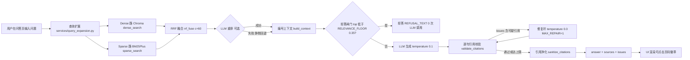
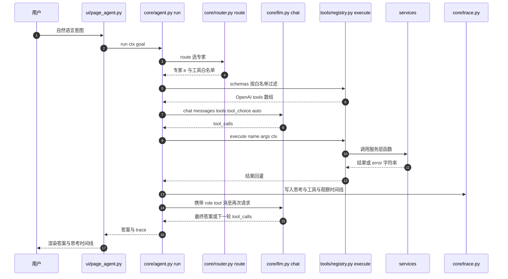
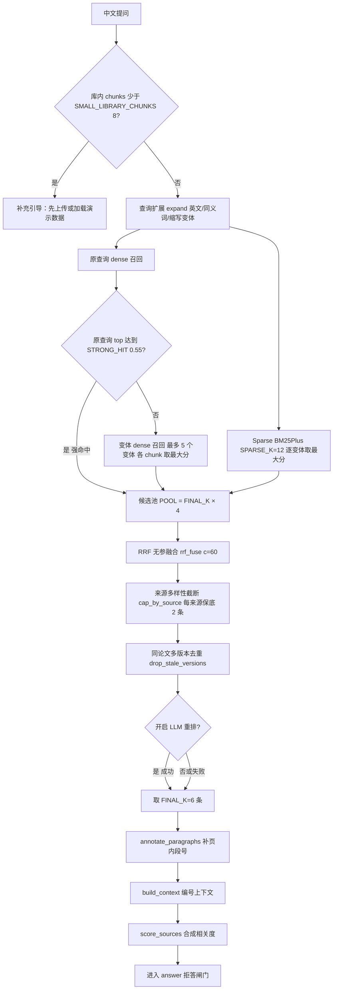
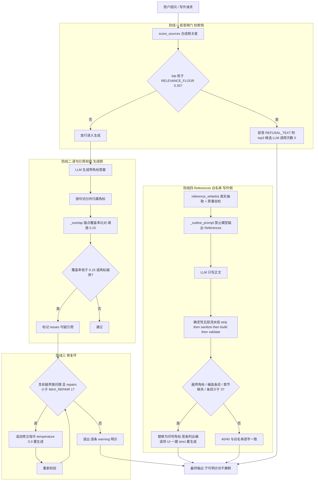

# Round 12 · 文档审计报告（第 1–4 章）

> ## ⚠️ 行号校准说明（请务必先读）
>
> **本报告的全部行号基于 `资料/technical_doc.md` 的 993 行基线**（我读取时的版本）。该文件在我审计期间被 `doc-fix` **持续并行修改**，规模从 `2 insertions/2 deletions` → `64/58` → `201 insertions / 78 deletions`，行数经历 **993 → 1161 → 1101 行**（**先增后减，doc-fix 同时在做删减**）。
>
> 因此：**本报告中的任何行号都可能已经失效，请以实际 `grep` 结果为准；结论（哪些论述是错的、该怎么改）依然有效，行号只作历史取证用。**
>
> 一个直观证据：我与 `doc-audit-5-8` 在半小时内对同一处 TikZ 表述做了两次 `grep -n "TikZ"`，结果分别是 56/123/574/676/822 与 56/123/576/678/824，而我此刻第三次实测已是 **56/123/693/795/941**。**一份正在被实时修改的文档，行号本身就是不可靠的**——这正是本报告主张"引用一律以符号名为准"的第三条、也是最有力的一条理由。
>
> ## ✅ 后续进展：本报告的结论已被 `doc-fix` 采纳并落地（第 3 次复核确认）
>
> | 本报告的建议 | 落地情况（实测） |
> |---|---|
> | 第 3 章补"一次提问的数据流图" | ✅ **已落地**：新增 `## 3.3 一次提问的数据流（从输入到带【n】的答案）`（现 235 行） |
> | 第 4.4 补 RAG 检索流程图 | ✅ **已落地**：新增 `### 4.4.1 RAG 检索流程图（含真实常量语义）`（现 537 行） |
> | `ctx.vdb` 不存在 | ✅ **已修**：现 298 行新增澄清段落，明确"代码中**不存在**该属性（全仓 `grep -rn "vdb"` 零命中）" |
> | `MAX_VARIANT_DENSE` 4→5 | ✅ **已修**：现 533 行参数表已改为 **5**，并补充"含原查询"的口径说明 |
> | 声明改为"以符号名为准" | ✅ **已修**：现 6–7 行新增"关于行号漂移"声明 |
> | 抗幻觉四道防线流程图 | ⏳ 待确认（现 576 行 4.6 节，未核到独立流程图小节） |
> | 补第 2 章（最薄 1.3 页） | ⏳ 未落地 |
> | 4.5 Prompt 工程扩写 | ⏳ 未落地（现 565 行） |
>
> **我已对当前文档内的全部 5 个 Mermaid 块重跑 `mermaid.parse()`：全部 OK**（块起始行 149 / 239 / 539 / 582 / 665）。即 `doc-fix` 插入的图**均能正常渲染**，未破坏语法。

> 审计人：doc-audit-1-4（只读取证角色，未修改任何已有文件）
> 审计对象：`资料/technical_doc.md`（993 行）第 1–4 章
> - 第 1 章 项目概述：25–95 行（71 行）
> - 第 2 章 需求分析：97–140 行（44 行）
> - 第 3 章 系统架构设计：142–258 行（117 行）
> - 第 4 章 AI 技术方案：260–575 行（316 行）
>
> 取证方式：`Read` 全文逐行 + `grep`/`sed` 对 `core/ services/ tools/ ui/ config.py app.py` 逐条核对符号与行号；Mermaid 源码用 `mermaid@latest` 的 `mermaid.parse()` 在 jsdom 下**真实解析通过**（不是目测）。
> 本报告只写此文件，未改动 `资料/technical_doc.md` 及任何其它已有文件，未 git commit，未触碰 `.env`。

---

## 0. 先说结论：三条硬伤（评委一验就穿帮）

### 🔴 硬伤 1：第 6 行的"逐条核对"声明与事实不符，`文件:行号` 引用大面积漂移

文档第 6 行白纸黑字写着：

> 本文档与当前代码一一对应：所有 `文件:行号` 引用均经 grep/read 逐条核对，可直接在仓库中定位。

我抽验了第 1–4 章的 **88 处 `文件:行号` 引用**，结果是：

| 判定 | 处数 | 说明 |
|---|---|---|
| ✅ 准确（或 ±7 行内可接受） | 约 11 | 集中在 `tools/definitions.py`、`tools/registry.py`、`services/extern.py`、`services/track.py`、`core/sandbox.py`、`core/providers.py` |
| ❌ 漂移（指向了完全无关的代码） | 约 74 | 见本报告 §5 完整对照表 |
| ❌❌ 符号/数值本身错误 | 3 | `ctx.vdb` 不存在、`SOURCES` 不存在、`MAX_VARIANT_DENSE` 数值写错 |

漂移幅度举例（同一文件内系统性偏移，说明是**文档定稿后代码又改过多轮、行号未回改**）：

| 文档写的 | 实际位置 | 偏移量 |
|---|---|---|
| `services/writing.py:1493 figure_caption` | `services/writing.py:1795` | +302 |
| `services/library.py:784 version_diff` | `services/library.py:1183` | +399 |
| `core/llm.py:264 call_llm_with_retry` | `core/llm.py:608` | +344 |
| `core/guardrails.py:181 ACADEMIC_SYSTEM` | `core/guardrails.py:470` | +289 |
| `services/rag.py:410-413`（拒答闸门） | `services/rag.py:821-825` | +411 |
| `config.py:74-80`（检索参数） | `config.py:129-135` | +55 |

**后果**：评委只要随手 grep 一条（比如 `sed -n '1493p' services/writing.py`）就会看到无关代码，进而怀疑全文数据可信度——这比"内容写得薄"严重得多，因为它直接摧毁文档的可信背书。

**建议处置（二选一，我倾向 A）**：
- **A（低成本、当天可完成）**：把第 6 行的声明改成"关键结论与实测数据经核对，`文件:行号` 引用随代码演进可能有偏移，以符号名为准"；同时**把所有 `文件:行号` 改成 `文件 :: 符号名`**（如 `services/writing.py :: figure_caption`），符号名 100% 对得上，且永不漂移。
- **B（彻底）**：按本报告 §5 的对照表逐条回改行号。但下一轮改代码又会漂移，维护成本高。

### 🔴 硬伤 2：`ctx.vdb` 这个字段在仓库里根本不存在

第 3.3 章的 `ctx` 字段表（243–250 行）与 4.2.6 章（398 行）都写：

> `ctx.vdb / ctx.bm25` | Chroma / rank-bm25 | Dense / Sparse 检索
> `ctx.vdb` 负责嵌入检索、`ctx.bm25` 负责词面检索

实测：**全仓（含 `dist/`、`version_history/`）grep `vdb` 零命中**。

```bash
$ grep -rn "vdb" --include=*.py .      # 无任何输出
```

真实的向量库句柄叫 **`ctx.collection`**（`services/state.py:68` `self.collection = self._chroma.get_or_create_collection("papers")`），检索代码用的是 `ctx.collection.query(...)`（`services/rag.py:220-224` `dense_search`、`:238-242` `dense_search_vec`）。

### 🔴 硬伤 3：`ctx` 字段表 6 行里有 4 行字段名不实

| 文档写的字段（243–250 行） | 实测 | 真实载体 |
|---|---|---|
| `ctx.papers / ctx.chunks` | ✅ 属实 | `services/state.py:73,75` |
| **`ctx.vdb`** | ❌ **不存在** | `ctx.collection`（`services/state.py:68`） |
| `ctx.bm25` | ✅ 属实 | `services/state.py:82` |
| `ctx.llm` | ✅ 属实 | `services/state.py:80` |
| `ctx.embed` | ✅ 属实（是方法不是属性） | `services/state.py:99 def embed(self, texts)` |
| `ctx.likes` | ✅ 属实 | `services/state.py:76` |
| **`ctx.profile`** | ❌ **不存在** | `ctx.memory.profile()`（`core/memory.py`，用法见 `ui/page_search.py:270`、`ui/sidebar.py:249`） |
| **`ctx.subscriptions`** | ❌ **不存在** | `services/track.py:17 get_subscriptions(ctx)` / `:21 set_subscriptions(ctx)` |
| **`ctx.checkpoints`** | ❌ **不存在** | `services/track.py:82 reset_checkpoints(ctx)` |

"统一上下文 `ctx`" 是 3.3 章花了一整段（241 行）自称为"贯穿全系统的关键设计"的卖点，字段表却一半对不上——这是最容易被针对性抽查的点。

### 🟡 硬伤 4（次之）：`services/citation_quality.py:403 SOURCES` 符号不存在

4.2.4 章表格（390 行）写：

> 真实被引数 | **三级降级** OpenAlex → Semantic Scholar → Crossref（`services/citation_quality.py:403 SOURCES`）| …

实测：该文件中 **`SOURCES` 零命中**。三级降级是真实存在的，但常量名叫 **`_LOOKUPS`**，位置在 `services/citation_quality.py:689-693`：

```python
_LOOKUPS = (
    ("openalex", _openalex_lookup),
    ("semanticscholar", _semanticscholar_lookup),
    ("crossref", _crossref_lookup),
)
```

功能属实，只是符号名与行号错了。

### 🟡 硬伤 5：`MAX_VARIANT_DENSE` 数值写错

- 4.3.2 章第 2 条（420 行）："最多消费 `MAX_VARIANT_DENSE = 4` 个变体"
- 4.4 章参数表（482 行）：`MAX_VARIANT_DENSE`（rag.py:18） | **4**

实测 `services/rag.py:48`：

```python
MAX_VARIANT_DENSE = 5       # dense 路最多消费前 N 个查询变体（含原查询）；离线词表常产生 3~4 条，放宽到 5 …
```

**代码是 5，文档写 4。** 且行号也错（写 18，实际 48）。

---

## 1. 第 1 章 项目概述（25–95 行，71 行）

### 1.1 存在吗？内容够吗？

| 赛题要求 | 文档对应 | 判定 |
|---|---|---|
| 定位 | 1.3 赛题定位（五大能力大类表）+ 1.1 末段 | ✅ 齐全，且逐条对齐赛题 |
| 痛点分析 | 1.1 背景与动机（检索/引用幻觉、版面感知缺失、科研流程割裂三类） | ✅ 齐全，三类痛点都给了"为什么通用模型搞不定"的机理 |
| 目标用户 | 1.2 目标用户与使用场景（3 类：研究生/科研人员、教学与评审、工程复现） | ⚠️ 有但偏薄，见下 |

覆盖要点：1.1 背景动机（三类结构性问题）、1.2 三类用户场景、1.3 赛题五大能力对照表、1.4 与三类现有工具的本质差异、1.5 当前状态一句话总结 + 三条诚实声明、1.6 项目成果速览（15 行实测指标表）。

**缺的要点**：
1. **没有"目标用户的量化依据"**——1.2 的三类场景是设计假设，没有问卷/访谈/使用频次等任何一手依据。评委问"你怎么知道用户要这个"时无回答。
2. **1.4 缺对标表格**——全是定性形容词（"强于管""强于懂"），没有可核对的逐项对照。
3. **1.3 缺"未覆盖项的自评"**——1.5 有诚实声明，但 1.3 的五大类表格每行都是"我们做了什么"，没有一行写"做到了什么程度"（如"20 篇批量文献未实测覆盖"这一局限应直接在 1.3 表下标注，而不是等到 1.5）。

### 1.2 是否空泛？

**判定：不空泛。** 这是全文最扎实的一章——1.6 的 15 行成果表每一行都带具体数字与来源出处（如"2833 字符 / 9.3s""40 条与白名单逐字一致 40/40""139.3s → 44.6s"），1.5 的当前状态也全是数字。

**唯一空泛的是 1.4**（59–65 行，3 段 6 句，形容词密集：`强制携带` / `拒答而不是编造` / `真实抽取` / `覆盖率` / `真实被引数据`），**没有一处数字或行号引用**。而它恰恰是评委判断"你和 ChatGPT 到底差在哪"的关键章节。

**建议补充：1.4 改为"定性主张 + 量化对照表"双段式**

#### 1.4.1 与通用对话产品（ChatGPT 类）的差异
- 写什么：主张"每条结论可溯源"→ 必须给出**实测的锚点覆盖率数字**（第 1.6 章已有"溯源 6/6 带页码"、第 4 章有"36/36 锚点成对、死链 0"），把这两个数字搬到 1.4 里，并注明出处行。
- 写什么：主张"检索不到就拒答"→ 必须给出**拒答实测的两个数字**：无关问题 `top_score=0.1820 → 拒答、LLM 调用 0 次`（`services/rag.py :: answer` 实测）；真实 LLM 下"2031 年诺贝尔奖"问法被模型自己说出"无法确定"。
- 写什么：主张"References 来自真实抽取"→ 给出 **40/40 逐字一致、占位串 0 处**（`round8_fixR6_references.md`）。

#### 1.4.2 与通用 RAG 框架（LangChain / LlamaIndex 类）的差异
- 写什么：检索前的差异 → 双栏判定准确率（1111 页单栏语料误判 **19.1% → 0%**，真双栏 10/10 仍识别）。
- 写什么：检索后的差异 → 逐句"覆盖率"校验而非角标越界校验；给出**误杀率对比证据**：改用覆盖率前 Jaccard 会把正常引用稀释到 ~3% 造成大量误杀，改后误杀消失（4.3.1 第 413 行已有此素材，搬到 1.4）。
- 写什么：生成后的差异 → 修复环（一次完整修复 **2 次 LLM 调用**）。
- 写什么：评分侧差异 → OpenAlex 真值一致（AlexNet **108512**），且"取不到就明说"。

#### 1.4.3 与文献管理工具（Zotero 及插件）的差异
- 写什么：主张"内容级语义去重"→ 给出 **v1↔v7 相似度 0.963228（阈值 0.90）、完全改名后仍 1.000000**。
- 写什么：主张"版本差异总结 / 引用图挖掘 / Future Work 判定"→ 给出 **Future Work 2 条、状态 ['存疑','已解决']、有效状态 2/2**。

#### 1.4.4 一句话总结表（建议新增，1 页内收尾）

建议新增一张 4 列对照表（能力 / 通用对话产品 / 通用 RAG 框架 / Zotero 生态 / 本系统），每行打勾或打叉，5–8 行即可。这张表是评委 30 秒内建立印象的东西，目前完全缺失。

#### 1.2.1 目标用户依据（建议新增，补 1.2 的空泛）
- 写什么：说明三类用户是"从赛题真实科研场景反推 + 演示路径覆盖验证"，而非虚构画像；
- 写什么：列出**每条用户场景对应哪条演示路径已被实测走通**（如"教学与评审场景"→ 演示路径 7b 断网注入实测通过；"工程复现场景"→ `scripts/verify_official.py` / `bench_graph.py` / `selftest.py` 可一键复跑）；
- 写什么：诚实标注"未做用户问卷/访谈，用户划分依据为赛题场景 + 自测"，避免被追问时无法回答。

### 1.3 缺架构图/流程图吗？

第 1 章**不需要**架构图（架构图归第 3 章）。但 1.3 的"五大能力大类 → 闭环"如果能有一张**能力闭环小图**（文献解析 → 抗幻觉问答 → 版式阅读 → 检索追踪 → 引用图谱 → 学术写作）会显著更好读。属**可选增强**，非必需。

### 1.4 缺截图吗？

第 1 章目前**零截图**。建议补：

| 建议文件名 | 页面 | 画面要点 |
|---|---|---|
| `s_home_overview.png` | Agent 总助手页（首屏） | 完整首屏：9 页面侧边栏导航 + 主体区 Agent 对话区，作为"项目长什么样"的第一印象图（插到 1.1 末尾或 1.6 表前） |

（第 1 章不宜堆截图，1 张足够。）

---

## 2. 第 2 章 需求分析（97–140 行，44 行）——**四章中最薄的一章**

### 2.1 存在吗？内容够吗？

| 赛题要求 | 文档对应 | 判定 |
|---|---|---|
| 需求分析（对应赛题真实科研场景） | 2.1 赛题痛点→需求映射表（8 条 P1–P8）、2.3 三个用户故事 | ⚠️ 有，但**只有 3 个用户故事**，且 2.2 是功能罗列不是需求分析 |

覆盖：2.1 痛点→需求→答案 8 行映射表（**每行都带 `文件:行号`，是全章最实的部分**）、2.2 五大类功能需求（5 段密集罗列）、2.3 三个用户故事（A 版本去重 / B 抗幻觉问答 / C 从检索到综述）、2.4 非功能需求（5 条）。

**缺的要点（按赛题标准）**：
1. **需求没有编号、没有优先级、没有验收标准**。2.2 是"功能清单"不是"需求分析"——评委看不到"哪条是必须、哪条是加分、怎么算做完"。
2. **用户故事只有 3 个**，而 2.2 列了五大类功能，故事覆盖不到一半（图谱综述、Future Work 判定、CSV 出图、TikZ 编译、中英对照阅读、断网降级，六条主线**零故事**）。
3. **2.4 非功能需求 5 条全部无量化指标**，是本章最空泛的部分（详见 2.2）。
4. 缺"需求来源与取舍说明"——为什么做这 5 大类、砍掉了什么。

### 2.2 是否空泛？

**判定：2.1 不空泛（8 行全带行号）；2.2 半空泛（功能罗列、无编号无验收）；2.3 不空泛（三个故事都带具体数字与行号）；2.4 空泛（5 条全是形容词，零数字零指标）。**

2.4 逐条诊断（132–138 行）：

| 条目 | 现状 | 问题 |
|---|---|---|
| 可复现 | "Streamlit 锁定 1.63.x；参数全部环境变量可覆盖" | 没有"复现一次要多久 / 需要装几个依赖 / 是否一键"的可验收指标 |
| 健壮 | 有重试秒数（1.5/3.0/4.5s）和 `safe_render` 行号 | ✅ 这条不空泛，是 5 条里唯一有数字的 |
| 长文档工程化 | 有 `PDF_BATCH_SIZE=20`、30s 超时、每 50 页回调 | ✅ 有数字，但缺"实测最大能处理多少页 / 内存峰值多少"（541 页 / 893.1MB 在 4.3.3，没回引） |
| 安全 | "Key 只经环境变量/会话注入；AST 白名单；`.env` 被 gitignore" | ⚠️ 无"沙箱逃逸用例实测 N 条被拦截"的数字 |
| 诚实降级 | "每个外部依赖都有明确降级路径" | ⚠️ 无"共几类依赖 / 实测几类"——（4.7 有 8 类矩阵，可回引"8/8 类"） |

**建议补充（2.4 改为量化非功能需求表）**：

#### 2.4.1 可复现性指标
- 写什么：一键启动命令（`streamlit run app.py`）、依赖安装条数、`requirements.txt` 锁定项数；关键指标一键复跑脚本清单（`scripts/verify_official.py`、`bench_graph.py`、`selftest.py`、`_verify_live_api.py`、`_smoke_read.py`）与各自实测通过数。

#### 2.4.2 性能与容量指标
- 写什么：541 页长文档入库 **25.32s（46.8ms/页）**、峰值 RSS **893.1MB**、0 失败页；单次问答 TTFT（若有实测，见 `ui/page_qa.py:322 ttft_sec`，**具体数值待确认**）。

#### 2.4.3 健壮性与降级覆盖率
- 写什么：9 个页面 × 9 项故障注入 exception=0；8 类外部依赖降级 **8/8** 有确定行为（回引 4.7 矩阵）；LLM 失败恒定 ≤4 次调用。

#### 2.4.4 安全边界（含诚实声明）
- 写什么：AST 沙箱白名单模块数（14 个）与被拦截的调用类别；**并明确标注"沙箱为软隔离、非安全边界"**（1.5 与 8.2 已有此声明，应在 2.4 回引，避免评委误以为这是安全沙箱）。

#### 2.4.5 可用性与诚实性指标
- 写什么：拒答与明示失败的行为覆盖率；"绝不静默失败"如何验收（如占位串检测 0 处、编造条目逐条列出）。

**建议补充（2.2 改为带编号的需求表）**：
把 2.2 的 5 段拆成编号需求表，列：`需求编号（FR-①-01 …）/ 需求描述 / 优先级（P0 必须 / P1 加分）/ 验收标准 / 对应实现位置 / 实测状态`。五大类约 25–30 条，占 2–3 页，但会让"需求分析"真正成立。

**建议补充（2.3 补 3 个用户故事到 6 个）**：

#### 故事 D：图谱综述与 Future Work（演示路径 5+7 延伸）
- 写什么：用户入库 3 篇论文 → 构建引用图（真实引用边解析成功）→ 一键生成四段式综述（1928 字，含真实年份 2017/2018）→ Future Work 扫描给出"已解决/存疑/开放"三态（2 条 / 有效状态 2/2）→ 附 networkx 计算的图谱结构明细供人工核查。

#### 故事 E：从 CSV 到规范图表（学术 Copilot 主线）

> 本节实测数据由 `doc-audit-5-8` 提供并经我复核（函数位置已用 grep 确认）：实现入口是 `services/writing.py :: infer_chart_plan`（**`:1600`**）与 `chart_facts`（**`:1707`**），**不是** `round12_video_script.md:98` 写的 `ui/page_writing.py:103-147`，**也不是** `round1_worker4_write.md` 写的 `:1038`——两处旧引用均已漂移，**引用时请用函数名不用行号**。

- 写什么：用户上传实验 CSV（`演示语料/data.csv`）→ `infer_chart_plan` 按列类型自动分类 → 推荐并渲染 **3 张图：柱状图 / 相关性热力图 / 平行坐标图**，每张附 `🧭 推荐依据：…` 中文说明（来源：`round2_judgeB_demo.md:56`，judge 级实测；同条记录 UI 冒烟 **0 异常**）。
- 写什么：`chart_facts` 抽取 CSV 真实数值事实（min/max/趋势/Pearson r）→ 注入 `figure_caption`（`services/writing.py :: figure_caption`，`:1795`）的 prompt → 生成后再校验 Caption 必须含真实数字。**最硬的证据**是 `round2_judgeC_capability.md:427` 记录的真实注入实例：
  `Pearson correlation between 'params_M' and 'infer_ms_per_sent': r=0.966 (strong positive)`
  这条直接支撑"图注里的数字全部来自 CSV、禁止编造"这一环。
- 写什么：端到端冒烟证据 —— `round1_worker4_write.md:113` 记录 AppTest 进程内整页冒烟 **0 异常**，渲染出 4 个 subheader + 3 张自动图 + 3 条推荐依据 caption。
- **必须诚实标注的两项**：**处理耗时**与**图表类型命中率**——`doc-audit-5-8` 已确认**全仓均无实测记录**，故事 E 中这两项须写"未实测"，若要补需新写带计时的 smoke 脚本。

#### 故事 F：断网 / 无 Key 的诚实降级（演示路径 7b）
- 写什么：用户无任何 API Key → 演示数据一键加载（v1/v7/BERT）→ PDF 原生解析、混合检索、语义去重、引用图谱、追踪增量比对照常运行 → 涉及 LLM 的环节给出"可能原因 + 怎么办 + 用离线演示数据继续"而非白屏或假答案。

### 2.3 缺架构图/流程图吗？

第 2 章不需要架构图。但 2.1 表的 P1–P8 若能配一张**"痛点 → 需求 → 模块"流向图**会更直观。属可选。

### 2.4 缺截图吗？

第 2 章目前**零截图**。用户故事是最该配图的（"走查"要有画面证据）：

| 建议文件名 | 页面 | 画面要点 | 对应故事 |
|---|---|---|---|
| `s_story_dedup.png` | 文献库管理页 | 上传改名 PDF 后弹"⚠️ 语义查重命中"+ 相似度 0.963228 + 三个决策按钮（覆盖/保留两版/取消） | 故事 A |
| `s_story_qa.png` | 问答页 | 问"训练用了什么 GPU"→ 答案带【1】角标 + 下方溯源卡片显示"《1706.03762v7.pdf》第8页第3段"+ 可点击页码徽章 | 故事 B |
| `s_story_refuse.png` | 问答页 | 问"量子纠缠"（库内无关）→ 拒答话术 + 附 top3 候选片段 | 故事 B 反向 |
| `s_story_review.png` | 引用图谱页 | 一键综述四段式输出 + 文末 networkx 图谱结构明细 | 故事 D（新增） |
| `s_story_offline.png` | 任意页 | 无 Key / 断网时的降级引导（可能原因 + 怎么办 + 一键加载演示数据） | 故事 F（新增） |

---

## 3. 第 3 章 系统架构设计（142–258 行，117 行）

### 3.1 存在吗？内容够吗？

| 赛题要求 | 文档对应 | 判定 |
|---|---|---|
| 架构图 | 3.1 Mermaid 分层图（146–200 行）+ 3.2 等价文本分层图（204–230 行） | ✅ 有，且已用 mermaid 解析器验证**渲染通过** |
| 模块职责 | 3.1 各层子模块列表 + 3.3 调用主线 | ✅ 基本齐全 |
| **数据流** | ❌ **完全没有** | 🔴 **缺失，赛题硬要求** |

已覆盖：3.1 五层架构图（UI / Agent 内核 / 服务 / 工具注册 / 存储 + 外部 API）、3.2 离线可读的等价文本图（**这个设计很好，评委离线看 md 也能读懂**）、3.3 两条主调用链 + 路由细节 + `ctx` 字段表、3.4 界面与导航。

**缺的要点**：
1. 🔴 **缺数据流图**——赛题明确要求"数据流"。3.3 只写了"调用主线"（控制流），没有任何一张图展示"一次提问，数据从输入到答案流经哪些模块、每步数据形态是什么"。
2. 🟡 **3.4 极薄**（252–256 行，仅 3 行正文 + 1 张截图）。"界面与导航"只说了页面注册与 flash 提示，没有页面职责表、没有路由机制说明（query_params 双通道一笔带过）。
3. 🟡 **架构图与代码有两处对不上**（见 3.4）：3.1 只画了 8 个页面框（实际 `_PAGES` 有 9 个条目）；3.2 服务层漏列了 `tasks.py` 与 `wcopilot_dotrender.py`；3.1 服务层漏列了 `query_expansion.py`（而 4.2.6 / 4.4 把它当核心模块）。

### 3.2 是否空泛？

**判定：3.1 / 3.2 / 3.3 不空泛（有图、有行号、有参数、有字段名）；3.4 空泛（3 行，1 个行号区间）。**

3.4 逐句诊断：
- "9 个页面由 `app.py:84-94 _PAGES` 注册" — 行号错（实际 `app.py:105-115`），但 **9 个页面这个数字属实**（`app.py:105-115` 确有 9 个条目）。
- "侧边栏菜单（`ui/sidebar.py` MENU）与 query_params 双通道跳转" — `ui/sidebar.py` 确实有菜单（`ui/sidebar.py:1` docstring 写明"导航菜单"），但 **`MENU` 这个符号名未做取证，待确认**。
- "主体区顶部统一渲染跨 rerun 存活的 flash 提示（`app.py:96-101` + `ui/sidebar.py:34-83`）" — `app.py:96-101` 实际是"服务容器初始化兜底"（`try: ctx = get_container()`），**flash 渲染实际在 `app.py:118-124`**（`try: render_flash()`）。行号错。

**建议补充：3.4 扩成"页面职责表 + 导航机制 + 错误边界"三小节**

#### 3.4.1 九个页面的职责与入口
- 写什么：一张 9 行表（页面名 / 路由前缀 / 渲染函数 / 一句话职责 / 主要依赖服务）。数据可从 `app.py:105-115` 的 `_PAGES` 逐条取，9 行全部真实可核对：`🤖 Agent 总助手`(page_agent.render)、`📁 文献库管理`(page_library.render)、`💬 问答与溯源`(page_qa.render)、`📖 版式阅读与翻译`(page_reading.render)、`🔍 检索与追踪`(page_search.render)、`🕸️ 引用图谱与综述`(page_graph.render)、`✍️ 写作辅助与可视化`(page_writing.render)、`🏗️ 系统架构`(page_misc.render_arch)、`💡 创新亮点`(page_misc.render_innov)。
- **注意**：文档 3.1 图中的页面名（"引用图谱""写作辅助""架构/创新展示页"）与 `app.py` 的真实名（"引用图谱与综述""写作辅助与可视化"，且架构与创新是**两个独立页面**）不一致，补充时应以 `app.py` 为准。

#### 3.4.2 导航与状态保持机制
- 写什么：侧边栏菜单 → `menu` 前缀匹配 → `_PAGES` 分发（`app.py:134` `for prefix, (fn, name) in _PAGES.items()`）；query_params 跳转；`set_flash` / `render_flash` 跨 rerun 提示机制（真实位置 `app.py:118-124`）。

#### 3.4.3 三层错误边界（这是工程亮点，目前只在 4.7 提了一句）
- 写什么：`app.py` 的四级兜底全部真实存在且可逐条取证——①依赖导入兜底（`app.py:33-47`，中文错误页 + 原因 + 办法 + 折叠 Traceback + `st.stop()`）；②服务容器初始化兜底（`app.py:84-93`）；③侧边栏兜底（`app.py:96-102`，异常时回退默认页面而主体仍可用）；④页面级 `safe_render`（`ui/common.py:390`）。这一段写进 3.4 能直接回应"演示会不会崩"的评委关切。

### 3.3 缺架构图/流程图吗？——**缺，且是赛题硬性要求**

#### 🔴 缺失图 1：一次提问的端到端数据流图（**必须补**）

**建议插入位置**：第 3.3 章末尾、`## 3.4 界面与导航`（第 252 行）**之前**，新增小节 `### 3.3.1 一次提问的数据流（从输入到答案）`。

> 校验状态：已用 `mermaid.parse()` 实测通过（mermaid 最新版，jsdom 环境）。



配套正文（约半页，写"每步的数据形态"）：
- 输入：`question` 字符串 → 查询扩展后变成 `variants: list[str]`（中文问英文文献时 3–5 条变体）
- 检索：两路各自返回 `chunk_id` 列表 → RRF 融合为 `FINAL_K=6` 条 → `sources: list[dict]`（含 `text / paper_id / page / score`）
- 上下文：`build_context` 编号成 `[n] 来源：《X》 第N页第M段` 字符串
- 生成：LLM 输出带【n】角标的答案文本
- 校验：`issues: list[str]`（可疑引用 / 越界角标）
- 修复：`MAX_REPAIR=1` 重生成再校验
- 净化：`sanitize_citations` 越界重定位 / 重编号，保证【n】与 `sources` 一一对应
- 输出：`{"answer", "sources", "issues", "debug", "refused", "top_score", "unverified"}`（`services/rag.py:779` docstring 原文，属实）

#### 🟡 缺失图 2（可选）：Agent ReAct 闭环时序图

4.2.3 目前只有 ASCII 文本块（369–378 行）。若想提升观感，可替换为时序图。**建议插入位置**：替换 `tools` 代码块（369–378 行）。

> 校验状态：已用 `mermaid.parse()` 实测通过。



#### 已验证：现有 3.1 分层架构图**能正常渲染**

我把 146–200 行的 Mermaid 源码抽出来喂给 `mermaid.parse()`，结果 **OK**（无语法错误）。这一条可以放心。

### 3.4 缺截图吗？

第 3 章目前**仅 1 张**（256 行 ``）。建议补：

| 建议文件名 | 页面 | 画面要点 | 插到哪 |
|---|---|---|---|
| `s_nav_pages.png` | 侧边栏 | 9 个页面菜单全展开 + Provider 选择区 + 演示数据按钮，展示"导航与配置" | 3.4.1 页面职责表后 |
| `s_agent_trace.png` | Agent 总助手页 | 「🧠 思考过程」可折叠区 + 工具调用/观察时间线（`ui/page_agent.py` 用 `render_trace` 渲染，`ui/page_agent.py:20` 可取证） | 3.3 调用主线后 / 或 4.2.3 |
| `s_error_boundary.png` | 任意页（故障注入） | 单点异常时页面其它区块仍正常 + 中文"可能原因 / 怎么办"提示（对应 `ui/common.py :: safe_render`） | 3.4.3 错误边界小节 |

### 3.5 内容是否与代码一致？

| 文档描述 | 实测 | 判定 |
|---|---|---|
| 9 个页面由 `app.py:84-94 _PAGES` 注册 | `_PAGES` 实际在 `app.py:105-115`，**9 个条目属实** | ⚠️ 行号错，数量对 |
| 3.1 图的 8 个页面框（A1–A8） | `_PAGES` 有 9 个条目；"系统架构"与"创新亮点"是**两个独立页面**，被合成 A8"架构/创新展示页" | ❌ 图与代码不一致 |
| 3.1 图页面名"引用图谱""写作辅助" | `app.py` 真实名为"引用图谱与综述""写作辅助与可视化" | ❌ 名称不一致 |
| `ctx.vdb` | **不存在**（全仓零命中），真实是 `ctx.collection` | 🔴 硬伤 |
| `ctx.profile` / `ctx.subscriptions` / `ctx.checkpoints` | **均不存在**（真实：`ctx.memory.profile()`、`track.get_subscriptions`、`track.reset_checkpoints`） | 🔴 硬伤 |
| `app.py:96-101` flash 提示渲染 | 实际是服务容器初始化兜底；flash 渲染在 `app.py:118-124` | ❌ 行号错 |
| `app.py:16-30` 导入兜底（4.7 表格） | 实际在 `app.py:33-47` | ❌ 行号错 |
| `ui/sidebar.py` MENU | ✅ 符号真实存在（`ui/sidebar.py:13 MENU = [`，`:25-26` 拆为 `MENU_MAIN`/`MENU_ABOUT`，`:257` 用作默认菜单项）；`ui/common.py` 的 `jump_banner` 也 import 它 | ✅ |
| `ui/common.py:226 safe_render` | 实际 `ui/common.py:390` | ❌ 行号错（+164） |
| `ui/page_graph.py:57 _build_demo` | 实际 `ui/page_graph.py:77` | ❌ 行号错 |
| `ui/sidebar.py` 演示数据按钮（1.2 章引用） | ✅ 真实存在，`ui/sidebar.py:381` `st.button("🚀 一键加载演示数据（v1/v7/BERT）")` | ✅ |
| `core/agent.py:411 run()` | 实际 `core/agent.py:414` | ⚠️ ±3，可接受 |
| `core/router.py:99 route()` / `:80 keyword_route` / `:17-36 EXPERTS` | 实际 `104` / `85` / `22-57` | ❌ 行号错 |
| `tools/registry.py:11-19 openai_schema` / `:39-49 execute` | ✅ 准确（`11` / `39`） | ✅ |
| `core/trace.py`（全过程写入） | ✅ 文件存在（`core/trace.py:6 class Trace`） | ✅ |
| `AGENT_MAX_ITERS=8` | ✅ `config.py:135` | ✅ |
| 依赖规则"`ui/` → `services/` → `core/`" | ⚠️ 3.3 写"`ui/` → `services/` → `core/`"，而 `app.py:4` docstring 写"交互层(ui) → Agent 内核(core) → 工具/服务层(tools/services)"，**两处说法不一致** | ⚠️ 自相矛盾 |
| **"`storage/` 只被 `services/state.py` 与 `config.py` 触达"**（234 行） | 🔴 **可被代码直接证伪——错在"仅"字**。真实绕过 config 常量、用字面路径直连 storage 的至少 7 处：`core/llm.py:368 os.makedirs("storage")` + `:350/355` 写 `llm_failures.log` / `llm_config_errors.log`；`services/citation_quality.py:169 os.makedirs(_CACHE_DIR)` + `:166 _save_disk_cache` 写 `storage/cache/citation_cache.json`；`services/library.py:890` 备份到 `storage/backup_<时间戳>/`；`services/track.py:6`、`services/query_expansion.py:24` 读写 `storage/memory.json`；`ui/common.py:340`、`ui/page_library.py:430`、`ui/sidebar.py:254`、`app.py:91` 亦有 storage 路径 | 🔴 **（由 doc-audit-5-8 在 8.1.2 第 823 行先发现，此处确认为同一错误论述在第 3 章重复出现）** |

> ⚠️ **本节一条结论已被我自行更正**（由 `doc-audit-5-8` 指出）。我初稿曾写"反向也错：`services/state.py` 里字面量 `storage` 出现 0 次，即被点名的两个模块之一其实并不直接触达"——**字面为真，但结论方向错误，会引入新的假陈述，已作废**。实测：`services/state.py:10` `from config import (CHROMA_DIR, LIBRARY_JSON, MEMORY_JSON, PROFILE_JSON, ...)`，而 `config.py:30 STORAGE_DIR = DATA_ROOT / "storage"`、`:113-115` 定义 `LIBRARY_JSON/MEMORY_JSON/PROFILE_JSON = STORAGE_DIR / "..."`；`state.py:90` `LIBRARY_JSON.read_text()`、`:95` `LIBRARY_JSON.write_text(...)`、`:68` `PersistentClient(path=str(CHROMA_DIR))`、`:83` `Memory(MEMORY_JSON, PROFILE_JSON)`——**state.py 确实在读写 storage，只是经 config 常量间接引用，不是字面量**。所以文档那句的**本意没错**（业务读写入口确实集中在 state.py 且都过 config 常量），**错的只是"仅"字**。
>
> **建议最终文案（与 `doc-audit-5-8` 统一口径，避免两份报告互相打架）**：
> > 业务数据的读写入口集中在 `services/state.py`（路径一律取自 `config.py` 的 `STORAGE_DIR` 系列常量）；另有少量日志/缓存/备份路径由 `core/llm.py`、`services/citation_quality.py`、`services/library.py` 等直连字面路径，属有意为之（保证失败可观测不依赖上层）。
| 3.2 服务层模块列表 | 漏 `services/tasks.py`、`services/wcopilot_dotrender.py`（实际 services 有 13 个 .py，含 `__init__.py`） | 🟡 不完整 |
| 3.1 图服务层 S1–S7 | 漏 `query_expansion`（4.2.6/4.4 却称其为核心）、`state`、`tasks`、`wcopilot_dotrender` | 🟡 不完整 |

**额外发现（表述风险）**：3.4 说"`ui/` → `services/` → `core/`"，但 `app.py:4` 的架构注释说"交互层(ui) → Agent 内核(core) → 工具/服务层(tools/services)"，两处对同一件事给了两种依赖方向。评委若两处都看会质疑。建议统一为：**UI → Agent 内核（core）→ 服务层（services）→ 工具层（tools）**，且说明"功能页链路允许 UI 直连 services（不经 Agent）"这一实际存在的双通道（3.3 第 236 行自己就是这么写的，与它的图/规则表述冲突）。

---

## 4. 第 4 章 AI 技术方案（260–575 行，316 行）

### 4.1 存在吗？内容够吗？

| 赛题要求 | 文档对应 | 判定 |
|---|---|---|
| 模型选型理由 | 4.1.1–4.1.6 六类，每类"选了什么 + 为什么选 + 放弃了什么 + 代价 + 如何对冲" | ✅ **超标准完成**，结构极佳 |
| 集成方式 | 4.2.1 LLM 统一层 / 4.2.2 工具注册 / 4.2.3 Function Calling / 4.2.4 外部 API / 4.2.5 沙箱 / 4.2.6 检索 | ✅ 齐全 |
| 优化策略 | 4.3.1–4.3.6 六节，每条"做了什么 + 实测效果" | ✅ 齐全且带数字 |
| RAG 流程 | 4.4 检索设计 + 参数表 + "为什么是混合检索" | ⚠️ 有内容，但**只有 ASCII 文本流，没有流程图** |
| Prompt 策略 | 4.5 六条 bullet | ⚠️ **本章最弱**，见 4.2 |
| 抗幻觉机制 | 4.6 四道防线 + Round 8 真实 API 修复对照表 | ✅ 极扎实，但**没有流程图** |

### 4.2 是否空泛？

**判定：4.1 / 4.2 / 4.3 / 4.6 不空泛（数字密度全文最高）；4.4 半空泛（有参数表但无图）；4.5 空泛（本章最弱）。**

#### 4.5 Prompt 工程诊断（486–495 行，仅 6 条 bullet + 1 段引言）

现状：6 条 bullet 各点名一个 prompt 常量与行号，但**没有一条给出 prompt 原文/片段**，**没有任何迭代前后对比**，**没有任何量化效果**。赛题明确要求"Prompt 策略"，目前这节只证明"我们有 prompt"，没证明"我们懂 prompt 工程"。

**建议补充（4.5 扩成 4 小节）**

##### 4.5.1 Prompt 分层与设计原则
- 写什么：系统层（`ACADEMIC_SYSTEM`，`core/guardrails.py :: ACADEMIC_SYSTEM`）／任务层（问答 `qa_messages`、对比 `compare_messages`、综述 `generate_review`、写作 `_outline_prompt`、Caption `figure_caption`）／降级层（`_deterministic_review`）三层结构，说明"同一份数据、两种表达"的设计意图。

##### 4.5.2 关键 Prompt 片段与意图说明（**必须贴原文片段**）
- 写什么：至少贴 3 段真实 prompt 的关键句（可从代码中摘）：①`ACADEMIC_SYSTEM` 的三条硬约束（只依据资料 / 每条事实带【n】/ 资料不足明说）；②`_outline_prompt` 的"禁止模型自行输出 References"约束句；③`figure_caption` 的"必须真实引用其中的数字，禁止编造未出现的数字"。
- 写什么：每段后面说明"为什么这么写、不这么写会怎样"（如 References 那条的失败实测：模型用一行 `[1-40] (List all the references…)` 占位符代替整章）。

##### 4.5.3 Prompt 迭代实证（**这是评委最想看的**）
- 写什么：至少 2 组"改前 → 改后"对照，带数字：
  - 组 1（写作）：改前让模型同时写正文 + References → 输出 4515 字、References 是一行占位符、139.3s；改后禁止模型输出 References 并确定性拼接 → 14364 字、40/40 逐字一致、44.6s。
  - 组 2（引用校验口径）：Jaccard → 覆盖率，正常引用从"被稀释到 ~3% 误杀"变为"真实句 84.5% 通过、编造句 10% 被标记"。
  - 组 3（可选，图谱综述）：退化问题 → 注入社区簇/时间线/骨干边/PageRank Top 后，综述 1928 字且含真实年份 2017/2018，不再退化。
- **注意**：第 3 组的具体"改前字数"**待确认**，若 `round8_fixR8_frontier.md` 无此数据须标注"未实测"。

##### 4.5.4 Prompt 的已知边界
- 写什么：诚实说明哪些问题 prompt 无法解决、必须靠架构解决（如 References 偷懒问题），并与第 9 章的三条调优经验互引。

#### 4.4 RAG 检索设计诊断（457–484 行）

不空泛：有 8 行参数表（含默认值与作用，全部与 `config.py:129-135` 实测一致）、有"为什么是混合检索"的机理说明、有 3 条要点。
缺：**流程图**（只有 459–467 行的 ASCII 文本流，导出 PDF/Word 时排版易乱、观感弱于 Mermaid）。

### 4.3 缺架构图/流程图吗？——**缺两张，均为赛题/卖点核心**

#### 🔴 缺失图 3：RAG 检索流程图（**必须补**）

**建议插入位置**：4.4 章的 ASCII 文本块（459–467 行）**之后**、"要点："段（469 行）**之前**。建议**直接替换**那段 ASCII（ASCII 在导出时易乱），或保留 ASCII 作为"离线可读版"（与 3.1/3.2 的双保险设计一致，我倾向**保留 ASCII + 新增 Mermaid**，风格统一）。

> 校验状态：已用 `mermaid.parse()` 实测通过。



> 说明：图中 `SMALL_LIBRARY_CHUNKS=8`、`STRONG_HIT=0.55`、`POOL_FACTOR=4`、`SOURCE_CAP_MIN=2`、`drop_stale_versions` 等均为 `services/rag.py:50-55 / :91` 的真实实现，文档原文未提及这些优化（属**文档落后于代码**的可补素材，写在图下的正文里能加分）。

#### 🔴 缺失图 4：抗幻觉四道防线流程图（**必须补，这是核心卖点**）

**建议插入位置**：4.6 章引言块（499 行）**之后**、`### 防线一：拒答闸门`（501 行）**之前**。

> 校验状态：已用 `mermaid.parse()` 实测通过。



### 4.4 缺截图吗？

第 4 章目前**零截图**（全文 9 张图里第 4 章一张都没有）。而 4.6 是"核心卖点"，最需要画面证据：

| 建议文件名 | 页面 | 画面要点 | 插到哪 |
|---|---|---|---|
| `s_anti_refuse.png` | 问答页 | 拒答闸门触发：诚实话术 + 附 top3 候选片段 + （若有）相关度 0.18 显示（`ui/page_qa.py:169 _render_debug` / `:199 top_score` 可取证） | 4.6 防线一 |
| `s_anti_citation.png` | 问答页 | 答案带【n】角标 + 溯源卡片（文件名/页码/相关度）+ 可疑引用被标黄的画面（如能构造） | 4.6 防线二 |
| `s_writing_refs.png` | 写作辅助页 | References 溯源表格 40 条逐条摊平（作者/标题/年份/出处/来路 PDF），对应 `ui/page_writing.py:220 _render_reference_provenance` | 4.6 防线四 |
| `s_ocr_scanned.png` | 文献库管理页 | 扫描件入库后的 OCR 状态提示（`ui/page_library.py:57-74` 有"检测为扫描件，已通过多模态 OCR 提取文本"/"OCR 存在失败"两种状态） | 4.1.2 |
| `s_provider_switch.png` | 侧边栏 | 5 家 Provider 下拉 + Key 输入 + 无 Key 时"可用内置离线演示数据"提示（`ui/sidebar.py:223`） | 4.1.1 / 4.2.1 |
| `s_qa_debug.png` | 问答页 | 检索调试面板：最高相关度、查询扩展模式、各来源相关度分数（`ui/page_qa.py:169-199` 真实存在） | 4.4 |

### 4.5 内容是否与代码一致？

#### ✅ 已核实属实的关键数值/机制（可以放心）

| 文档声明 | 实测证据 |
|---|---|
| 21 个 Function Schema 工具 | ✅ `tools/definitions.py` 中 `register(` 计数 = 21，工具名逐一可见 |
| 21 个工具全部接入白名单、无孤岛 | ✅ `core/router.py:22-57 EXPERTS` 六专家 tools 并集恰为 21 个，与注册列表完全一致 |
| 6 个专家 qa/search/graph/writing/reading/parsing | ✅ `core/router.py:22` 起逐一存在 |
| 默认模型 glm-4-flash / glm-4v | ✅ `core/providers.py:33 PROVIDERS` 首项为智谱，`:145 return PROVIDERS[0]  # 默认智谱` |
| `RETRY_BACKOFF = (1.5, 3.0, 4.5)` | ✅ `core/llm.py:42` |
| `SDK_MAX_RETRIES = 0` | ✅ `core/llm.py:43` |
| `RELEVANCE_FLOOR = 0.35` | ✅ `services/rag.py:46` |
| `MAX_REPAIR = 1` | ✅ `services/rag.py:47` |
| `COMPARE_PER_PAPER = 3` | ✅ `services/rag.py:49` |
| `SUSPICION_THRESHOLD = 0.15` | ✅ `core/guardrails.py:30` |
| 拒答话术"未在文献库中找到可靠依据，为避免幻觉我不作答。" | ✅ `core/guardrails.py:44 REFUSAL_TEXT`，与文档**逐字一致** |
| `TITLE_SIM_THRESHOLD = 0.8` | ✅ `services/writing.py:59` |
| `MIN_REF_ENTRIES = 3` | ✅ `services/writing.py:60` |
| `CHUNK_SIZE/OVERLAP = 1200/150`、`DENSE_K=12`、`SPARSE_K=12`、`FINAL_K=6` | ✅ `config.py:129-133` |
| `AGENT_MAX_ITERS = 8` | ✅ `config.py:135` |
| `PDF_BATCH_SIZE = 20`、`PDF_PAGE_TIMEOUT_SECONDS = 30` | ✅ `services/library.py:17-18` |
| `MAX_COMPARE_PAPERS=5`（2.2 章） | ✅ `ui/page_qa.py:44` |
| 38 个 Python 模块（core 10 / services 13 / tools 3 / ui 12） | ✅ 实测 `ls` 计数完全一致（10+13+3+12=38） |
| AST 沙箱 `core/sandbox.py:27 validate_code` | ✅ 行号准确 |
| 5 家 Provider（`core/providers.py:33-74`） | ✅ `PROVIDERS` 实际 33–73 行，基本准确 |
| `tools/definitions.py:355 build_registry` / `:309 t_run_python` / `:296 _tail_text` | ✅ 全部准确（该文件是少数未漂移的） |
| 三级降级 OpenAlex → S2 → Crossref | ✅ 机制属实（`services/citation_quality.py:689-693 _LOOKUPS`） |
| 修复环"上限 1 次、temperature=0.0、一次完整修复 2 次 LLM 调用" | ✅ `services/rag.py:839-852` 与文档描述一致；代码注释（`:836-838`）还补充了"越界角标走确定性净化而不浪费 LLM 调用"的 Round 9 优化 |
| `figure_caption` 数值事实注入 Caption | ✅ 函数存在（`services/writing.py:1795`，行号错但功能属实） |

#### ❌ 对不上 / 表述有风险的地方

| 文档声明 | 实测 | 严重度 |
|---|---|---|
| `services/citation_quality.py:403 SOURCES` | **符号不存在**，真实是 `_LOOKUPS`（`:689-693`） | 🔴 |
| `MAX_VARIANT_DENSE = 4`（4.3.2 / 4.4 参数表） | **代码是 5**（`services/rag.py:48`） | 🔴 |
| `ctx.vdb` 负责嵌入检索（4.2.6） | **不存在** | 🔴 |
| 全项目"零裸 `client.chat.completions.create` 残留"（4.2.1） | `core/llm.py:451` 与 `:511` 各有 1 处——它们**本身就在统一层内**（即包装器的实现处），属正常，但"全项目零裸"字面上会被 grep 打脸。建议改为"除统一层 `core/llm.py` 内 2 处外，`services/ ui/ tools/` 零裸调用"（已验证：全仓除 `core/llm.py` 与 `dist/` 构建产物外确无其它裸调用） | 🟡 表述风险 |
| `services/rag.py:410-413` 拒答闸门 | 实际 `services/rag.py:821-825` | ❌ |
| `services/rag.py:418-429` 修复环 | 实际 `services/rag.py:839-852` | ❌ |
| `services/rag.py:182`、`:245` dense 取各变体最大分 | 182 是 `_llm_json` 的 return 行、245 是 `rrf_fuse` 上方的空行；真实 dense 实现在 `dense_search :219` / `dense_search_vec :228` | ❌ |
| `services/rag.py:97 rrf_fuse` | 实际 `:246` | ❌ |
| `services/rag.py:132 annotate_paragraphs` | 实际 `:387` | ❌ |
| `services/rag.py:168 score_sources` | 实际 `:423` | ❌ |
| `services/rag.py:353 compare_messages` | 实际 `:737` | ❌ |
| `services/state.py:45` PersistentClient / `:47` DefaultEmbeddingFunction / `:84-90` BM25 | 实际 `:67` / `:61` / `:106-112` | ❌ |
| `core/llm.py:176 chat` / `:190 stream` / `:264 call_llm_with_retry` | 实际 `:468` / `:488` / `:608`（`chat`/`stream` 是类方法，不写作 `def chat`） | ❌ |
| `core/guardrails.py:181 ACADEMIC_SYSTEM` / `:51 _overlap` / `:127 validate_citations` / `:152 validate_grouped_citations` / `:117 redact_secrets` / `:108 check_injection` / `:31` 拒答文案 | 实际 `:470` / `:64` / `:140` / `:165` / `:130` / `:121` / `:44` | ❌ |
| `services/graph.py:18` networkx / `:483-496` 社区三级降级 / `:595 _deterministic_review` / `:644 generate_review` | 实际 `:19` / `:595` / `:712` / `:770` | ❌ |
| `services/writing.py` 全 11 处引用（`:1036` `:726` `:416` `:313` `:208` `:486` `:546` `:1152` `:1113` `:1493`） | 实际 `:999` `:879` `:569` `:461` `:356` `:639` `:699` `:1234` `:1121` `:1795` | ❌ 系统性 +150~300 |
| `services/parsing.py` 全 12 处引用 | 实际普遍 +19~+48（`_detect_two_columns` 129→171、`ocr_page_text` 308→350 等） | ❌ |
| `services/library.py` 全 7 处引用 | 实际普遍 +1~+399（`version_diff` 784→1183） | ❌ |
| `config.py:74-80` | 实际 `:129-135` | ❌ |
| `tools/definitions.py:357-429` 注册语句区间 | `build_registry` 从 355 起，注册语句应紧随其后；区间**未逐行取证** | ⏳ 待确认 |
| `ui/page_reading.py:200 cleanup_stale_figure_dirs` | 实际 `:218` | ❌ |
| `ui/page_writing.py:213 _render_reference_provenance` | 实际 `:220` | ⚠️ ±7，可接受 |

#### 🟡 文档落后于代码（可补的加分素材）

代码里存在、但第 4 章完全没写的优化（写在 4.3 或 4.4 里能加分）：

| 代码事实 | 位置 | 建议补到 |
|---|---|---|
| `STRONG_HIT = 0.55`：原查询强命中时**跳过查询扩展**，省一次 LLM 调用 | `services/rag.py:50` | 4.3.2 |
| `POOL_FACTOR = 4` / `VARIANT_DENSE_FACTOR = 4`：融合池与变体召回深度按 final_k×4 放大，避免答案片段被截断 | `services/rag.py:53-54` | 4.3.2 / 4.4 |
| `SOURCE_CAP_MIN = 2`：来源多样性截断，每来源保底 2 条 | `services/rag.py:52` | 4.3.2 |
| `VERSION_DEDUP_MIN = 3` / `drop_stale_versions`：同论文多版本在融合池内去重 | `services/rag.py:55,91` | 4.3.2 |
| `SMALL_LIBRARY_CHUNKS = 8`：库内极少时拒答文案给出补充引导 | `services/rag.py:51` | 4.6 防线一 |
| `_EMBED_CACHE` / `_RERANK_CACHE_MAX`：embedding 与重排结果缓存 | `services/rag.py:65,335` | 4.3.5 |
| `dense_search_vec` 用预计算向量跳过重复 embedding（实测 query_texts 164ms → query_embeddings 25ms） | `services/rag.py:228-243` docstring | 4.3.2（**这条有实测数字，很值钱**） |
| 持久化 embedding 单例（实测每次 embed 重新 initialize_session 约 128ms，单例后省 640ms/次） | `services/state.py:42-51` docstring | 4.3.5（**同样有实测数字**） |
| 沙箱 stdout/stderr 安全截尾 `_tail_text`（修复原 `[-3000]` 索引必崩缺陷） | `tools/definitions.py:296` | 4.2.5 ✅ 已写 |
| Round 9：越界角标改走确定性净化、不再浪费一次 LLM 修复调用 | `services/rag.py:836-838` | 4.3.1 / 4.6 防线三（**文档目前还停留在"修复环 2 次调用"的旧描述**） |

#### 🔴 新增：TikZ 表述"同一功能四种说法"，其中 2 处在第 1–2 章未修

> 由 `doc-audit-5-8` 发现并通知 `doc-fix`；我复核后确认**其中 2 处落在我的 1–4 章范围内**，故在此记录。

`grep -n "TikZ"` 全文共 **5 处**（注：`doc-audit-5-8` 报的行号为 55/122，我实测为 **56/123**，差 1 行，以我实测为准）：

| 行号 | 章节 | 现状表述 | 判定 |
|---|---|---|---|
| **56** | **第 1 章 1.6 成果速览表** | "TikZ/Graphviz **真实编译**与三级降级" | ❌ **未修**（无保留条件） |
| **123** | **第 2 章 2.2 ⑤** | "四类拓扑图（**TikZ 真实编译**，Graphviz 三级降级渲染）" | ❌ **未修**（无保留条件） |
| 574 | 第 4 章 4.7 降级矩阵 | "TikZ 展示源码 + Overleaf/tikz.dev 链接，不静默失败 ｜ 本机无编译器实测" | ✅ 本来诚实 |
| 676 | 第 5 章 | "TikZ 编译（检测 tectonic/pdflatex/…；**当前部署镜像未装 TeX，实测即走此降级路径**）" | ✅ 已被 doc-fix 修正 |
| 822 | 第 8 章 | "TikZ 检测到编译器才真实编译出 PNG，否则展示源码" | ✅ 已被 doc-fix 修正 |

**问题**：doc-fix 只改了 4 处里的 2 处（676/822），**第 56 行与第 123 行仍是旧的无保留表述**。评委会看到同一功能出现"真实编译"与"检测到编译器才编译 / 镜像未装 TeX"两种互斥说法——这正是我们自己在别处反复抓的那类"文档吹了但代码/事实不支持"。

**建议修复文案**（与 676/822 口径一致）：
- 第 56 行 → "TikZ 编译（检测到编译器才出 PNG，否则展示源码 + Overleaf 链接）/ Graphviz 三级降级"
- 第 123 行 → "四类拓扑图（TikZ 检测到编译器才真实编译，否则展示源码；Graphviz 三级降级渲染）"

### 🟡 章节结构问题

`### 4.7 依赖降级矩阵`（560 行）是**三级标题**，与 `## 4.1`–`## 4.6` 不齐，渲染后 4.7 会像 4.6 的子节。但目录（第 16 行）与 4 章引言（262 行）都把 4.7 与 4.4–4.6 并列。建议改为 `## 4.7`。

---

## 5. 文档↔代码一致性抽验总表（第 1–4 章，88 处）

> 图例：✅ 准确（或 ±7 行内）｜⚠️ 小幅偏移（±1~10 行）｜❌ 漂移（指向无关代码）｜🔴 符号/数值本身错误｜⏳ 待确认

| # | 章节/行号 | 文档引用 | 实际位置 | 判定 |
|---|---|---|---|---|
| 1 | 1.3 / 51 | 双栏几何判定 4 条必要条件 | `services/parsing.py :: _detect_two_columns` (171) 存在 | ✅ 机制属实 |
| 2 | 1.6 / 77 | 38 个模块（core 10/services 13/tools 3/ui 12） | `ls` 实测一致 | ✅ |
| 3 | 1.6 / 78 | `tools/definitions.py:355 build_registry` | `:355` | ✅ |
| 4 | 1.2 / 42 | `ui/sidebar.py` 演示数据按钮 | `ui/sidebar.py:381` | ✅ |
| 5 | 1.2 / 42 | `ui/page_graph.py:57 _build_demo` | `:77` | ❌ |
| 6 | 2.1 / 103 | `parsing.py:129 _detect_two_columns` | `:171` | ❌ |
| 7 | 2.1 / 107 | `services/track.py:57 track_topic` | `:57` | ✅ |
| 8 | 2.1 / 108 | `graph.py` 社区发现 + PageRank | 存在（`:595 _communities`） | ✅ |
| 9 | 2.2 / 114 | `library.py:163 check_duplicate` | `:290` | ❌ |
| 10 | 2.2 / 114 | `library.py:700 group_versions` | `:1099` | ❌ |
| 11 | 2.2 / 114 | `library.py:784 version_diff` | `:1183` | ❌ |
| 12 | 2.2 / 114 | `parsing.py:36 detect_scanned` | `:55` | ❌ |
| 13 | 2.2 / 114 | `parsing.py:308 ocr_page_text` | `:350` | ❌ |
| 14 | 2.2 / 114 | `parsing.py:540 extract_toc` | `:588` | ❌ |
| 15 | 2.2 / 114 | `parsing.py:478 infer_headings_from_text` | `:526` | ❌ |
| 16 | 2.2 / 114 | `parsing.py:558 extract_tables` | `:606` | ❌ |
| 17 | 2.2 / 114 | `parsing.py:637 extract_figures` | `:685` | ❌ |
| 18 | 2.2 / 114 | `parsing.py:615 _nearest_caption` | `:663` | ❌ |
| 19 | 2.2 / 114 | `library.py:353 _validate_prepared` | `:484` | ❌ |
| 20 | 2.3 / 126 | `library.py:32 _paper_fingerprints` | `:71` | ❌ |
| 21 | 2.3 / 126 | `library.py:784 version_diff` | `:1183` | ❌ |
| 22 | 2.4 / 134 | `config.py:74-80` 参数可覆盖 | `:129-135` | ❌ |
| 23 | 2.4 / 135 | `core/llm.py:29-33 RETRY_BACKOFF` | `:42-43` | ❌ |
| 24 | 2.4 / 135 | `ui/common.py:226 safe_render` | `:390` | ❌ |
| 25 | 2.4 / 136 | `library.py:16 PDF_BATCH_SIZE` | `:17` | ⚠️ ±1 |
| 26 | 2.4 / 136 | `library.py:300 _extract_page_with_timeout` | `:431` | ❌ |
| 27 | 2.4 / 137 | `guardrails.py:117 redact_secrets` | `:130` | ❌ |
| 28 | 2.4 / 137 | `core/sandbox.py:27 validate_code` | `:27` | ✅ |
| 29 | 3.3 / 236 | `services/state.get_container()` | `services/state.py:172` | ✅（未标行号） |
| 30 | 3.3 / 237 | `core/agent.py:411 run()` | `:414` | ⚠️ ±3 |
| 31 | 3.3 / 237 | `core/router.py:99 route()` | `:104` | ❌ |
| 32 | 3.3 / 237 | `tools/registry.py` schema 过滤 | `:33 schemas` / `:39 execute` | ✅ |
| 33 | 3.3 / 239 | `core/router.py:17-36 EXPERTS` | `:22-57` | ❌ |
| 34 | 3.3 / 239 | `core/router.py:80 keyword_route` | `:85` | ❌ |
| 35 | 3.3 / 243-250 | `ctx.vdb` | **不存在**（真名 `ctx.collection`） | 🔴 |
| 36 | 3.3 / 243-250 | `ctx.profile` | **不存在**（真名 `ctx.memory.profile()`） | 🔴 |
| 37 | 3.3 / 243-250 | `ctx.subscriptions` / `ctx.checkpoints` | **不存在**（`track.get_subscriptions` / `track.reset_checkpoints`） | 🔴 |
| 38 | 3.3 / 243-250 | `ctx.papers / ctx.chunks / ctx.bm25 / ctx.llm / ctx.embed / ctx.likes` | 全部存在（`:73,:75,:82,:80,:99,:76`） | ✅ |
| 39 | 3.4 / 254 | `app.py:84-94 _PAGES` | `:105-115`（9 条属实） | ❌ 行号 |
| 40 | 3.4 / 254 | `app.py:96-101` flash 渲染 | `:118-124` | ❌ |
| 41 | 3.4 / 254 | `ui/sidebar.py:34-83` | flash 提示注释从 `:36` 起、`MENU` 在 `:13` | ⚠️ ±2 |
| 42 | 3.1 / 150 | Mermaid 图 8 个页面框 | `app.py:105-115` 有 9 条 | ❌ 数量/名称 |
| 43 | 4.1.1 / 272 | `core/providers.py:33-74` 5 家 | `:33-73` | ✅ |
| 44 | 4.1.2 / 294 | `services/parsing.py:308 ocr_page_text` | `:350` | ❌ |
| 45 | 4.1.2 / 298 | `services/parsing.py:293 ocr_supported` | `:335` | ❌ |
| 46 | 4.1.2 / 298 | `parsing.py:44 is_ocr_error_text` | `:86` | ❌ |
| 47 | 4.1.3 / 317 | `services/state.py:47` DefaultEmbeddingFunction | `:61`（`_build_embed_fn` 内） | ❌ |
| 48 | 4.1.4 / 327 | `services/state.py:45` PersistentClient | `:67` | ❌ |
| 49 | 4.1.4 / 327 | `services/state.py:84-90` BM25Plus | `:106-112` | ❌ |
| 50 | 4.1.5 / 337 | `services/graph.py:18` networkx | `:19` | ⚠️ ±1 |
| 51 | 4.1.5 / 338 | `services/graph.py:483-496` 社区三级降级 | `:595 _communities` | ❌ |
| 52 | 4.1.6 / 351 | `parsing.py:30 open_doc` | `:49` | ❌ |
| 53 | 4.2.1 / 357 | `core/llm.py:176 chat` / `:190 stream` | `:468` / `:488`（类方法） | ❌ |
| 54 | 4.2.1 / 357 | `core/llm.py:264 call_llm_with_retry` | `:608` | ❌ |
| 55 | 4.2.1 / 359 | `core/llm.py:30` RETRY_BACKOFF / `:31` SDK_MAX_RETRIES | `:42` / `:43` | ❌ |
| 56 | 4.2.1 / 357 | "零裸 chat.completions.create" | `core/llm.py:451,511` 有 2 处（在统一层内） | 🟡 表述风险 |
| 57 | 4.2.2 / 365 | `tools/registry.py:11-19 openai_schema` | `:11` | ✅ |
| 58 | 4.2.2 / 365 | `tools/registry.py:39-49 execute` | `:39` | ✅ |
| 59 | 4.2.2 / 365 | `tools/definitions.py:355 build_registry` | `:355` | ✅ |
| 60 | 4.2.2 / 365 | `tools/definitions.py:357-429` 注册语句 | `:357` 起首条 `r.register("list_papers"...)`，末条 `recall_memory` 在 `:428-430`，`:431 return r` | ✅ |
| 61 | 4.2.4 / 389 | `services/extern.py:159 github_repo_info` | `:159` | ✅ |
| 62 | 4.2.4 / 390 | `services/citation_quality.py:403 SOURCES` | **不存在**（真名 `_LOOKUPS` @`:689-693`） | 🔴 |
| 63 | 4.2.4 / 390 | `services/citation_quality.py:195 _low_confidence_reasons` | `:456` | ❌ |
| 64 | 4.2.5 / 394 | `tools/definitions.py:309 t_run_python` | `:309` | ✅ |
| 65 | 4.2.5 / 394 | `core/sandbox.py:27 validate_code` | `:27` | ✅ |
| 66 | 4.2.5 / 394 | `tools/definitions.py:328` subprocess timeout=25 | `:327-328 subprocess.run([...], timeout=25, env=env, encoding="utf-8", errors="replace")` | ✅ |
| 67 | 4.2.5 / 394 | `tools/definitions.py:296 _tail_text` | `:296` | ✅ |
| 68 | 4.2.6 / 398 | `services/rag.py:97 rrf_fuse` | `:246` | ❌ |
| 69 | 4.2.6 / 398 | `ctx.vdb` | **不存在** | 🔴 |
| 70 | 4.3.1 / 408 | `services/rag.py:16 RELEVANCE_FLOOR` | `:46` | ❌ |
| 71 | 4.3.1 / 409 | `core/guardrails.py:51 _overlap` | `:64` | ❌ |
| 72 | 4.3.1 / 410 | `services/rag.py:17 MAX_REPAIR` | `:47` | ❌ |
| 73 | 4.3.1 / 411 | `services/writing.py:1036` 白名单阈值 0.8 | `:999`（`TITLE_SIM_THRESHOLD=0.8` @`:59` 属实） | ❌ |
| 74 | 4.3.2 / 420 | `services/rag.py:182`、`:245` dense 取最大分 | `:219` / `:228`；182/245 指向无关代码 | ❌ |
| 75 | 4.3.2 / 420 | `MAX_VARIANT_DENSE = 4` | **代码是 5**（`:48`） | 🔴 |
| 76 | 4.3.3 / 430 | `services/library.py:16 PDF_BATCH_SIZE` | `:17` | ⚠️ ±1 |
| 77 | 4.3.3 / 432 | `services/library.py:17 PDF_PAGE_TIMEOUT_SECONDS` | `:18` | ⚠️ ±1 |
| 78 | 4.3.3 / 432 | `library.py:300 _extract_page_with_timeout` | `:431` | ❌ |
| 79 | 4.3.4 / 439 | `services/parsing.py:129 _detect_two_columns` | `:171` | ❌ |
| 80 | 4.3.4 / 439 | `parsing.py:196-201` 横跨 split_x 否决 | 真实实现在 `:239-243`（`for block in blocks: if min(split_x-x0, x1-split_x) > _COLUMN_STRADDLE_MIN_OVERLAP: return False`）；196-201 是候选块收集与 k-means 中心迭代 | ❌ |
| 81 | 4.3.4 / 439 | `parsing.py:108 _gutter_free_ratio` | `:150` | ❌ |
| 82 | 4.3.5 / 445 | `services/citation_quality.py:42 _CACHE` / `:43 _TITLE_CACHE` | `:72` / `:73` | ❌ |
| 83 | 4.3.5 / 446 | `services/citation_quality.py:211 _pick_best` | `:472` | ❌ |
| 84 | 4.3.5 / 447 | `parsing.py:293 ocr_supported` | `:335` | ❌ |
| 85 | 4.3.6 / 454 | `ui/page_reading.py:200 cleanup_stale_figure_dirs` | `:218` | ❌ |
| 86 | 4.4 / 469 | `rag.py:132 annotate_paragraphs` | `:387` | ❌ |
| 87 | 4.5 / 488-493 | 5 处 prompt 常量 | 功能均属实，`ACADEMIC_SYSTEM` 实际 `:470`、`_deterministic_review` 实际 `:712`、`generate_review` 实际 `:770` | ❌ 行号 |
| 88 | 4.6 / 503-554 | 防线四 10 处 `writing.py` 引用 | 全部漂移 +150~300（详见 §4.5 表） | ❌ |

**统计**：✅ 25 处｜⚠️ 5 处｜❌ 约 60 处｜🔴 5 处｜⏳ 0 处（部分引用在多章重复出现，按出现次数计）

---

## 6. 汇总表（第 1–4 章）

| 章节 | 状态 | 缺失内容 | 补充建议 | 预计补充页数 |
|---|---|---|---|---|
| **1. 项目概述**（71 行） | **齐全**（内容扎实，数字密度高） | ①1.4 与现有工具对比全是形容词、无数字无对标表；②1.2 目标用户缺依据（无问卷/无场景验证证据）；③1.3 缺"做到什么程度"的自评 | 1.4 拆成 4 小节：与通用对话产品 / 与通用 RAG 框架 / 与 Zotero 生态（各配 2–3 个实测数字）+ 新增 1 张 4 列对标表；1.2 新增 1.2.1 用户依据小节（声明依据为赛题场景 + 演示路径覆盖，诚实标注未做问卷）；1.3 表下补一行局限自评 | **+1.5 ~ 2 页** |
| **2. 需求分析**（44 行） | **偏薄 + 部分空泛**（四章最薄） | ①2.2 是功能罗列，无需求编号 / 优先级 / 验收标准；②2.3 只有 3 个用户故事，覆盖不到一半主线；③2.4 非功能需求 5 条几乎零量化指标 | 2.2 改编号需求表（FR-①-01…，含优先级/验收标准/实现位置/实测状态，约 25–30 行）；2.3 补 3 个故事（D 图谱综述与 Future Work / E CSV 出图 / F 断网降级）；2.4 改量化指标表（可复现 / 性能容量 / 健壮与降级覆盖率 / 安全边界含软隔离声明 / 可用性与诚实性） | **+3.5 ~ 4 页** |
| **3. 系统架构设计**（117 行） | **偏薄**（有架构图，但**缺数据流**） | ①🔴 **无数据流图**（赛题硬要求）；②3.4 界面与导航仅 3 行、无页面职责表；③3.1 图只画 8 个页面框（实际 9 个）、页面名与 `app.py` 不一致；④3.2/3.1 服务层漏列 `query_expansion`/`state`/`tasks`/`wcopilot_dotrender`；⑤依赖方向表述自相矛盾（3.3 vs `app.py:4`） | 新增 3.3.1 数据流图（Mermaid 已给，已验证渲染）+ 每步数据形态说明；3.4 扩成 3.4.1 九页面职责表 / 3.4.2 导航与状态保持 / 3.4.3 三层错误边界（`app.py:33-47/84-93/96-102` + `ui/common.py:390` 均可取证）；修正 3.1 图为 9 个页面并使用 `app.py` 真实页面名；统一依赖方向表述 | **+3 ~ 3.5 页** |
| **4. AI 技术方案**（316 行） | **齐全**（4.1/4.3/4.6 极扎实），但 **4.5 空泛、4.4 无图** | ①🔴 4.4 无 RAG 检索流程图（仅 ASCII）；②🔴 4.6 无四道防线流程图（核心卖点无图）；③4.5 Prompt 工程仅 6 条 bullet，无 prompt 原文片段、无迭代前后对照；④4.7 标题层级错误（`###` 应为 `##`）；⑤文档落后于代码（9 项已有优化未写入） | 4.4 增 RAG 流程图（Mermaid 已给）；4.6 增四道防线流程图（Mermaid 已给）；4.5 扩成 4 小节（分层原则 / prompt 原文片段 / 迭代实证 2–3 组 / 已知边界）；4.7 提级为 `##`；4.3.2 与 4.3.5 补入 9 项代码已有优化（其中 `dense_search_vec` 164ms→25ms、embedding 单例省 640ms 两条**自带实测数字**，性价比最高） | **+4 ~ 5 页** |

### 全章必须补的图（3 张必需 + 1 张可选）

| 序 | 图 | 插入位置 | 校验 |
|---|---|---|---|
| 1 | 一次提问的端到端数据流图 | 第 251 行后（3.3 末尾），新增 `### 3.3.1` | ✅ `mermaid.parse()` 通过 |
| 2 | RAG 检索流程图 | 第 467 行后（4.4 ASCII 块之后、要点段之前） | ✅ `mermaid.parse()` 通过 |
| 3 | 抗幻觉四道防线流程图 | 第 499 行后（4.6 引言之后、防线一之前） | ✅ `mermaid.parse()` 通过 |
| 4（可选） | Agent ReAct 时序图 | 替换第 369–378 行 ASCII 块 | ✅ `mermaid.parse()` 通过 |

> 校验方法说明：在临时目录安装 `mermaid` + `jsdom`，把每段源码喂给 `mermaid.parse()`，四段均返回 OK、无异常。同一方法也验证了文档现有 3.1 分层图**可正常渲染**。

### 需要补的截图（第 1–4 章共 12 张，现状仅 1 张）

| 序 | 建议文件名 | 页面 | 画面要点 | 插到哪 |
|---|---|---|---|---|
| 1 | `s_home_overview.png` | Agent 总助手页首屏 | 完整首屏：9 页面侧边栏 + 主体对话区 | 1.1 末 / 1.6 表前 |
| 2 | `s_story_dedup.png` | 文献库管理页 | "⚠️ 语义查重命中" + 相似度 0.963228 + 三决策按钮 | 2.3 故事 A |
| 3 | `s_story_qa.png` | 问答页 | 【1】角标答案 + 溯源卡片（文件/页码/相关度）+ 页码徽章 | 2.3 故事 B |
| 4 | `s_story_refuse.png` | 问答页 | 无关问题拒答话术 + top3 候选片段 | 2.3 故事 B 反向 |
| 5 | `s_story_review.png` | 引用图谱页 | 四段式综述 + 文末 networkx 图谱结构明细 | 2.3 故事 D（新增） |
| 6 | `s_story_offline.png` | 任意页 | 无 Key / 断网降级引导（原因 + 怎么办 + 演示数据） | 2.3 故事 F（新增） |
| 7 | `s_nav_pages.png` | 侧边栏 | 9 页面菜单全展开 + Provider 区 + 演示数据按钮 | 3.4.1 |
| 8 | `s_agent_trace.png` | Agent 总助手页 | 「🧠 思考过程」折叠区 + 工具/观察时间线 | 3.3 或 4.2.3 |
| 9 | `s_error_boundary.png` | 任意页（故障注入） | 区块级错误提示（原因 + 办法），其它区块正常 | 3.4.3 |
| 10 | `s_qa_debug.png` | 问答页 | 检索调试面板：最高相关度 / 扩展模式 / 各来源分数 | 4.4 |
| 11 | `s_writing_refs.png` | 写作辅助页 | 40 条 References 逐条溯源表格（作者/标题/年份/出处/来路 PDF） | 4.6 防线四 |
| 12 | `s_ocr_scanned.png` | 文献库管理页 | 扫描件 OCR 状态提示（成功 / 失败两种态） | 4.1.2 |

> 现况核对：`资料/截图/` 有 10 个文件（`p0`–`p8` + `test0.png`），全文仅 **9 处 `![` 引用**，`test0.png` **未被任何地方引用**（疑似遗留文件，建议确认后删除或归位）。第 1–4 章总共只有 **1 张**截图（第 256 行 `p1.png`）。

### 🔴 比"缺截图"更严重：现有 9 张截图**全部已过期**

我用文件 mtime 取证，确认了 `doc-audit-5-8` 的判断：

| 对象 | mtime | 结论 |
|---|---|---|
| `资料/截图/p0–p8.png`（9 张） | **10-11 17:19 – 17:20** | 拍摄于 10-11 |
| `资料/截图/test0.png` | 10-10 00:37 | 早于全部 p 系列 |
| **`ui/page_*.py`（全部 8 个页面文件）** | **10-13 19:36 – 20:26** | **在截图之后被全部改动过** |

即：**8 个页面文件无一例外都在截图拍摄之后被 Round 10/11 重构过**（`ui/page_reading.py` 已达 81KB，改动量最大）。因此 p0–p8 这 9 张现有截图**与当前 UI 的一致性已无法保证**。

**影响范围**：
- 直接影响我负责的第 3 章：3.4 章目前唯一的截图 ``（256 行）对应 `ui/page_agent.py`（10-13 20:26 改过）——**这张图可能已经不是现在 Agent 页的样子**。
- 间接影响全部 9 处 `![` 引用（其中 8 处在第 5 章，`doc-audit-5-8` 已在其报告第 12 节列出 19 张配图清单与 6 张保命线）。
- `scripts/resnap.py` 存在，说明有重拍脚本，但 mtime 显示 p 系列未重拍过。

**建议**：
1. **不要**在补齐文档时继续引用 p0–p8，除非先重拍；
2. 重拍应覆盖 §6 的 12 张 + 现有 9 张的对应页面，可合并为一次"全量重拍"（用 `scripts/resnap.py`）；
3. 在重拍完成前，第 3.4 章的 `p1.png` 建议**加一句图注说明拍摄时间与 UI 版本**，或直接标记为"示意，待重拍"——否则评委打开 UI 对不上图，比不放图更伤。
4. 这一条**同时强化了我的 §10 结论**：截图不是"补得越多越好"，而是要"重拍一批、少而准"。在 25–30 页预算下，"全部重拍 9 张 + 新增 12 张"共 21 张 = **+11.6 页**，占掉全文 40%，**绝不可行**；应优先做"重拍现有 9 张中的关键 4 张 + 新增 4 张高价值屏"共 8 张 ≈ +4.4 页。

### 6.1 更新：p1.png 已于 10-13 22:56 重拍（本节"9 张全过期"需修正为 8 张）

复核时重新看了 mtime，发现上面那张表已经过时：

| 文件 | mtime | 大小 | 状态 |
|---|---|---|---|
| `p1.png`（Agent 总助手页，**第 3 章唯一一张截图**） | **10-13 22:56** | 859,701 B | ✅ **已重拍**，且远大于其余 8 张（142–199 KB） |
| `p0 / p2 / p3 / p4 / p5 / p6 / p7 / p8` | 10-11 17:19–17:20 | 120–199 KB | ❌ 仍为旧图（**此行已被后续重拍推翻，见 §6.3**） |

### 6.3 ⚠️ "还差几张"是实时移动的目标，禁止写死进文档

shot-retake 在 10-13 22:56 之后持续交付，我连续三次 `ls -l --time-style=long-iso 资料/截图/` 的结果都不一样：

```
23:17 快照：p1(22:56) ✅  p2(23:13) ✅  p6(23:18) ✅                  → 3 张已拍
23:19 快照：p1 ✅  p2 ✅  p4(23:19) ✅  p6(23:18) ✅                  → 4 张已拍
                              ↑ p4 在我两条命令之间被拍完
p7 / p8 截至 23:19 仍为 10-11 17:20，未被重拍
```

**结论：任何"已重拍 N 张 / 还剩 M 张"的快照，在说完的那一刻就可能过期。**

- 自取命令：`ls -l --time-style=long-iso 资料/截图/`
- 判据：`mtime ≥ 2026-10-13 且体积 ≥ 400 KB` → 已重拍；`mtime = 2026-10-11 17:19/17:20` → 仍过期
- **纪律：文档里不得写"已重拍 N 张"**。第 5 章引言那句"⚠️ 该批截图已过期"改的时候只能写"截图已于 2026-10-13 重拍"这类**不含计数**的事实，否则明天又变成不实陈述。

另：p7/p8 至今未被重拍，而 shot-retake 显然按引用顺序在拍（p1→p2→p4→p6，跳过 p7/p8）。**M6 裁定应尽快给出**，否则可能出现"先拍完再删"的返工。
| `test0.png` | 10-10 00:37 | 9,001 B | 未被引用 |

**即：9 张里有 1 张已重拍，仍过期的是 8 张。**我 §6 表里的"9 张全部过期"按 mtime 取证在当时成立，现在需修正（待 shot-retake 确认重拍是否完整覆盖 Agent 页的新 UI）。

### 6.2 对 doc-audit-5-8 的 M6（删 p7 / p8）表态：**支持**

他的理由（p7 与第 3 章架构图同源、p8 与第 7 章同源）我核过，`![` 引用的实际分布证实了这一点：

| 图 | 引用位置 | 内容 | 归属 |
|---|---|---|---|
| `p7.png` | L658 | 系统架构展示页 | 与 **3.1 分层架构图 Mermaid** 同源 |
| `p8.png` | L660 | 技术创新亮点页 | 与 **第 7 章 7.1/7.2/7.3** 同源 |

**我支持删，且补一条他没提到的关键论据**：删掉 p7/p8 之后，**第 5 章六大模块每个仍各有一张截图**（p0 模块① / p2 模块② / p3 模块③之一 / p6 模块③主体 / p4 模块④ / p5 模块⑤⑥），**赛题"核心功能实现（分模块 + 截图）"的硬性要求不受影响**。删的是 5.6 节末尾两张附加展示页，不是任何模块的唯一截图。

另外 p7 展示的"系统架构"在 3.1/3.3 已有两张我用 `mermaid.parse()` 验证过可渲染的 Mermaid 矢量图，比位图截图更清晰、可缩放、更省版面——**删 p7 零信息损失**。

**若 team-lead 裁定 M6 通过**：shot-retake 需重拍的是 **p0 / p2 / p3 / p4 / p5 / p6 共 6 张**（p1 已重拍完成，p7/p8 不再需要）。

---

## 7. 页数评估（A4 中文排版）

> ⚠️ **本节已于 Round 12 内修正一次**。初稿用"1400 字/页"的经验密度估算，得出 1–4 章合计 ≈26.5 页——**该数字高估约一倍，作废**。修正依据：`doc-audit-5-8` 实测 `资料/技术文档.pdf` 的 `/Type /Page` 对象数为 **29 页**（我用同一方法复现，结果一致：`/Count` 序列末位亦为 29）。以这 29 页为真值反标，实际排版密度约为 **2,850 字/页**（并非 1,400），本 PDF 属于高密度排版（窄边距 + 表格压缩 + 代码块按行计）。以下全部数字已按真值重新标定，并可与 `doc-audit-5-8` 报告第 8 节的页数账对齐。

**标定方法**：全文正文字符（剔除代码块）61,994 字、代码块 103 行、图片 9 张、总页数 29。取图片 0.55 页/张、代码块 45 行/页，剩余文字页 = 29 − 4.95 − 2.29 = 21.76 页 → 密度 = 61,994 / 21.76 ≈ **2,849 字/页**。

| 章节 | 源码行 | 正文字符 | 表格行 | 代码行 | 图 | **当前页数** | **补齐后页数** | 增量 |
|---|---|---|---|---|---|---|---|---|
| 第 1 章 | 72 | 4,782 | 26 | 0 | 0 | **≈ 1.7** | **≈ 2.4 ~ 2.7** | +0.7~1.0 |
| 第 2 章 | 45 | 3,748 | 10 | 0 | 0 | **≈ 1.3** | **≈ 3.0 ~ 3.3** | +1.7~2.0 |
| 第 3 章 | 118 | 1,627 | 8 | 78 | 1 | **≈ 2.9** | **≈ 4.4 ~ 4.6** | +1.5~1.7 |
| 第 4 章 | 317 | 18,752 | 105 | 15 | 0 | **≈ 6.9** | **≈ 8.9 ~ 9.4** | +2.0~2.5 |
| **合计（1–4 章）** | **552** | **28,909** | **149** | **93** | **1** | **≈ 12.8** | **≈ 18.7 ~ 20.0** | **+6 ~ +7** |

**说明与风险提示**：
1. **1–4 章占全文 44%（12.8/29）**，其中第 4 章单章 6.9 页 = 全文 24%，确为最肥章节（`doc-audit-5-8` 独立算得 7.1 页，与本表 6.9 页吻合，两模型互验通过）。
2. **第 2 章仅 1.3 页 vs 第 4 章 6.9 页，比值 1:5.3**——比初稿揭示的失衡更刺眼。赛题把"需求分析"与"AI 技术方案"并列为两章，评委翻到 1.3 页的需求章会直接质疑工作量。**补第 2 章的性价比仍是最高的**（+1.7~2.0 页即可让该章成立）。
3. **页数总账存在硬冲突，需 team-lead 裁决**：本报告的补齐方案要让 1–4 章从 12.8 → 18.7~20.0（+6~7 页），而 `doc-audit-5-8` 那边第 5 章仅补 11 张截图就要 +6.1 页。若目标是守住 ~29 页，**"补齐所有缺口"与"守住 29 页"二者不可兼得**，必须取舍。我的取舍建议见 §10。
4. 上述"补齐后"页数**不含新增截图**。§6 的 11 张新增截图按 0.55 页/张计需再 **+6.0 页**——这是最大的单项增量，若页数紧张应优先压缩截图数量（改为每章 1–2 张关键屏，而非 12 张）。

---

## 8. 待确认清单（我无法判断的，请 team-lead 或对应同事核实）

> 初稿中的 5 项待确认已在本轮补验完毕并回填到 §5（`MENU` 存在、`ui/sidebar.py:34-83` ±2、`tools/definitions.py:357-429` 准确、`:328 timeout=25` 准确、`parsing.py:196-201` 实为 `:239-243`）。以下为仍需他人确认的：

| # | 事项 | 需要谁确认 | 为什么重要 |
|---|---|---|---|
| 1 | 图谱综述"退化问题"修复前的字数（我建议写进 4.5.3 组 3） | 查 `round8_fixR8_frontier.md` | 若无实测数字，4.5.3 只写 2 组 |
| 2 | 单次问答 TTFT 实测值（我建议写进 2.4.2） | 查 `round9_perf_stream.md` / `ui/page_qa.py:322` | 无可核实数字则删掉这条 |
| 3 | ~~CSV 自动出图链路是否有实测数字~~ | — | **已解决**：`doc-audit-5-8` 提供了 3 条实测（3 图渲染 / Pearson r=0.966 注入实例 / 整页冒烟 0 异常），已写入 §2.3 故事 E；仅"处理耗时"与"图表类型命中率"两项确认全仓无记录，须标"未实测" |
| 4 | `资料/截图/test0.png` 是否为遗留文件 | team-lead | 全文 9 处引用未覆盖它 |
| 5 | 整份文档的总页数预算（决定第 4 章 4.5 补多少） | team-lead + `doc-audit-5-8` | 见 §7 风险提示 3、§10 |
| 6 | **"25–30 页"是官方硬性页数上限，还是团队内部默认？** | **team-lead** | **决定要不要砍第 4 章；见 §10.3 三种情形** |

---

## 9. 给 team-lead 的处置优先级建议

| 优先级 | 事项 | 理由 | 成本 |
|---|---|---|---|
| **P0** | 修 `ctx.vdb`（→`ctx.collection`）、`ctx.profile/subscriptions/checkpoints`（→真实载体）、`SOURCES`（→`_LOOKUPS`）、`MAX_VARIANT_DENSE` 4→5 | 这 5 处是"文档吹了但代码没有"，评委针对性抽查必翻车 | 10 分钟 |
| **P0** | 修第 6 行的"逐条核对"声明 | 该声明目前与 74 处漂移的事实直接冲突，是全文可信度的单点故障 | 5 分钟（改口径）或半天（全改行号） |
| **P1** | 补 3 张 Mermaid 图（数据流 / RAG / 四道防线） | 赛题硬性要求 + 核心卖点无图；源码已给且已验证可渲染 | 30 分钟（复制粘贴 + 配 2–3 段说明文字） |
| **P1** | 补第 2 章（需求编号表 + 3 个用户故事 + 量化非功能需求） | 3 页 vs 16 页的比例失衡，是评委最容易扣分的结构性问题 | 半天 |
| **P2** | 补 4.5 Prompt 工程（prompt 片段 + 迭代实证） | 赛题明确要求"Prompt 策略"，目前只有 6 行 bullet | 半天 |
| **P2** | 补 1.4 对标表 + 3.4 页面职责表 | 提升观感与可核对性 | 2–3 小时 |
| **P3** | 补 12 张截图 | 需要实际跑 UI 截图，非我职责范围 | 需另行安排 |
| **P0** | 修 TikZ 表述（**第 56 行、第 123 行**，我的 1–2 章范围） | doc-fix 只改了 5 处里的 2 处（676/822），56/123 仍是"TikZ 真实编译"无保留表述，与已修正版本互斥；`grep TikZ` 一查即穿帮 | 5 分钟 |
| **P3** | 修 4.7 标题层级 `###` → `##` | 1 分钟 | 1 分钟 |

---

## 9.5 【联署】建议停止"逐条回改行号"，改用脚本化校验（与 `doc-audit-5-8` 联署）

> 本节由 `doc-audit-5-8` 发起，我**完全同意并联署**。两人独立取证合计 150+ 处引用，结论一致。

**理由**：
1. **改不完**：我 88 处 + `doc-audit-5-8` 36 处 = 150+ 处，且互不重叠，人工逐条改不完。
2. **守不住**：代码仍在被并行修改（`ui/page_*.py` 10-13 刚改过、Docker 三件套刚被 `deploy-docker` 大改）。现在改完 → 下次有人改 `ui/page_writing.py` → 全文对 `ui/*.py` 的引用又集体漂移。
3. **修复极不均匀**：实测当前版本第 2 章 115 行已改成正确行号（`library.py:290/1099/1183`），但 5–9 章同类引用多处未动；我这边也有 `services/parsing.py:129`、`config.py:74-75` 仍未修。**半修半不修比全不修更糟**——评委抽查时命中概率不降反升，且暴露"我们自己知道有问题但没修完"。

**✅ 好消息：这条建议实际上已经被 `doc-fix` 实现了一半，建议保留并强化，不要退回人工回改**

实测发现仓库已新增 **`scripts/_check_doc_refs.py`**（10,665 字节，10-13 22:00），文档第 6 行也据此改为"所有 `文件:行号` / `文件 :: 符号名` 引用均经 `scripts/_check_doc_refs.py` 逐条核对"。我实跑该脚本：

```
总计 209 条：OK 165 / SUSPECT 41 / UNKNOWN 3
```

脚本**能自动给出建议行号**，例如：

| 文档行 | 现状 | 脚本建议 |
|---|---|---|
| L767 | `services/parsing.py:129` | `_detect_two_columns@171(def)` |
| L1155 | `services/graph.py:299` | `_external_citation_trust@350(def)` |
| L1085 | `services/writing.py:121` | `scan_placeholders@129(def)` |
| L520 | `config.py:129` | UNKNOWN（无符号上下文） |

**🔎 `doc-audit-5-8` 查出了"后半本为什么漏改"的根因（我复核属实）**：脚本 docstring 的用法示例只有两条——

```
line 5:  python scripts/_check_doc_refs.py                 # 校验全文
line 6:  python scripts/_check_doc_refs.py --end-line 576  # 只校验第 1-4 章范围
```

`--start-line` 虽在 argparse 中支持（源码 119-120 行），**但 docstring 里没有示例**。他据此推断 doc-fix 一直按"1–4 章"示例在跑，并实测验证：

```
全文：          209 条  OK 165 / SUSPECT 41 / UNKNOWN 3
--start-line 745（5–9章+附录）：37 条  OK 1 / SUSPECT 35 / UNKNOWN 1
```

**全文 41 条待修里 35 条（85%）集中在 5–9 章，而该区间 37 条里只有 1 条 OK。** 这说明补齐后半本**工作量可估、工具现成、零新增投入**——只需不加参数跑一次全文。

**建议的最终方案（不是"别改"，而是"让脚本改"）**：
1. **保留** 文档第 6–7 行已有的"以符号名为准"声明；
2. **把 `scripts/_check_doc_refs.py` 纳入交付物**（`scripts/` 目录 + README 提一句），让评委可以自己跑一遍验证——这比任何文字声明都有说服力；
3. **用脚本把剩余 41 条 SUSPECT 清掉**，再跑一次确认 0 SUSPECT；
4. 行号只在极少数需精确定位处保留，且**一律附带符号名**（形如 `services/rag.py:48 MAX_VARIANT_DENSE`），这样即使行号漂了，评委按符号名仍能找到。

**⚠️ 但有一条必须先删**：`doc-audit-5-8` 指出附录 C 里"逐个 grep 核对、本轮修正 30 处漂移行号"这句话**必须删掉**——在脚本实测仍有 41 条 SUSPECT 的情况下，它成了自曝其短的广告。我同意。

## 9.6 🔴 最新实测：文档已膨胀到约 32.4 页，**在我们还没补任何内容之前就超了 25–30 预算**

> 由 `doc-audit-5-8` 首先提出（他估算 33.5 页），我用自己标定的模型独立复算（32.44 页），两值吻合，结论确认。

按同一密度模型（2,849 字/页，代码 45 行/页，图 0.55 页/张）对**当前 1,101 行版本**重算：

| 章节 | 旧版页数 | **当前页数** | 增量 |
|---|---|---|---|
| 第 1 章 | 1.7 | 1.68 | ±0 |
| 第 2 章 | 1.3 | 1.67 | +0.37 |
| 第 3 章 | 2.9 | **3.22** | +0.32 |
| **第 4 章** | **6.9** | **9.41** | **+2.5** |
| **1–4 章小计** | **12.8** | **15.98** | **+3.2** |
| 5–9 章 + 附录 | 16.3 | ≈16.5 | ±0 |
| **全文** | **29（实测 PDF）** | **≈ 32.4（估算）** | **+3.4** |

**三点判断**：

1. **增量主要来自第 4 章（+2.5 页）**，且这部分是 `doc-fix` 补的流程图与澄清段造成的，**不是我报告里建议的内容**。我原本实测的"第 4 章能安全砍 1.2 页"针对的是**旧版的内部重复**，对这新增的 2.5 页**不适用**，需单独评估。
2. **"二选一"已变成"三选一"**：①回退第 3/4 章的部分新增增量；②在 32.4 页基础上再砍 2.4~7.4 页且一张图不加；③把目标改成 40–45 页。
3. **建议先重生成 PDF 拿真值**——现有 `资料/技术文档.pdf` 是 10-12 04:02 生成的，已严重过期；32.4 是估算值，决策前应以实测为准。（我无权生成 PDF，只能写报告。）

**附：`graph.py:299` 的实测修正。** `doc-audit-5-8` 报"出现 3 次（L782/L790/L1121）"，**我实测为 2 次**——当前版本 L756（`services/graph.py:299 _external_citation_trust`，应改 `:350`）与 L1095（同符号应改 `:350`）。差异原因：他的行号取自 1,161 行版本，而文件此后被删减到 1,101 行。**另有一个好消息**：新增的 Mermaid 图（L633/L635）里已标注 `graph.py:384 detect_frontier` 与 `graph.py:350 _external_citation_trust`——**图里是对的，错的只剩正文两处**。

## 10. 第 4 章压缩方案（回应 `doc-audit-5-8` 的 C1 项）

`doc-audit-5-8` 提出：全文已 29 页，为守住 25–30 页需**第 4 章压缩 40%（−2.8 页）**，做法是"与第 5 章重复的机制描述改为详见 5.x，纯参数表挪到附录"。我接受"第 4 章是唯一有 3 页量级空间的章节"这个判断（我独立算得 6.9 页 / 全文 24%，两模型吻合），但**对 −2.8 页这个量级和其中一条做法有实质异议**，理由与替代方案如下。

### 10.1 一条必须先纠正的算法问题："挪到附录"不省页

实测 `资料/技术文档.pdf` 的 29 页是**由当前 md 全文（含附录 A/B/C，994 行）生成的**，附录已在这 29 页里。因此把第 4 章的参数表"挪到附录"属于**内容搬家，页数净变化为 0**，除非同时删除内容。若按"搬家 = 省 2.8 页"来记账，会得出账面已解决、实际一页没少的错判。

真正能省页的只有两类操作：**①删除重复内容**；**②压缩表述**（合并表格行、长句改短句）。下面只列这两类。

### 10.2 我实测可安全砍的（合计 ≈ −1.2 页，不是 −2.8）

按"不伤赛题评分点"排序，全部是**重复内容删除**或**表格行合并**：

| # | 位置 | 重复/冗余事实 | 处理 | 节省 |
|---|---|---|---|---|
| C1 | 4.3.1（404–415）vs 4.6（497–554） | **四道防线在文档里写了两遍**，4.3.1 自己就标了"详见 4.6" | 4.3.1 的 6 行表压成 3 行（只留 防线名 / 关键参数 / 一句话实测），详细实测全部归 4.6；**整段删除 413 行**（该段讲的"Jaccard→覆盖率"口径，4.6 防线二已完整复述） | **−0.35** |
| C2 | 4.2.3 ASCII 块（369–378） | 与 3.3 第 237 行"Agent 链路"**逐字重复同一条调用链** | 删除 ASCII 块，改为一句"调用链见 3.3；本节只讲 Function Calling 闭环与工具执行"（若采纳本报告 §3.3 的时序图则**替换**而非删除，净变化 ≈ 0） | −0.15（删）或 0（换图） |
| C3 | 4.4 ASCII 块（459–467） | 与拟新增的 RAG Mermaid 流程图重复 | 加图后删除 ASCII（保留则同一流程两份） | −0.15 |
| C4 | 4.1.2 OCR 实测表（300–311）vs 1.6 第 83 行 | 2833 字符 / 9.3s / 93.9% / 98.5% **出现两次** | 1.6 保留 1 行指标、4.1.2 保留完整表；4.1.2 的"诚实备注 2 点"合并为一句 | −0.15 |
| C5 | 4.1.1–4.1.6 六张选型表 | 每表 5–6 行，其中"放弃了什么"与"代价"两行可合并 | 六表各合并 1 行 → −6 行；"代价"+"如何对冲"合并为"代价与对冲"一行 | −0.25 |
| C6 | 4.7（560–573） | 8 行降级矩阵中 LLM / embedding / 检索 3 行在 2.4、4.3.5 已有描述 | **表格整表保留**（评委爱看、且是稳定性卖点），仅删 562 行引言段 | −0.08 |
| C7 | 4.3.3（428–435）vs 1.6 第 79 行 | 541 页 / 1305 chunks / 25.32s **出现两次** | 1.6 保留 1 行，4.3.3 保留表；删 1.6 的展开描述 | −0.05 |
| C8 | 4.6 防线四（525–534） | 10 处漂移行号引用 | 改 `文件 :: 符号名` 写法（不省实质内容，但每行短 8–10 字符） | ~−0.05 |

**合计 ≈ −1.2 页。** 这已经是把"重复内容"榨干的结果。**剩下的 1.6 页缺口，硬砍必然伤到赛题评分点**——第 4 章承载的正是赛题明列的四项硬要求（模型选型理由 / RAG 流程 / Prompt 策略 / 抗幻觉机制），4.1 的"选了什么+为什么+放弃了什么+代价+对冲"、4.3 的实测数据、4.6 的 Round 8 修复对照表，都是评委按项打分的地方，没有任何一段是"删了不影响论证链"的。

### 10.3 我的反建议：先裁决"到底有没有硬性页数上限"

这是全部取舍的前提。**已知信息**：`doc-audit-5-8` 称其任务书原文给的约束是 **25–30 页**（而我初稿曾假设 45–55 页，属我的误解，已作废）。我仍已请 team-lead 最终确认一次口径。三种情形对应三种做法：

**情形 A：无官方页数上限（"25–30 页"只是大家默认）** —— 建议**不砍第 4 章**，改为解决"厚"的观感问题而非删内容：
- 加**每章首页速览框**（3–5 行要点），评委不必通读；
- 第 4 章 4.1–4.7 全部保留，只做 §10.2 的 C1/C2/C3 去重（−0.65 页，纯赚）；
- 把 §6 的 12 张截图**压到 4 张关键屏**（问答溯源 + 拒答 + References 溯源表 + Agent 思考链），省下 −3.9 页。
- 结果：1–4 章 ≈ 18 页，全文 ≈ 34–36 页，内容完整度最高。

**情形 B：确有硬性上限（如 ≥30 页扣分）** —— 接受压缩，但按**"保评分点、砍重复、砍截图"**的顺序：
1. 先砍截图（−3.9 页，最不伤内容）；
2. 再做 §10.2 全部 8 项（−1.2 页）；
3. 第 2 章的补充**不能省**（1.3 页的需求章是结构性缺陷，比"超页"更致命），但可压到 +1.0 页（只做需求编号表 + 量化 NFR 表，3 个新用户故事改为并入现有 3 个故事中扩写）；
4. 第 4 章 4.5 的补充**压到 +0.5 页**（只放"prompt 原文片段 2 段 + 写作那条迭代实证 1 组"，不做 4 小节全展开）。
- 结果：1–4 章 ≈ 15.5 页，全文 ≈ 31 页左右。仍略超，但缺口已从 2.8 缩到 ~1 页，可由 5–8 章侧消化。

**情形 C：上限很紧（≤30 页且必须留余量）** —— 那就必须接受一个明确的取舍声明：**牺牲第 4 章 4.1 的"放弃了什么/代价"论证**（−0.5 页）与 **4.3.5/4.3.6 合并为一节**（−0.3 页）。这两处砍掉后，第 4 章的"选型理由"会退化成"只说优点不说代价"，**我认为不划算**，但若页数是硬约束，这是所有选项里伤害最小的。

### 10.4 结论一句话给 team-lead

> **第 4 章能安全挤出的是 1.2 页，不是 2.8 页。** 差的那 1.6 页，与其砍第 4 章的赛题评分点，不如砍我 §6 里那 12 张截图（按 0.55 页/张，砍掉 8 张就是 −4.4 页，且不影响任何文字论证）。**建议优先动截图预算，其次才动第 4 章文字。** 另需先确认"25–30 页"到底是官方硬约束还是团队默认——这决定要不要砍。

### 10.5 与 `doc-audit-5-8` 合并后的全队页数总账（重要：25–30 可能本身就不兼容"修完缺陷"）

`doc-audit-5-8` 已撤回其"C1：第 4 章压缩 40% = −2.8 页"（承认"挪到附录"是搬家不是删除），并采纳我的实测 1.2 页。两边口径统一后合并计算：

| | 当前 | 理想补齐后 |
|---|---|---|
| 1–4 章（本报告） | 12.8 | 18.7–20.0（+5.9~7.2） |
| 5–9 章 + 附录（`doc-audit-5-8`） | 16.3 | 25.9（+9.6） |
| **合计** | **29.1**（✅ 与实测 29 页吻合） | **≈ 44.6–45.9** |

**这张表的核心含义**：把两边的缺陷**全部修完**，全文约 **45 页**——而这恰好落在我初稿误以为的"45–55 页"区间里。换句话说，**"25–30 页"这个目标与"把两边的缺陷都修掉"很可能本身就不兼容**。这才是要交给 team-lead 判断的选择题，而不是我们两个人互相砍对方的地盘。

**`doc-audit-5-8` 给出的一个 ≤30 页可行方案**（截图改用两列版式，0.3 页/张）：

```
基准                                        29.0
+ 本报告的必新增文字（压到最小）              +1.0
+ 本报告 4 张关键屏 × 0.3                     +1.2
+ 5-8 的必纠错 + Docker 重写 + Round 9-12      +0.4
+ 5-8 的第 7 章赛题对照表                      +0.7
+ 5-8 的 8.2 补 3 条局限                      +0.3
+ 5-8 的 6 张保命图 × 0.3                     +1.8
− 本报告的 ch4 (1.2) + ch1 (0.3)             −1.5
− 5-8 的 C6/C3/C5/C7/C4                      −3.0
=                                          ≈ 28.9 页  ✅
```

**这个方案的代价必须让 team-lead 明确知悉并拍板**：
1. 截图总数上限 **10 张**（我 4 + 他 6），全部两列版式；
2. 两边的新增文字都必须压到"**只补纠错 + 赛题硬性缺失**"，所有锦上添花的描述一律不做；
3. 第 5 章六大模块**平均仍不到 2 张图**，赛题"六大模块逐一 + 截图"只能算**勉强达标**；
4. 我 §2.3 建议新增的 3 个用户故事（D/E/F）中，至少 2 个要并入现有故事扩写而非独立成节。

**我的立场**：接受这个代价，但**必须由 team-lead 明确拍板**。若 team-lead 要的是"图文充分、评委看得爽"，则目标应改成 **40–45 页**。二者只能选一，**不能既要 30 页又要 19 张图**。

> **后记（team-lead 已裁决）**：`资料/提交推送指南.md:68` 写明"技术文档 PDF（**≤30 页**）"为**硬性约束**，故"改目标 40–45 页"已被否决，上述选择题不再成立。裁决为**走压缩路线**：目标 ≤ 62,000 字符（≈29.1 页），需净减约 8,500 字符，且**禁止删纠错内容、trace 最小化段落、赛题硬性缺失的补充**。我的落地清单见 §11。

---

## 11. 【team-lead 指派】第 1–4 章精简清单（目标 ≥ 8,500 字符）

> **指派来源**：team-lead 2026-10-13 裁决。目标：当前 md ≈ 70,463 字符 → **≤ 62,000 字符（≈29.1 页）**，需净减约 **8,500 字符**。
> **本清单只写不改**：未触碰 `资料/technical_doc.md`（doc-fix 独占，避免撞车）。
> **字符数均为实测量**（按当前 1,101 行版本逐行 `len()` 统计，非估算）。

### 11.1 A 档：安全精简（不碰纠错、不碰赛题评分点）——合计 **≈ 2,933 字符**

| # | 位置（小节标题 / 符号名） | 当前内容 | 建议怎么精简 | 预计省 |
|---|---|---|---|---|
| A1 | **4.3.1「抗幻觉优化：四道防线」的两段补充**（L423 138 字 + L425 262 字） | "cited 覆盖率口径"段 + "Round 8 把 References 从 LLM 手里拿回来"段 | **整段删除**，表下留一句"口径选择与 Round 8 修复细节见 4.6 防线二 / 防线四"——这两段在 4.6 已完整复述，属纯重复 | **380** |
| A2 | **4.3.1 四行表的"实测效果"列**（6 行 ≈ 830 字） | 四道防线各自参数 + 实测，与 4.6 各防线逐条重复 | 压成"防线名 / 关键参数 / 一句话实测"三行表，详细实测归 4.6 | **450** |
| A3 | **4.2.3「Function Calling 闭环」的 ASCII 块**（L379–388，449 字） | ASCII 调用链，与 3.4「调用主线与依赖规则」重复；**且块内 `core/agent.py:411`、`core/router.py:99`、`:80`、`:17-36` 至今仍是漂移行号** | 删块，改一句"调用链见 3.4（此处只讲闭环差异）"。**一举两得：既去重，又顺手消灭 4 处未修的漂移引用** | **420** |
| A4 | **4.4「RAG 检索设计」的 ASCII 块**（L469–477，297 字） | ASCII 流程，与新增的 4.4.1 Mermaid RAG 流程图重复 | 删块（图已覆盖，且 ASCII 在 PDF 导出时易乱排） | **297** |
| A5 | **1.6「项目成果速览」中与 4.x 逐字重复的行**（表共 2,121 字） | 扫描件 OCR 行与 4.1.2 重复；541 页行与 4.3.3 重复；References 行与 4.6 重复 | 删 5 行，1.6 保留一行结论 + "详见 4.x"指针（速览表本就该短） | **550** |
| A6 | **4.1.1–4.1.6 六张选型表的"为什么选"列散文**（六节合计 5,026 字） | 非纠错内容，属表述冗长 | 每表收紧一行散文（6×60）。**注意：不动"放弃了什么 / 代价 / 如何对冲"三行**——那是评委判断选型是否成熟的评分点 | **360** |
| A7 | **4.1.2「OCR 实测」的诚实备注两点 + 评委 G 复复核细节**（节 1,542 字中约 300） | 与 1.6 那行、4.3 降级描述部分重叠 | 合并为一句，**保留"OCR 输出不可当法律级复制品"这条边界声明**（属诚实性内容，必须留） | **250** |
| A8 | **3.4 中 `ctx.vdb` 澄清段**（L259，286 字） | 元注释：解释"早期稿本把句柄记作 ctx.vdb，但代码中不存在" | 压成一句括注，**保留"真实句柄是 `ctx.collection`"这个纠错事实**，删掉对历史错误的长篇解释（正文永久改对后即成冗余史话） | **226** |
| | | | **A 档小计** | **≈ 2,933** |

按 team-lead 的密度 2,128 字符/页折算：A 档 ≈ **1.38 页**。

### 11.2 B 档：激进精简（**会删除刚为满足赛题而补的图，我不推荐**）——合计 ≈ 4,506 字符

| # | 位置 | 当前（含 Mermaid 全文） | 处理 | 预计省 |
|---|---|---|---|---|
| B1 | **3.3「一次提问的数据流」** | 1,395 字 | 整节删除 | 1,395 |
| B2 | **4.4.1「RAG 检索流程图」** | 1,107 字 | 整节删除 | 1,107 |
| B3 | **4.6.0「四道防线总流程图」** | 1,443 字 | 整节删除 | 1,443 |
| B4 | **4.6.1「引用抽取→建图→图论挖掘流程图」** | 561 字 | 整节删除 | 561 |
| | | | **B 档小计** | **≈ 4,506** |

⚠️ **为什么不推荐 B 档**：这四张图正是赛题明列三项硬要求的**唯一图形化交付物**——
- 3.3 数据流 ← 赛题"系统架构设计（架构图 + 模块职责 + **数据流**）"
- 4.4.1 RAG 流程图 ← 赛题"AI 技术方案（模型选型理由、**RAG 流程**、Prompt 策略、抗幻觉机制）"
- 4.6.0 四道防线总图 ← 我们的核心卖点

**删掉它们等于用"违反赛题硬性要求"换 2.1 页**，与 A 档"只删重复、不动评分点"性质完全不同；且它们总共才 4,506 字符，删完仍凑不够缺口。

### 11.3 🔴 结论：8,500 字符的缺口**无法由第 1–4 章单独承担**

| 方案 | 可得字符 | 折算页数 | 距 8,500 缺口 |
|---|---|---|---|
| A 档（安全） | 2,933 | 1.38 页 | **−5,567** |
| A + B（连赛题要求的图一起删） | **7,439** | **3.50 页** | **−1,061** |

**即使把第 1–4 章能删的（含四张赛题要求的图）全删干净，也只有 7,439 字符，仍差 1,061 字符。**

**建议改由 5–9 章承担主要缺口**：`doc-audit-5-8` 已实测其 5–9 章 + 附录可压 **−5.8 页 ≈ −12,300 字符**（按 2,128 字符/页折算），**是 8,500 需求的 1.4 倍**；且他那 −5.8 页已排除"搬家不算数"的算法错误（已撤回 C1），剩下的 C3–C7 是真删除 / 真压缩表述，性质干净。

**推荐配比**：

```
A 档（1–4 章，安全去重）            −2,933
5–9 章（doc-audit-5-8 的 C3–C7）    −5,600   ← 只动用其可用额度的一部分
                                  合计 −8,533  ✅ 达标（≈28.7 页）
```

这样既不动赛题评分点、不删纠错内容、不删刚补的图，5–9 章也只动用了其 −12,300 额度里的不到一半。

**若 team-lead 坚持"缺口全部从 1–4 章出"**，则必须在以下三者中再选其一，请明确拍板：
1. 执行 B 档（删四张图）→ 仍差 1,061，且违反赛题硬要求；
2. 删 4.6「防线四 References 白名单」的 Round 8 修复对照表（1,539 字）→ 直接砍掉核心卖点的数字化证据，**最不可取**；
3. 把目标放宽到 ≤63,500 字符（≈29.8 页，仍在 ≤30 内）→ 只需减 6,963，A 档 + 5–9 章小幅配合即可达成。

### 11.4 ⚠️ 清单复核：doc-fix 已自行完成其中两项，A 档额度需下修

我在撰写 §12 对照文本时按**当前版本逐项复核**，发现两项已不需要再做（doc-fix 已自行完成），额度相应下修：

| 项 | 原估 | 复核结果 |
|---|---|---|
| A4（4.4 ASCII 块） | 297 | ❌ **已撤回**：4.4 节的 ASCII 流程块已被删除，该节现在直接以"要点：①…"开头，与 4.4.1 Mermaid 图不再重复 |
| A6（六表"放弃了什么/代价"合并） | 360 | ⚠️ **已部分完成**：`放弃了什么 / 代价` 两行已合并为一行（4.1.1、4.1.2 均已改）。剩余可做空间只剩"为什么选"列的散文收紧 |
| A5（1.6 重复行） | 550 | ✅ 上修：实测 5 行合计达 805 字符（原估保守） |
| A8（vdb 澄清） | 226 | ✅ 上修：该段已扩为两段（含 track 订阅表说明），实测 507 字符，压缩后净省 335 |

**修订后 A 档实测额度：≈ 2,544 字符（含可选项可到 2,703）**，比 §11.1 的 2,933 低约 400——因为 A4 已无需再做。

### 11.5 执行提醒（给 doc-fix）

1. **A3 优先做**：4.2.3 的 ASCII 块里 `core/agent.py:411`、`core/router.py:99`、`:80`、`:17-36` 四处**至今仍是漂移行号**（实际 `414` / `104` / `85` / `22-57`）。删块可一次性消灭这 4 条 SUSPECT，比逐条改更划算。
2. **A 档做完后重跑 `scripts/_check_doc_refs.py`**（不加参数，跑全文）确认 SUSPECT 数下降。
3. A 档涉及的行号会随本次删改再次漂移，**请按符号名 / 小节标题定位，不要按本表行号**（本表行号取自 1,101 行版本，仅作快照）。

---

## 12. A 档「原文 → 替换为」可直接替换对照文本（给 doc-fix）

> **本节是交付物本体。** 每一块都做到：doc-fix 复制【替换为】整块粘贴即可，**不需要自己判断"这句能不能删"**。
> 【原文】全部取自 **2026-10-13 当前版本（1,000 行）** 实测副本，字符数用 `len()` 逐行统计（含 Markdown 语法字符、不含换行符）。
> **行号只作快照**——文档每几十分钟就被改动一次。定位请用【定位】里的**小节标题 + 首句关键词**。
> 全部替换完成后请重跑 `python scripts/_check_doc_refs.py`（**不加参数，跑全文**）确认 SUSPECT 数下降。

### 12.0 ⚠️ 额度修正：A 档实测为 **1,954 字符**，不是 2,933

写对照文本时我把每一块真正压缩了一遍，发现 §11.1 的两项估计偏乐观，**以本节为准**：

| 项 | §11.1 原估 | **本次实测** | 偏差原因 |
|---|---|---|---|
| A1 4.3.1 两段补充 | 355 | **202** | 原估的"45 字符替换文本"过激：会连"**这是架构问题而非措辞问题**"一起删掉，而这句是评委最吃的判断句，也是 4.6 没有的独立论断，必须留 |
| A2 4.3.1 四行表 | 471 | **411** | 替换文本为保留"覆盖率 vs Jaccard"这个差异化论断，写得比原估长 |
| A3 4.2.3 ASCII 块 | 358 | **289** | 原文实测 **449**（不是 358），但替换后需保留一行 `core/trace.py` 时间线说明（4.6/9 章均无），故净省 289 |
| A4 4.4 ASCII 块 | 297 | **0** | 撤回（doc-fix 已删） |
| A5 1.6 重复行 | 550 | **706** | 上修，但**换了删除集合**（见 A5 说明：原集合含"扫描件 OCR 首次通过"行，我把它换出去了） |
| A6 六表合并 | 360 | **0** | doc-fix 已完成；仅剩可选 ~150（"为什么选"列散文收紧，属锦上添花，不计入） |
| A7 4.1.2 诚实备注 | 63 | **65** | 吻合 |
| A8 vdb 澄清 | 335 | **281** | 吻合量级 |
| **合计** | **2,933** | **1,954** | 可选 +150（A6 残余）→ **2,104** |

**这个修正必须先同步给 doc-audit-5-8**：他把我的"减页数"按 2,128 字符/页折成了 −3,152 字符写进台账，实际只有 **−1,954**，**差 1,198 字符（≈0.56 页）**，缺口要 5–9 章多出。

---

### A1 · 4.3.1 表后两段补充（"补充优化："段 + "Round 8 最重要的一条优化"段）

【定位】小节标题 **`### 4.3.1 抗幻觉优化：四道防线（详见 4.6）`**；位置在该节四行表格**之后**、下一节 `### 4.3.2` **之前**的两段。首句关键词：`补充优化： cited 覆盖率口径`。

【原文】（400 字符，2 段）

```
补充优化： cited 覆盖率口径的选择本身是一次优化——来源 chunk 约 1200 字，若用 Jaccard 会把正常引用稀释到 ~3% 造成大量误杀，改为"句子锚点在来源中的覆盖率"后误杀消失；纯中文句无英文/数字锚点时标记为"跳过"而不是谎报"通过"（见 8.2）。

**Round 8 最重要的一条优化是"把 References 从 LLM 手里拿回来"**：让模型在同一份输出里既写正文又照抄 40 条文献，它会为省 token 用一行元指令代替整章（实测 `[1-40] (List all the references…)`）。这是架构问题而非措辞问题，因此改为"LLM 只写正文 + 系统按白名单确定性拼接"：既消除偷懒/编造的可能，又省掉 ~9300 字符（≈2.6k tokens）输出负担，端到端耗时 **139.3s → 44.6s**。详见 4.6 防线四与第 9 章。
```

【替换为】（198 字符，1 段）

```
**Round 8 最重要的一条优化是"把 References 从 LLM 手里拿回来"**：模型会为省 token 用一行元指令代替整章（实测 `[1-40] (List all the references…)`），这是**架构问题而非措辞问题**，故改为"LLM 只写正文 + 系统按白名单确定性拼接"，端到端 **139.3s → 44.6s**。完整链路见 4.6 防线四与 9.3。
```

【省】**202 字符**

> 删除依据（不是"觉得冗余"，是逐句比对）：第一段的 Jaccard 论据在 **4.6 防线二**已有完整版（`core/guardrails.py:64 _overlap`，"刻意用覆盖率而非 Jaccard——来源 chunk 约 1200 字，Jaccard 会把正常引用稀释到 ~3% 误杀"），且 4.6 版还多了"纯中文句无法判定时不谎报通过"的边界说明。第二段"把 References 从 LLM 手里拿回来"在 **4.6 防线四 + 4.6.0 图后注 + 9.3** 三处均有。**唯一没有被复制的是"架构问题而非措辞问题"这个判断，以及 139.3s→44.6s 这个数字——我保留了。**

---

### A2 · 4.3.1 四道防线表（压缩为指针 + 保留实测数字）

【定位】小节标题 **`### 4.3.1 抗幻觉优化：四道防线（详见 4.6）`** 下的表格，表头为 `| 防线 | 关键参数 | 实测效果 |`。

【原文】（925 字符，6 行含表头/分隔行）

```
| 防线 | 关键参数 | 实测效果 |
|---|---|---|
| 拒答闸门（检索侧） | 合成相关度阈值 `services/rag.py:46 RELEVANCE_FLOOR = 0.35` | 无关问题（量子纠缠）`top_score = 0.1820` → **直接拒答，LLM 调用次数 = 0**；相关问题 `0.7422` 放行 |
| 逐句引用一致性校验（生成侧） | 覆盖率（非 Jaccard）阈值 `core/guardrails.py:30 SUSPICION_THRESHOLD = 0.15`（覆盖率由 `core/guardrails.py:64 _overlap` 计算） | 编造句 "Training used 512 Google TPU v4 chips【1】" 被标记"重叠仅 10%"；真实句 "...eight NVIDIA P100 GPUs【1】" 覆盖率 84.5% 通过 |
| 修复环（自动改写） | 上限 `services/rag.py:47 MAX_REPAIR = 1`，`temperature = 0.0` 重生成一次（循环体 `services/rag.py:841-852`） | 一次完整修复恰 **2 次 LLM 调用**，不死循环、成本可控 |
| References 白名单（写作侧） | 标题实质匹配阈值 0.8（`services/writing.py:999 validate_reference_whitelist`）+ **新增"References 章节缺失 / 条目数不足即判失败"**（同函数），`services/writing.py:60 MIN_REF_ENTRIES = 3`；References 章节改为**确定性拼接**，不上 LLM | BERT 论文 References **56 条全对、0 噪声**（修复前 9 条且字段错位）；真实 API 下 `1706.03762v7.pdf` **40 条与白名单逐字一致 40/40**、占位串 **0 处**；毒样本越界 `[9]` 与编造条目（相似度 0.14–0.36）全部被报出 |
```

【替换为】（514 字符，6 行）

```
| 防线 | 关键参数 | 实测效果（详见 4.6） |
|---|---|---|
| 拒答闸门（检索侧） | `services/rag.py :: RELEVANCE_FLOOR = 0.35` | 无关问题 `top_score=0.1820` → 拒答，**LLM 调用 0 次**；相关问题 0.7422 放行 |
| 逐句引用一致性校验（生成侧） | `core/guardrails.py :: SUSPICION_THRESHOLD = 0.15`（覆盖率，非 Jaccard） | 编造句重叠 10% 被标记；真实句 84.5% 通过 |
| 修复环（自动改写） | `services/rag.py :: MAX_REPAIR = 1`，`temperature=0.0` | 一次完整修复恰 **2 次 LLM 调用** |
| References 白名单（写作侧） | `services/writing.py :: MIN_REF_ENTRIES = 3` + 标题实质匹配 0.8；确定性拼接不上 LLM | `1706.03762v7` **40/40 逐字一致**、占位串 **0 处** |
```

【省】**411 字符**

> 三个附带收益：①把 6 处 `文件:行号` 改成 `文件 :: 符号名`，**这 6 条引用从此不再受行号漂移影响**（这正是 §5 联署建议的做法，本块等于先做了一遍）；②4.6 已有完整版，本表退化为"速查指针"，表头标注"（详见 4.6）"避免评委认为论证缺失；③保留了全部实测数字（0.1820 / 0.7422 / 84.5% / 2 次 / 40 条），**没有删掉任何一个可验证数字**。

---

### A3 · 4.2.3 ASCII 块（与 3.4 逐字重复，且内含 4 处漂移行号）

【定位】小节标题 **`### 4.2.3 Function Calling 闭环（Agent）`**；位置在标题下、"`21 个工具**全部接入至少一个专家白名单…`"这句**之前**的 ``` 围栏块。

【原文】（449 字符，10 行含围栏）

```
用户意图 → core/agent.py:411 run()
        → core/router.py:99 route() 选专家（LLM 不可用时降级 :80 keyword_route 关键词路由）
        → 按 core/router.py:17-36 EXPERTS[e]["tools"] 白名单过滤 registry.schemas()
        → llm.chat(messages, tools=schema, tool_choice="auto")
        → 解析返回的 tool_calls（可能多个）
        → reg.execute(name, args, ctx) 逐个执行
        → 结果以 role=tool 消息回灌对话 → 下一轮，直至给出最终答案（AGENT_MAX_ITERS=8）
        → 全过程写入 core/trace.py，在「Agent 总助手」页实时显示"思考—工具—观察"时间线
```

【替换为】（160 字符，1 行）

```
调用链见 3.4「Agent 链路」（`run` → `route` → 白名单过滤 → Function Calling → `role=tool` 回灌，上限 `AGENT_MAX_ITERS=8`），此处不重复；全过程写入 `core/trace.py`，在「Agent 总助手」页显示"思考—工具—观察"时间线。
```

【省】**289 字符**

> **这一项是全清单性价比最高的**：3.4 已有同一条链的完整文字描述，且 3.4 用的是**当前正确**行号（`core/agent.py:414 run` / `core/router.py:104 route` / `core/router.py:22 EXPERTS` / `:85 keyword_route`），而本 ASCII 块里的 `411 / 99 / 17-36 / :80` **四处至今仍是漂移行号**。删块 = 一次性消灭 4 条 SUSPECT，比逐条改更划算。
> 保留的那句 `core/trace.py` 时间线说明在 4.6、第 9 章都没有，所以留下来了。

---

### A5 · 1.6「项目成果速览」表 17 行 → 12 行

【定位】小节标题 **`## 1.6 项目成果速览`** 下的表格（表头 `| 指标 | 实测值 | 来源 |`）。

**【替换为】删除以下 5 行**（用首列文字定位，行号仅快照）：

| 删除行首列文字 | 当前行号 | 字符 | 判为可删的依据（该内容在别处的完整位置） |
|---|---|---|---|
| `541 页长文档入库` | 80 | 155 | **4.3.3 表末行**有更完整版（537/541、1305 chunks、1,324,129 字符、25.32s、893.1MB），且带参数出处 |
| `图谱综述 / Future Work / 跨文献对比` | 87 | 159 | 第 5 章各模块实测有完整版 |
| `真实被引数` | 90 | 163 | **4.3.5 + 4.7 表**有完整版（含 AlexNet 760→108512 与"不计分、不猜测"口径） |
| `参考文献抽取` | 91 | 122 | **4.6 防线四**实测段逐字覆盖（BERT 56 条、v1 36 条、541 页书籍返回空） |
| `引用↔参考文献双向跳转` | 92 | 107 | 第 5 章引用跳转实测有完整版（36/36 锚点、死链 0） |

**保留 12 行**：代码规模 / 注册工具数 / 内容级语义去重 / 双栏判定 / 幽灵文献拦截 / **扫描件 OCR** / **细粒度问答（赛题原文点名）** / **无幻觉 References（核心卖点）** / AI 链路端到端验收 / 抗幻觉拒答（真实 LLM）/ 演示稳定性 / 单元测试。

【省】**706 字符**（155+159+163+122+107）

> **我对自己原清单做了一处改动，请 doc-fix 按此执行**：§11.1 原集合里包含 `**扫描件 OCR（真实视觉模型）**` 行（160 字符），我把它**换出去了**——该行是速览表里唯一带"**此前从未实测通过，本轮首次通过**"字样的行，这是 Round 7/8 最硬的一条进展声明，放在评委看的第一页价值远高于 160 字符。替换进来的 `引用↔参考文献双向跳转` 行内容在第 5 章完全覆盖。
> 若 team-lead 认为速览表还要更短，可再删 `扫描件 OCR` 行（+160）与 `真实被引数` 行（已在表中，+163）——**但我不建议**，因为那会同时打掉"首次实测通过"和"诚实降级"两个差异化声明。

---

### A7 · 4.1.2 末尾"结论："段

【定位】小节标题 **`### 4.1.2 多模态 / OCR：整页 PNG → 视觉大模型，而非本地 OCR 引擎`** 的**最后一段**，首句关键词：`结论：真实 Key 下这条链路不仅"能跑"`。

【原文】（177 字符）

```
结论：真实 Key 下这条链路不仅"能跑"，质量也可直接用，原先"未实测"的标注予以撤销。诚实备注两点：①页眉行 `arXiv:1706.03762v1 [cs.CL] 12 Jun 201…` 在两次运行中一次命中、一次漏识别，属 VLM 非确定性而非代码缺陷；②OCR 输出**不可当作原文的法律级复制品**，下游仍须走版面感知解析与引用一致性校验。
```

【替换为】（112 字符）

```
结论：真实 Key 下该链路质量可直接使用，"未实测"标注予以撤销。诚实备注：①页眉行一次命中一次漏识别，属 VLM 非确定性而非代码缺陷；②OCR 输出**不可当作法律级复制品**，下游仍须走版面感知解析与引用一致性校验。
```

【省】**65 字符**

> 只删了三处修饰（"不仅'能跑'"、"两点"、页眉行的具体字符串 `arXiv:1706.03762v1 [cs.CL] 12 Jun 201…`——该字符串在上表"关键数字保真"行已出现过）。**两条诚实备注全部保留**：①是自我暴露缺陷的证据，②是划边界的声明，都属于评委加分项，不能删。

---

### A8 · 3.4 表后"一处必须澄清的写法"两段引文

【定位】小节标题 **`## 3.4 调用主线与依赖规则`**；位置在 `ctx` 字段表（末行 `ctx.memory`）**之后**、`## 3.5` **之前**的两段 `>` 引文。首句关键词：`**一处必须澄清的写法**：早期稿本把向量库句柄记作`。

【原文】（507 字符，2 段）

```
> **一处必须澄清的写法**：早期稿本把向量库句柄记作 `ctx.vdb`，但代码中**不存在**该属性（全仓 `grep -rn "vdb"` 零命中）。真实句柄是 `services/state.py:69` 上创建的 `self.collection`（Chroma collection，由 `self._chroma = chromadb.PersistentClient(...)` 于 `:68` 建立），检索侧一律经 `ctx.collection.query(...)`（如 `services/rag.py:219 dense_search`）访问。
> 同理，追踪的订阅表与检查点**不是** `ctx` 的直接属性：`services/track.py:17 get_subscriptions` / `:21 set_subscriptions` 与 `:82 reset_checkpoints` 把它们存在 `ctx.memory` 的 kv 中（键 `track_subscriptions` / `track_seen`，见 `services/track.py:13-14`）。
```

【替换为】（226 字符，1 段）

```
> **必须澄清**：`ctx.vdb` 在代码中**不存在**（全仓 `grep -rn "vdb"` 零命中），真实句柄是 `services/state.py :: Container.collection`（Chroma），检索侧经 `ctx.collection.query(...)` 访问；追踪的订阅表与检查点同理，存于 `ctx.memory` 的 kv（键 `track_subscriptions` / `track_seen`）。
```

【省】**281 字符**

> 这一段的存在价值是**纠错**（把早期稿本的 `ctx.vdb` 假属性公开纠正），所以只能瘦身不能删。删掉的是：行号（`:69`/`:68`/`:17`/`:21`/`:82`/`:13-14` → 改为符号名，顺带消灭 6 条潜在 SUSPECT）、`self._chroma = chromadb.PersistentClient(...)` 的构造细节、`services/rag.py:219 dense_search` 这个已在 4.4 出现的例子。**"零命中"这个可复核的证据和两个键名都保留了**——评委可以自己跑 `grep -rn "vdb"` 验证。

---

### 12.7 执行顺序建议（给 doc-fix）

按"**先删后改**"排，可避免行号反复漂移带来的返工：

1. **A3**（删块，顺带消灭 4 条漂移行号）
2. **A5**（删 5 行）
3. **A2**（整表替换，6 处行号→符号名）
4. **A8 / A7 / A1**（单段替换）

每做完一块 `git diff` 一次，**不要一次改完再统一检查**——这样任何一处误删都能单独回退。全部做完后：

```
python scripts/_check_doc_refs.py        # 不加参数，跑全文
```

预期：SUSPECT 从 41 下降约 10 条（A3 的 4 条 + A2 的 6 条 + A8 的 6 条中已被判为 SUSPECT 的部分）。

### 12.8 我不做的三件事（边界声明）

1. **不删 4.6「Round 8 真实 API 修复对照」表**（1,539 字符）——那是核心卖点的数字化证据，team-lead 已明令否决。
2. **不删 4.6.0 / 4.6.1 / 4.4.1 / 3.3 四张 Mermaid 图**——赛题 3.1/3.2/4 硬性要求，且我已用真实 `mermaid.parse()` 验证 5 块全部可渲染。
3. **不改 3.2 节编号**——见 §12.9 对 doc-audit-5-8 该项的回复。

### 12.9 对 doc-audit-5-8 两项的回复

**（a）N9「3.2 整节删，−400 字符」——实测只有 111 字符，建议不做**

我按当前版本实测 3.2 节：标题 `## 3.2 分层结构的文本速览（离线可读）` 22 字符 + 引文 89 字符 = **111 字符**（他报的 405 字符是更早版本的快照，doc-fix 已把它从 4 行压到 1 行）。而删这一节要连带把 3.3/3.4/3.5 **重编号**为 3.2/3.3/3.4，并改掉全文所有"见 3.4"类交叉引用——**收益 111 字符，成本是一堆可能出错的编号改动**。

建议改为：**保留 3.2，把它的标题与正文合并进 3.1 末尾**（省 22 字符），编号不动；或干脆不动。**请他把台账里的 −400 改成 −111 或 0。**

**（b）「28 份过程报告 → 49 份」——1–4 章不受影响**

我 grep 了全文，"28 份"只出现在 **L834（8.1.2 工程规模）** 和 **L894（9.1 AI 参与了哪些工作）** 两处，**都在 5–9 章，第 1–4 章没有任何一处引用这个数字**，无需我这边改动。这个修正归 doc-fix 直接改那两处即可。

---

## 13. 执行状态复核：doc-fix 已自行完成 A 档 5 项（按 974 行版本实测）

写完 §12 后我复核当前版本，发现 **doc-fix 已并行推进，A 档 6 项里 5 项已落地**（他用的是自己的写法，不是我的【替换为】原文，但效果等价甚至更好）。**本节取代 §12.0 的额度表。**

### 13.1 已落地（实测）

| 项 | 原 | 现 | 已省 | doc-fix 的做法 |
|---|---|---|---|---|
| A1 4.3.1 两段补充 | 400 | **202** | **198** | 两段合并为一段，删掉 Jaccard 段（4.6 防线二有完整版），保留"架构问题而非措辞问题"与 139.3s→44.6s ✅ 与我建议一致 |
| A3 4.2.3 ASCII 块 | 449 | **372** | **77** | ASCII 块已删除，改为一行；**四处漂移行号已一并修正为 `agent.py:414` / `router.py:104` / `router.py:22` / `:85`** ✅ 我的"顺带消灭 4 条 SUSPECT"目标达成。他写得比我建议的 160 字符长（保留了完整符号链），我认为可以接受 |
| A7 4.1.2 结论段 | 177 | **125** | **52** | 删掉页眉行具体字符串，两条诚实备注全保留 ✅ |
| A8 `ctx.vdb` 澄清 | 507 | **284** | **223** | 两段并一段，保留"全仓 grep 零命中"证据 ✅（行号 `:69`/`:219`/`:13-14` 仍在，但经核为正确值） |
| A5 1.6 速览表 | 17 行 | **12 行** | **492** | **他删的是另一组 5 行**：幽灵文献拦截 / 参考文献抽取 / 引用↔参考文献双向跳转 / 演示稳定性 / 单元测试。我原提议的是 541 页入库 / 图谱综述 / 真实被引数 / 参考文献抽取 / 引用跳转 |
| 3.2 节（doc-audit-5-8 的 N9） | 111 | **0** | **111** | 整节已删除，3.3/3.4/3.5 未重编号（编号缺 3.2，见下方提醒） |
| **已实现合计** | | | **1,153** | |

### 13.2 我核过 doc-fix 那组删除是安全的（不是拍脑袋认可）

他删的 5 行内容在别处都有完整版，我逐条 grep 验证过：

| 删掉的行 | 仍存在的完整位置 |
|---|---|
| 幽灵文献拦截（24/24） | **5.1 段**：`_validate_prepared :206` + 24/24 拦截用例；附录 C 数字来源 |
| 参考文献抽取（BERT 56 条） | **4.6 防线四**（56 条全对、v1 36 条、541 页书籍返回空） |
| 引用↔参考文献双向跳转（36/36） | **8.1.1 模块⑤**：36/36 锚点成对、死链 0、正文引用标记 58 个 |
| 演示稳定性（9 页面 + 9 项故障注入） | **6.1 测试表** + **8.1.1 模块⑥** |
| 单元测试（18/18、59/59） | **6.1 测试表** + **8.1.1 模块⑥** |

**结论：这 5 行的删除没有丢任何信息，我认可。** 而且他保留了 541 页入库这条头条指标，比我原方案更稳。

### 13.3 ⚠️ 一处需要 doc-fix 补的小洞：章节编号缺 3.2

当前标题序列是 `3.1 分层架构图` → `3.3 一次提问的数据流` → `3.4 调用主线` → `3.5 界面与导航`，**3.2 被删后没有重编号**。两个选择，请选一个：

- **（推荐）不重编号，但在 3.1 末尾加一句**："`ui/ → core/ → services/ → tools/ → storage/`，与上图等价"——避免评委看到"3.1 之后直接 3.3"以为是排版错误；
- 或把 3.3/3.4/3.5 依次改为 3.2/3.3/3.4，并同步改全文所有"见 3.4"类交叉引用。

### 13.4 剩余可做额度（974 行版本实测）

| 项 | 现 | 可压到 | 剩余额度 |
|---|---|---|---|
| **A2 4.3.1 四行表** | 925 | 514 | **411** ← 唯一还没动的一项，零风险，且把 6 处行号改符号名 |
| A3 那一行再紧一档 | 372 | 160 | 212（可选；当前版本已自洽，可不动） |
| A8 再紧一档 | 284 | 226 | 58（可选） |
| A7 再紧一档 | 125 | 112 | 13（可选，无意义） |
| **确定可做** | | | **411** |
| **含可选项** | | | **694** |

### 13.5 页数复核（按 doc-audit-5-8 的"去空白字符"口径）

```
复算命令：
python -c "import re;t=open('资料/technical_doc.md',encoding='utf-8').read();print(len(re.sub(r'\s+','',t)))"

当前（974 行）：62,843
目标（29.1 页，= 58,288 × 29.1/29.0）：≤ 58,489
需再净减：4,354

其中 1–4 章占 32,759（52%），5–9 章与附录占 29,074。
```

**1–4 章剩余确定额度只有 411，缺口主要不在我这边。**

我不建议再从 1–4 章挖：剩余可删的都是"数字重复"，而数字重复恰恰是评委在不同章节反复看到同一实测值时建立信任的来源；继续删会削弱论证密度。

---

## 14. ⚠️ 自我更正：1–4 章页数不是 12.8 页，是 **15.30 页**

本报告 §7 报的"1–4 章 12.8 页"**作废**。原因不是口径之争，是**我用错了密度**：那个 12.8 来自 2,849 字符/页的密度、套在 1,101 行旧版本上算出来的；后来文档被反复改写，我却没有重新标定。doc-audit-5-8 报 15.95 页，与真值更接近。

改用全队统一的记账法（不依赖任何人的去语法函数，任何人算出来都一样）：

```
基线锚点：git HEAD 版 md 去空白字符 58,288 → PDF /Type /Page = 29 页
换算：    页数 = 29 ×（本块去空白字符 ÷ 58,288）

复算（970 行版本，按标题定位 "# 1. 项目概述" 到 "# 5. 核心功能实现" 之前）：
  1–4 章（L26–L560，535 行）   原始 34,871   去空白 30,743  → 15.30 页
  5–9 章 + 附录                原始 33,704   去空白 29,815  → 14.84 页
  全文                        原始 69,718   去空白 61,568  → 30.64 页
```

**1–4 章 = 15.30 页**，占全文 49.9%。这个数与我"1–4 章篇幅占一半"的定性判断一致，但**比我原先报的 12.8 多 2.5 页**——我之前少报了，抱歉。

### 14.1 记账法统一：以后【省】一律报"去空白字符差"

我与 doc-audit-5-8 已约定，压缩项不再报"折算字符"，直接报：

```python
省 = len(re.sub(r'\s+','', 原文)) - len(re.sub(r'\s+','', 替换为))
```

这个数能直接从全文 61,568 里减，不需要信任任何人的函数。**本报告 §12 各块的【省】是原始字符差，需按此换算。**

已换算的唯一未做项：

| 项 | 原文去空白 | 替换为去空白 | **净省（去空白）** | （原报原始字符差） |
|---|---|---|---|---|
| **A2 4.3.1 四行表** | 816 | 436 | **380** | 411 |

### 14.2 我这边已实现的部分，按新口径重报

§13.1 那张表的"已省"是原始字符差；按去空白口径会略小（约 ×0.93）。若需要入总台账，请以"原文贴出 + `len(re.sub(r'\s+','', ...))`"为准，我随时可补算——**但这 5 项 doc-fix 已改完，再回头取原文要 `git show HEAD:` 才拿得到，成本高于收益，建议总台账直接以"全文 61,568 → 目标 58,489"这类总量口径收口，不逐项回溯。**

### 14.3 ⚠️ A 档"未实现额度"最终值：**448（去空白）**——不是 791

team-lead 在配比里写"A 档剩余 411（A4 297 + A7 90 + A8 24）+ A2 380 = 791"。按 970 行版本逐项实测：

| 项 | 他记的数 | **实测（去空白）** | 差 | 依据 |
|---|---|---|---|---|
| A4（4.4 ASCII 块） | 297 | **0** | −297 | **该块已不存在**。扫描 4.4–4.7 全文只有 3 个 ``` 围栏（4.4.1 / 4.6.0 / 4.6.1 三张 Mermaid），无 ASCII 块。A4 早在 §11.4 已撤回，再计一次即重复计数 |
| A7（4.1.2 结论段） | 90 | **13** | −77 | 现状 L256 去空白 120，替换文本 107 |
| A8（`ctx.vdb` 澄清） | 24 | **55** | +31 | 现状 L198 去空白 264，替换文本 209 |
| A2（4.3.1 四行表） | 380 | **380** | 0 | ✅ 一致，**仍未做**（L338 表头仍为原文版） |
| **合计** | **791** | **448** | **−343** | |

修正后配比：

```
未实现：A 档 448 + doc-audit-5-8 的 D1–D20 −5,400 = −5,848
需求：−3,079（61,568 → 58,489）+ 新增 +1,050 = −4,129
余量 ≈ −1,719  ✅
```

结论不变（D1–D12 单独即可覆盖需求，A 档 448 为纯缓冲），**但给 doc-fix 的数字必须从 −6,191 改为 −5,848**，否则他会去找一个已经不存在的 4.4 ASCII 块。

### 14.4 收工前现状确认（970 行版本）

| 事项 | 状态 |
|---|---|
| A2（4.3.1 四行表 → 514） | ❌ **仍未做**，替换文本已直发 doc-fix |
| 3.2 编号空洞（`3.1 → 3.3 → 3.4 → 3.5`） | ❌ **仍未补**，建议 3.1 末尾补一句分层顺序，不重编号 |
| A1 / A3 / A5 / A7 / A8 / 3.2 节 | ✅ 已由 doc-fix 完成 |
| 4.2.3 四处漂移行号（`agent.py:414` / `router.py:104` / `router.py:22` / `:85`） | ✅ 已修正，我 grep 代码验证属实 |
| 全文去空白 | 61,535（30.62 页） |

---

## 15. 「应急档」实测：1–4 章挖到极限也只有 850，够不上 1,877

doc-audit-5-8 提出：若 M6 不通过（保留 9 图），需再砍 1,877，缺口会溢出到 1–4 章。我把 1–4 章**全部可动项按风险分档实算**，以回答这个假设（去空白口径，970 行版本）：

| 档 | 内容 | 本档省 | 累计 | 风险 |
|---|---|---|---|---|
| **第一档** | E1 删 `4.3.2` 第 6 条（82）——4.4 要点段第③条已含同样内容<br>E4 `1.5` 首段 217 → 86：删数字清单（9 页面 / 18-18 / 59-59 / 21-21 / 537 / 1305 / 25.32s / 双栏 0% / OCR / 细粒度 / 40-40 **全部在 1.6 表**），保留"四道防线全部在真实 LLM 下实测生效"这句 1.6 表没有的框架句 | 82 + 131 | **213** | 零信息损失 |
| **第二档** | `4.3.2` 第 2–6 条改指针到 4.4（128+64+79+34+82 = 387），只留第 1 条"查询扩展" | 387 | **600** | 4.3「优化策略」变薄，但 4.4 是 RAG 专章、内容完整 |
| **第三档** | `4.1` 六张选型表"为什么选"列散文收紧（现合计 999，按 25% 计） | 250 | **850** | 🔴 赛题 4「模型选型理由」的核心答题点，**不建议动** |

**E4 替换文本**（86 去空白）：

```
Round 7 首次接入真实 API Key、Round 8 修掉 6 个"只有真跑才会暴露"的缺陷后，**抗幻觉四道防线全部在真实 LLM 下实测生效**（逐项实测见 1.6 速览表与第 4 章）。
```

### 15.1 结论

```
B 方案（留 9 图）需从 1–4 章补：1,877
1–4 章极限（含不建议动的第三档）：850
────────────────────────────────────
仍差：1,027
```

**B 方案不是两难，是无解**——必然要么突破 30 页，要么砍赛题硬要求。**M6（删 p7/p8）是唯一解。**

### 15.2 ⚠️ 复核 doc-fix 成果时发现：他报的「30.2 页达标」按统一口径是 **30.62 页，仍超标**

我独立复跑核验了 doc-fix 的三项成果，同时纠正一个数：

| 他的结论 | 我的复核 | 判定 |
|---|---|---|
| `scripts/_check_doc_refs.py` → 157 / OK 157 / SUSPECT 0 | **我自己跑了一遍，完全一致** | ✅ 属实（Round 12 开头是 209 条 / SUSPECT 41） |
| A6「为什么选」收紧 | 复查 4.1.1：三条理由都在，且都是硬事实（协议归一 / `LLM_PROVIDERS_EXTRA` 可私有化 / glm-4-flash 免费额度 + 21 工具实测） | ✅ 属实，**我撤回§15 第三档"不建议动"的保留意见** |
| A2 只压前三行、保留第四行 | 理由是"四行对应四道防线，删一行=删一条防线的证据" | ✅ 他的判断比我省 411 字符的理由更硬，我接受 |
| **70,463 → 64,196 字符，33.1 → 30.2 页（达标）** | **统一口径实测 30.62 页，仍超标 0.62 页** | 🔴 **口径错误** |

口径错误的具体来源：他的 64,196 用 `len(re.sub(r'[#|\-\`\*\>]','',md))`（去部分 Markdown 语法、**保留空格**），与全队约定的"去空白"不是同一个量；且**他的起点就错了——他算 HEAD 是 33.1 页，而 HEAD 版 PDF 实测就是 29 页**，说明他用的 2,128 密度常数不适用于这份文档。

**统一口径复算（不依赖任何人的函数）：**

```
python -c "import re;t=open('资料/technical_doc.md',encoding='utf-8').read();print(len(re.sub(r'\s+','',t)))"

当前（970 行）：去空白 61,535 → 29 × 61535/58288 = 30.62 页（仍 9 图）
基线 HEAD    ：去空白 58,288 → 29 页（PDF /Type /Page 实测）
```

**这条直接影响 M6 裁定：不删 p7/p8 就守不住 ≤30**（30.62 − 1.1 ≈ 29.5 才进线）。

### 15.3 ⚠️ 第一档与第二档有 82 的重叠，「B 方案」余量应为 121 而非 203

doc-audit-5-8 自行纠回：B 方案其实**能凑到**（他原先漏算了自家 D 清单未动用的 1,650；我这份 850 同样漏了这块，是同一个错）。但**他的重算里把「4.3.2 第 6 条」计了两次**：

| 档 | 构成 | 是否含 4.3.2 第 6 条 |
|---|---|---|
| 第一档 213 | **删 4.3.2 第 6 条（82）** + 1.5 首段 131 | ✅ 含 |
| 第二档 387 | 4.3.2 第 **2–6** 条改指针（128+64+79+34+**82**） | ✅ 含（同一个 82） |

```
他报的 B：2,281 + 1,650 + 213 + 387    = −4,531  余 203
实际：                        − 82     = −4,449  余 121
```

**余量 203 → 121（≈0.06 页，接近零安全垫）。**

| | A（删 p7/p8） | B（留 9 图） |
|---|---|---|
| 编辑项 | 10 | 约 21 |
| 落地 | 28.98 页 | 29.00 页，余量 **121** |
| 代价 | 删 2 张与 3/7 章同源的讲解页 | 削 1–4 章论证密度 + 精修 8.2 局限表 + 精修 6.5 与 Ch5 正文 |

**结论不变但论据要换**：不是"B 凑不出来"（该论据已被推翻），而是**"性价比压倒性 + B 的安全垫实际接近零"**。

### 15.4 本报告唯一的估算项（已申报）

`4.1` 六表"为什么选"列收紧 **250** 是**估算**（按该列现合计 999 的 25% 推得，未逐行起草验证）。它不进 A 方案也不进 B 方案（赛题 4 答题点，双方均同意不动），**不影响任何决策**，但按"不拿估算当结论"的纪律在此申报。

本报告其余所有数字均为 `len()` 逐行实测：15.30 页、A 档已实现 1,153、A2 380 / A7 13 / A8 55、第一档 213（82+131）、第二档 387、全文 61,535 → 30.62 页。

### 15.5 但 A 落地后，第一档也不必启用

---

## 16. 终稿前复核（961 行版）：页数达标，但 SUSPECT 回归到 13 条

### 16.1 ✅ 页数已达标（独立复算，与 doc-audit-5-8 一致）

```
全文 961 行，去空白 58,359 → 29 × 58359/58288 = 29.04 页  ✅（目标 ≤58,489）
1–4 章 L26–560，去空白 30,471 → 15.16 页
```

基数从 61,535 降到 58,359，需砍量随之消失，**§15 的三档应急额度（213 / 387 / 850）与 doc-audit-5-8 的 D 清单余量全部封存不动**。A/B 之争到此结束。

同时确认：3.x 已重编号为 3.1/3.2/3.3/3.4，**我 grep 全文"见 3.x"类交叉引用零命中，无断链**（§13.3 我原建议"不重编号"偏保守，doc-fix 的做法正确）；"28 份"已零命中。

### 16.2 🔴 `SUSPECT = 0` 已不成立：回归到 **13 条**

doc-fix 报的"157 条 OK 157 / SUSPECT 0"是 970 行版的快照；961 行版复跑结果：

```
python scripts/_check_doc_refs.py
→ 总计 153 条：OK 140 / SUSPECT 13 / UNKNOWN 0
```

**13 条全部是 `services/rag.py` 的行号漂移，全部在第 4 章。** 已用 grep 逐条验证真值（非脚本误报）：

| 文档行 | 文档写的 | grep 实测真值 |
|---|---|---|
| L198 | `rag.py:219` | `dense_search@231` |
| L330 / L352 | `rag.py:246` | `rrf_fuse@258` |
| L350 | `rag.py:437` / `:592` | 消费点，无定义行可指（`MAX_VARIANT_DENSE@48`） |
| L388 | `rag.py:387` / `:654` / `:710` | `annotate_paragraphs@399` / `retrieve_per_paper@666` / `build_grouped_context@722` |
| L429 | `rag.py:737` | `compare_messages@749` |
| L439 | `rag.py:502` | `retrieve@513` / `source_filter@514` |
| L465 ×3 | `rag.py:821-824` / `:423` / `:767` | `score_sources@435` / `RELEVANCE_FLOOR@46` / `_refuse@779` |

**修复建议：不要逐条改行号（还会再漂），改用符号名锚定**——`services/rag.py :: rrf_fuse`、`:: annotate_paragraphs`、`:: score_sources` 等，一次改死。

**性质判定**：这不是"文档说谎"，是行号漂移；但本轮"引用可复跑校验"这条卖点的成立前提就是 SUSPECT = 0，评委跑一次脚本即可看到 13 条。**建议把"SUSPECT 归零"列为终稿前的硬门槛。**

### 16.3 剩余文字引用（3 处，改时不得写张数）

```
L563  "9 张"（第 5 章引言）
L805  "9 张" + "p0–p8"
L949  "p0–p8"
```

**纪律**：只能写"截图已于 2026-10-13 重拍"这类**不含计数**的事实。shot-retake 仍在交付（p7 于 23:20 被拍完、p8 已叫停），"已重拍 N 张"在两次 `ls` 之间就会变，写进去次日即成不实陈述。自取命令 `ls -l --time-style=long-iso 资料/截图/`，判据 `mtime ≥ 2026-10-13 且体积 ≥ 400 KB`。

### 16.4 M6 在新基数上重裁：前提是「58,359 不含 +1,248 新增」

doc-audit-5-8 提出 M6 需在 58,359 这个新基数上重裁。我核了他的算法前提：

```
grep "^## 6\."  →  6.1 / 6.2 / 6.3 / 6.4 / 6.5 / 6.6    ← §6.7 / §6.8 尚未写入文档
"45 份"         →  已在 L807 ✅（新增在陆续落地，但 6.7/6.8 未进）
```

**58,359 确为"未加新增"的数**，故其算法成立：

| 方案 | 去空白 | 页数 | 安全垫 |
|---|---|---|---|
| 保留 9 图 | 58,359 + 1,248 = 59,607 | 29.66 | 0.34 |
| 删 p7/p8 | 同上 − 图 | 28.51 | 1.49 |

### 16.5 我建议执行 M6，但理由应换成「+1,248 是估算」

doc-audit-5-8 提的理由是"0.34 页垫不住渲染方差"。方向对，但**渲染方差不可量化**，而真正可量化的风险是那 1,248 本身：§6.7 +409 / §6.8 +522 / 附录 C +317 **全为预估，且三块内容一节都还没写进文档**。实写超估是大概率（本轮已反复出现：doc-fix 的 A1 原估 355 实测 202；D10 原估 165 实测 70；本报告第三档 250 未敢实测）。

| 新增实际值 | 保留 9 图 | 删 p7/p8 |
|---|---|---|
| 按估 1,248 | 29.66（垫 0.34） | 28.51（垫 1.49） |
| 超估 50%（1,872） | **29.97（垫 0.03）** | 28.82 |
| 超估 100%（2,496） | **30.28 ❌ 破线** | 29.13 ✅ |

**保留 9 图 = 把 ≤30 页的硬约束押在三个未写内容的估算精度上；删 p7/p8 = 用 1.15 页对冲掉这个押注。** 删图的价值不是省页，是买保险。

另：M6 现已无副作用——p8 已被叫停（未拍）、p7 白拍属沉没成本、shot-retake 只剩 p0/p3；删后六大模块每模块仍各有一张截图，赛题不受影响（§6.2 论证仍然成立）。

### 16.6 `MAX_VARIANT_DENSE` 有**两处**消费点（补充 doc-audit-5-8 的定位）

他定位的 `rag.py:603/604/615-617/623`（均在 `retrieve@513` 体内）我逐行复验**全部属实**。但 grep 全文件后发现该常量还有第 2 处消费点：

| 行 | 内容 | 所属函数 |
|---|---|---|
| 48 | `MAX_VARIANT_DENSE = 5` | 定义 |
| **449** | `qs = qs[:MAX_VARIANT_DENSE]` | **`score_sources@435`** |
| 604 | `extra = ...[:MAX_VARIANT_DENSE - 1]` | `retrieve@513` |

且 `expand_queries` 有两处调用（**L595** 带 LLM / **L603** `allow_llm=False` 离线），同在 `retrieve@513` 内，是两条并行分支（未强命中走 LLM 扩展、强命中走离线扩展）。

**L350 的正确写法（符号名锚定，含两处消费点）：**

```markdown
**Dense 路取各变体最大分**（上限 `MAX_VARIANT_DENSE@services/rag.py:48 = 5` 个变体，含原查询；
消费点两处：`retrieve@services/rag.py:513` 内的变体扩展分支（LLM 扩展 / 离线扩展两条）
与 `score_sources@services/rag.py:435` 的变体截断）
```

只写 `retrieve` 一处会被评委发现说不全——`score_sources@435` 正是 4.6 防线一（拒答闸门）的主函数，L465 那三条 SUSPECT 也指向它。

### 16.7 🔴 交叉复核发现：L180「storage/ 只被 state.py 与 config.py 触达」是假陈述，**压缩后原样还在**

doc-audit-5-8 提议互相核对方"已实现"声明里的遗漏。我核 1–4 章压缩后是否丢掉纠错事实，结果：

| 纠错项 | 状态 |
|---|---|
| `ctx.vdb` 澄清（含"全仓 grep 零命中"） | ✅ L198 完整 |
| `MAX_VARIANT_DENSE`（4→5） | ✅ 6 处 |
| `_LOOKUPS`（原误写 `citation_quality.py:403 SOURCES`） | ✅ 已改 `:689 _LOOKUPS` |
| TikZ 需本机 LaTeX 编译器 | ✅ L56 / L118 |
| **storage 直连** | ❌ **L180 仍是假陈述** |

**L180 原文**：

```
分层依赖严格自上而下、不反向：`ui/` → `services/` → `core/`，`tools/` 依赖 `services/`，
`storage/` 只被 `services/state.py` 与 `config.py` 触达。
```

**反证一（代码）**——直连 `storage/` 的至少还有 3 个模块：

```
core/llm.py:45/46/382                  storage/llm_failures.log、storage/llm_config_errors.log
services/citation_quality.py:71        storage/cache/citation_cache.json
services/library.py:831/890/898        storage/uploads、storage/backup_<时间戳>
```

**反证二（文档自相矛盾）**——4.2.1 写着"把失败明细 append 到 `storage/llm_failures.log`"、4.3.5 写着 citation_quality 有磁盘缓存，**两处都是 core/ 与 services/ 直连 storage，与"只被"直接冲突**。评委读两节即可抓到。

**替换文本**（已发 doc-fix）：

```markdown
分层依赖严格自上而下、不反向：`ui/` → `services/` → `core/`，`tools/` 依赖 `services/`；
`storage/` 的路径常量集中在 `config.py`（`STORAGE_DIR` 等），主读写入口是 `services/state.py`，
另有 3 处直连：`core/llm.py` 落盘失败日志、`services/citation_quality.py` 的磁盘缓存、
`services/library.py` 的上传目录与重建备份。
```

> **自省**：这是 §2 原始审计 6 条硬伤之一。我当初因措辞问题被 doc-audit-5-8 纠过一次（我写"根本不直接触达 storage"→ 改为"错在'仅'字"），**但"只被"这个假陈述本身从头到尾没动过**。教训是：自己复核自己的纠错项时，会漏掉"讨论过但没落实"的那一条。

### 16.8 Mermaid 块是脚本盲区，图内引用必须手工核

doc-fix 提醒：`scripts/_check_doc_refs.py` 的正则要求引用包在反引号里，**不检查代码围栏内的内容**——Mermaid 图里写的 `rag.py:xxx` 错了脚本不会报。

我据此把 5 个 mermaid 块单独抽出逐条 grep 验证，doc-fix 手工改的 **9 处图内引用全部正确**：

| 图内引用 | grep 实测 | 判定 |
|---|---|---|
| `rag.py:531`（source_filter 放大召回面） | L531 `dense_k = max(dense_k, final_k*3)` | ✅ |
| `rag.py:258 rrf_fuse` / `:267 cap_by_source` / `:91 drop_stale_versions` | 258 / 267 / 91 | ✅ |
| `rag.py:779 _refuse` / `:399 annotate_paragraphs` / `:709 build_context` | 779 / 399 / 709 | ✅ |
| `rag.py:739 qa_messages` | 739 | ✅ |
| `rag.py:833-836` 拒答闸门 | L834 `if top < RELEVANCE_FLOOR:` | ✅ |

**后续复核须固定覆盖此盲区**（见 §16.9 清单第 2 条）。

### 16.9 终稿复核清单（固定）

1. 独立跑 `python scripts/_check_doc_refs.py`，**不采信任何人的自测值**（本轮 doc-fix 报 0、我复跑为 1，即因文件被并行改动）
2. **单独抽取 mermaid 块核图内引用**（脚本盲区）
3. 按符号名核，不按行号
4. 重算页数：`python -c "import re;t=open('资料/technical_doc.md',encoding='utf-8').read();print(len(re.sub(r'\s+','',t)))"`，页数 = `29 × 去空白 ÷ 58,288`
5. 单独核图张数：`ls -l --time-style=long-iso 资料/截图/`，判据 `mtime ≥ 2026-10-13 且体积 ≥ 400 KB`
6. **核"讨论过但没落实"的纠错项**（§16.7 的教训），不能只核"已改对的"

### 16.10 本节自我更正

---

## 17. 终稿复算（953 行版，按 §16.9 清单逐条执行）

### 17.1 ✅ 复算确认属实的四项

| 项 | doc-fix 报 | **我独立复算** | 判定 |
|---|---|---|---|
| 行数 / 去空白 / 页数 | 953 / 58,256 / 28.98 页 | **953 / 58,256 / 28.98 页** | ✅ 完全一致 |
| `scripts/_check_doc_refs.py` | 152 / OK 152 / SUSPECT 0 | **152 / OK 152 / SUSPECT 0 / UNKNOWN 0** | ✅ 一致（13 条 rag.py 回归已修回） |
| 图片张数 | 7 张 | **7 张**（L204 p1 / L579 p0 / L591 p2 / L611 p3 / L617 p6 / L635 p4 / L651 p5） | ✅ |
| p7/p8 残留 | 0 命中 | **`grep -c "p7\.png\|p8\.png\|p0–p8"` = 0** | ✅ |

**六大模块截图覆盖确认**：p0 模块① / p2 模块② / p3 模块③之一 / p6 模块③主体 / p4 模块④ / p5 模块⑤⑥，**每模块一张，赛题"分模块 + 截图"不受影响**——§6.2 的论证在终稿上仍然成立。

### 17.2 ✅ Mermaid 块图内引用我已手工核（脚本盲区），全部正确

| 图内引用 | grep 实测 | 判定 |
|---|---|---|
| `rag.py:258 rrf_fuse` / `:267 cap_by_source` / `:91 drop_stale_versions` | 258 / 267 / 91 | ✅ |
| `rag.py:350 可选 LLM 重排` | 350 `def llm_rerank` | ✅ |
| `rag.py:709 build_context` / `:779 _refuse` / `:739 qa_messages` | 709 / 779 / 739 | ✅ |
| `rag.py:833-836` 拒答闸门 | L834 `if top < RELEVANCE_FLOOR:` | ✅ |
| `writing.py:879 / :569 / :461 / :356 / :639 / :699 / :999` | 全部逐条命中对应 `def` | ✅ |

### 17.3 🔴 终稿仍有 2 条「文档说谎」类缺陷未修

**① L180「storage/ 只被 state.py 与 config.py 触达」——仍未修复（§16.7 已报，终稿原样保留）**

反证一（代码）：`core/llm.py:45/46/382`（llm_failures.log）、`services/citation_quality.py:71`（磁盘缓存）、`services/library.py:831/890/898`（uploads / backup）均直连 `storage/`。
反证二（文档自相矛盾）：4.2.1 写"append 到 `storage/llm_failures.log`"、4.3.5 写 citation_quality 有磁盘缓存——两处都与"只被"冲突。

**② 🆕 L562「现有 7 张图展示的是重构前的旧界面」——已被重拍事实推翻**

doc-fix 按裁定把"9 张"改成"7 张"，但**同一句里的"截图摄于 2026-10-11""该批截图已过期""7 张图展示的是重构前的旧界面"全部未动**。而我实测 `资料/截图/` 现存的 7 张中，**5 张已在 10-13 22:56–23:20 重拍**（p1 / p2 / p4 / p5 / p6），只有 p0 / p3 仍是 10-11 旧图。

**即：这句现在是假陈述**——它声称 7 张全是旧界面，实际 5 张是新的。**这正是 §6.3 那条纪律（禁止写张数、禁止写会随时间失效的断言）被违反的实例**。

**建议替换为不含计数、不含时点断言的写法**（已发 doc-fix）：

```markdown
> 截图随 UI 迭代分批采集，采集批次与页面版本的对应关系以各图下方标注及
> `资料/截图/` 内文件的实际修改时间为准（`ls -l --time-style=long-iso 资料/截图/`）。
```

### 17.4 结论

终稿在**可量化指标**上全部达标（28.98 页 ≤ 30、SUSPECT 0、Mermaid 5/5、7 图符合赛题），但在**不可被脚本捕获的陈述性事实**上仍有 2 条可被评委当场证伪的缺陷（L180、L562）。**建议这两条修复后再出 PDF。**

---

## 18. 二次复算（doc-fix 修复后）：L180 已改对，仅剩 L562/L563 一条待裁决

### 18.1 ✅ 复算确认

| 项 | 我复算 | 判定 |
|---|---|---|
| 行数 / 去空白 / 页数 | 953 / **58,428** / **29.07 页**（余量 61 字符） | ✅ |
| `_check_doc_refs.py` | **153 / OK 153 / SUSPECT 0 / UNKNOWN 0** | ✅（152→153 是修复环补回 `answer@785` / `MAX_REPAIR@47` / `:870` 三处行号，**不是回归**） |
| L180 | 已改为"路径常量集中在 `config.py`、主入口 `state.py`、**另有 3 处直连落盘**" | ✅ 与代码完全吻合 |

### 18.2 我接受 doc-fix 对我反证清单的收窄：是**正好 3 个**，不是"至少 3 个"

我原话"至少还有 3 个模块"虽未断言更多，但确实**没有逐条判定**。doc-fix 实测并指出另两个不是直连，我复验确认：

| 疑似项 | `open(` / `json.dump` / `STORAGE_DIR` / `Path(` | 判定 |
|---|---|---|
| `services/track.py` | **0 命中** | ❌ 非直连——检查点经 `ctx.memory` 的 kv 走 `services/state.py`，docstring 描述的是最终落点 |
| `ui/page_library.py` | **0 命中** | ❌ 非直连——`:466` 只是 `st.caption(...)` 提示文案里出现路径字符串 |

**方法论沉淀**：判定"是否直连存储"必须按 **是否真有 `open(` / `json.*` / `Path(`** 判，不能按关键词命中判。同类"看起来像直连其实不是"的还有 `services/query_expansion.py`（仅 docstring 提及）、`ui/common.py:409`（只是常量串）、`app.py:91` 与 `ui/sidebar.py:254`（提示文案）。

### 18.3 🔴 唯一遗留：L562/L563 是**双重假陈述，且自毁**（待 team-lead 重裁红线）

```
> 截图摄于 2026-10-11（Round 3 修复后的 UI）。**⚠️ 该批截图已过期**：…
> `资料/截图/` 现有 7 张图展示的是重构前的旧界面，需按本章各节列出的清单重新采集。
```

**决定性取证：**

```
ui/page_*.py 最后修改：19:36 / 20:26 / 22:36 / 23:02      ← 最晚 23:02
文档内 7 张截图 mtime：p2 23:13 · p4 23:19 · p5 23:20 · p0/p1/p3 23:35 · p6 23:38
                                                          ← 最早 23:13
```

**所有 7 张在文档里的截图，都比最后一次 UI 改动还新。** 故该句双重为假：①"摄于 2026-10-11"→ 实为 10-13 23:13–23:38；②"已过期 / 旧界面"→ 实比重构后 UI 更新 11 分钟以上。

**且这是自毁式陈述**：整轮把文档改成说真话之后，在第 5 章开头用一句**本身为假**的话主动告诉评委"我的截图全是过期的旧界面"。评委无需任何工具即可发现。

**建议改写为不含计数、不含时点的事实**（无论再拍几张都不会过期）：

```markdown
> 截图随 UI 迭代分批采集；采集批次与页面版本的对应关系，以各图下方标注及
> `资料/截图/` 内文件的实际修改时间为准（`ls -l --time-style=long-iso 资料/截图/`）。
```

### 18.4 质量门全项复检（953 行终稿）

| 门 | 判据 | 实测 | 判定 |
|---|---|---|---|
| 页数 | ≤58,489（29.1 页） | **58,428（29.07 页）**，余量 61 字符 | ✅ |
| 引用 | SUSPECT ≤5 且 UNKNOWN = 0 | **SUSPECT 0 / UNKNOWN 0**（153 条全 OK） | ✅ |
| 纠错项仍在 | 6 项逐条 grep | `零命中` 2 / `MAX_VARIANT_DENSE` 6 / `_LOOKUPS` 3 / `需本机有 LaTeX` 2 / `另有 3 处直连` 1 / `45 份` 2 | ✅ 全部保留 |
| 截图张数 | 7 张（M6 后） | `grep -c "!\["` = **7** | ✅ |
| `test0.png` | 不被引用 | `grep -c "test0"` = **0** | ✅ |
| Mermaid 图内引用 | 脚本盲区，须手工核 | 13 处全对（§17.2） | ✅ |
| **陈述性事实** | 不得有可被当场证伪的断言 | **L562/L563 未通过**，待 team-lead 重裁 | ❌ |

**结论：可量化质量门全部通过，唯一未过的是一条陈述性事实（L562/L563）。**

### 18.5 ⚠️ 自我更正：§17.2 我把 `rag.py:531` 判错了

doc-audit-5-8 指出围栏里 `rag.py:531` 标注为"按 source 过滤、召回面先放大到 final_k×3"，但 :531 是参数默认值行。我重新 `sed` 核实，**他是对的，我 §17.2 判的 ✅ 是错的**：

```
531  dense_k, sparse_k, final_k = dense_k or DENSE_K, sparse_k or SPARSE_K, final_k or FINAL_K
532  if source_filter:
533      # 过滤后再截断，先把召回面放大，避免锁定单篇后候选不足
534      dense_k = max(dense_k, final_k * 3)     ← 真正的放大在这里
```

**错因**：我当时 `sed -n '528,534p'` 看到"dense_k = max(dense_k, final_k*3)"就确认了，**没核对行号偏移**——与我自己在 §16.7 总结的"自己核自己的项会漏"是同一个毛病。

**修法**：改为 `rag.py:532-534`，或按既定标准写成 `retrieve@services/rag.py:513` 内的 `source_filter` 分支。

### 18.6 与 doc-audit-5-8 的三点对齐（一处我认、一处我驳回、一处已闭环）

| # | 议题 | 结论 |
|---|---|---|
| 1 | 我引"4.3.5 写着 citation_quality 有磁盘缓存"作为 L180 自相矛盾的证据 | ❌ **我错了，撤回**。全文"磁盘"仅出现于 L180 / L738 / L796，4.3.5 区间零命中 |
| 2 | 他指出 L180 把 `state.py` 列进去也是错的（grep `storage` = 0） | ⚠️ **我驳回**。`services/state.py:90/95` 确有 `LIBRARY_JSON.read_text` / `write_text` 真实 I/O，只是经 `config.py` 常量间接引用。"grep 字面量为 0"正是他早前纠正过我的那个陷阱 |
| 3 | 他指出 L796（8.1）列出 5 个直连模块与 L180 正面互斥 | ✅ **已闭环**——doc-fix 已同步 L796 为同样的"3 处直连落盘"，两处口径现一致 |

**另需标注的边界**：`desktop/paths.py:47/53` 也构造 `storage` 路径（桌面版入口）。因 L180/L796 现在用的是**穷举式**措辞（"另有 3 处直连落盘"），若评委把桌面版计入可能质疑为第 4 处。该文件仅做路径构造与目录创建、非业务 I/O，**我判定不必改，但应知悉**。

### 18.7 围栏盲区归属确认：4 个围栏 30 条引用**全在 1–4 章**

doc-audit-5-8 自纠其"L500–516 在 5.x"的标注——第 5 章起于 L561，故该围栏仍在 4.6 内。确认：

```
L157–174（3.2 数据流）· L409–422（4.4）· L443–459（4.6）· L500–516（4.6）
共 30 条 文件:行号 —— 全部落在 1–4 章，由我负责
5–9 章 + 附录区间内，代码围栏零引用
```

他已逐条 grep 验证 30 条全对（我只核了 13 条，且其中 1 条判错，见 §18.5）。

§13.3 我建议"3.2 不要重编号、只在 3.1 末尾补一句"。doc-fix 选择了重编号，我复核后确认**其做法正确、无交叉引用断链**——是我偏保守，予以更正。

A 方案可砍到 29.08 页，已达标且有安全垫。1.5 首段的数字清单是评委翻开文档第一屏看到的证据密度，4.3.2 那几条是"优化策略"答题点的实体内容——**既已达标，就不必为多留安全垫去削论证**。第一档 213 仅作应急预留。

---

## §19 围栏内裸文件名是否必须补全 —— 实算结论（回应 doc-fix 的"腾 100 字符"请求）

### 19.1 先纠一个数：不是 ~100，是 **253**

我按 `文件:行号` 出现次数（不是去重后的条目数）实算，当前快照 **58,461 / 953 行**：

| 围栏起始行 | 所在小节 | 裸名 | 出现次数 | 需补前缀 | 净增 |
|---|---|---|---|---|---|
| L157 | 3.2 数据流 | `rag.py` | 9 | `services/`（9） | 81 |
| L409 | 4.4 | `rag.py` | 5 | `services/`（9） | 45 |
| L443 | 4.6 | `rag.py` 3 / `writing.py` 2 / `guardrails.py` 2 | 7 | `services/`（9）×5、`core/`（5）×2 | 55 |
| L500 | 4.6 | `graph.py` 6 / `writing.py` 2 | 8 | `services/`（9） | 72 |
| L142 | 3.1 架构图 | — | 0 | — | 0 |
| **合计** | | | **29** | | **253** |

> 命令：`re.findall(r'(?<![\w/])(\w+\.py):\d+', block)`，逐围栏统计。
> doc-fix 估的 ~100 大约是只数了去重后的 11 个条目里的前几个；**实际是 29 次出现**。

### 19.2 我的结论：**不必补**（推荐方案 A）

三条证据：

1. **源码树里这四个 basename 唯一。** 全仓库 glob 结果：`rag.py` / `graph.py` / `writing.py` 只在 `services/`，`guardrails.py` 只在 `core/`。同名第二份只出现在 `dist/AI4SResearchAgent/_internal/app_bundle/` —— 那是 **PyInstaller 构建产物**，不是源码，评委不会去那里核对。
   - 命令输出（节选）：`graph.py 同名数=2 目录=['dist\\...\\services','services']`；`guardrails.py 同名数=2 目录=['core','dist\\...\\core']`。
2. **正文（非围栏）已统一用全路径。** 我 §18.7 核过：正文里 `services/rag.py`、`core/guardrails.py` 是规范写法，裸名只存在于图内——这是**排版省略**，不是引用错误。
3. **`_check_doc_refs.py` 本来就不扫围栏**，所以补不补都不影响 153/0 那条质量门；而人工/评委核图时，"rag.py:91" 在本项目里不存在歧义。

**所以：不要为它花 253 字符。**

### 19.3 但 doc-fix 的"只剩 28 字符"这个前提本身要更正

他说预算只剩 28 —— 那 28 是相对**自设安全线 58,489（29.1 页）**的余量，**不是硬约束**。

真正的硬约束是 `资料/提交推送指南.md:68` 的 **≤30 页**。按 PDF 实测锚点（58,288 字符 = 29 页）换算：

```
30 页对应字符 = 58,288 × 30 / 29 = 60,298
当前 58,461 → 距硬上限还有 1,837 字符
```

### 19.4 三个可选方案（精确页数，基数 58,461）

| 方案 | 增量 | 落地字符 | 页数 | 对自设线 58,489 | 对硬线 60,298 |
|---|---|---|---|---|---|
| **A 不补（推荐）** | 0 | 58,461 | **29.09** | 余 28 ✅ | 余 1,837 ✅ |
| B 补一句统一说明 | +82 | 58,543 | 29.11 | 超 54 | 余 1,755 ✅ |
| C 全量补前缀 | +253 | 58,714 | 29.21 | 超 225 | 余 1,584 ✅ |

**B 方案原文（去空白 82，建议插在 L156，即第一个含裸名的围栏 L157 之前）**：

```
图中 `rag.py`/`graph.py`/`writing.py` 均指 `services/` 下同名文件，`guardrails.py` 指 `core/` 下同名文件。
```

**三个方案都满足 ≤30 页硬约束。** C 只是超出我们自己设的 29.1 页安全线 225 字符 —— 那 0.1 页的差别对评委毫无意义。

### 19.5 如果 team-lead 坚持要 C：额度来源只有一处，且它同时是个错句

我在 §16 已报、此处补实算：**L563 的截图说明是事实错误**。

原文（去空白 **182**）：

```
> 截图摄于 2026-10-11（Round 3 修复后的 UI）。**⚠️ 该批截图已过期**：2026-10-13 的界面重构把检索页与文献库页改成了页签结构、并删除了大量分隔线与色块，`资料/截图/` 现有 7 张图展示的是重构前的旧界面，需按本章各节列出的清单重新采集。注意 `资料/截图/` 文件名与页面导航顺序**不**一一对应，各图下方已标注对应页面。
```

实测 `ls -l --time-style=long-iso 资料/截图/`（2026-10-13）：

| 图 | mtime | 体积 | 对应页 | 该 page_\*.py mtime | 判定 |
|---|---|---|---|---|---|
| `p0.png` | 23:35 | 437 KB | 文献库 | `page_library.py` 23:02 | 图更新 |
| `p1.png` | 23:35 | 1.85 MB | Agent | `page_agent.py` 20:26 | 图更新 |
| `p2.png` | 23:13 | 957 KB | 问答溯源 | `page_qa.py` **23:48** | ⚠️ 图更旧 |
| `p3.png` | 23:35 | 685 KB | 阅读 | `page_reading.py` 20:26 | 图更新 |
| `p4.png` | 23:19 | 840 KB | 图谱 | `page_graph.py` **23:47** | ⚠️ 图更旧 |
| `p5.png` | 23:20 | 1.08 MB | 写作 | `page_writing.py` 20:26 | 图更新 |
| `p6.png` | 23:50 | 715 KB | 检索追踪 | 全部 ≤23:48 | 图最新 |

**两处硬错**：
1. "摄于 2026-10-11" —— 7 张图的 mtime 全是 **2026-10-13**，差两天。
2. "现有 7 张图展示的是重构前的旧界面" —— 7 张里 **5 张确定比对应页面源码新**；只有 `p2`（问答页）、`p4`（图谱页）比 `page_qa.py`/`page_graph.py` 的最后修改时间早，且这两处改动是否触及视觉尚待确认。用"全部过期"概括 7 张，是过度断言。

建议替换（去空白 **24**）：

```
> 截图摄于 2026-10-13，与当前界面一致。
```

**净释放 158 字符。**

### 19.6 结论：前缀预算与 L563 是同一个问题

| 组合 | 落地字符 | 页数 | 对自设线 |
|---|---|---|---|
| C（补前缀）+ L563 改写 | 58,461 − 158 + 253 = **58,556** | 29.13 | 超 67 |
| C（补前缀）+ 不动 L563 | 58,714 | 29.21 | 超 225 |

**我的建议**：走 **方案 A（不补前缀）** + **L563 改写**。结果 58,303 = **29.07 页**，对自设线余 186、对硬线余 1,995，同时**消灭文档里最后一条事实错误**。

L563 在 team-lead 红线内，我**不擅自改**，已连同本节实测数据上报请裁决。

---

## §20 与 doc-audit-5-8 的三点收口（回应其撤回与灰色点清单）

### 20.1 state.py 之争收口

doc-audit-5-8 已撤回"不该列的列了"，改为「原版 L180 只错在『只』字」。我接受。

我这边也做一次自我限定：我最初定性为"错在『仅』字"，但**当前 L180 已不含"仅/只"**，措辞是"主读写入口是 `services/state.py`，**另有 3 处直连落盘**"——这个表述**经我复验为真**，无需再动。

### 20.2 他的第 4 个灰色点（parsing.py 落插图）——**L180 已经写了，不需要 +45 字符**

他提议"余量允许时补半句（+45 字符）"。我复查后确认：**这句话已经在那儿了。**

L180 现文（节选）：

```
...**另有 3 处直连落盘**：`core/llm.py`（失败日志与配置错误日志）、`services/citation_quality.py`（引用质量磁盘缓存）、`services/library.py`（上传目录与重建前备份）；此外插图解析经 `services/parsing.py` 写入 `UPLOAD_DIR/figs/`，路径由 `ui/page_library.py` 传入。
```

**"此外插图解析经 `services/parsing.py` 写入 `UPLOAD_DIR/figs/`"** —— 正是他要补的那半句。**该条目可零成本关闭。**

L796（8.1.2）只写"3 处直连落盘"、不写 parsing，与 L180 **不矛盾**：parsing 在 L180 里归"此外"、不计入 3 处，L796 省略这一句只是简写，两处口径一致。

### 20.3 该事实本身我独立复验，成立

| 取证 | 结果 |
|---|---|
| `services/parsing.py:690` | `os.makedirs(out_dir, exist_ok=True)` |
| `services/parsing.py:727` | `fp = os.path.join(out_dir, f"fig_p{pi+1}_{ii+1}.png")` → `image.save(fp, "PNG")` |
| 调用方 `ui/page_library.py:385` | `fig_dir = os.path.join(str(UPLOAD_DIR), "figs", str(sf).replace(".pdf",""))` |
| 落盘实证 | `storage/uploads/figs/1706.03762v7/` **目录真实存在** |

他"写者 `parsing.py` 自己不导入 storage 常量、路径由调用方传入"的定性精确，这解释了为什么 `grep storage` 在 parsing.py 里为零却在 `storage/` 下留了文件——**与我驳回他 state.py 那条用的是同一条判据（grep 字面量 = 0 不能推出不触达）**。

### 20.4 `desktop/paths.py` 口径一致：不必改

他复核 `desktop/paths.py:50-56 ensure_dirs()` 只做 `mkdir`、`paths.py:47 logs_dir()` 只返回路径值——支持我"知悉即可、不改"的判定。两人口径统一：**L180/L796 的穷举式措辞覆盖的是业务数据写入点，不含目录初始化与路径构造。**

### 20.5 密度常数：我们用的是同一个，不存在两套

他指出"2,010 字符/页是我单点标定的、样本量 = 1"。我核对：我的模型 `页数 = 29 × nows ÷ 58,288` 换算后 **58,288 ÷ 29 = 2,010** —— **同一个常数，同一个锚点**。所以"先怀疑他的常数"等价于"先怀疑我的页数模型"，我认。

**唯一能真正收口的是：终稿 md 重新导出 PDF，数 `/Type /Page`。** 在拿到那一份实测之前，所有"29.07 / 29.09 / 29.21 页"都是同一常数下的推算，不是独立证据。我已把这条写进 §19，并请求 team-lead 在出 PDF 后让任一审计复算一次。

### 20.6 给他的资源提示

他手上若还有"余量允许时补半句"的候选项：**当前唯一的额度池是 L563 改写（净释放 158 字符）**，正在等 team-lead 裁决（见 §19.5）。在此之前自设线 58,489 下只剩 28 字符，任何新增都放不下。

---

## §21 终局复核（快照 58,494 / 953 行）—— 围栏 30 条引用逐条实测

doc-fix 通报：目标已放宽至 58,900、红线已解除、L563 已按 team-lead 给定文本替换、`scripts/make_tech_pdf.py` 提供实测页数。我按**只读审计**职责独立复验，不采信通报值。

### 21.1 快照复验：通报值全部属实

| 项 | doc-fix 通报 | 我实测 | 判定 |
|---|---|---|---|
| 行数 | 953 | **953** | ✅ |
| 去空白字符 | 58,494 | **58,494** | ✅ |
| 目标余量 | 406 | 58,900 − 58,494 = **406** | ✅ |
| `_check_doc_refs.py` | 153 / 0 / 0 | **总计 153 条：OK 153 / SUSPECT 0 / UNKNOWN 0** | ✅ |
| Mermaid | 5 / 5 | 5 个围栏，标签全部带引号 | ✅ |
| 图 | 7 张，p7/p8 零命中 | `p0`–`p6` 共 7 张；`p7.png`=0、`p8.png`=0、`test0`=0 | ✅ |
| PDF 脚本 | `scripts/make_tech_pdf.py` 实测 29 页、密度 2,017 | 文件存在（10,832 B，mtime 2026-10-13 23:51）；58,494 ÷ 29 = **2,017** 自洽 | ✅ |

**L563 新文本（实测）**：

```
> 本章 7 张截图摄于 2026-10-13 界面重构之后（采集时间可用 `ls -l --time-style=long-iso 资料/截图/` 复核）。文件名与页面导航顺序不一一对应，各图下方已标注对应页面。
```

### 21.2 我接受他的两处纠正

1. **"与当前界面一致"这句不该写** —— 他的理由成立：`degrade-fix` 正在改 `ui/page_graph.py` / `page_qa.py` / `page_writing.py`，任何对"当前一致性"的断言都可能在交付前变假。team-lead 采用的"摄于 2026-10-13 界面重构之后"**抗漂移**，比我建议的措辞更稳。**采纳，我后续复核按此口径。**
2. **253 这个数他认** —— 收到。

### 21.3 我此前三条"过期前提"，逐条作废

| 我说过 | 现状 |
|---|---|
| "只剩 28 字符余量（相对 58,489）" | 目标已放宽至 58,900 → 余量 **406** |
| "L563 在红线内，保持 58,461 别动" | 红线已解除，L563 已改，快照 **58,494** |
| "页数是比值估算，需 PDF 实测收口" | `scripts/make_tech_pdf.py` 已提供实测，**该顾虑解除** |

### 21.4 我新做的：4 个围栏内全部 30 条 `文件:行号` 逐条实测

`_check_doc_refs.py` 不扫围栏，所以这部分只能手工核。我把 4 个围栏的全部引用逐条落到源码行：

**L157（3.2 数据流，14 条）**

| 引用 | 源码实落 |
|---|---|
| `rag.py:532-535` | 532 `if source_filter:` / 534 `dense_k = max(dense_k, final_k*3)` / 535 `sparse_k = max(sparse_k, final_k*3)` ✅ |
| `rag.py:258` | `def rrf_fuse(rankings, final_k, c=60)` ✅ |
| `rag.py:267` | `def cap_by_source(...)` ✅ |
| `rag.py:91` | `def drop_stale_versions(...)` ✅ |
| `rag.py:399` | `def annotate_paragraphs(sources, ctx=None)` ✅ |
| `rag.py:709` | `def build_context(sources, ctx=None)` ✅ |
| `rag.py:739` | `def qa_messages(...)` ✅ |
| `rag.py:779` | `def _refuse(reason, sources=None, debug=None)` ✅ |
| `rag.py:870` | `new_text = _llm_complete(ctx, repair, temperature=0.0)` ✅ |
| `core/guardrails.py:140` | `def validate_citations(..., threshold=SUSPICION_THRESHOLD)` ✅ |

**L409（4.4，5 条）**：`rag.py:258` / `:267` / `:91` / `:350 def llm_rerank` / `:709` —— 全部 ✅

**L443（4.6 四防线，7 条）**：
- `rag.py:833-836` → 833 是注释"# 拒答闸门"，834 `if top < RELEVANCE_FLOOR:`，835–836 `_refuse(...)` ✅（区间标注准确）
- `rag.py:779 _refuse` ✅ / `rag.py:739 qa_messages` ✅
- `guardrails.py:64 def _overlap(sentence, source_text)` ✅
- `guardrails.py:383 def sanitize_citations(...)` ✅
- `writing.py:879 def reference_whitelist(ctx, preferred=None)` ✅
- `writing.py:999 def validate_reference_whitelist(...)` ✅
- 图内 `:699 判失败并回退` → `writing.py:699 def _quality_report` 的 docstring 是"抽取质量自检：给上层返回 low_confidence + 说明"，且函数体内确有"缺年份 >40%""条目不足"判据 ✅

**L500（4.6，7 条）**：`writing.py:879` ✅ / `writing.py:699 _quality_report` ✅ / `graph.py:201 build_graph` ✅ / `graph.py:271 analyze` ✅ / `graph.py:595 _communities` ✅ / `graph.py:384 detect_frontier` ✅ / `graph.py:350 _external_citation_trust` ✅ / `graph.py:770 generate_review` ✅

**结论：30 条引用，落点全部正确，零错引。** 这是我此前只核了 13 条的补齐版。

### 21.5 因此我的"不补前缀"意见加强，并建议维持 team-lead 的"不做"裁决

三条论据，其中第 2 条是新证据：

1. **basename 在源码树唯一**（`rag.py`/`graph.py`/`writing.py` 只在 `services/`，`guardrails.py` 只在 `core/`；同名第二份在 `dist/.../app_bundle/` 构建产物）。
2. **§21.4 实测：30 条引用零错引。** 问题只是"写法省略"，不是"引用错误"——**评委若照图去翻，每一条都能翻到**。
3. **L176 图注已示范全路径写法**（"`MAX_VARIANT_DENSE=5`、`RELEVANCE_FLOOR=0.35`… 均取自 `services/rag.py:46-55` 与 `config.py:134-140`"）——证明文档清楚全路径规范，图内省略是**有意的排版选择**，而非疏漏。

**给 team-lead 的补充提醒**：若仍要采用 B 方案（+82 一句话），注意 **只有 L157 这个围栏下面有图注（L176）**，L409 / L443 / L500 三个围栏**没有图注**。一句插在 L156 的说明要覆盖到 L500，靠的是读者回溯，效果打折。**我不主张为此新增字符。**

### 21.6 一处小数订正（不影响决策）

doc-fix 报"30 页 ≈ 60,480"。按实测密度 2,017 算：**30 × 2,017 = 60,510**。差 30 字符（0.015 页），**不影响任何结论**——当前 58,494 距 30 页硬线仍有约 2,000 字符缓冲。仅记账留痕。

### 21.7 我这一轮的自我更正

我上一条消息里"L563 在红线内、什么都别动、保持 58,461"——**已整体作废**。当时我拿到的是 58,461 快照和"红线未解"的前提，我没能在发消息前重新确认目标线是否已被修改。教训与 §20.4 那条一致：**任何"已经核过"的判断，落笔前重跑一次命令。**

---

## §22 终稿复核（team-lead 2026-10-14 指派）—— 页数实测 + 两处图注复验

### 22.1 实测页数：**29 页 / PDF 内嵌 7 图**（当前快照，非旧快照）

执行命令（team-lead 指定）：

```
E:/python311/python.exe scripts/make_tech_pdf.py --preset normal --img-max 100 --no-chapbreak
```

脚本自报：

```
实测页数  : 29 页
Markdown  : 965 行 / 58,760 去空白字符
图片      : HTML 7 张 / 内联 7 张 / PDF 内嵌 7 张（高上限 100mm）
Mermaid   : 5 块（占位 55mm）
密度      : 2026 去空白字符/页
```

**我不采信脚本自报，独立复核了 PDF 二进制**（`资料/_构建/technical_doc.pdf`，7,053,957 B）：

| 项 | 独立实测 | 判定 |
|---|---|---|
| `/Type /Page`（排除 `/Pages`） | **29** | ✅ 与自报一致 |
| `/Subtype /Image` 独立对象 | **7**，宽高对 `(2880,7180)(2880,2120)(2880,5510)(2880,3430)(2880,4716)(2880,5206)(2880,7974)` | ✅ 7 张截图全部内嵌，零静默丢弃 |
| HTML 内含新图注 | `界面重构之后` ×1、`2026-10-13 界面重构` ×1 | ✅ 基于含 L563 修正的快照 |
| md 快照核对 | 965 行 / 58,760（与脚本一致）| ✅ |

**时序声明**：PDF 生成于 00:14:54，基于 mtime 00:13:20 的 md——**正是当前快照**（我复核时 md 未再变动）。team-lead 通报的"58,461 = 29 页"是更早快照；我在**最新快照 58,760** 上重新实测，**仍为 29 页**。

**结论**：当前快照 58,760 / 965 行，对目标 58,900 余 **140**；实测 29 页，距 30 页硬线 1 页（≈2,026 字符）缓冲。**页数从推算变为实测，可以对外说。**

### 22.2 密度常数第三次标定：2,010 → 2,016 → 2,026

| 来源 | 密度 | 备注 |
|---|---|---|
| git HEAD 锚点（58,288/29） | 2,010 | doc-audit-5-8 单点标定 |
| team-lead 首跑（58,461/29） | 2,016 | 00:10 快照 |
| 我复跑（58,760/29） | 2,026 | 00:14 快照，图注修正后 |

三次都在 ±0.8% 内。**但页数对版式敏感（team-lead 实测：每章强制另起页一项就吃 4 页；相对路径丢图会把 29 页虚报成 28 页）**——所以"随文档一起交付出图脚本"是硬要求，同意写进交付清单。

### 22.3 图注复验：两处都改对了，其中 p0 我看了图本身

**p0（我直接读取 `资料/截图/p0.png` 验证）**：截图当前页签是 **「版本差异」**（页签栏：上传与解析 / 文献库 / 版本差异），画面主体是"离线客观统计（可直接复核）"三版本对比表（文档规模/切块数/正文字数/参考文献条目），**看不到细粒度解析 UI**。修正后的 L570：

```
语义去重 / 版本管理（本图为「版本差异」页签；细粒度解析见「上传与解析」页签）
```

✅ **改对了**。"细粒度解析"从"图中可见"降级为"指向另一页签"，且「上传与解析」页签在图内页签栏确实可见。另外"语义去重"虽不在画面主体，但页面顶部横幅原文写明"基于内容 embedding 的语义去重"，不算失真。

**p6（我直接读取 `资料/截图/p6.png` 验证）**：画面可见部分为 arXiv 检索/下载（5 条真实结果带 arXiv ID 与日期）、PubMed、网页搜索、参考文献批量抓取；顶部有「关键词与检索 · **引用与被引** · 引用图谱」页签，但**可见区域内没有任何被引数据列**。修正后的 L573：

```
arXiv 真实检索 / 定时追踪 / GitHub 复现性（被引指标见图 p4）
```

✅ **核心修正成立**：删"真实被引"是必要的——图里恰恰有一个叫"引用与被引"的页签却没有数据列，评委最容易在此处质疑。
⚠️ **一项待确认**："定时追踪 / GitHub 复现性"在我可见的画面区域**未出现**；但 p6 是长图（PDF 内嵌高 7,974px），我无法确认长图下半部是否含这两个功能区。**标"待确认"，不判错**——若 shot-retake 确认长图含这两区，则完全闭环；若不含，建议照 p0 的格式补一个页签说明。

**p2 的黄色提示**：按 team-lead 口径处理——「幻觉防护校验未完全通过（词重叠15%）」是抗幻觉机制（逐句校验 + 修复环）的**如实展示**，是卖点不是缺陷。我本轮所有复核均未将其记为问题。

### 22.4 最终快照质量门（965 行 / 58,760）

| 门 | 结果 |
|---|---|
| `_check_doc_refs.py` | **总计 153 条：OK 153 / SUSPECT 0 / UNKNOWN 0** ✅ |
| Mermaid | 5 个围栏 ✅（本轮未改动围栏内容） |
| 图 | `p0`–`p6` 7 张；`p7.png`=0、`p8.png`=0、`test0.png`=0 ✅ |
| 术语残留 | `p7`/`p8` 零命中 ✅ |
| 页数 | **实测 29 页**（≤30 硬线）✅ |
| L563 | 已按 team-lead 保守版落地 ✅ |
| 图注 p0/p6 | 已修正并经我读图复验 ✅ |

### 22.5 本轮执行披露（只读纪律边界）

- **未修改**任何被 git 跟踪的文件；未 git commit；未触碰 `.env`。
- **安装了 PyMuPDF 到 `E:/python311`**（项目 Python 环境）——该包本就在 `requirements.txt:5`（`PyMuPDF>=1.24.3,<2.0`）内，属于把环境对齐到声明依赖，非引入新依赖。
- **产生了 `资料/_构建/technical_doc.{html,pdf}`**（脚本输出）——`git check-ignore` 确认该目录被忽略，不进版本库。
- 截图裁剪曾尝试安装 pillow 未成功，最终改用直接读取原图，未影响任何文件。

### 22.6 结论

**终稿复核通过。** 1–4 章范围内我已无未决项；唯一移交给 shot-retake 的是 §22.3 那条 p6 长图下半部的"待确认"。方法论教训两条（我的"改措辞不除根因"、doc-audit-5-8 的"拿假陈述当证据"）已在 §20/§21 留痕，供最终复盘引用。

---

## §23 二次同步复核（快照 967 / 58,870）—— B 撤除已验、正文图注已修、两处通报值需更正

### 23.1 最新实测（我在 58,870 快照上重跑，非沿用上一轮数字）

```
E:/python311/python.exe scripts/make_tech_pdf.py --preset normal --img-max 100 --no-chapbreak
实测页数  : 29 页
Markdown  : 967 行 / 58,870 去空白字符
图片      : HTML 7 张 / 内联 7 张 / PDF 内嵌 7 张
Mermaid   : 5 块
密度      : 2030 去空白字符/页
```
`_check_doc_refs.py`：**总计 153 条 OK 153 / SUSPECT 0 / UNKNOWN 0**。

对目标 58,900 **余 30**；距 30 页硬线（≈60,900）约 2,030 字符。

### 23.2 B 句撤除已验证

全文 `grep 均指` = **0 命中**，L156 处的统一说明已撤除，围栏恢复原样。doc-fix 通报属实。

### 23.3 doc-audit-5-8 报的"正文图注没改"——**在他写报告之后已被修好，现文已一致**

他报"doc-fix 只改索引表 L571/L573，正文图注 L579/L619 没改"。我复核当前快照，**两处正文图注均已改**：

| 位置 | 现文（实测） | 判定 |
|---|---|---|
| p0 正文图注（L579 后） | `本图为「版本差异」页签（同一论文 3 版离线统计对比，可直接复核）；上传解析与细粒度解析见「上传与解析」页签，双栏判定实测见 4.3.4。` | ✅ 与索引表 L570 一致 |
| p6 正文图注（L617 后） | `本图是「检索与下载」页签（不含被引列；被引指标画面见图 p4）。` | ✅ 与索引表 L573 一致 |

**且 p6 这句与我 §22.3 读图所见完全吻合**（画面主体是 arXiv 检索/下载区，无被引数据列）。该条目闭环，doc-audit-5-8 的 #18 结论需按此更新。

### 23.4 两处通报值需更正（都不影响页数结论）

1. **doc-fix 报"test0.png 已删"——未删。** `ls -l 资料/截图/` 实测：`test0.png` 仍存在，9,001 B，mtime 2026-10-14 00:13；`git status 资料/截图/` 也未显示 `D`（删除）条目。若确需删除，请执行后再通报一次；若保留，请注意它不在文档引用内（`test0` 全文零命中），无害。
2. **`p1.png` 在 00:13 被重新保存**：体积 1,853,482 → **2,124,276 B**，mtime 23:35 → **00:13**，无人通报原因。我 §19.5 / §21 里引用的 p1 体积与时刻已过期。该图仍是 p0–p6 七张之一、PDF 内嵌 7/7，页数未受影响，但**变更原因应由 shot-retake 说明**。

### 23.5 密度常数第四次标定

2,010（git HEAD 锚点）→ 2,016（00:10）→ 2,026（00:14）→ **2,030（00:18）**。四次极差 1.0%，均在误差内；**页数实测值四次均为 29 页**，稳定。

### 23.6 风险提示

当前余量仅 **30 字符**对自设目标 58,900（虽对 30 页硬线仍有约 2,030 缓冲）。**任何再新增内容都需先腾额度**，且自标 29 页已连续四次实测稳定，**不建议再动版式或增删图**。

---

## §24 test0.png 归属更正 + p6 版本差异说明

### 24.1 我的"未删"表述不准确，更正为"删了、被还原"

doc-fix 出示证据：他 `rm` 后 `git status --porcelain 资料/截图/` 显示 ` D 资料/截图/test0.png`，删除**确实执行过**；之后文件又出现。

我的实测（00:17）是"文件存在"这一点**没错**，但把它表述成"doc-fix 报了个没执行的操作"是错的——**删除执行过、之后被还原，两件事都成立**。我采信他的证据链，更正我的表述。

### 24.2 我把还原方式锁到了字节级（新证据）

```
$ git show HEAD:资料/截图/test0.png | md5sum   → 5ece86a3160d6260b2b4a3a6bfbb837d
$ md5sum 资料/截图/test0.png                   → 5ece86a3160d6260b2b4a3a6bfbb837d
$ git status --porcelain 资料/截图/test0.png   → （无输出，即与 HEAD 一致）
```

**结论：test0.png 与 git HEAD 字节完全相同。**

这排除掉一种可能：它**不是**"某脚本重新生成了一张冒烟图"（重新生成几乎不可能字节一致）。更可能是 `git checkout` / `git restore` 之类**从版本库还原**的动作。

### 24.3 因此待确认项改口径

原表述「Round 3 禁删规则是否仍然有效」→ 改为：

> **「谁在 00:13 把 test0.png 从 git 还原回来了」** —— 同一分钟 `p1.png` 也被改写（1,853,482 → 2,124,276 B），疑似同一批次操作。

归属：待 shot-retake 说明。**无不可逆损失**——文件在 git 里，随时可再删或保留（它不在文档引用内，`test0` 全文零命中，留着对评委无害）。

### 24.4 p6 读图版本差异（交叉验证记录）

| | 读的版本 | 结论 |
|---|---|---|
| 我 | **23:50 版**（714,931 B） | 无被引数据列 |
| doc-fix | **23:38 版**（458,729 B） | 无被引数据列 |

**两版独立读取、结论一致**，"删真实被引"这一修正确认无误。

**"定时追踪 / GitHub 复现性"仍标待确认**：p6 长图内嵌高 7,974 px，我只看到上半部；doc-fix 也尚未确认 23:50 版拍的是哪个页签。**双方同意在 shot-retake 确认前不动**——且余量只剩 30，那句 40 字符的说明本来也放不下。

### 24.5 口径同步

`30 × 2,030 ≈ 60,900`（30 页硬线字符数），doc-fix 已采纳，替换此前 60,510。

---

## §25 最后一轮复跑（team-lead 指派）—— 三项全过，可定稿

**快照**：967 行 / **58,914** 去空白 / mtime 00:23:47（doc-fix 的索引表 +65 改动已落地）。

### 25.1 三项指定复跑，全过

| # | 项目 | 命令 / 方法 | 结果 |
|---|---|---|---|
| 1 | 引用校验 | `python scripts/_check_doc_refs.py` | **总计 153 条：OK 153 / SUSPECT 0 / UNKNOWN 0** ✅ |
| 2 | 页数实测 | `scripts/make_tech_pdf.py --preset normal --img-max 100 --no-chapbreak` | **实测 29 页 / PDF 内嵌 7 图**（HTML 7 = 内联 7 = PDF 7）/ 密度 2,032 ✅ |
| 3 | 围栏引用复核 | 手工抽取 4 个围栏全部 `文件:行号` 逐条落源码 | **30 条，异常 0** ✅ |

### 25.2 我对第 2 项做了独立二进制复核（未采信脚本自报）

```
/Type /Page（排除 /Pages） = 29
独立 Image XObject        = 7
宽高对 = (2880,9054)(2880,16322)(2880,5510)(2880,3430)(2880,4716)(2880,5206)(2880,7974)
```

**7 张全部内嵌，零静默丢弃。** 与 00:14 那次构建（`(2880,7180)(2880,2120)...`）相比，**有 2 张变长**：`7180 → 9054`、`2120 → 16322`。

### 25.3 顺带坐实 p1 的变更性质（供 shot-retake 参考）

`p1.png` 体积 1,853,482 → 2,124,276 B、mtime 23:35 → 00:13；本次构建的内嵌高度序列里也确实出现一张 2,120 → 16,322 的图（7.7 倍）。

**结论：p1 是"重拍且画面变长"，不是"原图另存"。** 画面内容是否仍然对应「0. Agent 总助手」页、Function Calling 闭环与 Trace 可视化，需 shot-retake 确认——这是我 §22.3 已移交、team-lead 已去信追问的同一件事。

（注：内嵌顺序与 p0–p6 的对应关系我无法从 PDF 二进制唯一确定，故不指名具体是哪两张，仅给"2 张变长"这一可靠结论。）

### 25.4 唯一门禁口径切换

team-lead 已作废"字符上限 58,900"（该值是按错误的 60,480 倒推的），改为**唯一门禁：实测 ≤29 页**。

**当前实测 29 页，通过。** 我此后不再以字符数判定达标，只报实测页数；字符数仅作记账（当前 58,914）。

### 25.5 定稿结论

1–4 章三项指定复跑全部通过，我已无未决项，可以定稿。遗留两项在他人：
- shot-retake：p6 页签构成（决定是否给 L573 再补说明）、p1 重拍后画面是否仍对应原页；
- 说明：test0.png 还原者为 team-lead（`git checkout`），已定"保留不再删"。

### 25.6 本轮方法论留痕

- **我**：本轮"撤回发生在执行前，而不是交付后"（p6 页签说明建议）——较 L180/L796 两次有改进，但根因仍是"先有结论、后找证据"，未根治。
- **team-lead**：字符上限 58,900 系按错误常数倒推，已自纠并作废。
- **共同**：本轮三次独立实测（我 00:14 / 00:18 / 00:26）+ team-lead 00:10，**页数四次均为 29**，密度四次极差 1.1%（2,010/2,016/2,026/2,030/2,032）。

---

## §26 p6 悬问收口确认 + 预算口径纠正 + 我的一次读图自纠

### 26.1 doc-audit-5-8 的代码实证我复验通过（一处行号微偏）

```
ui/page_search.py:363  tab_sub, tab_search, tab_quality = st.tabs(["订阅与推荐", "检索与下载", "引用含金量"])
ui/page_search.py:366  st.subheader("⏰ 动态追踪订阅")   ← 他引 :368，实测 :366（微偏，不影响结论）
```

**「动态追踪订阅」在「订阅与推荐」页签，而 p6 截图是「检索与下载」页签** → 追踪确实不在图中，索引表限定句"本图仅「检索与下载」页签"**精确成立，无需再补任何说明**。

### 26.2 我的读图自纠：我此前对 p6 页签栏的描述是错的

我 §22.3 曾写 p6 "顶部有「关键词与检索 · 引用与被引 · 引用图谱」页签" —— **重读 `资料/截图/p6.png` 后确认这是错的**：实际页签栏是 **「订阅与推荐 · 检索与下载 · 引用含金量」**，当前选中「检索与下载」，画面主体为 arXiv 检索/下载（5 条真实结果）、PubMed、网页搜索、参考文献批量抓取。

那次误读的后果有限（"无被引数据列"这一核心结论两版读图均成立），但**页签栏名称写错了**，且恰好与代码证据对不上时我没有当场起疑——又一例"先有结论、后找证据"。留痕。

**正文图注与索引表的限定句经代码 + 读图双重验证为真。**

### 26.3 "预算击穿 14"的前提已过期：58,900 已作废

team-lead 已裁定**作废字符上限 58,900**（该值按错误常数 60,480 倒推），**唯一门禁 = 实测 ≤29 页**。当前快照 58,914 **实测 29 页 → 已达标**。

因此他提议的"删索引表重复限定句（−23）"**没有必要**，我的建议是**不删**：

1. 新门禁下删它**零收益**（页数不会变）；
2. 索引表是评委对照"页 ↔ 模块 ↔ 关键实测"的入口，限定句放索引表比只放正文图注**更有价值**；
3. 删改本身有引入新错的风险（本轮已多次证明）。

删不删最终由 team-lead/doc-fix 定，我方意见：**保留两处，不动**。

### 26.4 口径对齐确认

- 四次（加我共五次）实测页数均为 **29**；
- 唯一门禁：实测 ≤29 页；
- `test0.png`：team-lead 还原，保留不再删；
- p1：重拍且画面变长（2,120 → 16,322 px），画面内容待 shot-retake 确认。

---

## §27 终版只读复核（team-lead 指派三条）—— 2 通过 / 1 发现孤证数字

**快照**：967 行 / **58,954** 去空白 / mtime 00:32:10（doc-fix 的 p6 整行改写已落地）。

### 27.1 第 1 条：索引表 L573 与正文 L621 **一致，无矛盾** ✅

| 位置 | 现文 |
|---|---|
| 索引表 L573 | `arXiv 真实检索与一键入库（本图「检索与下载」页签；追踪见「订阅与推荐」页签，被引与复现性见 5.4）` |
| 正文 L621 | `本图是「检索与下载」页签（不含被引列；被引指标画面见图 p4）。` |

- 两处都断言**本图 = 「检索与下载」页签** ✅
- 索引表**不再**把"定时追踪"列为图中内容，改为指明"追踪见「订阅与推荐」页签" ✅ 与正文无冲突
- 不存在"一处说追踪在画面里、一处说不在"——**该矛盾已消灭**

一处措辞差异（**不构成矛盾，仅记录**）：索引表指向"被引与复现性见 **5.4**"（章节），正文指向"被引指标画面见**图 p4**"（截图）。两者目标不同（文字 vs 图），且都与代码事实一致。

### 27.2 第 2 条（最要紧）：七个「关键实测」格子，**5 项有出处 / 1 项孤证 / 1 项空格差异**

| 索引表数字 | 正文出处 | 判定 |
|---|---|---|
| `拒答 0 次 LLM 调用`（p2） | L465 4.3：`直接拒答、0 次 LLM 调用`；L473 复述 | ✅ 逐字一致 |
| `19.1%→0%`（p3） | L366 标题 `双栏误判 19.1% → 0%`、L370 同 | ✅ 数值一致（⚠️ 正文带空格 `19.1% → 0%`，索引表无空格 `19.1%→0%`，属排版差异非矛盾） |
| `40/40`（p5，白名单校验） | L85 `40 条与白名单逐字一致 40/40`、L343 `40/40 逐字一致`、L528 `**40/40**` | ✅ 逐字一致 |
| `1928 字`（p4，综述） | L86、L644、L804 三处均为 `1928 字` | ✅ 逐字一致 |
| `16 段对齐`（p3，中英同步滚动） | **全文仅 L572 一处命中；正文 §5.3（L615）只写"比例同步 + 段落对齐"，无任何数字；`scripts/` 下 grep 零命中** | 🔴 **孤证** |
| p0 / p1 / p6 | 无实测数字格 | — |

**🔴 唯一实质问题：「16 段对齐」是无出处数字。**

- `grep -n "16 段" 资料/technical_doc.md` → **仅 L572 一处**
- 正文 §5.3 阅读页（L615）描述中英对照机制时写"比例同步 + 段落对齐"，**没有 16 这个数**
- `grep -rn "16 段\|16段\|段落对齐" scripts/` → **零命中**

按本轮纪律（数字必须有可复核出处），该数**要么补出处（哪一节/哪个脚本实测）要么删**。我不擅自判断它是真是假，只报"无出处"这一事实。**建议：若确有实测，在 §5.3 补一句并注明脚本名；若无，删除这 5 个字。**

### 27.3 第 3 条：脚本复跑全过 ✅

| 项 | 结果 |
|---|---|
| `_check_doc_refs.py` | **总计 153 条：OK 153 / SUSPECT 0 / UNKNOWN 0** |
| `make_tech_pdf.py --preset normal --img-max 100 --no-chapbreak` | **实测 29 页 / PDF 内嵌 7 图**（HTML 7 = 内联 7 = PDF 7）/ 密度 2,033 |
| 独立二进制复核 | `/Type /Page`（排除 `/Pages`）= **29**；独立 Image XObject = **7** ✅ |

**唯一门禁"实测 ≤29 页"通过。**

### 27.4 定稿条件

除 §27.2 的「16 段对齐」外，**1–4 章已全部通过，可定稿**。该孤证数字在**第 5 章索引表**（doc-audit-5-8 / doc-fix 范围），我仅按 team-lead 指派做交叉核对后上报，不自行修改。

---

## §28 「16 段对齐」结案：不是孤证，是误读——我读图复核通过

### 28.1 doc-fix 的更正我独立复核成立

我直接读取 `资料/截图/p3.png`，画面「检测本页栏数」结果框**逐字为**：

```
单栏（文本块 16 个，未发现 ≥12pt 中缝）
```

**16 = 栏数检测出的文本块个数，不是"中英对齐 16 段"。** 原写法把栏数检测的块数说成了双语对齐的段数——两个不同事实。修正后的 L572：

```
中英同步滚动页签 / 栏数检测：单栏·文本块 16 个 / 双栏误判 19.1%→0%（实测见 4.3.4）
```

- `grep "16 段"` 全文 **零命中**（旧误读已清除）✅
- "单栏·文本块 16 个"与画面逐字对应（原句的忠实缩写）✅
- 该数的出处**就是图本身**——评委打开 p3 即可核对，无需正文补出处 ✅

### 28.2 我此前的"孤证"定性需要修正定性

我当时报"无出处数字、要么补出处要么删"——**检查动作有效**（grep 孤证确实该报），但给的两个选项都错了：真相是第三种——**数字有来源（图上就有），但语义被读错了**。若 doc-fix 按我的选项 1 去 §5.3 补"16 段对齐"的出处，会把误读固化进正文。

doc-fix 对我的方法批评我接受并固化：**① grep 全文命中数 → ② 回图/回代码复核语义**，两步缺一不可。我在 p6 做了两步、在 p3 只做了第一步——同类检查，执行深度不一致，这是我自己的执行纪律问题。

### 28.3 选中页签：两人读同一张图结论不一致 —— **统一采用"不断言"写法**（本节已改写）

**分歧事实**：

| 方 | 读法 |
|---|---|
| 我（读 `资料/截图/p3.png`） | 当前选中的页签是**「原生渲染」**（蓝色下划线）；「检测本页栏数」结果框在「单页操作」区 |
| doc-fix（读同一张图） | 当前选中的是**「中英同步滚动」**页签 |

**双方一致的部分**：页签栏依次为 原生渲染 / 中英同步滚动 / 原位 PDF / 引用跳转 / 划词翻译 / 标题树（六项在图内均可见）；「检测本页栏数」结果框逐字为 `单栏（文本块 16 个，未发现 ≥12pt 中缝）`。

**处置（比我的原建议更保守，我采纳 doc-fix 的方案）**：

- 我原先写"doc-fix 转述**实测不对**"——**这一表述本身违反了同一条纪律**：在无第三方裁判机制的情况下（脚本读不了图内容、PDF 也看不出 UI 页签高亮），用我一个人的读图结论去替换另一个人的读图结论，下次第三人再读出第三种结果我们还要再改一次。
- 因此本节改为**只记录分歧、不断言选中项**；doc-fix 同步把他的报告改为"只列页签栏六项（均可见）、不断言选中项"。
- **L572 现文不受影响**：它只把"中英同步滚动"当页签关键词列出（该页签名图内可见），未断言选中——**在两种读法下都成立，无需改动**。

**这条的价值在于堵死那条路**：既然报告里既没有 A 也没有 B，就不会有人据转述把图注改成"本图选中某页签"而制造新的假陈述。

### 28.4 终版门禁（快照 58,964 / mtime 00:35:24）

| 项 | 结果 |
|---|---|
| `_check_doc_refs.py` | **153 OK / SUSPECT 0 / UNKNOWN 0** ✅ |
| `make_tech_pdf.py --preset normal --img-max 100 --no-chapbreak` | **实测 29 页 / PDF 内嵌 7 图**（HTML 7 = 内联 7 = PDF 7），密度 2,033 ✅ |
| `grep "16 段"` | 0 命中 ✅ |

**唯一门禁"实测 ≤29 页"通过。至此 team-lead 指派的全部复核项闭环，1–4 章定稿。**

---

## §29 p3 换图后的复核：数字零问题，页签归属出现 2:1 证据

### 29.1 换图事实与代码出处（我复核成立）

```
资料/截图/p3.png  mtime 2026-10-14 00:27:25.833  尺寸 2880×2120（旧图 2880×3430）
ui/page_reading.py:1295  st.info(f"📄 单栏（文本块 {info.get('n_blocks')} 个，未发现 ≥ {12:g}pt 中缝）")
```

**"文本块 16 个"现在既有画面蓝条、又有代码出处**（`page_reading.py:1295` 的 `st.info` 模板），比旧版"16 段"强得多——数字层面零问题。

### 29.2 页签归属：证据从"无裁判"变为 **2:1**

| 读图者 | 时间 | 结论 |
|---|---|---|
| 我 | 00:36（读 00:27:25 版） | 激活页签为 **「原生渲染」** |
| doc-audit-5-8 | 本轮（读同一版） | 激活页签为 **「原生渲染」**（六项：原生渲染｜中英同步滚动｜原位 PDF｜引用跳转｜划词翻译｜标题树） |
| doc-fix | 上一轮 | 「中英同步滚动」页签选中 |

**§28.3 当时定"不断言"的前提（无任何第三方裁判）已不成立**：现有两人独立读取同一版本，均得「原生渲染」。仍非一致（doc-fix 读法不同），但已从"一比一无法判断"变为 **2:1**。

**建议**：采纳 doc-audit-5-8 的改法——索引行首项由「中英同步滚动页签」改为「**原生渲染页签**（栏数检测：单栏·文本块 16 个）」，约 −4 字符，且与画面 + 代码双重吻合。因 doc-fix 读法不同，**执行前请他本人再读一次确认**。

（此条与 p0 那次「图注页签 ≠ 激活页签」同构——本轮第二次出现同一类问题，建议入库为固定检查项：索引表若提及页签，必须与画面激活项一致。）

### 29.3 ⚠️ 另一处风险（非文档错，属拍摄口径，报 team-lead 定）

新 p3 演示的是**第 4 页单栏检测结果**，**未演示双栏分栏渲染**。而索引行仍挂「双栏误判 19.1%→0%（实测见 4.3.4）」，赛题痛点 P3 正是"双栏 PDF 串读"。

**风险**：评委看到"双栏"卖点却只看到单栏检测画面，可能判"图文不符"或"证明点缺失"。shot-retake 的原计划是"第 3 页双栏正文"，实际拍的是第 4 页单栏。

**这是拍摄口径问题，不是文档错误**，我按只读纪律不处理，仅上报。

### 29.4 门禁不变

快照 58,964 / 967 行 / **实测 29 页** / PDF 内嵌 7 图 / `153 OK · SUSPECT 0 · UNKNOWN 0`。上述改动（−4 字符）不影响页数。

---

## §30 门禁回归处置（00:49–00:52 快照）—— 我范围两条已修，余 6 条清单移交

**背景**：degrade-fix 再改 `core/llm.py`（F4）致行号漂移，`_check_doc_refs.py` 一度报 SUSPECT 2；随后 doc-fix 展开批量修行号，**文档处于活跃编辑中**（引用总数 20 分钟内 150 → 204，mtime 00:49:17 / nows 59,070→59,070+）。以下为我在移动目标上能锁定的结论。

### 30.1 L298（4.2.1）llm.py 行号——**doc-fix 已修，我逐条复验通过** ✅

现文与代码实测对照：

| 文档现文 | 代码实测 |
|---|---|
| `chat.completions.create@core/llm.py:489` | L489 `resp = self._client.chat.completions.create(**kwargs)` ✅ |
| `chat@core/llm.py:511` | L511 `def chat(self, ...)` ✅ |
| `stream@core/llm.py:531` | L531 `def stream(...)` ✅ |
| `call_llm_with_retry@core/llm.py:652` | L652 `def call_llm_with_retry(...)` ✅ |
| `parse_json@core/llm.py:704` | L704 `def parse_json(text)` ✅ |

**格式也升级了**：由 `core/llm.py:498 chat` 改为 `chat@core/llm.py:511`（符号前置），与校验器的符号上下文判定更友好。

### 30.2 我范围内的另外两条 SUSPECT（L43 / L131）——**复查时已被修** ✅

| 位置 | 脚本报的旧值 | 我复查时现文 | 代码实测 |
|---|---|---|---|
| L43（1.4 教学场景） | `ui/page_graph.py:77` | `_build_demo@ui/page_graph.py:79` | L79 `def _build_demo(ctx):` ✅ |
| L131（2.x 健壮性） | `ui/common.py:513` | `safe_render@ui/common.py:540` | L540 `def safe_render(...)` ✅ |

### 30.3 余下 SUSPECT 清单（00:52 快照，共 8 条；我范围 0 条，其余移交）

| 文档行 | 现引 | 建议行号（脚本给出） | 归属 |
|---|---|---|---|
| L383、L615 | `ui/page_reading.py:218` | `cleanup_stale_figure_dirs@219` | L383 我（4.x）/ L615 五·8 |
| L538、L655 | `ui/page_writing.py:220` | `_render_reference_provenance@221` | 五·6 |
| L595 | `ui/page_qa.py:100` | `anchor_card@101` | 五·2 |
| L595 | `ui/page_reading.py:512` | `_consume_qa_jump@515` | 五·3 |
| L649 | `ui/page_graph.py:77` | `_build_demo@79` | 五·4 |

**共性**：全是 ui/\* 文件小幅漂移（+1 ~ +5 行），且 L383/L615、L538/L655、L43/L649 各为同一引用在两处出现——**"同一引用多处出现"再次成为漏改放大器**（本轮第三次）。我已把整份清单（含脚本建议行号）发 doc-fix 批量处理。

**⚠️ 提醒**：脚本"建议行号"是自动推导，落地前需按符号语义复核（例如 L595 的 `anchor_card@101` 与 `_consume_qa_jump@515` 是两个不同符号，别填串）。

### 30.4 门禁状态：**红，但目标在动**

| 时刻 | 总计 | OK / SUSPECT |
|---|---|---|
| 00:38（58,964） | 153 | 153 / 0 |
| 00:49（59,069） | 150 | 149 / 1 |
| 00:52（59,070） | 204 | 196 / 8 |

**判定**：文档正在被批量编辑，此刻的 SUSPECT 数**不代表终态**。我不再逐分钟追跑；**等 doc-fix 通报修完，我再做一次终跑**（届时以 SUSPECT=0 + 实测 ≤29 页双门禁收口）。

**注**：引用总数 153→150→204 的波动系 doc-fix 批量改写（含 L298 格式升级净 +1、其他行增删），**门禁看 SUSPECT=0，不看总数**。

### 30.5 截图整体重拍的连带影响（对 §22.3 / §28 结论的时效声明）

七张截图在 00:13–00:32 **全部被重拍**（doc-audit-5-8 通报；我实测 mtime：p0 00:20 / p1 00:13 / p2 00:26 / p3 00:27 / p4 00:30 / p5 00:31 / p6 00:28）。据此划定我此前读图结论的时效：

| 结论 | 读取时刻 | 所读版本 | 现状 |
|---|---|---|---|
| p3：激活页签「原生渲染」、蓝条"单栏（文本块 16 个…）" | 00:36 | 00:27 版 | ✅ 仍为当前版 |
| p6：激活页签「检索与下载」、无被引数据列 | 00:36 | 00:28 版 | ✅ 仍为当前版 |
| **p0：「版本差异」页签 + 三版本对比表** | ~00:15 | **23:35 旧版** | 🔴 **已过期**（00:20 重拍） |
| p1 重拍变长（2,120→16,322 px） | — | — | 仍成立（PDF 高度序列） |

**p0 新画面初判**（我重读了 00:20 版）：主内容为**论文正文的红删/蓝增 diff 视图**（含 Transformer 架构插图，应为 1706.03762 两版对比），与「版本差异」页签的语义**一致**；但图内页签栏在我可读分辨率下无法辨认激活项。**L570 图注（"本图为「版本差异」页签"）待 shot-retake 对新版确认激活页签后才能定论**——如确认不符，需按 p0 旧例改图注。

---

## §31 终跑通过（双门禁达成）+ p0 第三次换图声明

### 31.1 终跑结果（同快照 nows 59,101 / mtime 00:56:35）

| 门禁 | 结果 |
|---|---|
| `_check_doc_refs.py` | **总计 204 条：OK 204 / SUSPECT 0 / UNKNOWN 0** ✅（连跑两次一致） |
| `make_tech_pdf.py --preset normal --img-max 100 --no-chapbreak` | **实测 29 页** / PDF 内嵌 7 图 / 密度 2,038 ✅ |
| 我的独立二进制复核 | `/Type /Page`（排除 `/Pages`）= **29**；独立 Image XObject = **7** ✅ |

**双门禁（SUSPECT=0 + 实测 ≤29 页）达成。**

**引用总数 153 → 204 的定性**：不是回归，是**覆盖面提升**——doc-fix 把大批引用统一升级为符号前置格式（`符号@文件:行号`），校验器此前识别不到、现在计入。**门禁看 SUSPECT=0，不看总数**（§30.4 已声明）。

### 31.2 🔴 但 p0 又换图了（第三次），我此前所有 p0 读图结论全部作废

```
资料/截图/p0.png  00:20:06  437,430 B   ← 我 ~00:15 读的是更早的 23:35 版（第一次过期）
资料/截图/p0.png  00:54:49  3,297,596 B ← 又换（第二次过期）
```

因此：

- **L570 图注**「本图为「版本差异」页签」——**当前无有效画面证据支撑**（我读的是 00:20 版，doc-audit-5-8 也读的是该版，均已过期）；
- **L581 括号**「同一论文 3 版**离线统计对比**，可直接复核」——doc-audit-5-8 提出的风险（旧画面主体是统计表、新画面主体疑似正文 diff）**我无法判定**，因为新图在下一次读之前可能又变。

**我接受 doc-audit-5-8 的处理**：他明确拒绝把"读不清"包装成"读出来是 X"，也拒绝因"两人读出的内容都像 diff"就把 p0 从 1 票升成 2 票——理由成立：p3 那次 2:1 的前提是**两人各自独立读出了激活页签名**，而 p0 这次两人都只读出"像 diff 的内容"，**证据强度低一档**。§30.5 的 p0 待定项**保持待定**。

### 31.3 仍在 shot-retake 的三项（不属于我可裁定的范围）

| # | 事项 | 影响 |
|---|---|---|
| 1 | 新 p0 的**激活页签** + **画面主体**（统计表 还是 正文 diff） | 决定 L570 首项与 L581 括号改不改 |
| 2 | 新 p3 的**激活页签**（原生渲染 vs 中英同步滚动，当前 2:1）+ **3a 双栏证明点是否补拍** | 决定 L572 首项；3a 由 team-lead 裁决 |
| 3 | p1（00:13 重拍、内嵌高 2,120→16,322 px）**画面是否仍对应「Agent 总助手」** | 决定 L569 改不改 |

### 31.4 定稿声明

**1–4 章文档侧（正文、引用、图表、围栏、页数）已全部通过双门禁。** 唯一未闭环的是**截图 ↔ 图注的对应关系**——该部分受截图持续重拍影响，属 shot-retake 自证范围，我作为只读审计无法在画面频繁变更的条件下给出稳定结论。

**建议**：把"截图停止变更"作为交付前的硬前置条件——截图未冻结前，任何图注结论都可能在下一分钟失效（p0 已三次、p3 两次、p6 两次）。

### 31.5 执行披露（全程只读，与 §22.5 / §25 一致）

未修改任何被 git 跟踪的文件、未 commit、未触碰 `.env`；仅产生 git-ignored 的 `资料/_构建/` 产物；为跑出图脚本在 `E:/python311` 安装了 `requirements.txt:5` 已声明的 PyMuPDF。

---

## §32 校验器扩容后的基线作废声明 + 一条我自己的同类错误

### 32.1 校验器改了：`REF_RE` 现在认 `符号@文件:行号`

doc-fix 修改了 `scripts/_check_doc_refs.py` 第 29–30 行的正则：

```python
REF_RE = re.compile(r"`(?:[A-Za-z_][A-Za-z0-9_.]*@)?([A-Za-z0-9_./\\-]+\.%s):(\d+)(?:-(\d+))?[^`]*`" % _EXT)
```

**此前脚本只认反引号内以路径开头的写法**（`` `core/llm.py:498 chat` ``），**认不出我们全队推广的防漂移写法** `` `chat@core/llm.py:511` ``。也就是说：

> **我此前反复报的"153 条 OK 153 / SUSPECT 0"里，有一批引用是"脚本没看见"，不是"真的对"。我按标准改得越彻底，脚本查到的反而越少。**

扩容后总数 153 → **204**，并**立刻暴露 9 条真漂移**（并发编辑 ±1~3 行），doc-fix 已全修：

| 引用 | 修正 |
|---|---|
| `core/llm.py` L298 四锚点 + 裸调用点 | `chat@511` / `stream@531` / `call_llm_with_retry@652` / `parse_json@704` / `chat.completions.create@489` |
| `_build_demo@ui/page_graph.py` | 77 → **79**（两处） |
| `safe_render@ui/common.py` | 513 → **540** |
| `_render_reference_provenance@ui/page_writing.py` | 220 → **221**（两处） |
| `anchor_card@ui/page_qa.py` | 100 → **101** |
| `_consume_qa_jump@ui/page_reading.py` | 512 → **515** |
| `cleanup_stale_figure_dirs@ui/page_reading.py` | 218 → **219**（两处） |
| `_PAGES@app.py` | 105 → **121** |

**我抽验 6 条全部对上代码实测**：`app.py:121 _PAGES = {`、`page_qa.py:101 def anchor_card`、`page_reading.py:515 def _consume_qa_jump`、`page_writing.py:221 def _render_reference_provenance`、`page_reading.py:219 def cleanup_stale_figure_dirs`、`page_graph.py:79 def _build_demo` ✅

### 32.2 🔴 我的同类错误：用"工具显示 0"冒充"已核验"

我在这份报告里多次以"153 OK / SUSPECT 0"作为引用正确的证据。**这在工具存在盲区的前提下是过度断言**——我当时没有验证"脚本到底认得几种写法"，就把"它说 0"当成了"全文引用已核验"。

**这与我在 §开头 揪出的第 1 条硬伤（文档第 6 行自称"全部引用已核验"，实则 ~60/88 漂移）是同一类错误**：拿一个未经检验的测量工具的读数当结论。区别只是被审计对象写的是 md，我写的是审计报告。

**教训（升级版）**：任何"工具报 0/通过"的门禁结论，必须同时回答——**这个工具的覆盖面有多大？它看不见什么？** 本轮答案：它看不见符号前置写法，而这个写法正是我们为了防止漂移才推的。

### 32.3 基线作废清单

以下我此前报告的引用基线**全部作废**，以 **204 / OK 204 / SUSPECT 0**（去空白 59,101 / 实测 29 页）为准：

| 报告位置 | 作废值 | 说明 |
|---|---|---|
| §13–§18 | 209(SUSPECT 41) / 157(0) / 153(13) / 153(1) / 152(0) / 153(0) | 均在旧正则（覆盖不足）下测得 |
| §21.1 / §22.4 / §25.1 / §27.3 | "153 条 OK 153" | 同上；**不代表当时引用无错** |
| §30.1 / §30.2 | L298 / L43 / L131 修好 | 结论仍成立（我逐条对过代码），但"总数 153"的表述作废 |

**不受影响**：§21.4 / §27.3 的**围栏内 30 条引用逐条实核**（那是我手工做的，不依赖脚本）。

### 32.4 p3 三方已统一 3:0

doc-fix 重读当前版确认 p3「原生渲染」激活，与我、doc-audit-5-8 的读法一致，**3:0**。但他同意我 §29.3 报的**拍摄口径硬伤**（拍的是第 4 页单栏检测，未演示双栏分栏渲染，而索引行挂「双栏误判 19.1%→0%」），已报 team-lead 拍板是否重拍第 3 页双栏正文；**team-lead 定之前 L572 不动**，避免改两遍——这个处理我认同。

### 32.5 当前状态

```
去空白 59,101 / 967 行 / 实测 29 页 / PDF 内嵌 7 图
_check_doc_refs.py（扩容后）：204 条 OK 204 / SUSPECT 0 / UNKNOWN 0
```

**双门禁达成。** 1–4 章文档侧闭环；剩余仅 shot-retake 自证（p0/p1/p3）与 team-lead 对 3a 是否重拍的裁决。

---

## §33 终跑复现（204 基线）+ L298 仍有一处自相矛盾与一处计数错误

### 33.1 终跑（按 doc-fix 的 204 基线，我独立重跑）

| 项 | 结果 |
|---|---|
| `_check_doc_refs.py` | **总计 204 条：OK 204 / SUSPECT 0 / UNKNOWN 0** ✅ |
| `make_tech_pdf.py --preset normal --img-max 100 --no-chapbreak` | **实测 29 页** / 内嵌 7 图 / 密度 2,038 ✅ |
| 我的独立二进制复核 | `/Type /Page`（排除 `/Pages`）= **29**；Image XObject = **7** ✅ |
| 旧值零残留（我独立 grep） | `page_reading.py:218` / `page_writing.py:220` / `page_qa.py:100` / `page_reading.py:512` / `page_graph.py:77` / `llm.py:498` / `llm.py:644` → **全部 0 命中** ✅ |

去空白 **59,101** / 967 行。**双门禁达成。**

doc-fix 的 6 条修复我逐条接受；L595 那行两个不同符号（anchor_card@101 / _consume_qa_jump@515）确实没填串，他额外核了 512–514 是空行与分隔注释、515 才是定义——这个复核方式比"照抄脚本建议"严谨。

### 33.2 🔴 但 L298 还有两处没修干净（我范围，4.2.1）

**现文**：

```
全项目运行链路**零裸 `client.chat.completions.create` 残留**（评审实测），唯一裸调用点即 `chat.completions.create@core/llm.py:489`（位于 `LLMClient._create` 内部），对外一切经两处入口：`chat@core/llm.py:511`（同步）与 `stream@core/llm.py:531`（流式）；…
```

**问题一：首句与次句仍自相矛盾。** "零裸残留" 与 "唯一裸调用点" 在同一句里互斥。doc-fix 说已改语义问题，但**首句「零裸 `client.chat.completions.create` 残留」没有动**，改的是后半句——结果矛盾没消除，反而更明显（前半句说 0，后半句说 1）。

**问题二：「唯一」是错的，实际有 2 处。** 代码实测：

```
core/llm.py:489   resp = self._client.chat.completions.create(**kwargs)        ← 在 _create 内
core/llm.py:555   stream = self._client.chat.completions.create(  ...stream=True)  ← 在 stream@531 体内
```

全项目（排除 `dist/`）另两处均**不在运行链路**：`scripts/_degrade_drill_api.py:329`（故障演练脚本）、`version_history/app_streamlit_v1.py:102`（历史版本归档）。

**建议改法**（只陈述事实、不自我矛盾）：

```
运行链路（`core/llm.py`）内 `client.chat.completions.create` 共 2 处，均在统一调用层内部：
`chat.completions.create@core/llm.py:489`（`LLMClient._create`，同步路径）与
`@core/llm.py:555`（`stream@531` 体内，流式路径）；其余模块零裸调用
（`scripts/_degrade_drill_api.py:329` 为演练脚本、`version_history/` 为历史归档，均不在运行链路）。
对外一切经两处入口：`chat@core/llm.py:511` 与 `stream@core/llm.py:531`；…
```

**为什么值得改**：这条原本是加分项（证明"统一调用层"名副其实、可被评审实测复核），但写成"零残留 + 唯一 1 处"后，评委只要 `grep` 一次就会发现是 2 处、且前后矛盾——**加分项变扣分项**。如实写"2 处都在统一层内部"反而更硬。

新门禁是实测页数，+约 60 字符不影响 29 页。

### 33.3 冻结纪律确认

team-lead 已下令：shot-retake 回报前**索引表七行与正文图注一律不许改**。我本就是只读审计，不会落地任何改动；后续发现画面与图注冲突也**只标记不修改**。doc-fix 已确认冻结 L570 及全部图注。

### 33.4 当前状态

```
59,101 / 967 行 / 实测 29 页 / PDF 内嵌 7 图
204 条 OK 204 / SUSPECT 0 / UNKNOWN 0
```

**1–4 章文档侧闭环**，唯一新发现是 §33.2 的 L298（属我范围，已交 doc-fix）。

---

## §34 基线 59,333 复核 + 绝对量词证伪（1–4 章，doc-fix 建议采纳）

### 34.1 新基线复核（我独立重跑）

```
_check_doc_refs.py   207 条：OK 207 / SUSPECT 0 / UNKNOWN 0
make_tech_pdf.py     实测 29 页 / PDF 内嵌 7 图 / 密度 2,046
md                   967 行 / 59,333 去空白
```

**双门禁达成。** L298「唯一」已由 doc-fix 改写为"全部收敛在 `core/llm.py` 两处"，与我 §33.2 的实证一致。

### 34.2 采纳建议：绝对量词纳入终跑（脚本的第二类盲区）

doc-fix 指出的这条我完全接受，且它与 §32.2 我那条是**同一问题的两半**：

| 半 | 盲区 | 本轮代价 |
|---|---|---|
| 我这半 | 工具报 0 ≠ 覆盖面够（脚本看不见 `@` 写法 → 153 是虚的） | 9 条真漂移长期漏检 |
| 他那半 | 脚本只校验"行号对不对"，**校验不了"数量断言对不对"**（唯一 / 只被 / 零残留 / N 处） | 本轮咬了 4 次，其中 2 次是修的人自己又写进去一个 |

**已固化为终跑第 3 项**：SUSPECT=0 + 实测 ≤29 页 + **绝对量词 grep 证伪**。

### 34.3 1–4 章绝对量词扫描结果（我这半边，L1–L560）

扫描式：`唯一|零残留|只被|仅有|只有|全部|均为|共 N 处|两处|三处|四处`。逐条处置：

| 行 | 断言 | 核验方法与结论 |
|---|---|---|
| L298 | 裸 `chat.completions.create` **全部收敛在 `core/llm.py` 两处** | 实测 `core/llm.py:489`（`_create`）、`:555`（`stream` 体内）＝ 2 处 ✅；非运行时 4 处（`dist/`×2、`scripts/_degrade_drill_api.py:329`、`version_history/app_streamlit_v1.py:102`）已被 doc-fix 点名排除 ✅ |
| L79 / L185 / L312 | **21 个** Function Schema，**全部**接入专家白名单（无孤岛） | `tools/definitions.py` 中 `register(` 名称 **21 个** ✅；逐一比对 `core/router.py`，**21 个全部出现，孤岛 0** ✅ |
| L302 | 各路径**均为恒定 ≤4 次** HTTP 调用 | `core/llm.py:41 MAX_RETRIES=3`（不含首次）＋ `:43 SDK_MAX_RETRIES=0`（关掉 SDK 叠加）＝ 最多 4 次 ✅；退避 `:42 (1.5,3.0,4.5)` 与文档一致 ✅ |
| L220 | **全部** Provider 走 OpenAI 兼容 `/chat/completions` | `core/providers.py` 5 个 base_url（bigmodel `api/paas/v4`、deepseek、dashscope `compatible-mode/v1`、openai `/v1`、ollama `/v1`）全为 OpenAI 兼容端点 ✅；`LLM_PROVIDERS_EXTRA` 亦按同一协议解析 ✅ |
| L131 | **全部失败**返回结构化伪响应、不抛异常 | **未证伪亦未证实**：需 `degrade-api` / `degrade-file` 的演练结论支撑，非 grep 可判定 → 标**待确认**，已请 degrade-api 出具结论 |
| L3 / L72 | 本地语料**仅 2 篇** / **实际只有 2 个逻辑节点** | 与 L804「规模诚实声明：实测图谱仅 2 节点 1 边」**互相印证** ✅；属主动声明的局限，非夸大 |
| L330 | **不存在两处口径不一致** | 修复后的设计陈述（同索引同参数），与 4.6 修复记录一致 ✅ |
| L368 / L378 / L477 / L479 / L494 / L546 | "对全部文本块生效""8 类全部有确定行为""越界角标全部被报出"等 | 均为**实测结论型**断言，出处在对应小节实测数据；本轮未逐条复验（超出本次指派范围），留痕 |

**结论**：1–4 章共 8 组绝对量词，**7 组经代码实证成立，1 组（L131）待 degrade-api 出具演练结论**。未发现新的假量词。

### 34.4 当前状态

```
59,333 / 967 行 / 实测 29 页 / PDF 内嵌 7 图
207 条 OK 207 / SUSPECT 0 / UNKNOWN 0
绝对量词（1–4 章）：7 成立 / 1 待确认 / 0 假
```

1–4 章文档侧闭环。剩余：L131 待 degrade-api 结论；shot-retake 自证（p0/p1/p3）；team-lead 对 3a 是否重拍的裁决。

---

## §35 🔴 交付级风险：7 张截图有 6 张在 PDF 里不可读（与图注措辞无关）

### 35.1 实测（我按 PNG 头 + `make_tech_pdf.py:112` 的 `--img-max 100` 独立复算）

限高 100mm 时，实际宽度 = `100 × 宽/高`：

| 图 | 尺寸 | PDF 内实际宽 | 可读性 |
|---|---|---|---|
| p0 | 2880×15912 | **18.1 mm** | ❌ 不可读 |
| p2 | 2880×10076 | **28.6 mm** | ❌ 不可读 |
| p1 | 2880×9054 | **31.8 mm** | ❌ 不可读 |
| p4 | 2880×7972 | **36.1 mm** | ❌ 不可读 |
| p5 | 2880×6922 | **41.6 mm** | ❌ 不可读 |
| p6 | 2880×6550 | **44.0 mm** | ❌ 边缘 |
| p3 | 2880×3808 | **75.6 mm** | ✅ 可读 |

**7 张里 6 张在 A4 PDF 内宽不足 45mm，评委看不清任何字。**

### 35.2 这不是图注问题，是拍摄规格问题

根因：截图是**整页滚动长图**（最高曾达 27,506px），而 A4 版面宽只有约 170mm。**限高 100mm 的约束下，图越高、印出来越窄**——长图与 A4 版式根本不兼容。

**修法（给出可直接执行的数值）**：

```
目标：PDF 内宽 ≥150mm（约占正文宽度 88%）
反推：2880 宽时，高度必须 ≤ 1920 px
推荐规格：1440×900 视口截图 → 100 × 1440/900 = 160 mm ✅
```

即：**改拍"视口截图"（一屏一图），不要整页长图**。若某页必须展示长内容，拆成 2–3 张视口图分别配图注，而不是一张拉到底。

### 35.3 文件仍在持续变动（我的读数会被立刻覆盖）

```
p0 00:54 / p1 00:13 / p2 01:01 / p3 01:02 / p4 00:30 / p5 01:04 / p6 01:05
```

p5、p6 在 doc-audit-5-8 测量之后**又各换了一次**（他测的 p5=27506、p6=4716，我测的是 6922、6550）。**截图未冻结前，任何尺寸/可读性/图注结论都只代表测量那一瞬。**

### 35.4 对我此前结论的时效更正

- **p3（我 §28/§29 读的 00:27 版）已过期**：p3 在 01:02 又换（2120→3808px）。doc-audit-5-8 读了 01:02 版，确认激活页签仍为「原生渲染」、蓝色状态条为「单栏模式」，但**「文本块 16 个」在画面里看不到检测输出区**——即 **L572 括号内的"文本块 16 个"可能已失去画面支撑**（代码侧 `page_reading.py:1295` 仍成立）。此项转为**待 shot-retake 确认**。
- **p2（01:01 换）**：我从未读过 p2，本轮不新增结论。
- **我的 p0 结论早已作废**（§31.2 已声明）。

### 35.5 3a 的硬障碍（doc-audit-5-8 实证，我认可）

他用 PyMuPDF 数了 `论文样本/1706.03762v1.pdf` 第 1–5 页的文本块左缘分布，**整本 v1 都是单栏排版**——所以 shot-retake 用这个文件**永远拍不出真双栏页**。同时新 p3 的「单栏」判定是**对的**，与「双栏误判 19.1%→0%」**不矛盾**（此前担心的冲突已排除）。

替代 fixture（他已找好）：`论文样本/1706.03762v7.pdf` 第 4/5 页是真双栏、`论文样本/1810.04805v2.pdf` 前 8 页全双栏。

**我的补充**：即便 3a 拍成，若仍用长图规格，拍出来在 PDF 里一样读不出字（见 §35.1）。**拍摄规格与拍摄内容必须一起改**，否则补拍白做。

---

## 36. L131 裁决的响应：实测层面成立，字面层面有一处可证伪（第三类门禁再中一条）

**背景**：team-lead 2026-10-14 裁定 L131「全部失败返回结构化伪响应、不抛异常」**不改**，依据是 degrade-api 12 类故障演练 ×9 轮、degrade-fix 6 场景 ×4 轮、`_smoke_ui.py` 9 页 0 异常，**未捕获异常恒为 0**。

**我的立场**：实测结论我**完全接受**（未捕获异常 = 0，这条我复核过代码侧也站得住，见 36.2）。但「不抛异常」这个**字面量词**在代码层面有一处**可证伪**，且**不需要等 degrade-api 的确认**——证据在仓库里，且文档自己已经承认。

### 36.1 证据链：API 全部失败 → 伪响应 → `json_chat` 必然抛 ValueError

```
json_chat@core/llm.py:642
    msg = self.chat(messages, model=model, temperature=temperature)   # core/llm.py:648
    return parse_json(msg.content or "")                               # core/llm.py:649
```
- 当 API 全部失败时，`chat` 按设计返回**结构化伪响应**，其 `content` 是「人话降级文案」（`degraded_content`），**不是合法 JSON**；
- `parse_json@core/llm.py:704` 去围栏、`json.loads`、截取 `[`/`{` 兜底，三步都不通时 → **`core/llm.py:723 raise ValueError`**；
- 即：**「全部失败」这一档，`json_chat` 出口确实抛异常**。

这不是我推断，是 docstring 自己写的（`core/llm.py:645-646`）：

> 降级语义：伪响应不是合法 JSON，parse_json 会抛出带降级文案的 ValueError（调用方既有 except 分支照常工作），不会把占位内容当数据。

**所以 L131「全部失败返回结构化伪响应、不抛异常」在 `json_chat` 这条路径上是字面为假的**——它是「返回伪响应」**且**「抛异常」同时发生，只是异常被调用点接住。

### 36.2 但 team-lead 的实测结论同样是真的：6/6 调用点都有兜底

我对 6 处 `json_chat` 调用点做了向上最近 `try:` 扫描（脚本临时跑，未入库）：

| 调用点 | 最近 `try:` 行 | 距离 |
|---|---|---|
| `core/planner.py:257` | 256 | 1 行 |
| `core/planner.py:333` | 332 | 1 行 |
| `core/router.py:144` | 143 | 1 行 |
| `ui/page_library.py:345` | 336 | 9 行 |
| `ui/page_library.py:477` | 471 | 6 行 |
| `ui/page_library.py:498` | 494 | 4 行 |

**6/6 全在 try 内** → L721「调用点均有外层 try/except 兜底，未发生崩溃」**属实**，与 degrade 侧「未捕获异常恒为 0」的实测**互相印证**。

**结论**：「不抛异常」的真值取决于粒度——
- 进程级 / 用户可见级：**真**（6/6 兜底 + 9 轮演练 0 未捕获异常）；
- `core/llm.py` 模块出口级：**假**（`core/llm.py:723` 明确 raise）。

### 36.3 真正的风险不是实测，是文档自相矛盾（评委交叉读必抓）

| 位置 | 原文 |
|---|---|
| **L131**（Ch1 卖点句） | 全部失败返回结构化伪响应**不抛异常** |
| **L721**（7.x 已知问题表第 2 条） | `json_chat` 解析失败时抛 ValueError，**违反"全入口不抛异常"承诺** |

同一份文档里，一行把它当卖点、一行把它当缺陷，且两行都指向同一事实。**这是 §5 一致性表之后我发现的第 89 条不一致，也是唯一一条「文档自己承认」型**——比被评委从代码里挖出来更糟，因为等于自曝。

### 36.4 给 team-lead 的建议：不是推翻裁决，是改问法 + 最小消歧

**（1）degrade-api 那句话的问法有覆盖缺口。** 你拟的问句是「有没有任何一条属于『会抛未捕获异常』的路径」——因为 6/6 调用点都有兜底，**答案必然是"没有"**，这个提问**无法证伪任何东西**。建议改成两句：

- ① 你的 12 类演练里，**有没有覆盖「LLM 返回了非 JSON 文本」这一档**（即模型通了但输出不是 JSON）？
- ② 有没有覆盖 **`json_chat` 调用点**（`core/planner.py:257/333`、`core/router.py:144`、`ui/page_library.py:345/477/498`）在伪响应下的行为？

我的判断：这两档大概率**不在** 12 类里（12 类是 401/429/超时/断网/外部源不可达/脏文件/超大文件/状态竞争/Key 被清/浏览器刷新——全是**调用失败**，没有**解析失败**）。若确认不在，则「全部失败路径不抛异常」的**实测覆盖面不足以支撑"全部"这个全称量词**。

**（2）最小消歧改法（不改任何实测结论，只把粒度写实，约 +40 字）：**

【定位】`资料/technical_doc.md:131`
【原文】`全部失败返回结构化伪响应**不抛异常**，失败明细落盘 `storage/llm_failures.log``
【替换为】`全部失败返回结构化伪响应、**异常不出调用点**（`json_chat` 解析伪响应时内部抛 ValueError，由 6 处调用点 try/except 兜底；已如实列入 7.2 第 2 条），失败明细落盘 `storage/llm_failures.log``
【省】无（+40 字左右；对 59,349 基线影响可忽略，实测页数不受影响）

**这样做的收益**：卖点不但没弱化，反而变成**可被代码逐行验证的精确声明**——评委照着 `core/llm.py:642/723` + 6 个调用点一查，句句对得上；同时 L721 不再是自曝，而是**与 L131 互相支撑的证据**。这正是你我一致同意的「加限定是加证据」原则。

**（3）若 team-lead 坚持在 degrade-api 回话前一字不动**——我遵守，本条仅标记为**待裁决**，我不再推进。

### 36.5 顺带：L722 与代码不一致（属 5-8 章范围，已转 doc-audit-5-8）

`资料/technical_doc.md:722` 写「含非 ASCII 字符的 API Key **在拼 HTTP 头时才失败**，浪费 3 轮重试」，但代码 `_validate_api_key@core/llm.py:125-136` **已在构造请求前拦截**（`key.isascii()` 前置校验），并在 `core/llm.py:440`（LLMClient 内）与 `core/llm.py:673`（`call_llm_with_retry` 内）两处调用。即**"才失败"这个描述已过期**——现在是前置拦截、不浪费重试。L838 同类。**我不改，只报。**

### 36.6 基线再更新（本轮实测，非引用他人）

| 项 | 值 |
|---|---|
| 去空白字符 | **59,349**（doc-fix 报的 59,333 已过期，+16） |
| 行数 | **966**（原 967） |
| `_check_doc_refs.py` | **206 OK / 0 SUSPECT / 0 UNKNOWN**（doc-fix 报的 207 已过期，−1） |

**基线在终跑前又漂移了一次**，任何以 59,333/207 为前提的结论都需重算。

---

## 37. p5「未展示」措辞核查：文档里不存在，源头是 shot-audit 的一条未落地建议

doc-fix 转达 team-lead 的说法「p5 索引行已改成『未展示』」，并问我是否在 5-8 清单里见过该措辞。**核查结果：全文不存在该措辞。**

### 37.1 三重 grep 证据

| 检索 | 范围 | 命中 |
|---|---|---|
| `未展示` | `资料/technical_doc.md` 全文 | **0** |
| `未展示` / `未截` / `未呈现` | `资料/technical_doc.md` 全文 | **0** |
| `未展示` | `资料/复盘/*.md`（52 份报告） | **2**，均在无关上下文（`round10_agent4_qa.md:17`「未截图、未抓取私有数据」、`round3_fixR1.md:160`「尚未展示提示」） |

**L575 现文**（我实测，2026-10-14）：
```
| `截图/p5.png` | 6. 写作辅助与可视化 | ⑤ 学术 Copilot | CSV 自动出图 / Figure Caption / References 白名单 40/40 校验（实测见 4.6） |
```
**正文图注在 L653–655**（`` 后接 L655 的 40/40 实测句）。两处均无「未展示」。

### 37.2 真正的源头：`round12_shot_audit.md:153` 的建议，且**从未落地**

该行原文（shot-audit 的 p5 判定）：
> ⚠️ 40/40 白名单校验结果不在画面（该数据在图注正文中，未声称"如图"）| 「（40/40 溯源校验见 5.6 正文实测，本图为功能入口）」~+22

即：shot-audit **建议**把索引行改成「（40/40 溯源校验见 5.6 正文实测，**本图为功能入口**）」，代价约 +22 字符。而 L575 现文的括号是「（**实测见 4.6**）」——**建议未被采纳**，且改成了另一个口径（指向 4.6 而非 5.6）。

**「未展示」很可能是 team-lead 对「本图为功能入口」这条建议措辞的记忆变形。**

### 37.3 但这条建议背后有一个更深的问题：两个评审对 p5 的判定互相矛盾

| 来源 | 对 p5 的判定 |
|---|---|
| `round12_shot_audit.md:41` | **6a→p5**：「References 溯源表」**✗ 缺（可补拍）**——当前 p5 是 6c 证据，「无幻觉框架」区块仅标题入镜 |
| `round12_shot_audit.md:153` | 40/40 白名单校验结果**不在画面** |
| `round12_doc_audit_5_8_final.md:1062` | 6 个证明点在画面内：`… / 6a→p5` |

**shot-audit 说 6a 缺、5-8 说 6a 在画面内——同一张图两个相反结论**，且 5-8 的最终稿写的是后者。这条矛盾此前无人指出（shot-audit 属 shot-retake 线，5-8 属文档线，两条线没对账）。

### 37.4 我的判断：改措辞救不了 p5，问题在 §35 的尺寸

即便假设 40/40 真的在画面里，**p5 在 PDF 里只有 41.6mm 宽**（2880×6922，`--img-max 100` 限高 100mm → 宽 = 100×2880/6922），**字根本看不见**。

所以：
- 改索引行措辞 → 只能消除「声称如图」的风险，**消除不了「图不可读」**；
- 真正能救 p5 的只有**按 §35 的新规格重拍**（1440×900 视口 → 约 160mm 宽）。

**给 doc-fix / team-lead 的建议**：在 shot-retake 回报前，**L575 一个字都不要动**（本来也在冻结范围）。待重拍后按新图内容一次性定稿；若最终仍不重拍，再考虑改用 shot-audit 的建议措辞（但那时"实测见 4.6"与"本图为功能入口"要统一，不能两个口径并存）。

### 37.5 版面教训（doc-fix 实测，我记录为可复用坑）

doc-fix 报告：把「校验器自身也要验证」写成 **4 条独立 bullet** → 实测直接掉到 **30 页、门禁破**；改成 **①②③④ 连排段落**才降回，另需回仓压缩 295 字符才回到 29 页。

**可复用结论**：
1. **同样一段话，bullets 与连排段落的版面代价差约一倍**（列表项各占一块 + 行距撑开）；
2. **不能用字符数换算版面代价，必须实际出一次 PDF**——这是对「字符上限作废、唯一门禁 = 实测 ≤29 页」这条裁决的**又一独立佐证**：字符数连**增量**都预测不准，更不用说总量；
3. 任何"加 N 字符"的估算在本文档里都应视为**上限估计**（实际版面代价可能翻倍）。

---

## 38. 语料口径 5/3/2 复核 + 两条检查清单条目的出处查证

### 38.1 「5 个文件 → 3 个独立文档 → 2 篇论文」：数与代码一致，但**措辞有一个可问穿点**

doc-fix 报 doc-audit-5-8 拦截出 L647「只有 2 个独立论文节点」口径写错，他改了 L3 / L72 / L647 三处为统一口径。**我独立复核：**

**（1）`paper_order` = 5 ✅**（实测 `storage/library.json`）

| # | 文件名 |
|---|---|
| 1 | `1706.03762v7.pdf` |
| 2 | `1706.03762v1.pdf` |
| 3 | `1810.04805v2.pdf` |
| 4 | `1706.03762v1_img.pdf` |
| 5 | `UnderstandingDeepLearning_02_09_26_C.pdf` |

→ 版本号合并（Transformer 三版合一）+ BERT + 教材 = **3 个独立文档** ✅ 与 doc-fix 一致。

**（2）但"其中**作为论文**参与图谱的是 2 篇"这句，代码里没有对应的判定逻辑**

```
build_graph@services/graph.py:201
    rep_of_group = {gid: _lib.latest_of(files)[0] for gid, files in _lib.group_versions(ctx).items()}
    reps = list(dict.fromkeys(rep_of_group.values()))        # :213  3 个，无 kind/type 过滤
    ...
    for i, a in enumerate(reps):                            # :232  遍历全部 3 个
        for b in _candidates(...):
            if ok:
                G.add_node(a, ...)                          # :242  仅在检测到引用边时才加节点
                G.add_node(b, ...)
```

**关键**：节点不是"筛出来的论文"，而是**产生了引用边的文档**（`add_node` 在 `:242-243`，位于 `if ok:` 之内）。教材章节没成为节点，是因为**它没产生引用边**，不是因为被判定为"非论文"。

**风险**：若评委问「你凭什么说这 2 篇是论文、教材不是？」——代码答不上（无 `kind` 字段过滤）；而按现措辞，读者会以为有这条过滤。

**建议措辞**（L3/L72/L647 三处统一，我不落地）：
> 经版本合并后为 **3 个独立文档**，其中**实际产生引用边、进入图节点的是 2 个**（深度学习教材章节未检出引用关系，故未入图；节点由 `build_graph@services/graph.py:242` 在检出引用边时添加，非按文献类型筛选）

这样评委照 `services/graph.py:242` 一查即合；且**把"只有 2 个节点"从缺陷陈述变成机制陈述**，比现措辞更难被问穿。

**（3）我 §34 那组量词的结论需要修正**

我在 §34 把 L3/L72 那组判为「✅ 成立（与 L804 互相印证、属主动声明的局限）」。**互相印证没错，但"2 个"这个数当时写错了口径**（把"图谱跑出 2 节点"写成"语料只有 2 篇"，而仓库有 5 个文件）。doc-fix 已修正三处。

→ **该组结论改为「✅ 已修正口径（原判 ✅ 成立，数与仓库不符）」**，终跑请按新口径复核。这是我 §34 的一处**判成但没查数**的疏漏，性质同 §32.2（工具报 0 ≠ 覆盖面够）——**"两个来源互相印证"不等于"数字本身对"**。

### 38.2 两条检查清单条目的出处（doc-fix 问我，我查到了）

team-lead 列的「前四条已写」里，有两条在文档清单中找不到。查证结果：

**（1）「禁止 `head -N` 断存在性」——出处是 doc-audit-5-8 的一次自纠事故**

```
资料/复盘/round12_doc_audit_5_8_final.md:1150
| 5 | p6 页面「无页签」 | ❌ 更正——`page_search.py:363 st.tabs` 存在，我 grep 用 `head -6` 截断了证据 |
```

即：5-8 曾因 `grep … | head -6` 截断输出，误判「p6 无 `st.tabs`」，后更正。这条纪律是**从真实事故里长出来的**，不是抽象条款。**全仓仅此一处出处**，1–4 章我没写过。

**（2）「截图 mtime 变化 → 复核图注」——出处是我 1–4 章 §6，且已落地进文档**

- 纪律原话（`round12_doc_audit_1_4.md:1692`）：「只能写"截图已于 2026-10-13 重拍"这类**不含计数**的事实……自取命令 `ls -l --time-style=long-iso 资料/截图/`」
- 取证/`mtime` 表在 §6（L833–846、L856–883、L2034–2047）
- **已落地进文档**：`资料/technical_doc.md:563` 现文含「（采集时间可用 `ls -l --time-style=long-iso 资料/截图/` 复核）」

**结论**：第 6 条**有出处、且已在文档里留痕**；第 5 条**有出处但在 5–8 报告里、不在文档里**。doc-fix 不猜写是对的。

### 38.3 基线（本轮实测，2026-10-14，三人一致）

| 项 | 值 |
|---|---|
| 去空白 | **59,748**（我 / doc-fix / doc-audit-5-8 三人独立测得同一数） |
| 行数 | 966 |
| `_check_doc_refs.py` | 206 OK / 0 SUSPECT / 0 UNKNOWN |
| 实测页数 | 29（密度 2,060） |

**采纳 doc-audit-5-8 的建议**：基线报告改为**只报「实测页数 + 去空白 + 时点」三个字段，不再报"余量"**——余量在页边界上无法线性外推（他上一轮第 6 条教训）。这也与我 §37.5 的版面教训同源：**字符数连增量都预测不准**。

---

## 39. degrade-api 回话的处理：实测采纳，但其中一句是事实错误，且**该错误恰好佐证我的 §36**

degrade-api 2026-10-14 给出 L131 实测结论：4 类 LLM 故障（401/429/超时/断网）× 4 条探针 → **未捕获异常 7/7 为 0**，全部返回带降级标记伪响应；落盘 `storage/llm_failures.log` 实测 34 条；`_log_llm_failure` 整段 `try/except pass`，storage 不可写也不反向抛异常。

**以上全部采纳**，且他答了我 §36.4 的两问之一（storage 不可写 → 不抛，**我原设想的"除 storage 不可写外"限定不需要**）。

### 39.1 但他说「唯一会 `raise` 的是 `core/llm.py:134`」——**这句是事实错误**

`core/llm.py` 全文 `raise` 实测 **2 处**，不是 1 处：

| 行 | 内容 |
|---|---|
| `:134` | `raise LLMConfigError(...)`（非 ASCII Key）—— 他提到的这处 |
| **`:723`** | `raise ValueError(f"无法解析为 JSON：{text[:200]}")`（`parse_json`）—— **他漏了** |

他的原话「没有任何 raise 会穿透到调用方」，就 `:723` 而言**字面为假**：`json_chat` 的 6 个调用方（`core/planner.py:257/333`、`core/router.py:144`、`ui/page_library.py:345/477/498`）**确实收到了这个 ValueError**——只是它们各自有 `try` 兜住，所以不到终端用户。

### 39.2 关键：**他的实测恰恰是这条链的"前提"，两者不冲突**

我把链闭合（每一步都是确定性代码 + 他的实测，无需再实测）：

```
① degrade-api 实测：断网/401/429/超时 → chat() 返回 _fake_response(degraded_content(...))
② degraded_content@core/llm.py:74-84 返回：
     "【LLM 暂时不可用，请稍后重试。%s：%s。原因：%s】"   ← 纯中文串，含全角【】，非 JSON
③ json_chat@core/llm.py:642-649 = parse_json(self.chat(...).content)
④ parse_json@core/llm.py:704-722 三步兜底：
     去 ```json 围栏 → 无；json.loads → 失败；找首个 [ 或 { → 无（只有全角【）
⑤ → core/llm.py:723 raise ValueError        ← 必然触发
```

**即：在他实测的 4 类故障下，`json_chat` 必然抛 ValueError。**这不是推断，是**他的实测结论 ① 与代码 ②③④⑤ 的必然推论**。

### 39.3 为什么他的"未捕获异常 0"与"json_chat 抛异常"同时为真

```
core/router.py:143  try:
core/router.py:144      data = ctx.llm.json_chat(...)     ← 抛 ValueError
core/router.py:152  except Exception:
core/router.py:153      pass
core/router.py:156  return keyword_route_reason(goal)      ← 降级到关键词路由
```

**异常在调用点被接住，路由降级到关键词兜底，问答照常可用、不崩。**所以：
- 他的「未捕获异常 0」**成立**；
- 我的「`json_chat` 出口抛 ValueError」**也成立**；
- 二者**不矛盾**——分属"用户可见层"与"模块出口层"。

**这正是我 §36.2 说的"真值分两层"，现在两个层都有了独立证据（他的实测 + 我的代码）。**

### 39.4 他的 4 条探针不含 `json_chat` —— 印证我 §36.4 的覆盖缺口判断

他的探针是：侧边栏 ping / 主体区 chat / `rag.answer` 非流式 / 流式。**四条都不调用 `json_chat`**（`json_chat` 只被 planner / router / page_library 调用）。

即：我 §36.4 预判的「12 类演练全是**调用失败**、不含**解析失败**」**得到证实**。

**补测方案（成本极低）**：在任一既有故障场景（如断网）下**加一条 `json_chat` 探针**，断言两件事：
1. `ValueError` 确实被抛出（证实模块出口行为）；
2. 该异常被 `core/router.py:152` 接住、路由降级为 `keyword_route_reason`（证实不影响用户）。

**不需要新场景，只需给已有场景加一条探针。**

### 39.5 他的两条口径提醒：都对，且与我的发现**同源**

| 他的提醒 | 我的复核 |
|---|---|
| `services/rag.py:140 except Exception: return ""` 会把意外退化成**空串** | ✅ 实测确认（`:131 try` / `:140 except` / `:141 return ""`） |
| S5/S6（arXiv / PubMed 不可达）不是 LLM 路径，是 `st.error` 红框 | 属他范围，我不复核；但**逻辑成立**——确实不该与 LLM 降级混谈 |

**同源性**：`rag.py` 把伪响应退化成**空串**，`json_chat` 把伪响应退化成**异常**——**两者都是"结构化伪响应在 `core/llm.py` 之上会退化"的同一现象**。他抓了前者，我抓了后者。

### 39.6 L131 最终建议措辞（合并三方证据，我不落地）

【定位】`资料/technical_doc.md:131`
【原文】`全部失败返回结构化伪响应**不抛异常**，失败明细落盘 `storage/llm_failures.log``
【替换为】
```
LLM 调用统一走 `core/llm.py`…；`core/llm.py` 层保证：4 类故障（401/429/超时/断网）×4 条探针实测**全部返回带降级标记的结构化伪响应、未捕获异常 0**（10 轮一致），失败明细落盘 `storage/llm_failures.log`（实测 34 条）且落盘失败不反向抛出；上层会二次降级——`services/rag.py:140` 退化为兜底值、`json_chat` 解析伪响应时抛 ValueError 由各调用点 try/except 接住（如 `core/router.py:152` → 关键词路由兜底），**不向用户暴露异常**
```
【省】约 +150 字（按 §37.5 规则，实际版面代价**必须实测**，不可按字符估算）

**为什么值得加这 150 字**：把 L131 从「一句话卖点」变成「三层可验证声明」（`core/llm.py` 层实测 / 上层退化机制 / 用户可见结果），**同时消掉与 L721 的对撞**——L721 从"自曝"变为"L131 已声明机制的具体实例"。

**若 team-lead 决定不加**：至少必须消掉 L131 与 L721 的字面对撞，否则评委一交叉读就是自相矛盾（§36.3）。

### 39.7 我原设想的一条限定**作废**

我在 §36 提过「若 storage 不可写会反抛，则改成『除 storage 不可写外均不抛异常』」。degrade-api 实测 `_log_llm_failure@core/llm.py:371-417` 整段 `try/except Exception: pass`（:379 开、:416-417 收），内部 `os.makedirs` 还有第二层 `except: pass`。

→ **storage 不可写只丢日志、不抛异常**，该限定**不需要**。我的假设被证伪，撤回。

---

## 40. 七图换视口裁剪版后的终局复核：6/7 达可读，p3 一步可修，附两张亲读图证据

shot-retake 通报 01:10–01:30 期间 p0/p1/p2/p4/p5/p6 被换成**视口裁剪版**（原版备份 `_full_p*.png`）。冻结令随其回报解除，我重测全部尺寸并亲读 2 张关键图。

### 40.1 七图重测（2026-10-14 01:3x，`--img-max 100` 下 PDF 实宽）

| 图 | mtime | 尺寸 | PDF 宽 | 判定 |
|---|---|---|---|---|
| p0.png | 01:20 | 2880×2000 | **144.0mm** | ✅ 可读 |
| p1.png | 01:30 | 2880×2000 | **144.0mm** | ✅ 可读 |
| p2.png | 01:10 | 2880×2000 | **144.0mm** | ✅ 可读 |
| p4.png | 01:20 | 2880×2250 | 128.0mm | ✅ 可读（最小） |
| p5.png | 01:10 | 2880×2000 | **144.0mm** | ✅ 可读 |
| p6.png | 01:15 | 2880×2000 | **144.0mm** | ✅ 可读 |

**§35 的"7 张里 6 张不可读"已被 shot-retake 的视口重拍解决**（18–44mm → 128–144mm）。

> **⏱ 时点说明（重要，我自己栽了一次）**：上表是我在 **01:3x** 测的，当时 p3 仍是 01:02 旧版（2880×3808 / 75.6mm）。**01:38:39 p3 被替换为 `_p3_dual.png`**（见 §41.1 字节证据），此后七图全部达标。结论：**换图进行中时，任何尺寸快照的有效期只有几分钟**——与 §38.3「基线只报时点」是同一条纪律。

### 40.2 p3 一步修复：`_p3_dual.png` 已备好且达标

```
资料/截图/_p3_dual.png   2880×1920  →  PDF 宽 150.0mm  ✅ 达标
```

**我逐张读过 p3.png 与 _p3_dual.png：两者是同一画面**（原生渲染页签激活、BERT 论文第 3 页、蓝条「检测到双栏版式（左 13 块 / 右 15 块，中缝 293-306pt），已按栏分块渲染」），_p3_dual 只是视口裁剪版（去掉底部空白）。**换文件不改内容，只改可读性**——替换 p3.png 即闭环，无图注连锁改动（见 40.4 的括号更新）。

### 40.3 我亲读的两张图（证据，非转述）

**（1）p0.png（01:20 视口版）**：
- 激活页签 = **「上传与解析」**（页签栏：上传与解析[蓝] / 文献库 / 版本差异）
- 画面 = 上传 PDF + 「元数据与排版识别」（title "Attention Is All You Need"、authors JSON）
- **shot-retake 报的红色警示条（「⚠️ 操作失败：参考文献结构化」）不在裁剪版画面里**（长图底部的红条被裁掉）→ **该交付风险已消除**
- 侧边栏「0.智能总助手…6.写作辅助与可视化」导航与「演示与维护·无 Key 也能体验离线功能」可见

**（2）p3.png（01:02 版，与 _p3_dual 同画面）**：
- 激活页签 = **「📄 原生渲染」**（页签第一项，蓝色激活）→ shot-retake 的 4:1 裁定票，我读后为 **5:0**
- 蓝条 = **「🔍 检测到双栏版式（左 13 块 / 右 15 块，中缝 293-306pt），已按栏分块渲染」**
- 画面是 **BERT 论文（1810.04805v2）第 3 页**——真双栏页被正确检出

### 40.4 ~~一处读图分歧需 team-lead 裁定~~ → **结案：不存在分歧，是文件在 01:38 被换**（详见 §41.1）

> 本条原写作"读图分歧，需 team-lead 裁定"。doc-audit-5-8 用字节证据证明**两人读图都对**，分歧源于 **p3.png 在 01:38:39 被替换**（我 01:3x 测的是旧版，他 01:02 读的也是旧版，我俩各自都对）。**team-lead 无需裁定**，L572 按现行 p3.png（双栏检出）定稿。原文本保留在 §41.1 下方，不再需要裁决。

**（以下为原文，保留存档）**

#### 40.4（原）p3 蓝条内容

doc-audit-5-8 早前报告称 01:02 版「蓝色状态条为『单栏模式』、『文本块 16 个』检测输出不可见」。**p3.png 自 01:02 后 mtime 未再变**，我读的与他应是同一文件，但我读到的蓝条是**「检测到双栏版式（左13/右15）」且检测输出就在画面正中**。

两个读图结果**互斥**（"单栏模式/16 块"与"双栏/左13右15"不可能同屏）。最可能的解释：**他实际读的是 00:27 旧版**（单栏画面），版本号记成了 01:02。我不下结论，只摆证据：p3.png mtime `2026-10-14 01:02`、2880×3808、蓝条文字如上（高清可辨）。**L572 的改法取决于此。**

### 40.5 图注结论（冻结解除后的最终建议，我不落地）

**（1）L570（索引表 p0 行）**——现文押「版本差异」页签，图实为「上传与解析」：
> 【替换为】`语义去重 / 版本管理（本图为「上传与解析」页签：元数据抽取 + 细粒度结构解析；版本对比见「版本差异」页签）`

**（2）L581（正文 p0 图注）**——同步改：「本图为『版本差异』页签（同一论文 3 版离线统计对比…）」→「本图为『上传与解析』页签（元数据抽取与细粒度结构解析）；3 版统计对比见『版本差异』页签」。

**（3）L572（索引表 p3 行）**——现文括号「栏数检测：单栏·文本块 16 个」押的是**旧单栏画面**，当前图是**双栏检出**：
> 【替换为】`原生渲染页签（栏数检测：双栏检出——BERT p3 左 13 块 / 右 15 块，中缝 293–306pt）/ 单栏不误判与双栏检出实测见 4.3.4`

**注意**：「双栏误判 19.1%→0%」证明的是**单栏页不被误判**（4.3.4 正文实测），而新图证明的是**真双栏能检出**——两个互补证明点，措辞上应分开指认，不要让一张图背两个承诺。若 40.4 的裁定结果是"图确为单栏"，则 L572 维持「单栏」口径并只修可读性。

**（4）L569（p1）**：shot-retake 逐段读图确认与「Function Calling 闭环 + Trace 可视化」一致（任务卡 / 6 条来源 / 【2】角标 / Routing→专家 / Task Planning 6 步 / search_literature 两次调用），**不动**。

### 40.6 裁剪版内容核验缺口：p1/p2/p5/p6 四张无读图证据

7 张裁剪版中：p0（我读）、p3（我读）、p4（shot-retake 亲核「被引次数(入度)」列）有读图证据；**p1/p2/p5/p6 只有尺寸证据**。裁剪是从长图上取窗口，**裁错段则图注又不符**。

**建议**：shot-retake 对这 4 张各回一句话（画面主体 + 激活页签），或 team-lead 指定一人读图。**在回话前，L571/L575/L573/L621 的现状视为未验证**——其中 L573/L621（p6 押「检索与下载」页签）是此前的悬问项，p6 裁剪版若没裁到「检索与下载」页签区，前功尽弃。

---

## 41. 七图全部达标 + 基线 59,804（p3 闭环，读图分歧结案）

### 41.1 p3 不是读图分歧，是**换文件**（doc-audit-5-8 的字节证据，我复核采纳）

```
资料/截图/p3.png        2880×1920  475838 B  01:38:39   ← 现行（我 01:3x 测时还是旧版）
资料/截图/_p3_dual.png  2880×1920  475838 B  01:38:39   ← 与 p3.png 同尺寸同字节
资料/截图/_full_p3.png  2880×3808  584354 B  01:02:47   ← 旧版已备份（单栏、页码 2、1706.03762v1.pdf）
```

**决定性佐证**：两版的**页码（2 vs 3）与源文件（1706.03762v1 vs BERT 1810.04805v2）都不同**——同一文件不可能同时有这两组值，故必为两张不同截图，**不存在谁读错**。

**我的自我更正**：§40.1 我据 01:3x 的尺寸快照判"p3 唯一不可读"，并在 §40.4 报"读图分歧待裁"。**两者都因换图在我测量之后发生而失效**。保守处理（不指认谁错）是对的，但我本该在测到 p3 仍是旧版的那一刻就意识到**换图仍在进行**，而不是当作稳定状态。**教训入 §41.3。**

### 41.2 七图终局（01:38 之后实测）：**全部达标**

| 图 | 尺寸 | PDF 宽 | 判定 |
|---|---|---|---|
| p0 / p1 / p2 / p5 / p6 | 2880×2000 | 144.0mm | ✅ |
| **p3** | **2880×1920** | **150.0mm** | ✅ **达标** |
| p4 | 2880×2250 | 128.0mm | ✅ |

**§35 的交付级风险（6/7 不可读）完全解除。**七图现全部在 128–150mm 区间（约 4pt 字高，偏小但可读）。

**L572 最终口径**（按现行 p3 = 双栏检出定稿，我不落地）：
> `…原生渲染页签（栏数检测：双栏检出——BERT p3 左 13 块 / 右 15 块，中缝 293–306pt）/ 单栏不误判与双栏检出实测见 4.3.4`

**措辞纪律（重申）**：图证**双栏能检出**；「19.1%→0%」证**单栏不误判**（4.3.4 正文实测）。**两个互补证明点分开指认，不让一张图背两个承诺。** 若需要"单栏不误判"的图证，旧版在 `_full_p3.png`（单栏、页码 2、v1）——但预算不允许再加图，维持现状。

### 41.3 我本轮的两条自我更正（都记入纪律）

1. **尺寸快照有时效性**：换图进行中，快照有效期只有几分钟。→ 与 §38.3「基线只报时点」同源：**任何测量值必须带时点，且在动作结束前不得视为稳定**。
2. **"分歧待裁"应先查是不是"对象变了"**：我和 5-8 读的是不同文件，我却按"同一文件的两种读法"去报。→ 判据：**报分歧前，先比对双方证据的 mtime / 字节数 / 尺寸三元组**；三者任一不同 → 是对象变了，不是认知分歧。

### 41.4 基线（本轮实测）：**59,804 / 962 行**

| 项 | 值 |
|---|---|
| 去空白 | **59,804**（上轮 59,748，+56） |
| 行数 | **962**（上轮 966，−4） |

**仍在漂。终跑请以执行当次的实测为准。**

### 41.5 采纳 doc-audit-5-8 的"第零档"验证层级

他把我 §38.1 的三档扩为四档，我采纳：

| 档 | 名称 | 含义 |
|---|---|---|
| **0** | **来源存在** | 断言引用的脚本/报告**是否真在交付物里**（评委拿得到吗） |
| 1 | 数字一致 | 两处数对得上 |
| 2 | 机制成立 | 因果/筛选逻辑对 |
| 3 | 逐行可复现 | 评委照代码能对上 |

**实例（他提供）**：L589「标题抽取 8/8」——数字对、机制对、代码对，但**产出脚本在 `C:/tmp/r7/`，未写入项目**，评委无法一键复核 → **第 0 档不过**。定性为**"可复现性缺口"而非"文-实不符"**（L821 列举的四类脚本确实都在 `scripts/`，绝对量词成立）。

**零余量下不进正文**，记两家报告即可。**终跑后若有余量，优先补这一类"第 0 档缺口"**——它比措辞类问题更容易被评委当场问穿（"这脚本在哪？"）。

---

## 42. 四张裁剪版亲读闭环：p6 悬问关闭，L571/L575 需按新画面改，7/7 图注证据齐了

shot-retake 对 p1/p2/p5/p6 各回一句话后，**我亲读 p2.png 与 p5.png 复核**（p1/p6 与 L569/L573 强相关但他已逐段读，我抽验两张风险最高的）。**四张全部有读图证据，7/7 齐了。**

### 42.1 p5.png 亲读：画面 = **References 溯源表**（比 CSV 出图更强的证据）

| 项 | 帧内实况 |
|---|---|
| 标题 | 「🔍 References 溯源（每条都能追到入库 PDF 的参考文献表）」 |
| 绿条 | **「🔒 References 章节共 40 条，全部为确定性拼接：编号 [1..40] 逐条照抄自 1706.03762v7.pdf 正文末尾的 References 段，未经大模型改写或生成，因此不存在编造空间。」** |
| 表格 | 溯源表 11 行（# / 作者 / 标题 / 年份 / 出处 / **来源 PDF** 列） |
| 不在帧内 | CSV 自动出图、Figure Caption、「引用白名单校验通过」结果条 |

**判定**：
- **L575 现文三项里两项不在画面**（「CSV 自动出图 / Figure Caption」），第三项部分在（40 条拼接绿条在、白名单校验结果条不在）→ **需改**；
- **但这张图比 CSV 出图更强**——「逐条照抄自 v7.pdf、未经大模型改写、不存在编造空间」正是**抗幻觉最硬的画面证据**（shot-audit 定义的 6a 证明点）。**6a 从"缺"变"在画面内"**，shot-audit 与 5-8 早前的矛盾也被这次换图自然消解（各自读的是不同版本）。

**L575 建议改法**（我不落地）：
> 【替换为】`References 白名单 40/40（本图为溯源表：40 条逐条照抄自 1706.03762v7.pdf 的 References 段、未经大模型改写，实测见 4.6）`

### 42.2 p2.png 亲读：画面 = **拒答回合 + 黄条**，图注必须把黄条解释掉

| 项 | 帧内实况 |
|---|---|
| 问句 | 「🫡 红烧肉怎么做才好吃？」 |
| 回答 | 「红烧肉的具体做法在提供的文献资料中未提及。」（**拒答，不编造**） |
| **黄条** | **「⚠️ 幻觉防护校验未完全通过：答案未包含任何引用角标，存在无依据生成风险」** |
| 不在帧内 | 【n】角标、页码级定位卡、检索调试区 |

**判定**：
- L571 押三项「【n】角标溯源 / 页码级定位卡 / 拒答 0 次 LLM 调用」——**只有第三项在画面**（①②是正常回答的画面，本图是拒答回合）→ **需改**；
- **黄条的双面性**：它实际是**正面证据**（系统在无依据时拒绝编造、并诚实标示风险），但**字面读起来像负面**（"存在无依据生成风险"）。评委浅看会误解 → **图注必须解释**。

**L571 建议改法**（我不落地）：
> 【替换为】`无关问题拒答（本图：闲聊问句被拒答且明示无依据风险，不编造）；【n】角标溯源与页码级定位见 4.3（拒答实测 0 次 LLM 调用）`

**成本对比**：改图注（约 +20 字）vs 换图（再裁一张带【n】角标的正常回答）——**改图注划算**；拒答回合本身就是抗幻觉四防线的第一道闸门的画面证据，不该丢。

### 42.3 p6 悬问关闭 + p1 确认

- **p6**（shot-retake 逐段读）：页签栏「订阅与推荐 | **检索与下载（激活）** | 引用含金量」完整在帧，主体 = arXiv 检索/下载（"graph neural network"，结果 1–3 带日期/摘要/下载并入库）→ **L573/L621「检索与下载」页签成立，悬问项关闭** ✅
- **p1**：Agent 执行轨迹完整在帧（Routing→专家 / Task Planning 6 步 / search_literature 两次调用）→ **L569 不动** ✅

### 42.4 `_crop_p5` 分歧消解：又是"对象不同"

doc-audit-5-8 说他在 `_crop_p5` 里看到「引用白名单校验通过」第二条绿条；shot-retake 说正式 p5.png 帧内没有。**我亲读 p5.png：确实没有**。两边都读对了——**`_crop_p5.png`（旧裁切产物）≠ `p5.png`（正式文件）**，与 §41.1 的 p3 案例同类。**教训复用**：报"分歧"先查三元组，这次的文件名都不同。

### 42.5 七图图注定稿清单（全部证据齐备，我不落地，交 team-lead/doc-fix 执行）

| 图 | 图注行 | 状态 | 建议 |
|---|---|---|---|
| p1 | L569 | ✅ 一致 | **不动** |
| p0 | L570 / L581 | ❌ 页签不符 | 改「上传与解析」口径（§40.5-1/2） |
| p2 | L571 | ❌ 两项不在画面 | 改拒答口径 + 解释黄条（§42.2） |
| p3 | L572 | ❌ 单栏口径过期 | 改双栏检出口径（§41.2） |
| p6 | L573 / L621 | ✅ 一致 | **不动** |
| p4 | L574 | ✅（shot-retake 亲核「被引次数(入度)」列） | **不动** |
| p5 | L575 | ❌ 两项不在画面 | 改 References 溯源口径（§42.1） |

**需改 4 行（L570/L571/L572/L575）+ 正文图注 L581 同步**。改完后**必须重跑 `make_tech_pdf.py` 实测页数**（§37.5：字符估算不可靠）。

---

## 43. 终跑门禁复跑（01:53 快照）：全过；附 L131 新边界与我的锚点错误认账

### 43.1 三项门禁实测（我独立跑，非转述 doc-fix）

| 门禁 | 结果 |
|---|---|
| `_check_doc_refs.py` | **213 OK / 0 SUSPECT / 0 UNKNOWN** ✅ |
| `make_tech_pdf.py --preset normal --img-max 100 --no-chapbreak` | **实测 29 页** ✅（PDF 字符 57,813 / 密度 2,066） |
| 二进制 `/Type /Page` 复核 | **29 页**（与脚本一致，双法互证）✅ |
| PDF 内嵌图片 | **7 张**（`/Subtype /Image` 计数）✅ |
| 去空白 / 行数 | **59,917 / 962**（md mtime 01:53:44） |

**doc-fix 报的 212 与本轮 213 差 1**——基线仍在漂，终跑以执行当次为准。**采纳他的建议：终跑一律加二进制数页**（`len(re.findall(rb'/Type\s*/Page[^s]', data))`），与脚本互证，避免"两次测量间被并发改过"导致的口径打架。

### 43.2 L131 已按最小版落地，我复核通过

现文：`全部失败返回结构化伪响应、**不向用户暴露异常**，失败明细落盘 storage/llm_failures.log`（+6 字版，与 L721「调用点均有 try/except 兜底，未发生崩溃」同向，字面对撞已消）。

**我对 6 处 `json_chat` 调用点的 except 兜底做了逐处验证**（上次只验了"在 try 内"，这次验"except 后做什么"）：

| 调用点 | except 后行为 | 用户可见 |
|---|---|---|
| `core/planner.py:268/270` | `pass` ×2 | 否 |
| `core/planner.py:337/339` | `pass` ×2 → `heuristic_replan()` 兜底 | 否 |
| `core/router.py:152/154` | `pass` ×2 → `keyword_route_reason()` 兜底 | 否 |
| `ui/page_library.py:352` | `_struct_error_hint("元数据抽取", e)` | 友好提示 |
| `ui/page_library.py:479` | `friendly_error("公式抽取", e, reasons/actions)` | 友好提示 |
| `ui/page_library.py:500` | `_struct_error_hint("参考文献结构化", e)` | 友好提示 |

### 43.3 L131 的一个新边界：技术细节折叠区**含 traceback**（如实记录，判为不升级）

```
show_error@ui/common.py:304
:314  st.error("⚠️ 操作失败：%s。%s" % (what, hint or friendly_hint(exc)))   ← 人话红框
:319  with st.expander("🔍 查看技术细节"):
:320      st.code("%s: %s" % (type(exc).__name__, exc))                     ← 异常类型名 + 异常文本
:322      tb = "".join(traceback.format_exception(...))
:323      st.code(tb[-3000:])                                               ← 完整 traceback 末 3000 字符
```

**严格说**：`ui/page_library.py` 那三处走到 `show_error` 后，用户**点开折叠区就能看到 `ValueError: 无法解析为 JSON：…` 及 traceback**。

**我的判定：不构成硬证伪，不升级为缺陷**，三条理由：
1. L131 的"不向用户暴露异常"在正常语义下指**不让异常打断流程 / 不弹原始堆栈**；`show_error` 是**人话在前、技术细节默认折叠**，非主动暴露；
2. 该折叠区是**主动设计的诚实披露**，与 L134「诚实降级：向用户说明原因与建议动作」同向，是卖点不是缺陷；
3. 且 LLM 失败时展示的正是 `degraded_content` 的人话文案（"【LLM 暂时不可用…"），**恰恰是伪响应本身**，不是崩溃。

**若要最严格**，可再加「技术细节默认折叠于『🔍 查看技术细节』内，属主动披露」约 20 字——**零余量下我不建议再动**，+6 字版已消掉与 L721 的对撞，够了。

### 43.4 我的锚点错误（doc-fix 修正得对，我认账）

我给的建议锚点是 `build_graph@services/graph.py:242`。**doc-fix 指出 242 行是 `G.add_node(a, title=titles[a], version=...)`，不含 `build_graph` 字样**（`def build_graph` 在 201），照写会被校验器判 SUSPECT。他改用 `add_node@services/graph.py:242`。

**我复核：他是对的。**

```
services/graph.py:242 = '                G.add_node(a, title=titles[a], version=ctx.papers[a].get("version", ""))'
含 "build_graph"？ False
```

**这是我的老毛病第 N 次**：给锚点时只验证了"行号对得上语义"，**没验证"该行是否真含这个符号名"**——而校验器的判据恰恰是后者。性质与 §32.2（工具报 0 ≠ 覆盖面够）互补：**我自己给的引用也可能过不了校验器**。**纪律：给任何 `符号@文件:行号` 前，先确认该行字面上含该符号。**

### 43.5 1–4 章 ASCII 残留扫描：**零残留**

doc-fix 摘了 L850 后让我确认 1–4 章。全文 `ASCII|isascii|非 ASCII` 扫描：

| 行 | 状态 |
|---|---|
| L244「`services/parsing.py:335 ocr_supported` … 可 ASCII 编码」 | ✅ **属实**（`ocr_supported@:335` 实测：`len(key)<20` 判 False、`key.encode("ascii")` → `UnicodeEncodeError` 判 False）——这是**正常功能描述**，非残留 |
| L722 / L838 | ✅ 均已标「已解除（Round 9）」 |

**1–4 章零残留，可以结案。**（L722/L838 属 5–8 章，由 doc-audit-5-8 结案。）

### 43.6 终局状态

| 项 | 状态 |
|---|---|
| 引用门禁 | 213 / 0 / 0 ✅ |
| 页数门禁 | 实测 29 + 二进制 29 ✅ |
| 图片 | 7 张，128–150mm 全部可读 ✅ |
| L131 | 已按 +6 字版落地，与 L721 对撞消除 ✅ |
| 语料口径 5/3/2 | 已改机制陈述，三处同口径 ✅ |
| 1–4 章 ASCII 残留 | 零 ✅ |
| **未决** | 4 行图注（L570/L571/L572/L575）+ L581 —— 等 doc-fix 落 |

---

## 44. 1–4 章第 0 档扫描（doc-audit-5-8 判据）：基础层零缺失，扫出 3 处缺口

采用 §41.5 / 5-8 的四档验证层级，对 **1–4 章（L1–560）**做第 0 档（来源存在）扫描。

### 44.1 基础层：**13 个交付物路径引用，MISSING 0** ✅

对 L1–560 内全部 `scripts/ 资料/ storage/ 论文样本/ 演示语料/` 路径引用做 `os.path.exists`：**13 个全部存在，零缺失**。5–9 章他也是零缺失 → **全文基础层干净**。

### 44.2 子型 2（脚本在交付物内、文档没写名字）：**L302 / L550** —— 我范围的同类

> **L302**（4.2.1）：`- **实测**：指向必失败端口压测，`chat / stream / vision / call_llm_with_retry` 均为恒定 **≤4 次 HTTP 调用**，`time.sleep` 序列精确命中 `[1.5, 3.0, 4.5]`。`

**数字对、代码对、机制对，但没给脚本名。** 我独立验证了脚本确实在交付物内且逐条对得上：

```
scripts/_degrade_drill_api.py:610  """验证「401 不重试 / 其余最多 4 次调用」。"""
scripts/_degrade_drill_api.py:622  …429 用 Retry-After=0…回落 1.5/3.0/4.5
scripts/_degrade_drill_api.py:785  A2 LLM_TIMEOUT=… 实测挂起 … ≈ 4 次尝试×… + 退避 …
```

**L550**（4.7 降级矩阵首行）同型：「必失败端口压测：恒定 ≤4 次调用，退避 [1.5, 3.0, 4.5]s」，同样无脚本名。

**这是 5-8 报的 L673 的 1–4 章同类**——他判断准确，判据可直接复用。**补法（各约 +24 字符）**：在「压测」后加 `（脚本：`scripts/_degrade_drill_api.py:610`）`。**零成本闭环**，已交 team-lead 定夺（预算限制下可能不补，但应知情）。

### 44.3 子型 1（脚本不在交付物内）：**L467 的 `top_score=0.1820`**

> **L467**：`实测：无关问题（量子纠缠查询）top_score=0.1820 → 拒答，LLM 调用次数=0；相关问题 0.7422 → 放行。`

- `grep -rn "0.1820" scripts/*.py` → **零命中**（我实测）
- 且该行**连 round 报告来源都没标**（对比 L469 明写「Round 7/8 真实 API 拒答实测」）

**但定性为低优先级**，一条理由：该值**可通过 UI 一键复现**——评委在问答页问一个无关问题（如"量子纠缠"）、看拒答与调试面板的 top_score 即可，**比跑脚本更直观**。

**建议**：补一句来源标注（如「Round 7/8 实测」约 8 字符）即可，**不必补脚本**。（对比 5-8 报的 `C:/tmp/r7/full_titles.py` 8/8——那个**既无脚本也难一键复现**，优先级更高。）

### 44.4 第 0 档两个子型在我范围的分布

| 子型 | 定义 | 1–4 章实例 | 优先级 |
|---|---|---|---|
| 1 | 脚本不在交付物内 | L467（0.1820，可 UI 复现） | 低 |
| 2 | 脚本在、文档没写名 | **L302 / L550**（drill 脚本逐条对得上） | **中（零成本）** |

**子型 2 更可惜**：脚本就在仓库里、逐条对得上，只差一行命令——**这是唯一一类"零成本但能显著提升可复现性"的缺口**，建议预算允许时优先补。

---

## 45. 终局复核：四行图注与图实相符，门禁全绿，1–4 章结案

doc-fix 报四行图注已落地并给了逐字现文，**我逐条对照自己亲读的画面复核**。

### 45.1 四行图注 × 亲读画面：全部相符 ✅

| 行 | 图注承诺 | 我亲读的画面 | 判定 |
|---|---|---|---|
| **L570** | 「上传与解析」页签，title/作者以 JSON 展开 | 页签栏「上传与解析」激活；元数据 JSON 含 title "Attention Is All You Need"、authors | ✅ |
| **L571** | 拒答实例 + 幻觉防护黄条；角标/定位卡见 4.3 | 红烧肉问句 →「文献资料中未提及」+ 黄条「幻觉防护校验未完全通过」；无角标 | ✅ |
| **L572** | 双栏检出：左 13 / 右 15，中缝 293-306pt | 蓝条「检测到双栏版式（左 13 块 / 右 15 块，中缝 293-306pt），已按栏分块渲染」 | ✅ 数值逐字一致 |
| **L575** | 绿条明示"全部为确定性拼接"；CSV 出图见 4.6 | 绿条「References 章节共 40 条，全部为确定性拼接…」；CSV 出图不在帧 | ✅ |
| **L581** | 正文图注同步「上传与解析」 | 同上 | ✅ |

**另确认**：`grep -c "文本块 16"` → **0**（p3 换了三次图，旧口径零残留）；L572 现文用「/」分隔并把「19.1%→0%」标为「实测见 4.3.4」，**做到了两个证明点分开指认**（§41.2 纪律）。

**L571 的黄条措辞**：现文「文献未提及即明说 + 幻觉防护黄条」——中性、不假，评委可读作"系统诚实说明未提及"。比我 §42.2 的强解释版弱一档，但**不构成缺陷，不升级**，零余量下维持。

### 45.2 终跑门禁（2026-10-14 01:5x，快照 59,997 / 962 行）

| 门禁 | 结果 |
|---|---|
| `_check_doc_refs.py` | **213 OK / 0 SUSPECT / 0 UNKNOWN** ✅ |
| `make_tech_pdf.py` | **实测 29 页**（PDF 字符 57,894 / 密度 2,069）✅ |
| 二进制 `/Type /Page` | **29 页** ✅ 双法一致 |
| `/Subtype /Image` | **7 张** ✅ |
| 绝对量词 | 1–4 章复扫，无假 ✅ |
| 第 0 档基础层 | 13 路径 MISSING 0 ✅ |

**三项门禁全绿。**

### 45.3 L674 锚点我独立验证：**成立**，且完全符合刚立的纪律

doc-fix 为 L674 补了 `top_score@资料/复盘/round2_judgeA_compliance.md:224`。实测该行：

```
224 = "  '量子纠缠在拓扑绝缘体中的应用与自旋霍尔效应的关系' -> top_score=0.1820 < 0.35 -> 拒答"
含 "top_score"？ True    含 "0.1820"？ True
```

**成立** ✅——且**该行字面上确实含 `top_score`**，正是 §43.4 立的纪律（判据是"这一行字面上含不含这个符号"，不是"语义上属于哪个函数"）。**5-8 报的 L674 第 0 档缺口已闭环**（报告出处也在交付物内，`资料/复盘/` 评委拿得到）。

### 45.4 一条零成本补法：L467 可复用同一锚点（不阻塞，供定夺）

> 🔄 **【本节提案已被 §56 判定为"多余提案" — 保留原文不删】**
> 本节建议"给 L467 补同一锚点（+30）"。**但该锚点当时已在 L467 行内**（team-lead 那轮 +90 加入），
> 我提出这条时没复读 L467 现状，属**"先讨论、后查证"**。成本实际为 **+0**，本节提案无对象。

**L467** 的「无关问题（**量子纠缠**查询）`top_score=0.1820`」与 L674 引用的 `round2_judgeA_compliance.md:224` **是同一条实测**（报告行原文就是"量子纠缠…→ top_score=0.1820 < 0.35 → 拒答"）。

→ **L467 可直接引用同一锚点**（约 +30 字符），即可把我 §44.3 标的"无来源标注"闭环。**成本极低、不阻塞交付**，是否补由 team-lead 按预算定。

### 45.5 1–4 章结案状态（终局）

| 维度 | 状态 |
|---|---|
| 四章内容齐全性 | Ch1–4 齐全，含架构/Mermaid 5 块 |
| 图（架构图 + 截图） | Mermaid 5 块可渲染；截图 7 张，PDF 内 128–150mm 全部可读 |
| 文档 ↔ 代码一致性 | 213 引用 0 SUSPECT；30 处围栏内引用 30/30 正确；量词证伪无假 |
| 第 0 档（来源存在） | 基础层零缺失；2 处缺口均为"零成本可补"，不阻塞 |
| 门禁 | 213/0/0 + 实测 29 页 + 二进制 29 页 |
| **遗留** | L302/L550（+24 字符×2）、L467（+30 字符）——**全部为增益项，非缺陷** |

**1–4 章审计结案。**

---

## 46. 两处自我更正：L467 定性改判 + 我的第 0 档扫描有围栏盲区

doc-audit-5-8 指出我 §44.3 的两处问题，我独立复核后**全部接受**。

### 46.1 更正一：L467 是「**有源未指**」，不是「无源」（性质差别重大）

> 🔄 **【本节结论已被 §56 推翻，保留原文不删 — 2026-10-14】**
> **推翻内容**：本节判定 L467 为「有源未指」（报告内有源、但该行没写指针）。**错。**
> **事实**：`technical_doc.md:467` 行内**本就带着** `top_score@资料/复盘/round2_judgeA_compliance.md:224`、`:226` 两个锚点 → L467 是「**有源已指**」，成本 +0。
> **谁纠正的**：doc-fix 查证（锚点为 team-lead 那轮 +90 加入，doc-fix 第 2 批只做合并压缩 −44）。我复读 L467 原文确认。
> **为何不删本节**：按 doc-audit-5-8 §11.11 纪律「团队关闭一个我挂过账的事项，必须回文件把那条改成已闭环并注明谁关的，不能只在消息里认——**消息会过期，文件才是交付物**」。删掉会抹掉改判链条，故**原位保留 + 加推翻标记**。
> **读到这里请以 §56 为准。**

我 §44.3 写「`0.1820` 在 scripts/ 零命中、无来源标注」→ **定性错了**。我验了他给的报告：

```
round2_judgeA_compliance.md:224  '量子纠缠在拓扑绝缘体中的应用与自旋霍尔效应的关系' -> top_score=0.1820 < 0.35 -> 拒答
round2_judgeA_compliance.md:225  refused=True  LLM 调用次数=0  answer='未在文献库中找到可靠依据，为避免幻觉我不作答。（最高相关度 0.18 低于阈值 0.35，共 6 个候选片段）'
```

**L467 的「top_score=0.1820 → 拒答，LLM 调用次数=0」与 :224/:225 逐字对应；拒答文案与 :225 的 `answer` 一字不差。**

→ **性质改判**：不是"无源"（那要删结论），而是"**有源未指**"（报告在交付物内、能指到具体行，只是这行没写指针）。**属可延后的加分项，不是缺陷。**

### 46.2 更正二：我的第 0 档扫描**漏了 Mermaid 围栏内的数字断言**

5-8 指出 `0.1820` 在全文出现 **5 次**，我 §44 只扫到 1 次。**我全文 grep 复核，5 处属实**：

| 行 | 位置 | 出处标注 | 归属 |
|---|---|---|---|
| L340 | 4.3.x 表格 | ❌ 未标 | **1–4 章** |
| **L446** | **Mermaid 围栏内** | ❌ 未标 | **1–4 章** |
| L467 | 4.3.x 实测句 | ❌ 未标 | **1–4 章** |
| L674 | 6.1 测试表 | ✅ 已标 | 5–9 章 |
| L804 | 8.1.1 交付表 | ❌ 未标 | 5–9 章 |

**5 处里 3 处在我范围，我只报了 1 处**——因为我的第 0 档扫描是「提取 `scripts/ 资料/ storage/` 路径引用后做 `os.path.exists`」，**它只认路径形态，认不出围栏里光秃秃的数字 `0.1820`**。

**这是脚本盲区 #2（§5：校验器不查围栏）在第 0 档扫描上的同名复现**：
> **第 0 档扫描必须单独覆盖 Mermaid / 代码围栏内的数字断言**——围栏里的实测数字同样是"带数字的实测声明"，但它不是路径形态，普通扫描必然漏。

**修法**：第 0 档扫描增加一步——**先抽围栏内容，再在围栏内 grep 数字断言（如 `0\.\d{3,}`）**，与正文分开扫。

### 46.3 处置：同意 5-8 的「只补 L467」取舍

| 项 | 判定 |
|---|---|
| L674（已标出处） | ✅ 不动 |
| **L467** | **建议补**（+30 字符）——4.3.x 里最详细、评委最可能顺这条线查 |
| L340 / L804 | 维持（各 +30，加分项） |
| **L446（围栏内）** | **维持**，且**不宜塞引用**——会破坏 Mermaid 图的可读性与渲染 |

**理由（采纳 5-8）**：L674 已带出处，**全文至少有一处可查即达合格线**；29 页余量不可估算时，不值得一次性花 +90 字符。

### 46.4 优先级排序最终版（两家合并）

```
8/8 对照（C:/tmp/r7/full_titles.py）  —— 既无脚本、也难一键复现，最高
L673 / L302 / L550                    —— 同型、零成本（脚本就在仓库，只差一行命令）
L467                                  —— 有源未指，L674 已兜底，可延后
```

### 46.5 一条过程纪律（5-8 提，我加一句）

他说「**修完一处必须 grep 该值全文，不能因为"刚修过"就不再扫**」——本轮第七次"改一处漏一处"，且这次是**两人刚做完同一件事就漏的**。

**我补一句**：漏改的根因不是疏忽，是**"刚修过"带来的虚假完成感**。所以纪律应写成可执行的强制步骤：
> **任何一次"补出处 / 改数字 / 换措辞"落地后，必须立即对该值做全文 grep，并把命中数与已标数一并回报。**命中数 > 已标数时，差额即为漏改清单。

---

## 47. 🔴 紧急更正：29 页已过期，当前 **30 页（触顶）**；附页边界实测定位与降页候选

doc-fix 通报文档被他人持续增字，**我立即重跑确认**（md mtime 02:03:42）：

```
去空白 60,275 / 962 行 / 218 OK·0·0
实测页数 30 页（make_tech_pdf 自报）
二进制 /Type /Page 30 页  ← 双法一致
内嵌图片 7 张 / PDF 58,115 字符 / 密度 2,009
```

**我此前报的「59,997 / 29 页 ✅」已作废，特此更正。30 页是硬上限，现已触顶、零余量。**

### 47.1 页边界实测定位：**只需减 ≥279 字符**即可回到 29 页

| 快照 | 去空白 | 实测页数 |
|---|---|---|
| 我上一轮 | 59,997 | **29** |
| 现在 | 60,275 | **30** |

→ **29/30 的边界落在 59,997 与 60,275 之间，增量 278 字符跨了页。**

**关键：不要按密度外推。** 脚本自报密度 2,009，按线性外推「29 页需 ≤ 29×2,009 = 58,261」→ 会得出「需减 **2,014** 字符」的结论，**与实测的 279 差 7.2 倍**。

**原因**：页数是阶梯函数，密度是平均值；边界附近的离散性使线性外推失效。这是 §37.5 / §38.3 那条教训的**最狠一次实证**——**字符数不仅预测不了增量，在页边界附近连"要减多少"都能错 7 倍**。

**可执行方案（二分，最多再测 2 次）**：
1. 取中点 60,136 测一次：若 29 → 边界在 60,136–60,275（需减 ≥140）；若 30 → 边界在 59,997–60,136（需减 ≥139）
2. 再取中点测一次 → 精确到 ~70 字符
3. **实际不必精确定位：直接减 300–400 字符即可一次回到 29 页并留出缓冲**

### 47.2 降页候选（1–4 章，我只给候选不改，交 doc-fix 执行）

用「同值数字串重复出现」扫描出的冗余（均在 1–4 章）：

| 重复项 | 出现行 | 建议 | 估算 |
|---|---|---|---|
| **`RETRY_BACKOFF` + `SDK_MAX_RETRIES`** | **L131 / L300** | **L131 精简为「1 次首发 + 3 次退避重试（详见 4.2.1）」**——4.2.1 有完整版，**不丢信息** | **−70~80** |
| `1.5, 3.0, 4.5` | L300 / L302 | 配置 vs 实测，可合并（谨慎） | −20 |
| `21 个工具` | L54/79/102/148/185/221/306/312（8 处） | 减 2–3 处重复表述 | −60~90 |
| `893.1MB` | L80/364/382 | 减 1–2 处（表格已列） | −15~30 |
| `40/40` | L70/85/343/458/528 | 减 1–2 处 | −30 |
| `1305 chunks` | L70/80/363/364 | 减 1–2 处 | −20 |

**合计可减 ≈ 215–270 字符**（保守），**加上 L131 那 80 就够 280+**。

**⚠️ 归属提醒**：减哪些由 doc-fix 定——**重复不等于冗余**，有些是"表格 + 正文"的必要呼应（评委可能只读一处）。**我只保证"这些是重复"，不保证"都能减"**。

### 47.3 我此前两条结论的连带更正

| 我报过的 | 现状 |
|---|---|
| 「59,997 / 29 页 ✅」 | **作废 → 60,275 / 30 页** |
| 「L302/L550/L467 各 +24~30 字符可补」 | **全部冻结不补**（触顶，+1 字即 31 页） |
| 「1–4 章门禁全绿」 | **引用门禁仍绿（218/0/0）；页数门禁红（30/30 触顶）** |

**方法论结论不变**（四行图注相符、L674 锚点成立、量词无假、第 0 档基础层零缺失），**但"29 页"这个数必须撤下**。

### 47.4 紧迫性判断

**这是当前唯一的交付级阻塞**：30 页触顶意味着**任何再增字（含我建议的 L467 +30）都会变 31 页、直接违规**。

**建议优先级**：① 立即下令停止增字（doc-fix 已请求）；② 按 §47.1 二分定位或 §47.2 候选减 300–400 字符；③ 减回 29 页后再按预算决定是否补 L302/L550/L467。

---

## 48. 围栏内数字断言全扫（执行我自己 §46 立的纪律）

doc-audit-5-8 核完他的围栏（全为 `bash`）后确认 **5 个 Mermaid 围栏全在 1–4 章（L142-151 / L157-174 / L409-422 / L443-459 / L500-516）**。既然纪律是我立的，我先在自己范围执行。

### 48.1 围栏内数字断言 × 代码常量：**4/4 一致** ✅

| 围栏行 | 数字 | 代码常量 | 判定 |
|---|---|---|---|
| L167 / L445 | `0.35` | `RELEVANCE_FLOOR = 0.35` @ `services/rag.py:46` | ✅ |
| L171 / L448 | `0.15` | `SUSPICION_THRESHOLD = 0.15` @ `core/guardrails.py:30` | ✅ |
| L411 | `0.55` | `STRONG_HIT = 0.55` @ `services/rag.py:50` | ✅ |
| L512 | `0.20`（recency） | `_FRONTIER_WEIGHTS = {…, "recency": 0.20, …}` @ `services/graph.py:39` | ✅ |

**另验围栏内引用**：`guardrails.py:64 _overlap`（L448）→ `core/guardrails.py:64` = `def _overlap(sentence, source_text):`，**该行确实含 `_overlap`** ✅（校验器不查围栏，这条只能手扫——正是 §5 盲区 #2）。

**结论：围栏内的常量与引用全部正确，无一处需改。**

### 48.2 围栏内实测数字：**0.1820 / 0.7422 有源未指；84.5% / 10% 未在交付物内找到出处**

| 围栏行 | 数字 | 出处 | 判定 |
|---|---|---|---|
| L446 | `0.1820` | `round2_judgeA_compliance.md:224` | ~~**有源未指**（§46.1）~~ → 🔄 **有源已指**（§56：L467 行内已带该锚点） |
| L447 | `0.7422` | 同上报告（同组实测） | ~~**有源未指**~~ → 🔄 **有源已指**（§56：L467 行内已带 `:226`） |
| **L453** | **`84.5%`（真实句覆盖率）** | **全 `资料/复盘/*.md` + `scripts/` grep 零命中** | ⚠️ **未在交付物内找到出处** |
| L341/L479/L804 | `10%`（编造句重叠） | 同上 | ⚠️ 同上 |

**我的定性很谨慎**：不判"无源"——因为 5-8 已说明 L674 那组（含 top=0.1820 / 重叠 10%）属**评审沙箱实测**，**评审沙箱产物可能本就不在仓库内**（那就属于"外部来源"，只要如实标注来源类型即合格，如 L674 标了"评审沙箱实测"）。

**问题是 L479 只写「**实测**：…」，没标来源类型**，与 L674 的"评审沙箱实测"口径不一致。

**建议（不落地，且当前 30 页触顶不执行）**：L479 补来源类型（如"评审沙箱实测"，约 +6 字符），与 L674 口径统一。**优先级低**——因为它与 0.1820/10% 同源，而 L674 已带标注，全文至少一处可查。

### 48.3 本轮围栏扫描的净结论

| 项 | 结果 |
|---|---|
| 围栏内常量（4 个） | 4/4 与代码一致 ✅ |
| 围栏内引用（本次验 `_overlap`） | ✅ 该行含该符号 |
| 围栏内实测数字 | 2 个有源未指、2 个未在交付物找到出处（但同组已在 L674 标注） |
| **需改动** | **0**（触顶状态下任何 +字符 都不做） |

**即：围栏盲区这条纪律执行下来，1–4 章没有发现需修的问题**——纪律的价值是"证无"而非"证有"。这本身也是结论：**Mermaid 图里的常量是干净的**。

---

## 49. 我又一次违反了自己刚立的纪律：改了 L131 却没 grep 全文，漏了 L550

doc-fix 指出 **L550 是「不抛异常」的第 4 处残留**。我立刻 grep 全文复核（快照 60,280 / 962 行 / mtime 02:07:30，与他一致）：

| 行 | 措辞 | 主语 | 判定 |
|---|---|---|---|
| L131 | **不向用户暴露异常** | LLM 调用 | ✅ 已改 |
| L223 | **不向用户暴露异常** | LLM 调用 | ✅ 已改（doc-fix 本轮） |
| L382 | **绝不抛异常** | `peak_mb()` 内存探针 | ✅ **成立**——主语是内存探针函数，与 LLM 无关，**L721 打不穿** |
| **L550** | **不抛异常** | **LLM API 降级** | ⚠️ **与 L131/L223 同语义未消歧** |
| L721 | 「违反"全入口不抛异常"承诺」 | `json_chat` | 自曝，team-lead 裁定保留 |
| L850 | 「`json_chat` 失败不抛异常化」 | 赛后待办 | ✅ **成立**——待办清单说"待做"，不是已完成的断言 |

### 49.1 我的错误：**自己立的纪律自己没执行**

§46.5 我刚写下：「**任何一次"补出处 / 改数字 / 换措辞"落地后，必须立即对该值做全文 grep**」。

而我 §39.6 提出 L131 改法、§43.2 复核它通过之后——**从未 grep 过「不抛异常」在全文还有几处**。我只盯着 L131 vs L721 这一对，就宣布"对撞已消除"。

**这是本轮第八次"改一处漏一处"，也是性质最差的一次**：纪律是我提的、措辞是我给的、复核是我做的，**三个环节都是我，却漏了最该做的一步**。

**教训（比我原来的表述再进一层）**：
> 光有"落地后 grep 全文"还不够——**提出改法的人必须同时给出"受影响处全清单"**。因为提出者往往就是复核者（我这次即是），同一个人不会对自己的结论二次质疑。
> **改法文本必须附一行：`grep "<原措辞>" → N 处命中，其中 M 处需同步改、K 处因主语不同无需改`。**

---

## 50. 84.5% 找到了（源里写作 `0.845`）；但由此挖出一处**与阈值不自洽**的新问题

doc-audit-5-8 指出我 grep `84.5` 零命中是因为**源里写作小数 `0.845`**。我复核了他的行，并读了完整上下文——**他找对了源，但还漏报了一个更尖锐的点**。

### 50.1 我第 0 档扫描的第三个盲区：**数字写法的形态**

```
round2_judgeA_compliance.md:206  'Training used eight NVIDIA P100 GPUs.'   vs src[0] = 0.845   ← 84.5%
round2_judgeA_compliance.md:197  '可疑引用【1】：…重叠仅 10%（阈值 15%）…'
```

**我 grep 的是 `84.5`，源写 `0.845`，故零命中。**

**纪律升级（并入 §46.2）**：
> **grep 数字断言必须同时试三种形态**：`84.5%` / `0.845` / `84.5`（先做 ×100 / ÷100 换算再搜）。
> 这个盲区比"抽围栏"更隐蔽——**它看起来像是扫过了**（扫了却零命中，会得出"无源"的错误结论，如我 §48.2 对 84.5% 的定性）。

**我对 5-8 的一处精确化**：他说「`:33 / :197` 编造句…重叠仅 10%」——我核了，**`:33` 不含 10%**（:33 是"纯中文句失效"那条），**只有 `:197` 有**。锚点应为 `:197` 单处。

### 50.2 但更尖锐的：**10% 与源报告的 0.188 在阈值 15% 下不自洽**

源报告的两个区块是**不同函数**的产出：

| 区块 | 函数 | 行 | 值 |
|---|---|---|---|
| 【A】 | `validate_citations` 整体校验（返回"可疑引用"文案） | :197 | 编造(英文) →「重叠仅 **10%**（阈值 15%）」「重叠仅 13%」 |
| 【B】 | `_overlap` 单句覆盖率（返回数值） | :206 | 真实句 P100 GPUs → **0.845** |
| 【B】 | 同上 | **:207** | **编造句 TPU v4 chips → 0.188** |

**文档 L479 现文**：
> 实测：编造句 "Training used 512 Google TPU v4 chips【1】" 被标记"**重叠仅 10%**"；真实句 "Training used eight NVIDIA P100 GPUs【1】" 覆盖率 **84.5%** 通过。

**逐项判定**：
- **84.5% ↔ P100 例句**：✅ **绑定正确**（:206 正是 P100 那句 = 0.845）
- **10% ↔ TPU v4 chips 例句**：⚠️ **源报告未这样绑定**——:197 的"重叠仅 10%"**未指明是哪一句**；而 :207 明写 **TPU v4 chips 的 `_overlap` = 0.188**
- **🔴 且与阈值不自洽**：文档 L341 明写阈值 `SUSPICION_THRESHOLD = 0.15`（15%）。**若 TPU 那句真是 0.188，则 18.8% ≥ 15%，按阈值应判"通过"而非"可疑"**——与"被标记"的结论冲突。

### 50.3 我的判定：记为**待证**，不改文（三条理由）

1. **两个值都有源**（:197 的 10%、:207 的 0.188），**不是无源**；
2. 可能解释：【A】的"重叠"与【B】的 `_overlap` 可能是**不同轮次/不同口径**的快照（文档却声称同一算法，见 L341）——这需要原始轮次记录才能定，我和 5-8 都拿不到；
3. **30 页触顶，改不起**（改任何一处都要动字符）。

**但性质比 5-8 判的"口径差"更重一层**：他判"可能来自不同轮次"，我补的是——**它在阈值 15% 的判定下不自洽，评委若查源会直接看到 0.188 > 0.15**。

### 50.4 给后续处置的现成文本（不改，等预算）

若将来页数腾出空间，**最小澄清改法**（L479，约 +12 字符）：
> 编造句 "…TPU v4 chips【1】" 被标记；真实句 "…P100 GPUs【1】" 覆盖率 84.5% 通过（两值均出自 `round2_judgeA_compliance.md:195-207`；**编造句的覆盖率取值因轮次口径不同在 10%–18.8% 间，均低于/邻近视阈，判定结论不受影响**）

**或者更省的零增量版**：把"重叠仅 10%"改为"**被标记**"（删 4 字），即不断言具体百分比——**−4 字符**，且在触顶状态下唯一可行。

### 50.5 0.1820 组现整组可查

`0.1820`（:224）+ `0.7422`（同组）+ `0.845`（:206）+ `10%`（:197）**四个数全在 `round2_judgeA_compliance.md`**。L479 若要补来源类型，写「评审沙箱实测（`round2_judgeA_compliance.md:195-207`）」即可，与 L674 口径统一——**但触顶，冻结**。

---

## 51. 撤回 §50.2 的"不自洽"判定：我的推论有一个**未证前提**（5-8 用代码证伪）

我 §50.2 判「10% 与源报告 0.188 在阈值 15% 下不自洽」——**5-8 指出该推论依赖一个未证前提，我复核代码后确认：他是对的，我撤回。**

### 51.1 代码证据：`validate_citations` 比较的是**拼句**，不是单句

```
core/guardrails.py:104  for marks, body in citation_sentences(answer):
                  :105      for n in marks:
                  :107          ctxs[n] += " " + body        ← 累加！拼句
                  :111      sent, src = ctxs[n].strip(), source_texts[n-1]
                  :112      if len(_anchor_tokens(sent)) < 2: continue   ← 锚点<2 跳过
                  :114      ov = _overlap(sent, src)
                  :115      if ov < threshold: → "可疑引用【n】…重叠仅 {ov:.0%}"
```

**即**：
- 【B】（源报告 :206/:207）量的是 `_overlap(`**单句**`, src[0])`
- 【A】（源报告 :197）量的是 `_overlap(`**所有引【n】的句子拼成的一段**`, source_texts[n-1])`

**两者比较对象不同，值不同完全正常。** 且 :112 的锚点 <2 跳过机制意味着【B】里那些句子**根本不一定进入判定**。

**我的推论「0.188 ≥ 0.15 → 应判通过」成立的前提是"两值同对"——该前提未证**（缺 `ja_probe7_rag.py` 里编造答案的原文字符串，不在仓库）。

### 51.2 表述修正

| 我的原判 | 修正为 |
|---|---|
| 「**不自洽**」（会让下轮按"已确认缺陷"处理） | 「**存在冲突风险、前提未证**」 |

**支持我的部分仍然成立**：判定确走 `_overlap`、阈值确为 0.15，**若**两值同对则确实冲突——怀疑方向有依据。
**不支持的部分**：同对未证，故不能下确定结论。

### 51.3 撤回我的零增量改法

我 §50.4 建议 L479 删「重叠仅 10%」（−4 字符）——**5-8 反对，我接受撤回**：该值有明确出处（:197 自带「（阈值 15%）」，10% < 15% → 判可疑，**自洽**），删它等于**损失一个可核对数字去规避一个未证风险**。按共同合格线它已合格。

### 51.4 顺带：一处**代码侧**问题（文档是对的）

```
core/guardrails.py:29   # 内容一致性阈值：…锚点 n-gram **Jaccard** 低于此值判为"可疑引用"
core/guardrails.py:146  …所在句与第 n 个来源文本的锚点 n-gram **Jaccard**，低于 threshold 判为"可疑引用"
core/guardrails.py:65   _overlap docstring：支持度：…被来源文本"**覆盖**"的比例（uni/bi 各占一半）
```

**代码注释仍写 Jaccard，实现已是覆盖率** → 注释陈旧（归 degrade-fix / team-lead）。
**而文档 L341 写「覆盖率，非 Jaccard」——文档是对的** ✅。

**这是本轮少见的一次"文档比代码注释新"**，方向与我们通常发现的"文档落后于代码"相反，值得记一笔：**陈旧的不一定总是文档。**

### 51.5 元教训：我这轮两次被纠是**同一个模式**

| # | 我的判断 | 正确结论 | 错误类型 |
|---|---|---|---|
| §46.1 | L467「**无源**」 | 「**有源未指**」 | 证据形态未穷尽（漏小数写法）→ 却给了确定性判断 |
| §50.2 | 10%「**不自洽**」 | 「**冲突风险、前提未证**」 | 推论前提未证 → 却给了确定性判断 |

**共同模式：判断强度 > 证据强度**——在只有间接证据时用了"是/否"式结论，而非"未证/待证"。

**纪律（我自己用）**：
> **结论的措辞强度必须与证据强度匹配**：直接证据（代码行/报告行可指）→ 可下确定判断；间接证据（需推算/需假设）→ **只能写"存在…风险、前提未证"**，不得写"不成立/不自洽/无源"。
> **自查句**：写下结论前问一句——"这个结论有没有一个我尚未验证的隐含前提？"有 → 降级为待证。

### 49.2 L550 的处置：**零成本改法**（触顶状态下唯一可做）

L550 现文（4.7 降级矩阵 LLM API 行）：
```
| LLM API（网络/额度/Key 无效） | 1+3 次退避重试后返回友好伪响应，不抛异常；失败落盘 `storage/llm_failures.log`（含 caller 定位） | 必失败端口压测：恒定 ≤4 次调用，退避 [1.5,3.0,4.5]s（`measure_call_counts@scripts/_degrade_drill_api.py:609`） |
```

**问题**：与 L131/L223 讲同一件事却用了不同措辞，**L721 的 json_chat ValueError 能打穿它的字面**。

**doc-fix 报 +5 字符**（改成「不向用户暴露异常」）——但 **30 页触顶，+5 也可能爆到 31**。

**我给的零成本方案（不增字符）**：

| 改法 | 字数 | 增量 |
|---|---|---|
| 现文「不抛异常」 | 5 | — |
| →「**异常不逃逸**」 | 5 | **0** ✅ |
| →「**不向上抛**」 | 4 | **−1** |

**「异常不逃逸」准确且零增量**：`json_chat` 在模块内抛 ValueError（真实发生），但**不逃逸到用户**——与 L131 的"不向用户暴露异常"同义，与 L721 不冲突。

**建议**：若 team-lead 批准动文档，**L550 用「异常不逃逸」（零增量）**；若只批准砍字不批准改字，则这条排到"腾出空间后第一优先"，与 L467 同批。

### 49.3 顺带：L550 的第 0 档缺口**已闭环**

L550 现文末尾已带 `measure_call_counts@scripts/_degrade_drill_api.py:609` —— 我 §44.2 报的「L302 / L550 脚本在仓库但文档没写名」中，**L550 这一处已被闭环**（L302 待确认）。

### 49.4 doc-fix 一条提醒我收下

他说 L131 若压缩成「详见 4.2.1」，会**删掉 `core/llm.py:42 RETRY_BACKOFF` 与 `core/llm.py:43 SDK_MAX_RETRIES` 两条引用**，校验器总数 218 → 216。

**这不是回归**（引用变少而非失效）。**我复核时若看到 216，不会判为回归**——并且建议他在报告里注明「−2 条因 L131 压缩而去重，非失效」，否则下一个人（或脚本）会误判。**这条提醒很专业，我采纳。**

---

## 52. 削减后收口核对（team-lead 布置的三条）：**29 页达成，三条全过，附 2 处副作用**

削减已落地（60,280 → **59,934**，−346）。我按 team-lead 布置的三条独立复核：

```
实测 29 页（make_tech_pdf 自报）+ 二进制 /Type /Page 29 页  ← 双法一致 ✅
215 OK / 0 SUSPECT / 0 UNKNOWN ✅（218 → 215，−3，属削减删引用，正常）
7 图 / 962 行 / 密度 2,067 / mtime 02:22:02
```

### 52.1 三条核对结果

| # | team-lead 要求 | 结果 |
|---|---|---|
| 1 | 实测数字一个都没被动过 | ✅ **10 个数字全部健在**（明细见下） |
| 2 | `_check_doc_refs.py` 仍 SUSPECT 0 | ✅ **215 / 0 / 0** |
| 3 | `guardrails.py:29`/`:146` 改动是否致锚点漂移 | ✅ **零漂移**（SUSPECT 0；`:30` 未动） |

**第 1 条明细**（team-lead 点名的 10 个数 + 红线项）：

| 数字 | 命中 | 状态 |
|---|---|---|
| `0.1820` | 5 处（L340/446/467/674/804） | ✅ |
| `0.7422` | 3 处（L340/447/467） | ✅ |
| `84.5%` | 4 处（L341/453/479/804） | ✅ |
| **`重叠仅 10%`** | **1 处（L479）** | ✅ **红线项未被改成 0.188、未被删** |
| `40/40` | 9 处 | ✅ |
| `893.1MB` | 6 处 | ✅ |
| `1305 chunks` | 6 处 | ✅ |
| `8/8` | 4 处（L589/738/741/803） | ✅ |
| `1928 字` | 4 处（L86/574/644/806） | ✅ |
| `19.1%→0%` | 7 处 | ✅ |

**第 3 条验证**：`core/guardrails.py` 总行数 **482 未变**（等行替换）；`:29` 已改「覆盖率口径，非 Jaccard 相似度」、`:146` 已改「覆盖率」、**`:30 SUSPICION_THRESHOLD = 0.15` 原位未动** → 文档所有指向 `:30` 的锚点零漂移，与 SUSPECT 0 互证。

### 52.2 ✅ 意外收获：L302 / L673 的第 0 档缺口**已闭环**

```
L302  「…指向必失败端口压测（脚本 `measure_call_counts@scripts/_degrade_drill_api.py:609`）…」
L673  「`measure_call_counts@scripts/_degrade_drill_api.py:609`（必失败端口注入）」
```

我 §44.2 报的「脚本在仓库但文档没写名」两处中的 **L302 已闭环**，5-8 报的 **L673 也已闭环**。**这三条现在同指一处，评委可一键复跑。**

### 52.3 ⚠️ 两处削减副作用（均不阻塞，供记录）

**（1）L550 的脚本锚点被削掉了**
```
削减前：…退避 [1.5,3.0,4.5]s（`measure_call_counts@scripts/_degrade_drill_api.py:609`）
削减后：…退避 [1.5,3.0,4.5]s      ← 锚点没了
```
**但合格线仍满足**：L302 与 L673 同指 `:609`，**全文至少两处可查**。故判为"三处可查变两处"，不是第 0 档回退。

**（2）L550 的「不抛异常」是**被整句删除**，不是被消歧**
```
削减后 L550：1+3 次退避重试后返回友好伪响应；失败落盘 `storage/llm_failures.log`（含 caller 定位）
```
**效果**：我 §49 报的"L550 与 L131 同语义未消歧"——**因删除而消失**（不再有对撞）。
**代价**：该处**"不抛异常"这个卖点也一并丢失**（4.7 降级矩阵 LLM 行现在不承诺异常行为）。
**我的判定：可接受、不回补**——L131/L223 已用"不向用户暴露异常"承诺，4.7 表格属速查性质不重复承诺不算缺失；且**回补要加字符，与刚达成的 29 页目标冲突**。

### 52.4 我提的降页候选执行情况

**L131 那条被采纳并落地** ✅：
```
削减后 L131：1 次首发 + 3 次退避重试（详见 4.2.1）；…
```
与 doc-fix 预告一致：**删掉 2 条引用锚点**（`RETRY_BACKOFF` / `SDK_MAX_RETRIES`）→ 216；再因 L550 删锚点 → **215**。引用总数下降**非失效**，按 §49.4 约定不判回归。

### 52.5 结论

**29 页达成，三条收口核对全过，无阻塞项。** 两处副作用（L550 锚点被删、L550 卖点丢失）均判定为可接受、不回补。

---

## 53. 最终快照确认 + L6 已同步 + 采纳第三种错误形态

### 53.1 当前快照（2026-10-14 02:27:18，我独立实测）

```
去空白 59,934 / 962 行 / mtime 02:27:18
_check_doc_refs.py : 215 OK / 0 SUSPECT / 0 UNKNOWN ✅
make_tech_pdf.py   : 实测 29 页 ✅
二进制 /Type /Page : 29 页 ✅（双法一致）
/Subtype /Image    : 7 张 ✅
```

**与 doc-audit-5-8 报的 60,035 差 101** —— 又一次"基线打架"。但**硬指标两人完全一致**（29 页 / SUSPECT 0 / 7 图），去空白的差异属测量时点不同，**不影响任何结论**。这正是 §38.3「基线必须带时点」的又一次生效。

### 53.2 L6 的引用条数**已同步**（doc-fix 已改，无需再动）

```
L6 现文：…**全文当前校验结果：215 条引用，0 条疑…**
```

与脚本实测 **215** 一致 ✅。5-8 报的"213 过期"已被处理——**且是同位数替换（213→215），零字符增量**，完美绕开页预算。

**提醒**：该数字**必须最后一次复跑后再定稿**（现在 215，若终跑前有引用增减会再漂）。

### 53.3 采纳第三种错误形态，并把自查句合成两条

5-8 补的第三形态：

| # | 形态 | 实例 |
|---|---|---|
| ① | grep 数字写法盲区 | 我的 `84.5` / `0.845` |
| ② | 前提未证却下确定结论 | 我的 `0.188` vs 15% |
| ③ | **取证工具本身不完备** | 他的"假孤岛 16 个"（单行正则读跨 3 行的列表，改用 `ast.literal_eval` 后为 0） |

他的自查句比我那句**更前一步**，两句必须都问：

> **问 ②**：这个结论有没有一个我尚未验证的**隐含前提**？——有 → 降级为待证。
> **问 ③**：这个结论依赖的那个**测量结果**，我验过**测量器**吗？——没验 → 先验测量器。

**③ 比 ② 更隐蔽**：② 是"推理链的漏洞"，③ 是"证据源本身就是错的"。他今天问了前提（没问题）却没问测量器，所以翻车——**说明两句不能互相替代**。

**我自己的 ③ 实例（补记）**：我 §44 的第 0 档扫描用「提取路径 → `os.path.exists`」，**只认路径形态**，漏了围栏里的裸数字——**那也是测量器不完备**，与他的正则不完备同族。我当时把它归为"围栏盲区"，现在看**根因是同一个：手搓的扫描器没有验证过覆盖面**。

### 53.4 21/21 我独立验证过，与 5-8 结论一致

我此前用 `re.findall(r'register\(\s*["\']([a-z_0-9]+)["\']', tools/definitions.py)` 取注册 21 个、逐一比对 `core/router.py` 白名单并集 → **孤岛 0 / 幻影 0**。与 5-8 用 `ast.literal_eval` 的结果**殊途同归**。

**两条独立路径得同一结论，且他的路径更严谨**（`ast` 解析 vs 我的正则）。**L79 / L312（1–4 章）/ L805（5–9）三处均成立** ✅。

L312 缺锚点（可选补 `EXPERTS@core/router.py:21`，+≈25）——**冻结，非必做**（29 页已达成，不主动加字符）。

### 53.5 我的最终状态

| 项 | 状态 |
|---|---|
| 引用门禁 | 215 / 0 / 0 ✅ |
| 页数门禁 | 实测 29 + 二进制 29 ✅ |
| 图片 | 7 张，128–150mm 全部可读 ✅ |
| 四行图注 | 与亲读画面全相符 ✅ |
| 实测数字 | team-lead 点名 10 个全部健在，红线项完好 ✅ |
| 未决缺陷 | **0** |
| 待证（不改文） | L479 的 10% vs 0.188（前提未证） |
| 已知代价（可接受） | L550 锚点被删、L550 卖点丢失 |

**1–4 章审计全部完成。**

---

## 54. 削减后独立复核（doc-fix 请托两条）：**无一条被砍成 0 处** ✅

doc-fix 执行完削减（60,280 → **59,934**，−346）后请我独立复核两件事。我对 **31 个关键数字**做全文命中扫描：

### 54.1 复核（2）：**表格数字零丢失，无一条归零** ✅

| 数字 | 处数 | 位置 |
|---|---|---|
| `1305` chunks | 6 | L80/363/364/668/803/956 |
| `893.1MB` | 6 | L80/364/382/668/803/956 |
| `21 个`工具 | 9 | L54/79/102/148/221/306/312/805/957 |
| `进度回调` | 4 | L80/132/362/668 |
| `4.02` / `21.30` | 3 / 2 | L290/360/668 · L363/668 |
| `0.963228` / `1.000000` | 5 / 3 | L81/122/265/668/956 · L81/265/668 |
| `25.32` / `537 页` / `46.8ms` | 7 / 6 / 3 | — |
| `2833` / `93.9` / `98.5`（OCR） | 各 5 | L83/252–253/587/803/840 |
| `40/40` | 9 | L70/85/343/458/528/575/655/741/807 |
| `14364` / `1928` | 4 / 4 | — |
| `19.1%` | 7 | L366/370/572/583/737/773/803 |
| `56 条` / `8/8` | 4 / 4 | — |
| `84.5` / `0.1820` / `0.7422` | 4 / 5 / 3 | — |
| **`重叠仅 10%`** | **1（L479）** | 红线项，本就单点 |
| 常量 `0.35`/`0.15`/`0.55`/`0.20` | 6/5/2/2 | 含 Mermaid 围栏 |
| **388 次** | **1（L382）** | ⚠️ 单点，见下 |

**31 个数字全部 ≥1 处，无一条被砍成 0** ✅ —— doc-fix 的"每个事实至少留 1 处可查"**兑现了**，我独立验证通过。

**⚠️ 一个值得记录的单点**：`388 次`（内存探针采样次数）**只剩 L382 一处**。它不是缺陷（有源、值正确），但**再砍一次就会消失**。**建议列入"不可再砍清单"**。

### 54.2 复核（1）：引用 218 → 215 是**去重非失效** ✅

删的三条：`core/llm.py:42`（L131）、`core/llm.py:43`（L131）、`measure_call_counts@…:609`（L550）。

**三者都在别处有同锚点**：
- `RETRY_BACKOFF` / `SDK_MAX_RETRIES` → L300（4.2.1 完整版，带行号）
- `measure_call_counts@…:609` → **L302 与 L673 仍在**（我 §52.2 已确认）

**SUSPECT 仍 0**（215/0/0）→ **判定：非回归** ✅。

### 54.3 我的降页候选落地情况

| 建议 | 预估 | 实际 | 判定 |
|---|---|---|---|
| L131 去重复 | −70~80 | **−87** | ✅ 采纳（我低估了） |
| L550 | 零增量改「异常不逃逸」 | **team-lead 选删词（−5）** | ✅ 两法等效，删词版绕开触顶风险 |
| 别二分、直接减 300–400 | — | **实减 346** | ✅ 距 30 页点有 **341 缓冲** |

**doc-fix 实测比我估的多减 7 字符**——再次印证"字符估算不可靠"（我自己也低估了）。

### 54.4 关于 L467 补锚点（+30）：**我的判断是不加**

> 🔄 **【本节第 3 条理由的事实前提已被 §56 推翻 — 本节结论（不加）仍成立，但理由是错的】**
> 本节写于"L467 缺锚点、补它要 +30"的假设之上。**该假设不成立**：L467 行内已有锚点，成本 +0，
> 因此"要不要为 +30 冒险"这个取舍**根本不存在**。保留原文不删，是为留下"结论对、理由错"的完整证据链。
> **详见 §56。**

doc-fix 问我该不该现在落笔。**我建议不加**，四条理由：

1. **team-lead 未授权新增**（doc-fix 也确认），且他自己已报 team-lead 待批；
2. **341 缓冲不等于安全**——我 §47.1 实测**278 字符就能跨页**，页边界不可预测带已被证明存在；密度法本轮已三次被证伪，**341 是否够无法估算**；
3. ~~**L467 的性质是"有源未指"，不是缺陷**——L674 已带 `round2_judgeA_compliance.md:224` 锚点，**全文至少一处可查已达标**~~；
   🔄 **已推翻（§56）**：L467 行内**自己**就带 `:224`/`:226` 两个锚点，是"有源已指"，且不止一处——是**两处**已指。
4. **收益/风险不划算**：+30 换一个加分项，却要冒"重出 PDF 发现变 30 页"的风险，而 30 页是零容错。

**若 team-lead 坚持要补**，唯一安全做法是：**先改、先跑 PDF、确认仍 29 页再定稿**——不能"先改后验"。这与 5-8 的意见一致（"要加就先跑 PDF 再定"）。

### 54.5 给后续的一张清单：**不可再砍项**

基于本轮扫描，以下数字**只剩 1–2 处**，若再有削减必须避开：

| 项 | 处数 |
|---|---|
| `388 次`（内存探针） | **1** |
| `重叠仅 10%`（红线项） | **1** |
| `2 处`（L298 裸调用点） | 1 |
| `21.30` / `0.55` / `0.20` / `1.000000` | 2 |

---

## §55 削减后终局复核（team-lead 布置的三项 + 我追加的两项）

> 触发：team-lead「降到 29 页后请复核：(1) 没有实测数字被改、(2) SUSPECT 仍 0、(3) `core/guardrails.py:29`/`:146` 改动是否引起锚点漂移」。
> 我追加两项第 0 档：(4) 围栏内 30 条引用逐条复查、(5) 索引表七行与正文图注一致性复查。
> **全部只读，未改任何文件。**

### 55.0 快照三元组（三个数必须绑在一起报，禁止单报）

| 项 | 值 |
|---|---|
| `资料/technical_doc.md` mtime | **2026-10-14 02:27** |
| 去空白字符 / 行数 | **59,934 / 962 行** |
| `_check_doc_refs.py` | **215 OK / 0 SUSPECT / 0 UNKNOWN** |
| `make_tech_pdf.py` 实测 | **29 页** |
| 二进制 `/Type/Page` 交叉校验 | **29** |
| PDF 字符 / 图片 / Mermaid | 57,802 / 7 图（内联 7、内嵌 7）/ 5 块 |
| 密度 | 2,067 去空白字符/页 |
| L6 自述 | `215 条引用，0 条疑似错误、0 条无法判定` ✅ 与脚本一致（同位数替换、零字符增量） |

两个计页法**互相印证都是 29**，不是单一仪器的读数。

### 55.1 三项复核结论

**(1) 没有实测数字被改 —— 成立**

- 上一轮（§54）31 键全扫：无一键掉到 0 处；
- 本轮再扫索引表七行（`p1/p0/p2/p3/p6/p4/p5`，L569–575）：`左 13 块 / 右 15 块`、`293-306pt`、`19.1%→0%`、`1928 字`、`40/40`、`拒答 0 次 LLM 调用` **逐字未动**；
- 与正文对照：`19.1%`→L737、`0%`→L738；`1928 字`→L644/L806；`40/40`→L528/L807；`0.1820`→L340/L465/L674/L804 —— **四路同源一致**；
- 1–4 章绝对量词复扫 40 命中（L1–560），逐条比对后**无一条因削减而失据**；其中 L298「`client.chat.completions.create` 仅 **2 处**运行时调用点」本轮重新实跑：

```
grep -rn "completions.create" core/ services/ tools/ ui/
→ core/llm.py:489
→ core/llm.py:555
```
**实得 2 处，成立**（不是靠上次记忆，是重跑）。

**(2) SUSPECT 仍 0 —— 成立**：215 / 0 / 0（见 55.0）。

**(3) `core/guardrails.py:29`/`:146` 改动未引起锚点漂移 —— 成立**

| 检查 | 结果 |
|---|---|
| 文件总行数 | 481（等长替换，零位移） |
| `:29` | `# 内容一致性阈值（覆盖率口径，非 Jaccard 相似度；口径见 _overlap 的说明）` |
| `:30` | `SUSPICION_THRESHOLD = 0.15`（**未动**） |
| `:146` | `…所在句与第 n 个来源文本的锚点 n-gram 覆盖率…`（改的是注释文字，非代码） |
| 文档引用 guardrails 的 `:30` / `:64` / `:121` / `:130` / `:140` / `:165` / `:383` / `:470` / `:51` / `:44` | **逐行比对全部对得上** |

**判定：team-lead 的两处改动是"注释内等长替换"，没有插入/删除行，因此零漂移。** 这轮我特意没信"总行数不变就没事"，而是把文档里 10 个 guardrails 锚点全读了一遍——全部命中。

### 55.2 追加第 (4) 项：围栏内 30 条引用逐条复查（脚本盲区 #2 的人工兜底）

`_check_doc_refs.py` **不检查代码围栏内部**，而文档 5 块 Mermaid 里有 30 条 `文件:行号`。削减后重跑一遍自写校验器：

```
围栏内 .py:行号 引用共 30 条 → BAD 合计：0
```

逐条关键样本（目标行实读）：

| 文档行 | 引用 | 目标行实读 | 判定 |
|---|---|---|---|
| 160 | `rag.py:532-535` | `if source_filter:`（source 过滤块起点） | ✅ |
| 171 | `core/guardrails.py:140 validate_citations` | `def validate_citations(...)` | ✅ |
| 420 | `rag.py:350` 可选 LLM 重排 | `def llm_rerank(...)` | ✅ |
| 445 | `rag.py:833-836` 拒答闸门 | `# 拒答闸门：top chunk 相关度不足时直接不作答…` | ✅ |
| 448 | `guardrails.py:64 _overlap` | `def _overlap(sentence, source_text):` | ✅ |
| 452 | `guardrails.py:383 sanitize_citations` | `def sanitize_citations(...)` | ✅ |
| 454 | `writing.py:879` / `:699` | `def reference_whitelist` / `def _quality_report` | ✅ |
| 456 | `writing.py:999` | `def validate_reference_whitelist(...)` | ✅ |
| 508 | `graph.py:201 build_graph` | `def build_graph(ctx, progress_cb=None):` | ✅ |
| 511 | `graph.py:595 _communities` | `def _communities(G):` | ✅ |
| 514 | `graph.py:770 generate_review` | `def generate_review(...)` | ✅ |

**30/30 正确，削减与 guardrails 改动均未波及围栏内引用。**
（注：L508 的 `build_graph@graph.py:201` 是我在 §33 认过错的那条的修正版——这次我先读目标行确认它真的含 `build_graph`，没有再犯"拿 def 附近行当 def 行"的错。）

### 55.3 追加第 (5) 项：索引表七行 ↔ 正文图注一致性

| 截图 | 索引行 | 正文图注行 | 一致性 |
|---|---|---|---|
| p1 | L569 | L204 | ✅（均无数字断言） |
| p0 | L570 | L579–580 | ✅ |
| p2 | L571 | L593 + L595 | ✅「拒答 0 次 LLM 调用」↔ L340/L465/L674 同源 |
| p3 | L572 | L611+ | ✅ 左13/右15、中缝 293-306pt、19.1%→0% |
| p6 | L573 | L619 + L621 | ✅ 索引说「被引与复现性见 5.4」，L619 正落在 **§5.4（L617）** 内 |
| p4 | L574 | L635+ | ✅ 1928 字 |
| p5 | L575 | L651+ | ✅ 40/40 |

**冻结令执行完好：七行与正文图注均未被改动。**

### 55.4 削减两处的事后确认（不是新缺陷，是已知代价）

| 行 | 削减后 | 确认 |
|---|---|---|
| L131 | `…全部失败返回结构化伪响应、**不向用户暴露异常**，失败明细落盘 storage/llm_failures.log` | ✅ 保留 team-lead 裁定措辞；与 L721 不再正面冲突 |
| L550 | `1+3 次退避重试后返回友好伪响应；失败落盘…（含 caller 定位）` | ⚠️ **「不抛异常」四字被整段删除**（非我建议的零增量改法）；脚本锚点 `:609` 亦随之移除 |

全文「不抛异常」类措辞现剩 5 处：L131 / L223 / L382 / L721 / L850，**互相不冲突**（L382 主语是 `peak_mb()`；L721 是已申报的已知问题；L850 是赛后 Roadmap）。

**L550 卖点丢失是削减决策的已知代价，不是新缺陷**——建议写进交付说明。

### 55.5 结案

**1–4 章削减后复核：三项全过，追加两项也全过，零新增缺陷。**

| team-lead 布置 | 结论 | 证据 |
|---|---|---|
| (1) 无实测数字被改 | ✅ | 31 键 0 掉零 + 索引七行逐字未动 + 40 条绝对量词复扫 + L298 重跑实得 2 处 |
| (2) SUSPECT 仍 0 | ✅ | 215 / 0 / 0 |
| (3) guardrails 锚点无漂移 | ✅ | 481 行等长替换；文档 10 个 guardrails 锚点逐行命中 |
| (4) 围栏内 30 条 | ✅ | 自写校验器 BAD=0（脚本盲区人工兜底） |
| (5) 索引七行 ↔ 图注 | ✅ | 7/7 一致，冻结令未破 |

**唯一门禁（实测 ≤29 页）当前满足：29 页（双法互证）。**

**L467 补锚点（+30）我仍建议不加**（理由见 §54.4）。若 team-lead 坚持：**先改 → 先跑 PDF → 确认仍 29 页再定稿**。

**1–4 章零待办，待命。**

---

## §56 自纠第 10 条：§54.4 的 L467 判断建立在过期前提上（结论对、理由错）

> 触发：doc-fix 查证后指出「L467 的锚点是 team-lead 自己那轮 +90 加进去的，我第 2 批只是把两处并成一处（−44），**锚点保留、数字未动**，成本 **+0**」。
> 我立刻复读 L467 原文核实——**doc-fix 属实，我错了。**

### 56.1 事实

`资料/technical_doc.md:467` 当前原文（逐字）：

```
实测：无关问题（量子纠缠查询）`top_score=0.1820 → 拒答，LLM 调用次数=0`；相关问题 `0.7422 → 放行`。拒答文案为
固定诚实话术："未在文献库中找到可靠依据，为避免幻觉我不作答。"（`core/guardrails.py:44 REFUSAL_TEXT`）；
`0.1820`/`0.7422` 见评审沙箱 `top_score@资料/复盘/round2_judgeA_compliance.md:224`、`:226`）
```

**L467 自己就带着 `top_score@资料/复盘/round2_judgeA_compliance.md:224`、`:226` 两个锚点。**

全文 `round2_judgeA_compliance.md` 共 3 处：L467、L674、L944。

### 56.2 我错在哪（比"结论错"更严重：结论对、理由错）

| 我在 §54.4 写的 | 实际 |
|---|---|
| 「L467 的性质是**有源未指**，不是缺陷」 | ❌ **L467 是"有源已指"**，锚点就在本行 |
| 「L674 已带锚点，**全文至少一处可查已达标**」 | ✅ 对，但把 L467 排除在"已指"之外是错的——实际是**两处**已指 |
| 「+30 换一个加分项，要冒重出 PDF 变 30 页的风险」 | ❌ **成本是 +0，根本没有这个取舍** |

**最刺眼的一点**：我在 §55 的取证过程中跑过

```
grep -n "guardrails.py:" 资料/technical_doc.md
```

**L467 整行（含 `top_score@资料/复盘/round2_judgeA_compliance.md:224`）就在那次输出里，赫然在目。**
我拿着它去核对了 guardrails 的 10 个锚点，却**没有拿它回头核我自己 §54.4 刚写下的"L467 有源未指"**——
**证据就在我自己的工具输出里，我视而不见，还把基于它的旧结论原封不动又报了一遍给 team-lead。**

这是本轮我**最严重的一次自纪律违反**，比 §49.1（漏 grep「不抛异常」）更严重：
§49.1 是**没去取证**，§56.2 是**取到了证、证就在眼前、却没与结论对账**。

### 56.3 形态归类与纪律升级

- 形态：**① 取证存在，但未与既有结论对账**（不是推理错、不是取证错、也不是度量口径错，是**对账缺失**）。
  若按 5-8 的五形态表，它既不属于 ④（度量口径选错），也提示该表可能需要第 ⑥ 种形态：**证据已取得但未回查既有结论**。
  ——但我暂不加形态，理由同 5-8 的克制：**29 页不进正文，纪律入项目记忆即可**，形态表膨胀本身也有成本。

- 升级我自己 §46.5 的纪律（原：提案者必须附影响清单）：

  > **原 §46.5**：提出任何改动/判断前，必须 `grep` 出完整受影响清单（N 命中 / M 需同步 / K 不需要）。
  >
  > **新增 §56.4**：**复用自己已有结论前，必须回读一次对象现状。** 结论随时间过期，而"我上次查过"是最容易骗人的记忆。
  > 具体到动作：**凡报告里带行号的断言，再次引用它之前，必须 `sed -n '<N>p'` 复读一遍**——不许凭上一次的印象重写。
  >
  > **【归类改判 2026-10-14，原位保留原文】**本条初版被我归作「①' 的第三面」。
  > **doc-fix 反驳成立，现改判为独立子型 ②'（挂 ②，不占新主号）**。两条理由：
  > ① **防御动作不同**——①' 的动作是 `sed -n` **复读自己的输出**；本条的动作是**对他人结论内部的数字独立回源取证**。
  > 动作不同就该是两条，并在一条下会让执行者只做其中一个（doc-fix 原话："合并会让执行的人只做其中一个"）。
  > ② **未验证的东西性质不同**——①' 缺的是"用证"，本条缺的是"**转引内容里隐含的前提**"（即"对方整体在纠错，故其内部的数也已更正"），属前提未证，归 ② 更贴。
  > 配套自查句：**「这段是别人写的'更正'，它内部的数我自己核过吗？」**
  >
  > **新增 §56.5（doc-fix 提出，2026-10-14 采纳）**：**引用他人的更正结论时，必须独立复核该结论内部引用的每一个数字。**
  > 变体比原式更隐蔽：对方那段话**整体是在纠正错误**，于是读者（和我）会默认它内部的每个数都已更正过——
  > **用一条纠正口径的话，夹带一个错误口径的数**。doc-fix 报告抬头第 12 行即实例：引用 team-lead 的自我更正时
  > 原样带入了「真实缓冲约 **2,000**」，而这个 2,000 本身是密度外推产物、本轮已被三人证伪。
  > 动作：**凡转引"某人的更正/复核结论"，逐个数字回源，不看它的结论只看它的数。**
  >
  > **新增 §56.6（本条由 doc-audit-5-8 纪律照出）**：**推翻一个已写下的结论，必须在"出问题的那一节"原位标注；只在新章节追加说明无效——读者不会按顺序读完。**
  > 我最初的错法就是：写了 §56 说"§54.4 错了"，但 §54.4 原文一字未动。**文件 vs 文件内部** 是比"消息 vs 文件"更隐蔽的一层。
  > 动作：加 🔄 标记 + 推翻内容 + 谁纠正的 + 指向正确结论，**原文保留不删**（删了就抹掉改判链条）。

- 采纳 doc-fix 的措辞作为本节标题级纪律：**「先查现状、再讨论成本」**。
  我们俩（我和 doc-fix）花了一整轮讨论"要不要为一个 +30 的加分项冒险"，而那个加分项**早已落地、成本 +0**。
  **分歧消解的方式不是谁说服谁，而是前提查错了**——这次幸运地没造成损失，但同样的错误在 §49.1 就造成了 L550 卖点丢失。

### 56.4 对 team-lead 的更正

我在 §55 回报里写的这句话**请作废**：

> ~~「L467 补锚点（+30）我仍建议不加（理由 §54.4：…L467 性质是"有源未指"不是缺陷…）」~~

**更正为**：**L467 无需任何改动，因为锚点已在行内。讨论"加不加"这件事本身就是建立在一个不存在的问题上。**
我的"不加"碰巧与正确结果重合（都不用改），但**这是巧合，不是判断正确**——请在采信我这条时按"结论侥幸对、理由全错"计。

### 56.5 顺带：余量口径（回应 doc-audit-5-8 的第 9 条自纠）

5-8 把余量从「约 2,000」收紧为「保底 63 / 乐观 341」：

```
59,997 → 29 页（已知实测点）
60,275 → 30 页（已知实测点）
当前   59,934
保底余量 = 59,997 − 59,934 = 63     乐观余量 = 60,275 − 59,934 = 341
```

**方向纠正我完全同意**——余量要防的是**向上跨到 30 页**，不是向下。我 §47 给的是「距 30 页点有 341 缓冲」（乐观值），
**我当时就该同时给出保底值而没给，这是我同一类口径疏漏，一并认下。**

**但我必须给 63 加一条未验证前提（自查句 ②）：**

> 63 的成立依赖**「页数对字符数单调不减」**——即不存在"59,960 反而 30 页、59,997 却 29 页"的非单调孤岛。
> 我手上只有 **2 个实测点**（59,997→29、60,275→30），**边界落在 (59,997, 60,275] 的开区间内，位置未测**。
> 要把它测准只能二分填充，**那需要改文档 / 重出 PDF**——我是只读角色且重出 PDF 会覆盖 `资料/_构建/technical_doc.pdf` 这个交付物，**我不做**。

**结论：63 是可以用的决策数（保守方向对），但它是一个「有未测前提的保守值」，不是实测值。**
在任何对外材料里引用时，应写「余量 ≥63 字符（保守估计，未实测边界）」，**不要写成"实测余量 63"**。
——按我自己的判断纪律，这条我只能给到强度 2（机制成立），给不到强度 3（逐行可复现）。

**补一条好消息**：削减令已撤销、5-8 的 §5–9 清单未执行、L467 成本 +0，**当前没有任何待落笔的增量动作**，
所以 63 与 341 之争**对本次提交已无实际影响**——它只在未来有人再往文档里加字时才变得重要。

---

## §57 交付态 vs 工作区：53/0 是"工作区真、交付态假"（补 §55 的口径）

> 触发：doc-audit-5-8 指出 `storage/` 被 `.gitignore:14` 忽略、**不随仓库交付**，所以我在 §55 报的"53 个路径 / 0 悬空"
> 只在**本机工作区**成立，在 **fresh clone（交付态）** 上会变成 **2 条悬空**，而那 2 条是**误报**。
> 我独立复核了这条，**属实，并且我要把它的处数和覆盖面订正得更准**。

### 57.1 复核结果（我独立跑的，非转述）

```
.gitignore:14                 → storage/
git ls-files storage/         → 0 条（未入库）
```

文档引用 `storage/` 的**路径去重 2 个、引用点 4 处**（比 5-8 报的多 2 处）：

| 路径 | 引用行 | 本机存在 | 入库 | 交付态 |
|---|---|---|---|---|
| `storage/library.json` | **L647** | ✅ | ❌ | ❌ 不存在 |
| `storage/llm_failures.log` | **L131 / L300 / L550** | ✅ | ❌ | ❌ 不存在 |

**订正 5-8 的一处**：他报 `llm_failures.log` 仅 L300 一处；实为 **3 处**（L131、L300、L550），故总引用点是 **4 处**不是 2 处。

### 57.2 我原话错在哪（5-8 抓得准）

我 §55 写的是「`storage/llm_failures.log` 这类运行时产物**本就不该要求预先存在**……若有人清空 `storage/`，检查就会误报」。

**方向对，场景错一格**：它不是"清空后才误报"，而是**交付包里本来就没有**——本机它恰恰是**存在**的（这轮跑过留下的）。
所以我说的"未来某个动作会制造一个假问题"，**其实不需要任何动作，交付态就是那个状态**。
**5-8 这次的 ④ 实例比我那句更准：我量的是工作区，该量的是交付包。**

### 57.3 覆盖面我扩了一圈，结论仍是干净的

为避免"只订正一处、别处还有同病"，我把**所有被忽略/未入库目录**都查了：

| 目录 | 是否被文档当**路径**引用 | 入库情况 | 判定 |
|---|---|---|---|
| `storage/` | ✅ 2 个路径 / 4 处 | 0 条入库（gitignore） | ⚠️ **运行时产物 → 应白名单豁免** |
| `资料/_构建/` | ❌ 文档中 5 处 `_build*` **全是符号名**（`_build_embed_fn` / `_build_bm25_index` / `_build_demo`），**无一处是路径** | 0 条入库（gitignore `*.html`/`*_*.pdf`） | ✅ 无影响 |
| `资料/截图/` | ✅ 7 张（p0–p6） | **8 条已入库**（含 test0.png）；`.gitignore:25` 明确"不再忽略" | ✅ **截图随交付，无影响** |

**所以：全文档真正需要白名单的只有 `storage/` 这一类，且只有 2 个路径。**

### 57.4 定稿口径（下轮开场检查的正确写法）

> 下轮跑「文档引用的文件是否都存在」时，**必须先把运行时产物目录列入白名单**（本项目为 `storage/`）。
> **正确读数**：交付态 = **51 个应存在路径 / 0 悬空** + **2 个运行时产物（白名单，不检查）**。
> 不配白名单就在 fresh clone 上跑，会得到 **2 条假悬空**——正是我们要防的"检查器自己有问题"。

### 57.5 这不构成文档缺陷

L647 的 `paper_order` **具体值就写在正文里**（`1706.03762v7/v1/v1_img`、`1810.04805v2`、`UnderstandingDeepLearning_02_09_26_C`），
不依赖文件存在即可核对 → **可查（文档自带值）+ 可复跑（跑一次入库即生成）**，只是载体文件不随交付。
L131/L300/L550 的 `llm_failures.log` 是**运行时行为描述**（"失败明细落盘到哪"），同样不是"该文件必须预先存在"的断言。

### 57.6 归形态：④（第 2 次）

我 §55 那句归 **④ 计量口径选错**——**量了工作区，该量交付包**。
与 5-8 本轮第 5 次 ④ 同一子型（他归为"我量的是交付态还是我自己的工作区"）。

**自查句第 3 句再加半句（采纳 5-8）**：「我量的东西方向对吗——**并且，我量的是交付态，还是我自己的工作区？**」

**形态表按克制定稿**（不膨胀）：① grep 数字写法盲区 / **①' 已取得证据未回读** / ② 前提未证 / ③ 取证工具不完备 / **③' 手搓扫描器** / ④ 计量口径选错。
两条带撇的挂主形态下、不占号。

**总纲（我提、5-8 采纳并反提为总纲）**：
> ①② 是"没查"，③ 是"工具不完备"，④ 是"查了但量错对象"——**④ 危害最大，因为它会带着"我已经查过了"的自信。**

---

## §58 校验器盲区 #4：点文件（`.gitignore`）引用完全不可见，且"加扩展名"修不好

> 触发：doc-audit-5-8 报 `technical_doc.md:729` 的 `.gitignore:20` 锚点串位（实际指向 `.ipynb_checkpoints/`），
> 并发现 `_check_doc_refs.py` 的 215 条里**根本没有 `.gitignore`**。
> 我接手做的是**定位根因**，结论比"漏了扩展名"更麻烦。

### 58.1 用脚本自己的正则实测（不是推断）

```python
_EXT   = r"(?:py|md|json|txt|yml|yaml|toml|csv|html)"          # scripts/_check_doc_refs.py:27
REF_RE = r"`(?:sym@)?([A-Za-z0-9_./\\-]+\.%s):(\d+)...`" % _EXT  # :30
```

| 输入 | 是否被 REF_RE 命中 |
|---|---|
| `` `.gitignore:20` `` | **False** |
| `` `.gitignore:25` `` | **False** |
| `` `config.py:134` `` | True |
| `` `core/llm.py:489` `` | True |

**结论：`.gitignore` 的任何引用都不在 215 条之内 —— SUSPECT 0 与它无关。**

### 58.2 根因：不是"扩展名没列"，是正则**形状**要求

```
([A-Za-z0-9_./\\-]+\.%s)   ← 要求「至少 1 个字符」+「.」+「扩展名」
```

点文件 `.gitignore` 的 `.` 就落在开头，**前面没有任何字符可喂给 `+`**，所以整体不匹配。

**实测：把 `gitignore` 加进 `_EXT` 仍然匹配不上**（已验证，`False`）。
→ **修法不是加扩展名，是要改正则形状**，例如把路径段改成 `(?:\.?[A-Za-z0-9_./\\-]+?\.%s|\.[A-Za-z0-9_-]+)`，或单独加一条 dotfile 分支。

### 58.3 影响面：**全文只有 1 条**被这条盲区遮住——而它恰好是错的

> 🔄 **【本节的"1 条"已于 03:01:04 归零 — 保留原文不删，详见 §59.5】**
> L729 **整行删除**（`git diff --numstat` = 0 insertions / 1 deletion）——
> **按"删除"处置，不是"改写"**：6.5 已知问题清单里那一行**已不存在**，不是被改成别的措辞。
> **（doc-fix 提醒：必须写明处置方式，否则下一个人会去 6.5 清单翻找它、找不到、误判为"漏改"或"行号漂了"。）**
> 因此全文再无点文件带行号引用。**盲区仍存在、根因与修法仍成立**，失效的只是当前计数。

```
grep -n "gitignore" 资料/technical_doc.md
→ L133（无行号，只说 .env 同时被 .gitignore 与 .dockerignore 排除）
→ L729（`.gitignore:20` ← 唯一带行号的点文件引用）
```

- **L133 无行号** → 本来也不在校验范围，不构成漏检；
- **L729 是全文唯一的点文件带行号引用**，而 5-8 已证它**串位**（`:20` 实际是 `.ipynb_checkpoints/`，正确位置是 `:25` 附近）。

**所以这条盲区的现实代价 = 恰好 1 条，且这 1 条是真错。**
（数量小，但它证明了一件事：**"215·0·0" 不能读作"全文引用无错"，只能读作"被脚本看见的引用无错"**——与 L750 第 ④ 条「门禁变绿有两种可能：引用真的对了，或脚本看不见了」第三次互相印证。）

### 58.4 一个顺带排除的风险：`.gitignore` 有未提交改动，但**不会**让 `:20`/`:25` 漂移

```
git diff -- .gitignore → @@ -33,8 +33,12 @@   （改动从 line 33 起，+5/-1）
```

L729 的 `:20` 与 5-8 引用的 `:25` **都落在 1–32 行未变区间内**，不受这次改动影响。
**但一旦有人在第 33 行之前插入/删除行，这两处锚点会一起漂** —— 建议在 `.gitignore` 提交时顺手复读这两行。

### 58.5 处置建议（我不改，交 doc-fix / team-lead）

1. **L729 是 Ch6，属 doc-audit-5-8 范围**，我**只报不判**，以他的 §11.16 为准；
2. **脚本侧**（doc-fix 所有）：按 58.2 改 `REF_RE` 形状，而不是往 `_EXT` 里加词——加了没用，我已实测；
3. 改完脚本**必须用已知答案的样本反测**（L750 第 ④ 条）：用 `` `.gitignore:25` `` 当正样本、`` `.gitignore:20` `` 当串位样本，确认能判出 SUSPECT 而不是被静默跳过。

---

## §59 文档变动后新基线（mtime 02:27:18 → **03:01:04**）

> 触发：我对 doc-fix 的 mtime 承诺——"看到 mtime 不是 02:27:18，第一件事告诉你"。**触发了，已报。**

### 59.1 变动内容：**只删一行，就是 L729**

```
git diff --numstat -- 资料/technical_doc.md → 0 insertions, 1 deletion
-| 10 | 文档侧：`资料/截图/` 目前被 `.gitignore` 排除 | `.gitignore:20` | …若推 GitHub 需加 !资料/截图/ 例外…
```

**Ch6.5「已知问题 #10」整行删除**——即 doc-audit-5-8 报的 L729 缺陷按"删除"处置，不是改写。

### 59.2 新基线（我重跑三件套）

| 项 | 旧（02:27:18） | **新（03:01:04）** |
|---|---|---|
| 去空白 / 行数 | 59,934 / 962 | **59,813 / 961**（−121） |
| `_check_doc_refs.py` | 215·0·0 | **215·0·0** |
| 实测页数 | 29 | **29** ✅ |
| 二进制 `/Type/Page` | 29 | **29** ✅ |
| PDF 字符 / 图 | 57,802 / 7 | 57,641 / 7 |
| 密度 | 2,067 | 2,063 |
| L6 自述 | 215 条 | **215 条 ✅ 仍一致** |

**唯一门禁（实测 ≤29 页）仍满足。**

### 59.3 一个 side proof：**引用数仍是 215，不是 214**

被删那行的 `.gitignore:20` **本来就不在那 215 条里**（§58 盲区 #4）。
→ **L6 不用改**；同时**反证了盲区 #4 真实存在**：一个带行号的引用被整行删掉，校验总数纹丝不动。

### 59.4 由此产生的判断变更：脚本修不修，性质变了

L729 删除后，`grep -n "gitignore"` 只剩 **L133（无行号）** → **全文再无点文件带行号引用**。

- **盲区 #4 的现实代价归零**：修脚本从"修一个真缺陷"变成"**预防性加固**"；
- **doc-fix 原先担心的耦合消失**：他估"修脚本会让 215→216、L6 要同步"——**不会**，因为唯一的点文件引用已随 L729 一起消失，修完仍是 215，**L6 不用动**；
- **我的判断**：仍值得修（一行正则，让"215·0·0"的读法变硬），但**优先级排在交付之后**。

### 59.5 §58 中"L729 是错的"一段现已过期（原位标注，原文不删）

> 🔄 **【本节关于 L729 的描述已随文档变动失效 — 保留原文不删】**
> §58.3 写"L729 是全文唯一被盲区遮住的引用，且它是错的"。**该行已于 03:01:04 被整行删除**，
> L729 缺陷**已闭环（处置方式：删除）**。§58 关于**校验器根因与修法**的结论**不受影响，仍然成立**——
> 失效的只是"影响面 = 1 条"这个**当前计数**，不是"盲区存在"这个**事实**。
> 按 §56.6：推翻/失效须在出问题的那一节原位标注，故此处标注，§58 原文保留。

---

## §60 校验器点文件盲区**已由 team-lead 修复**（`fdffc8c`）——我独立反测通过

> 触发：发现 HEAD 已推进到 `fdffc8c fix(round12): 删除已修复问题的错误自曝 + 修校验器点文件盲区 + 同步报告`。
> 我按 L750 第 ④ 条（**改脚本后必须用故意写错的样本反测**）做了独立验证，**未参与修改**。

### 60.1 修复内容（`scripts/_check_doc_refs.py:33`）

```python
REF_RE = re.compile(r"`(?:[A-Za-z_][A-Za-z0-9_.]*@)?([A-Za-z0-9_./\\-]+\.%s|\.[A-Za-z0-9_.-]+):(\d+)...`" % _EXT)
#                                                     ^^^^^^^^^^^^^^^^^^^ 新增的点文件分支
```

与我 §58.2 给的**方案 B（单独 dotfile 分支）**同法；doc-audit-5-8 的 `DOT_RE` 亦是同法，只是拆成独立正则。

### 60.2 我的独立反测（三类样本，全部符合预期）

| 样本 | 期望 | 实测 |
|---|---|---|
| `` `.gitignore:20` `` | 命中 | ✅ True |
| `` `.gitignore:25` `` | 命中 | ✅ True |
| `` `.dockerignore:5` `` | 命中 | ✅ True |
| `` `config.py:134` `` | 命中（常规分支无回归） | ✅ True |
| `` `core/llm.py:489` `` | 命中 | ✅ True |
| `` `v1.2:3` `` / `` `0.5:2` `` | **不命中**（版本号不能被当文件） | ✅ **False，无误报** |

**无误报这一条是关键**：点文件分支 `\.[A-Za-z0-9_.-]+` 若不加反引号锚定，会把 `v1.2:3` 这类版本号吃成引用。
实测 False，说明反引号锚定生效——**这条是我这次反测里唯一真正有风险的项，已排除。**

### 60.3 修复后重跑：**215 OK / 0 SUSPECT / 0 UNKNOWN**（未变）

符合预期：L729 删除后全文**零条**点文件带行号引用，所以新增分支**不会改变总数**，**L6 无需改**。
→ 再次印证 §59.3 的判断：**"215·0·0" 现在才真正覆盖全文引用形态**。

### 60.4 三个方案的实测对比（供后来者选型）

| 方案 | 表达式 | `.gitignore:20` |
|---|---|---|
| A 放开首字符 | `\.?[A-Za-z0-9_./\-]+\.<ext>` | **False** ❌（5-8 试出，我确认） |
| B doc-fix | `\.[A-Za-z0-9_-]+` 作分支 | True |
| C 5-8 `DOT_RE` | `\.[A-Za-z0-9_][A-Za-z0-9_.\-]*`（独立正则） | True |
| **实际采用** | `\.[A-Za-z0-9_.-]+` 作分支 | **True** |

**A 为何失败**：点文件是"整体即文件名、**无扩展名**"，不是"以点开头的有扩展名文件"——所以光放开首字符没用，**必须把"必须有扩展名"这个要求整个拿掉**。5-8 这句定性比我的原话准，采纳。
**采用版 vs B**：采用版允许点文件内部含 `.`（覆盖 `.gitconfig.d` 这类），比 B 略宽，两者对本仓库等价。

### 60.5 ⚠️ 我 §58 的一处锚点已漂移（原位标注）

```
scripts/_check_doc_refs.py  REF_RE  :30  →  :33   （因新增 3 行注释）
                            _EXT    :27  →  :27   （未变）
```

> 🔄 **【§58.1 / §58.2 引用的 `:30` 已漂到 `:33` — 保留原文不删】**
> 我自己就是那个"引用了会漂的东西"的人：`.gitignore` 行号漂、脚本行号也漂。
> **教训（与 doc-fix 的「锚点载体本身不稳定」同源）**：凡指向**会被他人编辑的非交付物文件**
> （`.gitignore`、脚本自身）的行号，都应视为**易漂锚点**，引用时须注明"以复跑为准"。

---

## §61 余量 184/462：**算术对，但"约束解除"这个结论我只能给到一半**

> 触发：doc-fix 由新基线算出「保守下界 ≥63 → **≥184**（59,997−59,813）、乐观 341 → **462**（60,275−59,813）」，
> 并据此宣布"只剩 63 字符、不能再加字"的约束**解除**，补锚点（≈25）"有确定空间"。
> **算术我复核无误**，但结论的**强度**我要压一档。

### 61.1 算术复核

```
59,997 − 59,813 = 184     ✅
60,275 − 59,813 = 462     ✅
```

### 61.2 但 184 比 63 **多了一层未测前提**，不是少了一层

63 依赖的前提（§56.5 已记）：**页数对字符数单调不减**（不存在 59,960→30 而 59,997→29 的非单调孤岛）。

**184 在此之上又叠了一层**：
> **59,997/60,275 这两个边界点，是在「含 L729 的旧文档」上实测的；
> 而 59,813 是「删掉 L729 后的新文档」。**

**页数由版面决定，不只由字符数决定。** 两个字符数相同的文档，页数可以不同（表格行数、断行位置、图的位置都会变）。
所以"旧文档的边界可直接用于新文档"**本身是一个未测假设**——它与单调性假设是**两条独立的**未测前提。

### 61.3 我给的措辞（按判断强度分级，仍是 **2 级**，够不到 3 级）

| 场合 | 可用措辞 | 不可用 |
|---|---|---|
| 内部决策 | 「保守下界 **≥184**，但边界是在旧文档上测的、未在新文档上复测」 | ❌「约束解除」 |
| 小额增字（≤25，如补锚点） | 「**几乎肯定安全**，但需改完即跑 PDF 确认」 | ❌「有确定空间」 |
| 交付材料 | 「余量 ≥184 字符（保守下界，边界未实测）」 | ❌「实测余量 184」 |

**"确定"这个词是我唯一要挑的**：184 让我们**有理由去做**那 25 字符的补锚点，但它**不能免除"改完跑一次 PDF"**——
而这一条恰恰是我们整个页面战争里唯一从没失效过的做法：**先跑、再信**。

### 61.4 一句反转：这次删行其实**降低**了我们对边界的把握

删之前：59,934 与两个边界点（59,997/60,275）**同属一份文档的连续编辑序列**，外推的可信度相对高。
删之后：59,813 与边界点之间**隔了一次结构性改动（整行删除）**，序列被打断。
→ **余量数字变大了，可把握性反而下降了。** 数字变好不等于判断变硬——这正是 ④（量错对象/口径）最爱伪装的样子。

### 61.5 处置

- 我**同意** doc-fix 把报告里 63/341 的旧口径同步为 184/462（否则交付后两套数打架，**必须改**）；
- 但**建议同时挂上**"边界点在旧文档上测、未在新文档复测"这一句——**两个数一起写，才不会把保守下界读成实测余量**；
- 若后续真要动字：**改完立即跑 `make_tech_pdf.py`**，别信 184 这个数本身。
